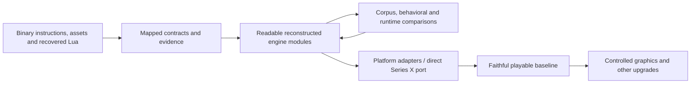

# Source reconstruction plan

**Chosen direction · October 22, 2026.** Parent: [brief](BRIEF.md).
Original engine: [architecture](research/engine/ARCHITECTURE.md).
Reconstructed engine: [architecture design set](docs/architecture/README.md)
(**working structural baseline**, October 22, 2026).

The user selected source reconstruction: a readable, buildable implementation
of the recovered Steam PC engine, preserving original behavior. That codebase
will support a direct port to Series X Developer Mode and later upgrades.
Binary translation is no longer the proposed production foundation.

This is reconstruction from evidence, not recovery of Cavia's original source
text, class names or build system. Automatic decompiler output is reference
material. Existing scripts, assets, native exports and maps remain the foundation.

## Architecture before the next source slice

The [engine architecture](docs/architecture/logical-overview.md),
[runtime ownership](docs/architecture/runtime-model.md),
[world and simulation](docs/architecture/world-and-simulation.md),
[rendering](docs/architecture/rendering-and-presentation.md),
[execution/lifetime contracts](docs/architecture/execution-contracts.md),
[change axes](docs/architecture/change-axes.md), and
[file mapping](docs/architecture/file-mapping.md) describe the complete target engine independently of delivery order.
Use this connected baseline to design the next implementation contracts. It distinguishes
the recovered original, existing SRC-01 code, proposed organization and unresolved
contracts. The inspector and eventual game use the same production modules.

SRC-01 now separates format readers, catalog lookup, content location and host
file access while retaining its verified behavior. Shared DPK access and resource
lifecycle now support task/Lua/root integration. Concrete startup services and
logo/check tasks and native movie output are implemented. The Mac backend uses
Metal and AudioQueue; advertise/title/menu remain next.

The required [engine memory subsystem](docs/architecture/memory-and-residency.md)
follows the launch-screen milestone, including its launch cinematics. Reach that
visible startup boundary first, then implement the memory foundation deliberately.
A small allocation interface may be introduced earlier where a concrete owner
needs it; do not build a placeholder subsystem or treat it as completed memory
management. Existing container allocations remain explicit migration work, and
bounded media queues do not close that gap.

## What we are building

- Maintainable native engine modules with meaningful types, explicit ownership,
  documented interfaces and traceability to original functions and data.
- Original Lua behavior and script/native contracts, including yielding,
  pending/completion distinctions and callback arguments. Preserve the recovered
  Lua 5.0.2 semantics before considering a language/runtime upgrade.
- Original resource, actor, AI, animation, physics, particle, UI and save behavior.
  A game-specific routine is reconstructed from its observed contract, not replaced
  by a plausible-looking gameplay implementation.
- Platform adapters around graphics, input, files, timing, threading, audio and
  video. These permit target-specific code without scattering host assumptions
  throughout gameplay.

The initial native implementation can use C++ with fixed-width data descriptions.
On-disk offsets and original 32-bit fields must remain distinct from host pointers.
Floating-point behavior, ordering and lifetimes require explicit checks.
Readable source does not require imitating every compiler artifact or original
allocation scheme when a different representation demonstrably preserves the contract.

## Implementation sequence

| Milestone | Deliverable | Completion evidence |
|---|---|---|
| SRC-01: resource/data foundation | Buildable native library and command-line inspector for RAT/CPR catalog lookup and supported record views; explicit ownership and errors | Compare inventory, names, ranges, lookup/precedence and decoded results with existing independently generated evidence; exercise malformed/truncated inputs; identify unsupported records explicitly |
| SRC-02: startup and UI | Task lifecycle, Lua bridge/resume contract and resource requests driving an interactive title/menu through reconstructed sprite commands | Script/native argument and scheduling traces; resource lifecycle checks; input and draw output; compare with original-game observations when available |
| SRC-03: one playable mission | Actor creation/state, AI tree evaluation and required native action families, pose, collision, particles, sound and checkpoint flow | Mission load/play/restart/save tests and original behavior comparisons; visible gaps remain documented |
| SRC-04: faithful game baseline | Remaining missions, action/actor variants, progression, UI and error/release paths | Broader playthrough and regression evidence, including timing and save compatibility |
| PORT-01: direct port | Same reconstructed engine with Series X platform adapters and packaging | On-device startup, gameplay, resource limits, input/audio/save and performance checks |
| UPGRADE-01: improvements | Separately controlled graphics, performance and other enhancements | Compare each change to the retained faithful baseline; verify gameplay behavior where affected |

These are delivery milestones, not a requirement to finish every module before
compiling or to postpone all target work until the end. Build and test each module
as it is reconstructed. Bring up a small Xbox host early enough to expose target
constraints; expand it as engine functionality arrives. Do not mix visual
redesign with the initial behavior-preserving reconstruction.

For SRC-01, begin with the native loader/getter formulas and the existing catalog
corpus. Preserve raw bytes alongside typed views, distinguish file offsets from
loaded references, implement named lookup/precedence, and make unsupported record
handlers visible. CPU inspection comes before GPU object creation. This delivers
production-useful loading code and exercises the data contracts needed by startup.

## Fidelity and evidence

For each reconstructed component record:

1. Original image hash, function/table addresses and relevant instruction/data
   witnesses, linked from the module's reconstruction notes.
2. The public contract, state/data layout, ownership, error and completion semantics.
3. Evidence status: static-derived, corpus-checked, compared with native execution,
   or observed in the reconstructed game. These are distinct levels of assurance.
4. Focused tests for meaningful behavior, using existing corpus results or captured
   original outputs as independent references where possible. A test duplicating
   the new implementation's logic does not establish equivalence.
5. Remaining uncertainty and its effects. A placeholder or approximate behavior
   must not be counted as a faithful completed subsystem.

The arrows describe the chosen development approach, not an already working port.

## Boundaries still requiring decisions

Legacy middleware needs explicit treatment. Reconstructing the game engine does
not itself supply PhysX, XACT or video codecs. Resolve the physics implementation
and compatibility requirements early enough to inform SRC-03. Record any change
in collision/destruction behavior; do not silently substitute a newer simulation.
The Mac startup backend uses Metal and a minimal shared FFmpeg decoder. World
rendering, Xbox adapters, remaining middleware, deployment and final packaging
remain concrete engineering work. Source reconstruction is settled.

The [contract worklist](research/engine/WORKLIST.md) supplies local unknowns to resolve as code
reaches them. Continue independent modules when one is blocked. Revisit user
direction only when a choice changes behavior, scope or the agreed architecture.

## SRC-01 delivered

October 22, 2026: [resource foundation](docs/resources.md) is implemented and
corpus-checked: 6,625 CPR archives / 29,996 records, 25 RAT catalogs / 15,262
resources. Native C++ and CLI tests pass; full comparison passes under UBSan.
ASan is locally blocked before program startup and is not counted as passed.

This milestone supplies container views, namespace/dependency decoding, priority
lookup and a read-only inspector. The subsequent startup-resource slice supplies DPK decoding and supported USER
request/publication/lease/release state (see `docs/startup-runtime.md`). GPU
objects and other record handlers remain unimplemented.
After the SRC-01 separation, the next implementation
slice is SRC-02's script package access and startup resource lifecycle, followed
by the Lua bridge/task contract and title/menu path.

## File organization and current state

Production resource source, headers, CLI and tests now live in `src/`, `include/`,
`tools/` and `tests/`. Module design and use are documented in `docs/`, separately
from the original-engine reference. Research tools, experimental translations,
copied game resources, generated evidence and work logs remain under `research/`.
The game installation stays read-only. Preserve the architectural map as the
original-engine reference and document new module designs separately.

## Migrating SRC-01

The SRC-01 boundary migration below is implemented and preserves the existing
CLI and corpus contracts. It separates responsibilities before
adding resource state. Keep a compatibility header/target temporarily if needed
by callers; do not maintain two parser implementations.

| Current responsibility | Proposed destination | Preserve / clarify |
|---|---|---|
| `ResourceArchive` decoding and record/argument/range types | `formats/resource_archive.hpp/.cpp` | Original bytes, padded argument area, selected extraction ranges and explicit unsupported variants |
| `ResourceCatalog` disk decoding | `formats/resource_catalog.hpp/.cpp` | Namespace/resource/file/dependency views and bounds/membership validation |
| `ResourceCatalog::find`, `CatalogSet` and priority selection | `resources/catalog.hpp/.cpp` | ASCII query folding, selected identity, low-key precedence and ambiguity behavior |
| `archive_path`, path separator/location policy | `content/access.hpp/.cpp` | Catalog-relative containment; evolve to declared virtual roots without broadening paths silently |
| `read_file`, parser `open` convenience calls | File capability and selected `platform/files/` adapter; content-level open composition | Byte readers remain callable without I/O; all read failures remain explicit |
| Common checked byte access / errors | Small internal format helpers or public error types only where shared contract requires | Do not expose implementation helpers or invent an omnibus core library |
| Inspector command-line parsing and JSON formatting | Existing `tools/resource_inspector.cpp` | Uses shared production views; does not acquire runtime loading semantics by accident |
| Existing C++ and CLI tests | Same contracts, reorganized with source ownership if needed | Preserve behavior assertions; update includes/call sites, not expected asset results |

The split gives `ResourceCatalog` ownership of decoded `ResourceCatalogData` plus a lookup index.
Full-name construction has a single owner in the decoder. Mounted catalogs
retain decoded views for every request using their identity.

The current CPR inline-reference inspection formula remains provisional as a
runtime reference model. Migration preserves inspection behavior without making
that formula the resource service's unchecked runtime pointer semantics.

### Integration sequence and status

1. **Implemented:** SRC-01 format/catalog/content/file boundaries; existing CLI
   and corpus behavior preserved.
2. **Implemented:** bounded DPK v1 access; script bytecode stays at the script boundary.
3. **Implemented:** request/publication/retention/release and supported USER
   construction. Other record handlers fail explicitly.
4. **Implemented startup subset:** task lifecycle, Lua context/bridge, root driver
   and 17 native startup bindings delegated to explicit game-service capabilities.
   Original root routing is verified with fixture services. Background worker
   execution and the rest of the native API are not implied to exist.
5. **Implemented startup subset:** concrete logo/check session tasks, shared
   decoding/playback/fades and native Mac presentation/audio/input. Both company
   movies now complete with full PCM consumption and zero underruns in the
   recorded native run. Next: advertise,
   required sprite/font resources and interactive title/menu as SRC-02 requires.
6. **Later:** world/entity/AI/animation/physics/effect behavior for a complete mission,
   preserving the same mechanisms for later missions and host ports.

Steps are dependency guidance, not a new requirement to ask at each transition.
The architecture is the working structural baseline. This sequence does not determine its
runtime structure; the same complete engine architecture governs every slice.

## Startup source slice implemented

The three authorized implementation steps are delivered: boundary migration;
DPK/USER resource lifetime; task scheduling, compatible Lua bridge and original
root driver. See [startup runtime](docs/startup-runtime.md) for exact contracts,
verification commands and limitations. This completes the infrastructure slice
of SRC-02. It does not complete the interactive title/menu milestone: concrete
advertise/title/menu, sprite/font and remaining game-state services are still
needed. The provisioned original-root scenario retains full-route fixtures and
also drives the production session through logo/check completion. The native
startup executable uses the same production session and original media. See
[native startup](docs/native-startup-host.md) for device verification and limits.
