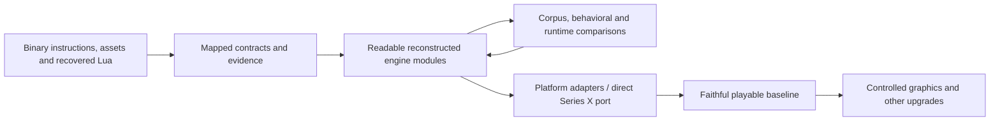

# Source reconstruction plan

**Chosen direction · October 22, 2026.** Parent: [brief](BRIEF.md).
Original engine: [architecture](research/engine/ARCHITECTURE.md).

The user selected source reconstruction: a readable, buildable implementation
of the recovered Steam PC engine, preserving original behavior. That codebase
will support a direct port to Series X Developer Mode and later upgrades.
Binary translation is no longer the proposed production foundation.

This is reconstruction from evidence, not recovery of Cavia's original source
text, class names or build system. Automatic decompiler output is reference
material. Existing scripts, assets, native exports and maps remain the foundation.

## What we are building

- Maintainable native engine modules with meaningful types, explicit ownership,
  documented interfaces and traceability to original functions and data.
- Original Lua behavior and script/native contracts, including yielding,
  pending/completion distinctions and callback arguments. Preserve the recovered
  Lua 5.0.2 semantics before considering a language/runtime upgrade.
- Original resource, actor, AI, animation, physics, particle, UI and save behavior.
  A game-specific routine is reconstructed from its observed contract, not replaced
  by a plausible-looking gameplay implementation.
- Platform adapters around graphics, input, files, timing, threading, audio and
  video. These permit target-specific code without scattering host assumptions
  throughout gameplay.

The initial native implementation can use C++ with fixed-width data descriptions.
On-disk offsets and original 32-bit fields must remain distinct from host pointers.
Floating-point behavior, ordering and lifetimes require explicit checks.
Readable source does not require imitating every compiler artifact or original
allocation scheme when a different representation demonstrably preserves the contract.

## Implementation sequence

| Milestone | Deliverable | Completion evidence |
|---|---|---|
| SRC-01: resource/data foundation | Buildable native library and command-line inspector for RAT/CPR catalog lookup and supported record views; explicit ownership and errors | Compare inventory, names, ranges, lookup/precedence and decoded results with existing independently generated evidence; exercise malformed/truncated inputs; identify unsupported records explicitly |
| SRC-02: startup and UI | Task lifecycle, Lua bridge/resume contract and resource requests driving an interactive title/menu through reconstructed sprite commands | Script/native argument and scheduling traces; resource lifecycle checks; input and draw output; compare with original-game observations when available |
| SRC-03: one playable mission | Actor creation/state, AI tree evaluation and required native action families, pose, collision, particles, sound and checkpoint flow | Mission load/play/restart/save tests and original behavior comparisons; visible gaps remain documented |
| SRC-04: faithful game baseline | Remaining missions, action/actor variants, progression, UI and error/release paths | Broader playthrough and regression evidence, including timing and save compatibility |
| PORT-01: direct port | Same reconstructed engine with Series X platform adapters and packaging | On-device startup, gameplay, resource limits, input/audio/save and performance checks |
| UPGRADE-01: improvements | Separately controlled graphics, performance and other enhancements | Compare each change to the retained faithful baseline; verify gameplay behavior where affected |

These are delivery milestones, not a requirement to finish every module before
compiling or to postpone all target work until the end. Build and test each module
as it is reconstructed. Bring up a small Xbox host early enough to expose target
constraints; expand it as engine functionality arrives. Do not mix visual
redesign with the initial behavior-preserving reconstruction.

For SRC-01, begin with the native loader/getter formulas and the existing catalog
corpus. Preserve raw bytes alongside typed views, distinguish file offsets from
loaded references, implement named lookup/precedence, and make unsupported record
handlers visible. CPU inspection comes before GPU object creation. This delivers
production-useful loading code and exercises the data contracts needed by startup.

## Fidelity and evidence

For each reconstructed component record:

1. Original image hash, function/table addresses and relevant instruction/data
   witnesses, linked from the module's reconstruction notes.
2. The public contract, state/data layout, ownership, error and completion semantics.
3. Evidence status: static-derived, corpus-checked, compared with native execution,
   or observed in the reconstructed game. These are distinct levels of assurance.
4. Focused tests for meaningful behavior, using existing corpus results or captured
   original outputs as independent references where possible. A test duplicating
   the new implementation's logic does not establish equivalence.
5. Remaining uncertainty and its effects. A placeholder or approximate behavior
   must not be counted as a faithful completed subsystem.

The arrows describe the chosen development approach, not an already working port.

## Boundaries still requiring decisions

Legacy middleware needs explicit treatment. Reconstructing the game engine does
not itself supply PhysX, XACT or video codecs. Resolve the physics implementation
and compatibility requirements early enough to inform SRC-03. Record any change
in collision/destruction behavior; do not silently substitute a newer simulation.
Renderer backend, middleware implementations, build/deployment tooling and final
packaging remain concrete engineering decisions. Source reconstruction is settled.

The [contract worklist](research/engine/WORKLIST.md) supplies local unknowns to resolve as code
reaches them. Continue independent modules when one is blocked. Revisit user
direction only when a choice changes behavior, scope or the agreed architecture.

## File organization and current state

Current work is this plan and the existing research; no reconstructed runtime has
been implemented by recording the decision. When implementation starts, production
source, headers, platform adapters and tests belong in clearly named project
folders, separate from `research/`. Research tools, experimental translations,
copied game resources, generated evidence and work logs remain under `research/`.
The game installation stays read-only. Preserve the architectural map as the
original-engine reference and document new module designs separately.
