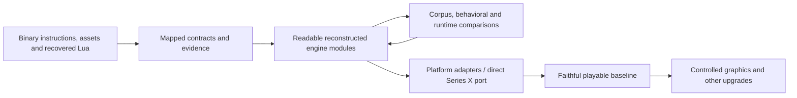

# Source reconstruction plan

**Chosen direction · October 22, 2026.** Parent: [brief](BRIEF.md).
Original engine: [architecture](research/engine/ARCHITECTURE.md).
Reconstructed engine: [architecture design set](docs/architecture/README.md)
(**working structural baseline**, October 22, 2026).

The user selected source reconstruction: a readable, buildable implementation
of the recovered Steam PC engine, preserving original behavior. That codebase
will support a direct port to Series X Developer Mode and later upgrades.
Binary translation is no longer the proposed production foundation.

This is reconstruction from evidence, not recovery of Cavia's original source
text, class names or build system. Automatic decompiler output is reference
material. Existing scripts, assets, native exports and maps remain the foundation.

## Architecture before the next source slice

The [engine architecture](docs/architecture/logical-overview.md),
[runtime ownership](docs/architecture/runtime-model.md),
[world and simulation](docs/architecture/world-and-simulation.md),
[rendering](docs/architecture/rendering-and-presentation.md),
[execution/lifetime contracts](docs/architecture/execution-contracts.md),
[change axes](docs/architecture/change-axes.md), and
[file mapping](docs/architecture/file-mapping.md) describe the complete target engine independently of delivery order.
Use this connected baseline to design the next implementation contracts. It distinguishes
the recovered original, existing SRC-01 code, proposed organization and unresolved
contracts. The inspector and eventual game use the same production modules.

SRC-01 now separates format readers, catalog lookup, content location and host
file access while retaining its verified behavior. Shared DPK access and resource
lifecycle now support task/Lua/root integration. Concrete startup services and
logo/check tasks and native movie output are implemented. The Mac backend uses
Metal and AudioQueue. Advertise, title, profile loading, interactive menus and
validated campaign gameplay requests are implemented. The current front end
supports persisted costume selection and volume settings, with original authored
menu/costume sprite assets. One Shot Kill now owns its original mission context,
retained stage and character dependencies, and a static stage/sky
view. The original mission load returns naturally and waits at world setup;
actor creation, gameplay and authored stage presentation remain work.

The [memory foundation](research/engine/subsystems/memory-migration-completion.md)
now covers the current startup owners, bounded root Lua heap, native CPU backing
and Metal texture accounting. Extend those ownership boundaries as mission,
world and worker consumers arrive. World/AI pools, reset policies and asynchronous
device retirement remain consumer-specific work; startup coverage does not imply
that every future engine allocation has been reconstructed.

## What we are building

- Maintainable native engine modules with meaningful types, explicit ownership,
  documented interfaces and traceability to original functions and data.
- Original Lua behavior and script/native contracts, including yielding,
  pending/completion distinctions and callback arguments. Preserve the recovered
  Lua 5.0.2 semantics before considering a language/runtime upgrade.
- Original resource, actor, AI, animation, physics, particle, UI and save behavior.
  A game-specific routine is reconstructed from its observed contract, not replaced
  by a plausible-looking gameplay implementation.
- Platform adapters around graphics, input, files, timing, threading, audio and
  video. These permit target-specific code without scattering host assumptions
  throughout gameplay.

The initial native implementation can use C++ with fixed-width data descriptions.
On-disk offsets and original 32-bit fields must remain distinct from host pointers.
Floating-point behavior, ordering and lifetimes require explicit checks.
Readable source does not require imitating every compiler artifact or original
allocation scheme when a different representation demonstrably preserves the contract.

## Implementation sequence

| Milestone | Deliverable | Completion evidence |
|---|---|---|
| SRC-01: resource/data foundation | Buildable native library and command-line inspector for RAT/CPR catalog lookup and supported record views; explicit ownership and errors | Compare inventory, names, ranges, lookup/precedence and decoded results with existing independently generated evidence; exercise malformed/truncated inputs; identify unsupported records explicitly |
| SRC-02: startup and UI | Task lifecycle, Lua bridge/resume contract and resource requests driving an interactive title/menu through reconstructed sprite commands | Script/native argument and scheduling traces; resource lifecycle checks; input and draw output; compare with original-game observations when available |
| SRC-03: One Shot Kill | Mission loading and world presentation, then required actors, AI, animation, collision, effects, sound and checkpoint behavior | Real stage presentation followed by playable mission, restart and return-to-menu acceptance; save compatibility and original behavior comparisons remain explicit |
| SRC-04: faithful game baseline | Remaining missions, action/actor variants, progression, UI and error/release paths | Broader playthrough and regression evidence, including timing and save compatibility |
| PORT-01: direct port | Same reconstructed engine with Series X platform adapters and packaging | On-device startup, gameplay, resource limits, input/audio/save and performance checks |
| UPGRADE-01: improvements | Separately controlled graphics, performance and other enhancements | Compare each change to the retained faithful baseline; verify gameplay behavior where affected |

These are delivery milestones, not a requirement to finish every module before
compiling or to postpone all target work until the end. Build and test each module
as it is reconstructed. Bring up a small Xbox host early enough to expose target
constraints; expand it as engine functionality arrives. Do not mix visual
redesign with the initial behavior-preserving reconstruction.

For SRC-01, begin with the native loader/getter formulas and the existing catalog
corpus. Preserve raw bytes alongside typed views, distinguish file offsets from
loaded references, implement named lookup/precedence, and make unsupported record
handlers visible. CPU inspection comes before GPU object creation. This delivers
production-useful loading code and exercises the data contracts needed by startup.

## Fidelity and evidence

For each reconstructed component record:

1. Original image hash, function/table addresses and relevant instruction/data
   witnesses, linked from the module's reconstruction notes.
2. The public contract, state/data layout, ownership, error and completion semantics.
3. Evidence status: static-derived, corpus-checked, compared with native execution,
   or observed in the reconstructed game. These are distinct levels of assurance.
4. Focused tests for meaningful behavior, using existing corpus results or captured
   original outputs as independent references where possible. A test duplicating
   the new implementation's logic does not establish equivalence.
5. Remaining uncertainty and its effects. A placeholder or approximate behavior
   must not be counted as a faithful completed subsystem.

The arrows describe the chosen development approach, not an already working port.

## SRC-03: One Shot Kill delivery breakdown

**Target selected October 23, 2026; slices 1–3 are authorized, with distinct
acceptance boundaries below.**
The Concept Mission menu unlock, source-backed concept routing and owned mission
Lua are implemented. The original load returns after genuine resource
construction. Static main-stage, spawn-cave and sky rendering uses a declared
inspection policy; native observations are recorded separately from CPU tests.
The renderer follows the faithful reconstruction
direction in its dedicated architecture drill-in. Use One Shot Kill (`cm01_00`, extra mission ID 1), which
loads stage resources `st04_c`. The [DLC comparison](research/engine/subsystems/dlc-first-level-selection.md)
supports the choice by script scope; it does not establish the smallest asset or
native gameplay workload. Extend the existing engine and session, not a separate
level-viewer project.

| Slice | Work | Acceptance boundary |
|---|---|---|
| 1. Concept launch and mission ownership | Resolve native menu status 5 versus root status 6 and the selected-extra resource route. Original root calls `_StartMission("concept")`; establish how selection ID 1 resolves to `cm01_00`. Consume the owned request instead of exiting the host. Retain root/profile/screens in the session; give the mission its Lua context, default callbacks, pending operations and resource group. | Original Lua reaches the validated concept handoff with difficulty/costume intact; mission script loading and pending/error transitions are observed. Concept Mission is accessible without game completion by explicit user decision; campaign Stage Select and difficulty gates remain intact. No guessed status remapping, changed Lua or fabricated achievements. Full mission `load()` completion depends on slice 2. |
| 2. Required content and typed loading | Follow the real `load()` sequence and census its transitive stage/placement dependencies: sky, character lighting, area/model data, text/score, hide/path data, sound/environment/reverb, magic/background objects and `cm01_00_0`. Extend typed record/CALL handling and the shared background resource worker as required. | Required content is decoded and owned with explicit readiness; queue completion alone never reports successful asset construction. Missing/malformed content, cancellation and release have observable outcomes and balanced ownership. GPU readiness remains a later consumer boundary. |
| 3. World renderer foundation | Follow the [renderer reconstruction drill-in](docs/architecture/world-renderer-reconstruction.md). Assemble real static stage geometry through shared world/render contracts and the Mac Metal backend. Add vertex/index/depth handling and the required original textured material subset. Use the script-authored spawn and recovered initial player-camera settings, clearance and projection. | First visible level: actual `st04_c` geometry appears with checked placement, scale and depth. This is a static world view, not player control or completed original lighting; omissions are recorded. |
| 4. Required stage presentation | Add the sky, background, lighting/area behavior and material/effect variants required by the confirmed dependency closure. This can proceed alongside later actor work once interfaces are stable. | The stage's required presentation inputs have visible consumers and known gaps; no blanket original-renderer parity claim. |
| 5. Alicia and traversal | Construct the player actor, model/animation, input, game camera and collision/movement path. Honor mission entry and checkpoint-dependent player positions. | Alicia can traverse the stage through the game camera without falling through geometry; original start/pause/resume gates and checkpoint 0/10/20 placement branches are exercised. |
| 6. Mission behavior | Implement the placement-driven enemies and required native AI/combat/damage, traps 610/620, checkpoints 10/20, goal 500, timer dispatch, HUD/messages, gameplay audio and effects. Establish where the one-hit rule is implemented outside the mission script. | The actual actors and mission callbacks produce observable behavior: checkpoint progression, music timer, goal handling and evidenced one-hit/death behavior. Script simplicity is not treated as absence of native enemies or AI. |
| 7. Complete the mission loop | Connect clear/death/retry/result/root-return routing and repeat load/unload. Preserve outcome values separately from cleanup completion. | Load, play, clear or die, retry, return to menu and load again without stale jobs, callbacks, leases or device uses. Gameplay save writing is accepted only after its schema and restoration behavior are implemented. |

Current slice status: slice 1 owns routing, original mission/default callbacks,
wait/error states and cancellation. Slice 2 now completes the original
`cm01_00.load()` naturally: stage/sky residency, typed collision/area/material
animation, text/cover/sound registration, background variants, placement tables,
character/weapon motion/shape dependencies and NPC palette bindings are owned.
The script stops at `awaiting_world_setup`; no gameplay start is fabricated.
The original-root corpus verifies 54 dependency model variants, 11 shared support
sets and 178 palette bindings, plus complete cancellation and zero retained CPU
allocation. Slice 3 composes all ten ordinary stage models from borrowed
load-owned resources: 4,097 selected draws, three explicit untextured-material omissions
and one sky draw. Source-backed model classification includes background,
detail and cave geometry; overlapping bounds are not treated as a LOD filter. The initial camera now consumes the original fresh-start pose, authored player
settings and static collision queries. Shared view transforms and native depth
state preserve the original reverse-depth convention. This remains a static
snapshot before actor setup. Slices 1–3 are implemented, verified and accepted
for commit on October 23, 2026.
The corrected native host shows the cave, exterior ground, buildings, mountains
and sky. Runtime shader selection now consumes the original sky and authored
stage spherical-harmonic inputs, and the host forwards the authored output
settings. This closes the earlier black sky and clipped ground failures without
changing exposure values. Complete stage presentation remains slice 4: original
visibility, shadows, material animation, generated mip chains and background
placement still need their consumers. Slice 4 is the proposed next scope for
discussion; implementation is not yet authorized.
Current native observations belong in [renderer evidence](research/engine/subsystems/stage-view-completion.md);
load acceptance is recorded in [mission ownership](research/engine/subsystems/mission-launch.md).

Teardown and partial-construction rollback belong to every slice; slice 7 verifies
the complete loop rather than introducing cleanup at the end. A developer mission
launch path may shorten iteration, but cannot stand in for validated menu routing.
The user-approved Concept Mission completion-gate removal is an intentional
menu-policy departure for this reconstruction. It does not mark the game complete,
set achievements or unlock campaign Stage Select, Chaos or Hell. The native
status accessor and selected-concept resource alias are separately recovered and
implemented; menu access policy does not replace those contracts.

Before traversal, decide the backend and cooked-collision treatment for the
[recovered PhysX 2.6.4 boundary](research/engine/subsystems/physics-and-collision.md).
That choice affects behavior and needs explicit direction if it changes fidelity;
it need not block the first static view. Existing movie PCM playback does not
implement gameplay sound banks. Scope material/shader work to actual stage needs,
not translation of all 490 shaders. The CPU loader now confirms 15 model definitions in the `st04_c` namespace;
that is not 15 placed terrain objects. Actor/placement construction remains
outstanding.

Keep shared contracts and reusable algorithms portable, with native device work
under the target folders. Use subagents, header-first contracts and brief local
intent comments; consult both C++ MCP corpora during design and implementation,
then run the required checks. Refine architecture diagrams, file mapping and
research as each slice becomes implemented. Original-script execution, CPU
readiness, native rendering and gameplay acceptance are distinct evidence.

Existing maps remain the starting point:
[mission lifecycle](research/engine/subsystems/mission-lifecycle.md),
[stage loading](research/engine/subsystems/mission-and-stage-loading.md),
[resource dispatch](research/engine/subsystems/resource-dispatch.md),
[background worker](research/engine/subsystems/background-resource-worker.md) and
[runtime ownership](docs/architecture/runtime-model.md).

## Boundaries still requiring decisions

Legacy middleware needs explicit treatment. Reconstructing the game engine does
not itself supply PhysX, XACT or video codecs. Resolve the physics implementation
and compatibility requirements early enough to inform SRC-03. Record any change
in collision/destruction behavior; do not silently substitute a newer simulation.
The Mac startup backend uses Metal and a minimal shared FFmpeg decoder. World
rendering, Xbox adapters, remaining middleware, deployment and final packaging
remain concrete engineering work. Source reconstruction is settled.

The [contract worklist](research/engine/WORKLIST.md) supplies local unknowns to resolve as code
reaches them. Continue independent modules when one is blocked. Revisit user
direction only when a choice changes behavior, scope or the agreed architecture.

## SRC-01 delivered

October 22, 2026: [resource foundation](docs/resources.md) is implemented and
corpus-checked: 6,625 CPR archives / 29,996 records, 25 RAT catalogs / 15,262
resources. Native C++ and CLI tests pass; full comparison passes under UBSan.
ASan is locally blocked before program startup and is not counted as passed.

This milestone supplies container views, namespace/dependency decoding, priority
lookup and a read-only inspector. The subsequent startup-resource slice supplies DPK decoding and supported USER
request/publication/lease/release state (see `docs/startup-runtime.md`). Generic executable graphics handlers remain unimplemented; the later startup
slice explicitly decodes supported images/fonts and constructs renderer textures
through its own presentation adapter. SRC-02 now builds on the script package,
resource lifecycle, Lua bridge and task contracts to reach a profile-backed menu
and a validated gameplay request.

## File organization and current state

Production resource source, headers, CLI and tests now live in `src/`, `include/`,
`tools/` and `tests/`. Module design and use are documented in `docs/`, separately
from the original-engine reference. Research tools, experimental translations,
copied game resources, generated evidence and work logs remain under `research/`.
The game installation stays read-only. Preserve the architectural map as the
original-engine reference and document new module designs separately.

## Migrating SRC-01

The SRC-01 boundary migration below is implemented and preserves the existing
CLI and corpus contracts. It separates responsibilities before
adding resource state. Keep a compatibility header/target temporarily if needed
by callers; do not maintain two parser implementations.

| Current responsibility | Proposed destination | Preserve / clarify |
|---|---|---|
| `ResourceArchive` decoding and record/argument/range types | `formats/resource_archive.hpp/.cpp` | Original bytes, padded argument area, selected extraction ranges and explicit unsupported variants |
| `ResourceCatalog` disk decoding | `formats/resource_catalog.hpp/.cpp` | Namespace/resource/file/dependency views and bounds/membership validation |
| `ResourceCatalog::find`, `CatalogSet` and priority selection | `resources/catalog.hpp/.cpp` | ASCII query folding, selected identity, low-key precedence and ambiguity behavior |
| `archive_path`, path separator/location policy | `content/access.hpp/.cpp` | Catalog-relative containment; evolve to declared virtual roots without broadening paths silently |
| `read_file`, parser `open` convenience calls | File capability and selected `platform/files/` adapter; content-level open composition | Byte readers remain callable without I/O; all read failures remain explicit |
| Common checked byte access / errors | Small internal format helpers or public error types only where shared contract requires | Do not expose implementation helpers or invent an omnibus core library |
| Inspector command-line parsing and JSON formatting | Existing `tools/resource_inspector.cpp` | Uses shared production views; does not acquire runtime loading semantics by accident |
| Existing C++ and CLI tests | Same contracts, reorganized with source ownership if needed | Preserve behavior assertions; update includes/call sites, not expected asset results |

The split gives `ResourceCatalog` ownership of decoded `ResourceCatalogData` plus a lookup index.
Full-name construction has a single owner in the decoder. Mounted catalogs
retain decoded views for every request using their identity.

The current CPR inline-reference inspection formula remains provisional as a
runtime reference model. Migration preserves inspection behavior without making
that formula the resource service's unchecked runtime pointer semantics.

### Integration sequence and status

1. **Implemented:** SRC-01 format/catalog/content/file boundaries; existing CLI
   and corpus behavior preserved.
2. **Implemented:** bounded DPK v1 access; script bytecode stays at the script boundary.
3. **Implemented:** request/publication/retention/release and supported USER
   construction. Other record handlers fail explicitly.
4. **Implemented startup subset:** task lifecycle, Lua context/bridge, root driver
   and 19 root bindings, including mission start/wait, delegated to explicit
   game-service capabilities. Original root routing is verified with fixture
   services and the concrete profile/menu composition. Background worker
   execution and the rest of the native API are not implied to exist.
5. **Implemented startup subset:** concrete logo/check session tasks, shared
   decoding/playback/fades and native Mac presentation/audio/input. Both company
   movies now complete with full PCM consumption and zero underruns in the
   recorded native run. Advertise and title now reuse that transport and add
   decoded original sprite/font assets and native Metal quad presentation.
6. **Implemented front-end subset:** profile compatibility and writable POSIX
   storage, character-load/error lifecycle, interactive selection menus, original
   costume previews and validated original-root gameplay handoff. The corpus
   selects costume 5 and verifies actual save/reload; native manual acceptance
   observed costume 1 selection and handoff. Remaining gaps are listed below.
7. **Implemented current-owner memory foundation:** explicit domains, native
   backing, bounded root Lua allocation and current startup ownership migration.
   Extend these contracts for concrete world/AI/worker consumers.
8. **Planned SRC-03:** the One Shot Kill slices above, preserving the same engine
   mechanisms for later missions and host ports.

Steps are dependency guidance, not a new requirement to ask at each transition.
The architecture is the working structural baseline. This sequence does not determine its
runtime structure; the same complete engine architecture governs every slice.

## Startup source slice implemented

The resource/task/Lua infrastructure and concrete front-end slice are delivered.
The original root drives logos, startup check, opening cinematic, animated title,
profile loading and interactive menus. New Game, valid Continue and campaign-stage
selections can produce a validated owned gameplay request. One Shot Kill now
consumes that request through its original mission Lua and retained load owners.
The shared host prepares a separate static stage/sky view from the
load owner's resident models and textures. Original load completes before the
world-setup boundary; the inspection does not advance actor or gameplay setup.
Other mission routes still stop at the request boundary.

The provisioned original-root scenario retains routing fixtures and also uses
production profile/menu/session code, actual profile I/O, original decoded assets
and a synthetic renderer. It selects costume 5 and reloads its saved profile.
Native manual acceptance separately observed costume 1 preview/selection and the
resulting new-game handoff. Strict checks and the recorded native run establish
those boundaries, not full original-game parity. See
[startup runtime](docs/startup-runtime.md), [native startup](docs/native-startup-host.md)
and [front-end integration](research/engine/subsystems/frontend-integration.md).

SRC-02 remains partial in fidelity and subsidiary features: options currently
expose volumes and costumes; volumes persist without output-gain wiring; menu
background music, cues and other option screens are absent. Fresh achievement
flags remain false without a connected provider, so campaign Stage Select and
higher difficulty gates remain intact. Concept Mission alone bypasses its
game-completion gate by user-approved menu policy; installed assets are not
evidence of achievements. The native extra status 5 versus original Lua status 6
accessor mapping and selected-concept resource alias are resolved and implemented
without changing original Lua. The startup-check
visuals and complete original storage/dialog behavior also remain work. The
faithful menu milestone must not be declared complete by counting selection
policies alone.

The current target is One Shot Kill. Preserve the implemented front-end, owned
mission and inspection contracts while completing remaining load consumers; address the
remaining front-end gaps at their owning subsystems rather than fabricating
successful behavior.
