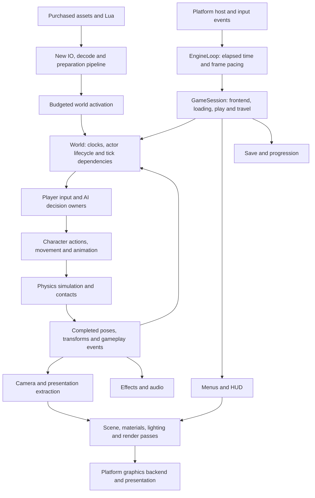

# Runtime architecture

This is the design for a new engine and game implementation. The first
[game-loop slice](game-loop.md) implements the headless lifecycle and native Mac
timing path. All 17 contract scenarios pass; native measurements are recorded
there. The [memory foundation](memory.md) implements native virtual-memory
blocks and their fatal failure path. The [general allocator](binned-allocator.md)
adds selected Binned3, pooled crash reserves and the required named-thread trim
dispatch leaf. World, rendering, input and other systems
remain proposed.
No existing Bullet Witch project code is an implementation dependency. Original purchased assets and Lua are inputs
through newly written readers and bindings.

Unreal Engine source at `f45729c0b6f097038e72b52d366a62baeca3275b` supplies the
architectural and algorithm references. Linked Epic source requires an account
with source access. Links identify inspected paths/functions; their presence
does not claim implementation or validation. We describe the design in our own
words and do not bundle Unreal code.

## Connected runtime

This diagram is an ownership map, not permission for arbitrary call cycles.
The world scheduler orders dependencies and publication barriers. Workers
receive explicit inputs and return owned results; render/audio consumers do not
mutate world state. Loading and activation have distinct owners.

## Drill-ins

| Document | Boundary |
|---|---|
| [Source layout and runtime tools](source-layout.md) | Agreed project-wide destination ownership, tooling compositions and migration plan; not yet migrated |
| [Register permutations and reductions](math-register-composition.md) | Implemented ARM64 permutations/reductions, source grouping and verified exact XYZ accesses |
| [Native register foundation](math-registers.md) | Implemented ARM64 register primitives, source algorithms and native verification |
| [Shared math](math.md) | Implemented vector/scalar/default-diagnostic leaf; later native SIMD and transforms mapped |
| [Game loop](game-loop.md) | Authoritative host lifecycle, frame timing and pacing |
| [Allocator lifecycle](allocator-lifecycle.md) | Implemented executable allocation routing and game-thread ownership integration |
| [General allocator](binned-allocator.md) | Implemented Binned3, TLS/recycler, dynamic registry and bootstrap |
| [Crash memory](crash-memory.md) | Source pooled reserves, crash activation and owner-thread allocation |
| [Named-thread dispatch](named-thread-dispatch.md) | Source owner queues, task storage and asynchronous desktop trim broadcast |
| [Memory](memory.md) | Selected Mac allocator path; implemented virtual-memory blocks and native fatal handling |
| [Future world scheduling](engine-loop.md) | World time, tick phases and jobs; not implemented |
| [World lifecycle](world-lifecycle.md) | Prepared resources, actor activation, registration and retirement |
| [Characters and AI](characters-ai.md) | Player/NPC decisions, task lifetime, movement and animation |
| [Rendering and assets](rendering-assets.md) | New import, resource preparation, scene and GPU pipeline |
| [Runtime services](runtime-services.md) | Input, combat, effects, audio, media, UI, save and session |
| [Implementation order](implementation-order.md) | Dependency sequence and the first concrete build slice |

## Agreed source boundaries

[Source layout and runtime tools](source-layout.md) records the destination tree
and follow-on migration. `src/engine/core/` holds common math, memory, concurrency,
tasks and diagnostics. Engine modules own runtime/world/content, character and AI
mechanisms, rendering and runtime services. `src/game/` owns Bullet Witch rules,
actors, Lua meanings, missions, progression and frontend behavior.

`src/platform/os/` and `src/platform/cpu/` separate OS services from silicon
implementations; large rendering and physics backends stay with their subsystem.
`src/hosts/` composes executable targets. Tools use the same production modules
for headless simulation, character/AI inspection and offscreen capture. A debug
publication/control seam supports a 2D simulation inspector without giving tools
writable access to controller or physics internals.

This is the agreed destination, not a report of moved files or implemented tools.
Current foundations still use `src/core/` and the existing platform paths. Tests,
docs and build boundaries will follow actual module owners; no empty future
scaffolding or old-project implementation is introduced.
