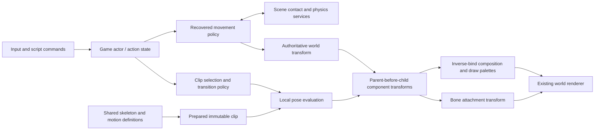

# Actors, poses and animation

October 23, 2026. [Engine architecture](logical-overview.md) ·
[World and simulation](world-and-simulation.md).

The actor owns its authoritative world position and action state. Its model
instance owns animation time and evaluated bones. Rendering and weapon
attachments consume the completed pose; neither moves the actor through the
world. During the evasive leap, authored root XYZ supplies the trajectory; the
movement owner consumes it once and resolves obstruction and ground contact.
Gravity takes over only after that authored phase completes. Pose playback alone
does not perform collision or move the authoritative body.



This diagram describes data authority and update dependencies, not worker-thread
scheduling. The initial implementation uses one owner thread and publishes a
complete pose before the native draw. A future job scheduler must preserve that
publication boundary and the lifetimes of the shared definitions.

The engine animation boundary accepts prepared skeleton/clip data and explicit
sample time. It does not know Alicia, costume IDs, controller buttons or gameplay
state. Game policy selects original motion labels, playback and transitions.
Missing tracks retain the skeleton bind pose; absent channels within a present
track use that track's authored constants. These are different cases.

Preparation validates key ranges and time order, decodes the original float and
half values once into contiguous runtime storage, and prepares the hierarchy
order once. Evaluation samples only prepared channels, then composes each bone
once. Pose and palette buffers are allocated at instance creation and reused;
there are no frame-time catalog lookups, format decodes or geometry uploads.
Shared clips can serve multiple model instances. Runtime layout is chosen for
the actual consumer; CPU SIMD remains a target optimization boundary, not a
reason to replace the original interpolation or introduce GPU readback.

The source uses local transforms, hierarchy composition, inverse bind matrices
and per-draw joint maps. Attachment transforms consume the unskinned bone
transform: applying inverse bind to a weapon attachment would be wrong. Both
skin and attachment output then consume the same actor world transform.

Slice 5 now connects selected-costume presentation to a separate movement owner.
`PlayerActor` prepares motion and publishes poses; `PlayerController` owns the
lower-sphere-center body position, velocity, grounded/takeoff/airborne/landing
state and input selection. It consumes the raw root interval retained by the preceding model update,
resolves contacts, then advances the model and publishes its corrected pose.
The render pose removes consumed bone-zero translation and rotation while
preserving authored pelvis movement. Selection changes the current direction
reference without clearing the retained raw interval. A fresh model starts with
an identity interval; paused appearance publication advances neither clock. See
[actor/model phase order](../../research/engine/subsystems/actor-model-clock-order.md).

`StageInspection` currently owns the bounded scene lifetime, including prepared
collision, the actor/controller and live game camera. Its retained view update
changes camera/fog/shadow constants without rebuilding geometry or the submitted
draw list. See [live view publication](../../research/engine/subsystems/live-view-publication.md)
for the retained native contract and verification. Pause withholds actor, camera, animation and material advancement.
`PlayerTargeting` separately owns the original two-mode unenchanted target
selection and camera request. Native input contributes press edges; the player
controller retains the independent raised-weapon lifetime. Explicit review
requests use the same targeting owner, while scripted-flight posture obligations
remain isolated review input. [Targeting](../../research/engine/subsystems/player-targeting.md)
and [camera contexts](../../research/engine/subsystems/player-camera-targeting.md)
record original ordering and native verification boundaries.

### Current time ownership and remaining world boundary

There is no complete authoritative world clock or world scheduler yet. The host
measures wall time as a float, caps each supplied game delta at 100 ms, and
discards the excess; there is no retained simulation debt or fixed-world
accumulator. UI-owned frames supply zero game time. Loading and paused appearance
transactions rebase the host sample; ordinary weapon switching does not.

`StageInspection` orchestrates this bounded scene. Pause returns before its
actor, camera and material updates and separately pauses its cue output.
`PlayerController` subdivides the supplied interval, runs actor policy/contact
then the complete model pose, events and controller retirement for each consumed
substep, and publishes GPU data once afterward. Clip cursors, facial fades and
secondary motion are local phase state advanced from that supplied step; they
do not independently read wall time. An explicit unavailable action dependency
can stop consumption before the entire interval has advanced.

The surrounding Stage clocks are not yet a unified world schedule: targeting
and presentation policy receive the full supplied interval before controller
consumption is known; material time also advances by that full interval. The
ordinary camera receives consumed time, while preview camera motion receives
the full interval. Audio service updates have no delta argument, and the listener
is sampled before that frame's camera advance. These differences are current
implementation boundaries, not a claim of original world scheduling parity.

After this animation slice is accepted, recover the original world update order
and establish authoritative world tick, pause/input and audio ownership alongside
real gameplay pause/resume and HUD state, before adding more gameplay entities.
Do not infer that a fixed-step accumulator is the required source design. See
[actor/model phase order](../../research/engine/subsystems/actor-model-clock-order.md)
for the already verified local parent/model contract.

The normal One Shot Kill menu path enters this bounded traversal without
pretending the complete Lua mission `start()` has executed. The sole approved
`initial_placement_shim` validates fresh `cm01_00`/`st04_c` and injects the original
initial pose. There is no production checkpoint-coordinate table or playerless
Stage fallback; save restoration and mission progression remain incomplete. User review reopened earlier traversal acceptance:
the hardware leap had been wired to a generic scripted jump and the model retained
its constructor height. Those defects are corrected from original consumers;
fresh native verification is tracked in [traversal acceptance](../../research/engine/subsystems/player-traversal-acceptance.md).
See [player evasive leap](../../research/engine/subsystems/player-evasive-leap.md)
for original LT dispatch, directional root-reference basis, source movement
normalization and walk/dash rates. Combat and configurable trigger swapping
remain outside this bounded traversal owner.

The recovered player uses the original custom Runner for ordinary contact and
movement and the separate source evasive action; it does not delegate traversal to a generic middleware character
controller. Keep that policy above the shared triangle/contact services and the
separate dynamic-body provider. The provider choice remains open. See
[player collision boundary](../../research/engine/subsystems/player-collision-boundary.md).

Current presentation uses the selected `pw0`–`pw5` model, shared compatible PW0
motions, original player group mask, model facing basis and live negative-radius
height offset. The common constructor's -0.5 value is superseded by -0.4 for
living Alicia. Source samples the current local Waist_direction for root movement. The
prepared evaluator now samples that reference for every selected clip and
consumes the retained current-to-previous relative root transform through that
current reference, including the recovered signed wrap translation rule. This is separate from the render-only half turn.
The weapon uses its own skeleton and independent source motion owner, the authored local
half-turn and the completed `RightWeapon` bone. Mission loading owns archives,
definitions and native residency; the scene owns mutable pose instances and
retained palettes. Destruction retires the scene before the mission assets.
Locomotion and evasive clips are selected by explicit movement state. Start
requires clip completion; landing plays at 2x and returns control at its authored
frame-25 cancellation or clip completion. Event timing and directional bases are
prepared during setup without frame-time parsing. Prepared facial scalar curves deform authored shape streams before GPU skinning;
the secondary-bone pass then supplies the outfit pose. Both follow the recovered
CPU work placement. Body and upper motion owners dispatch events after model
shape/pose evaluation. Body and upper audio receivers share the actor voice priority/history owner
while retaining separate interval sound handles. Mission composition prepares
original sound banks through an injected native cue service; actor teardown
stops its handles before the banks retire. Native audio acceptance remains
separate from decoding or policy fixtures. Effect consumers and local-light
lists still require their owning systems; decoded records alone do not
implement their effects.

```mermaid
sequenceDiagram
  participant Input as Host input
  participant Scene as Traversal scene
  participant Move as Player controller
  participant Pose as Player actor
  participant Contact as Static collision
  participant Camera as Game camera
  participant Render as Retained renderer
  Input->>Scene: raw axes, held evade, pause edge
  Scene->>Move: game time and camera yaw
  Move->>Pose: select current action / reference
  Pose-->>Move: preceding raw root interval
  Move->>Contact: previous/proposed capsule pose
  Contact-->>Move: corrected position and support
  Move->>Pose: advance model clocks once
  Note over Pose: retain next raw interval; evaluate layers,
  Note over Pose: aim, hierarchy, secondary pose and facial streams
  Pose->>Render: corrected transform and retained palettes
  Note over Pose: dispatch current body/upper events after pose
  Scene->>Camera: actor pose and look axes
  Camera-->>Scene: live view
  Scene->>Render: world/sky view constants
```

### Local reference and secondary pose modifiers

Root movement consumes the original authored direction reference. Alicia's local
pose modifier then resets that named bone's basis before hierarchy composition,
matching the recovered player model update order. The remaining visible-facing
review is documented separately; root travel does not establish visual parity. The
shared evaluator accepts explicit local basis overrides after blending, and a
separate transactional world override batch for secondary-motion consumers.
Game bindings own bone identity and policy; engine pose ownership maintains
hierarchy and skin matrices with prepared storage. See
[direction reference](../../research/engine/subsystems/player-direction-reference.md).

## Paused appearance replacement

A live PlayerActor keeps its identity while its prepared appearance changes.
MissionLoading prepares a separate stable-address body owner; a failed decode or
upload leaves existing views and device resources intact. New clip bindings use
the replacement skeleton defaults, preserving current action clocks and blend
phase. Scene publication replaces only the body draws before prior resources
retire. The controller, camera, weapon and mission remain resident. See
[pause and costume switching](../../research/engine/subsystems/pause-and-costume-switching.md)
for the intentional in-mission improvement and the clock/publication contract.

The [ordered animation layer contract](../../research/engine/subsystems/alicia-animation-layers.md)
records authored per-bone channel masks, local override/additive composition,
source-bounded controller pools and separate body/weapon clocks. The generic
pose evaluator implements ordered layers; live action requests and their event
receivers remain separate game/playback responsibilities.

The selected actor now composes prepared retained controller rings through
`CharacterMotionPlayer`: body, upper-body and additive banks have source-sized
capacities and the weapon owns its own clock. Events belong only to the current
controller; outgoing motions remain pose contributors. Appearance transactions
share this stable action owner while replacing costume-local poses and secondary
state. See [prepared catalog integration](../../research/engine/subsystems/prepared-animation-catalog.md)
for current verification and remaining concrete event/family consumers.

The [facial animation contract](../../research/engine/subsystems/facial-animation.md)
separates immutable shape preparation, costume-local shape state and stable
action clocks. Native stand-event captures verify the production FAC path
closes and reopens the eyes with source model-update ordering. The
[action policy](../../research/engine/subsystems/alicia-action-policy.md) owns
grounded/crouched selection, deterministic special idle and accepted Shooter
requests. Current hardware movement admits crouch/stand; combat acceptance and
world effects remain outside this presentation boundary. Parameter INT overrides
are prepared once and applied on native selection changes, with outgoing exit
precedence and the original preserve-phase exception.


## Raised posture and accepted action families

The [raised aim contract](../../research/engine/subsystems/raised-aim-posture.md)
keeps game target calculation, posture lifetime and facing policy separate from
the engine's pre-hierarchy chain modifier. Bone admission follows the original
case-sensitive lookup: the source's `Hipsbone` request misses installed
`HipsBone`, so the current asset admits five named chain bones. The aim target
uses the physical model transform before the render half turn. Accepted raised
observations do not synthesize firing or hit outcomes. Actual authored-chain
scale is part of native acceptance, beyond synthetic unit transforms.

`AliciaActionOwner` gives one exclusive base family authority over body selection;
ordinary locomotion cannot overwrite an active damage, close-attack, magic or
death request. Upper and weapon owners remain independent where the source
allows them. The [reaction contracts](../../research/engine/subsystems/alicia-action-transitions.md),
[scripted jump](../../research/engine/subsystems/scripted-jump-policy.md) and
[spell phases](../../research/engine/subsystems/spell-presentation.md) distinguish
accepted presentation requests from their external gameplay owners. Missing
dynamic-body, cinematic, target or effect observations are explicit outcomes;
a clip ending does not manufacture those observations. Source start-frame
arguments retain frame units and are converted using the prepared clip's FPS.

The integrated review boundary and evidence matrix are in
[animation acceptance](../../research/engine/subsystems/alicia-animation-acceptance.md).


### Interactive presentation review

The existing stage owns hardware presentation intent and a bounded preview
snapshot. Pause selects named families or actual catalog publications; it does
not own playback. Live fire preserves source raised/upper/cadence gates, while
explicitly bypassing absent combat admission as a labeled presentation request.
External reaction/spell/death inputs are visibly synthetic previews. The same
actor banks, event sinks, collision controller, audio and renderer perform them.
Raw catalog layers deliberately fix placement. The paused Weapon Class preview
prepares a selected-instance candidate from retained mission assets and publishes
replacement weapon draws before retiring old playback borrowers; that explicit
preview begins neutral action clocks. See
[interactive review](../../research/engine/subsystems/interactive-animation-review.md)
for ordering, costs, native checks and the user review sequence.

Normal weapon selection retains four immutable mission-resident weapon asset
owners and recreates only the selected instance/playback/attachment state. Normal
B/Q does not borrow the menu pause lifecycle or reset the host clock; current body,
audio and camera owners survive. Candidate renderer publication commits before
selected identity changes, and failure retains current state. Menu class preview
still deliberately resets action presentation under its paused UI owner. See
[selection residency](../../research/engine/subsystems/weapon-selection-residency.md).

### Character illumination ownership

Stage owns the prepared character irradiance field and enabled local-light
selection data for its admitted static prop owners. Body and attached weapon
sample separately from each model's transformed group-zero center and original
unscaled group radius. Complete retained packets replace both SH coefficients
and direct-light slots; unused slots clear, and camera updates do not replace
this lighting. Selected-model/costume transactions sample their candidate before
publication. Prop-joint attachment and the source pixel-light family remain
separate from animation state; dynamic prop motion and successful-shot emitter
lifetime belong to their actual world owners, not fabricated preview outcomes.
See [spatial sampling](../../research/engine/subsystems/character-light-sampling.md)
and [placed emitters](../../research/engine/subsystems/placed-local-lights.md).
