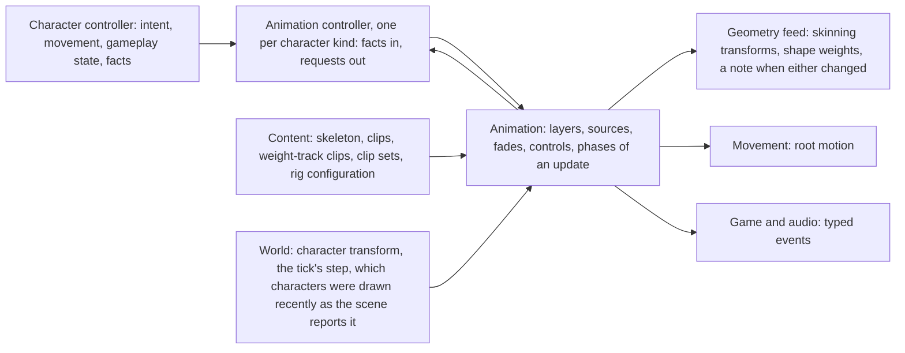
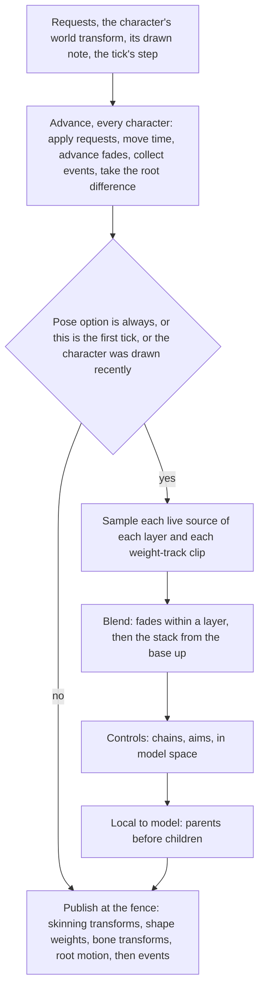
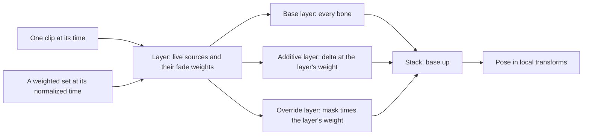
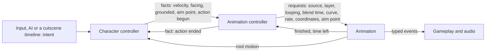

# Animation

How a character's pose is made each tick. Animation plays the clips it is
asked to play, blends them in layers, moves the bones no clip drives, and
publishes one pose per character, its shape weights, its root motion and
its timed events. It holds no rule about which clip follows which: that is
an animation controller's, one per kind of character, and the character
controller beside it names nothing in animation terms.

| Term | Means |
|---|---|
| Clip | per bone of one skeleton and per channel, a constant or keys; a rate, an interpolation and timed events |
| Weight-track clip | named tracks of one float each over time: shape weights, texture transforms |
| Pose | one local transform per bone, in skeleton order |
| Layer | one slot of a character's fixed stack: the base, an additive layer or an override layer |
| Source | what a layer plays: one clip, or a weighted set of clips |
| Weighted set | clips placed on one or two axes and blended by where a coordinate falls among them |
| Control | a step after the layers that moves bones in model space: a chain or an aim |
| Request | play this source on this layer, looping or not, over this blend time on this curve, at this rate; or play this weight-track clip, looping or not, at this rate |
| Fact | what a character controller states about its character: velocity, facing, grounded, an aim point, an action begun |
| Pose option | per character, whether its pose is built always or only when it was drawn recently |
| Drawn recently | the [scene](scene.md) reported the character's instance as drawn into a view within the last second of the world's time |

## Position

Between the character code of the game, which decides what a character
does, and the [geometry feed](geometry.md), which turns a published pose
into vertices. Fed by [content](content.md), which holds skeletons, clips
and the authored rig configuration. Beside the world, which owns each
character's transform and passes on the [scene](scene.md)'s report of which
characters were drawn.

## Invariants

1. Animation is a mechanism. It plays what requests name and holds no rule
   about which source follows which or when. The same requests, facts,
   drawn notes and steps in the same order give the same poses; time enters
   through the tick's step alone.
2. A character's requests come from its one animation controller and from
   nothing else, for its layers, its aims and its weight-track clips
   alike. A character controller owns intent, movement and gameplay state
   and names no clip, set, layer or blend time; it states facts. The
   animation controller reads the facts and owns everything said in
   animation terms. Input, AI and a cutscene timeline are intent
   providers: each reaches a character through its character controller.
3. Nothing outside an animation controller reads a clip's name, length or
   time. Movement receives root motion. Gameplay receives typed events,
   and the animation controller states, as a fact of its own, that an
   action it was told had begun has ended.
4. A clip holds, per bone track and per channel of rotation, translation
   and scale, a constant or keys. A key is a time in frames at the clip's
   rate and a value. The clip states its rate, its interpolation, one of
   step, linear and cubic, and its key encoding. Conversion keeps stored
   key times and values exactly and resamples nothing.
5. Sampling is a pure function of a clip and a time. No state is kept
   between samples. A rotation is interpolated on the shorter arc and
   normalized.
6. Looping belongs to the request. A looping source's time wraps; a source
   that does not loop holds its last key and reports that it finished. A
   layer reports the time its current source has left.
7. A pose is local transforms in skeleton order, parents before children.
   A bone a clip has no track for takes the skeleton's local rest
   transform. Poses blend as a weighted sum with every rotation taken in
   the hemisphere of the first, then one normalize.
8. A character has a fixed, ordered stack of layers: a base layer over
   every bone, and above it additive and override layers. The stack is
   evaluated from the base up.
9. A layer cross-fades to a requested source over the request's blend time
   on the request's curve, smoothstep unless the request names linear. A
   request that arrives during a fade starts a new fade from the layer's
   blended output so far; the earlier fade runs on beneath it and ends when
   the newer one ends. A request for a source that still has weight in the
   layer has its time shortened by that weight.
10. A weighted set is one source. Its weights come from where the
    request's coordinate falls among its samples; at most three samples
    result from a lookup; a weight at or under 0.00001 is dropped, samples
    naming one clip are merged, and the rest are normalized to sum to one.
    The set holds one normalized time, and each clip is sampled at that
    time times its own length.
11. An additive layer applies a delta to the pose beneath it at the
    layer's weight: translation added, rotation multiplied. Additive clips
    are stored as deltas.
12. An override layer replaces the pose beneath it on the bones of its
    mask, at the layer's weight times each bone's mask weight, blended in
    local space. A bone at full weight takes the layer's transform; a bone
    at or under the threshold keeps the pose beneath.
13. Root motion leaves the pose. The root bone's track is read at the
    previous and the current time, split at a loop, and the difference is
    published; the pose's root is held at the clip's first frame. Within a
    layer the differences of its sources are blended by their weights.
    Root motion is the base layer's, unless an override layer's mask gives
    the root bone weight, and then it is that layer's.
14. A clip's events are typed and timed in the clip's frames. The events
    between the previous and the current time, split at a loop, are
    collected as time advances and handed out after the pose is final. A
    weighted set reports the events of its heaviest clip.
15. A weight-track clip is played by request beside the layers, with its
    own time, rate and looping, and produces no pose. Its tracks are
    published by name. A shape weight at or under the threshold is
    published as zero, and reaching zero is stated as a change.
16. Controls run after the layers, in model space, before anything is
    published. Each has a weight, and its result is blended with the pose
    it was given, in local space, by that weight.
17. A chain keeps its bones' positions and velocities and its accumulated
    time per character. It restarts from the animated target with no
    velocity on its first evaluation, when whoever teleports the character
    requests it, and when a bone is farther from its target than the
    chain's threshold. The time a chain takes in one evaluation is clamped
    and the excess is dropped.
18. Advance runs for every character every tick. Each character carries a
    pose option its animation controller sets: always, which it has unless
    set otherwise, or when drawn. An always character is evaluated every
    tick. A when-drawn character is evaluated on its first tick and on
    every tick it is drawn recently. Whether an instance was drawn is the
    [scene](scene.md)'s to say, for the main view and the shadow views
    alike; the report describes a frame some frames back, and the world
    holds it for one second of its time and passes it on as a note per
    character. With no renderer no character is drawn recently. A
    character that is not evaluated loses no time, no event and no root
    motion; its pose, its bone transforms and its weight tracks stay those
    of its last evaluation and are not stated as changed; its chains' state
    is untouched and accumulates no time, and they continue from it when
    evaluation resumes.
19. Evaluation of one character reads its advanced state and immutable
    skeleton and clip data, and writes its own pose and control state.
    Characters are evaluated as tasks that share nothing else.
20. Everything is published at one fence per tick: skinning transforms and
    shape weights with a note when either changed, model-space bone
    transforms, root motion, and then the events.
21. A request that names a source of another skeleton, a layer the
    character does not have, a set with no samples, or a mask or binding
    naming a bone the skeleton lacks fails by name. Nothing plays the rest
    pose in its place.
22. Animation depends on content, core and the platform's tasks, and on
    nothing in rendering; the drawn note reaches it as an input, from the
    world. A run with no renderer runs all three phases, with no character
    drawn recently.
23. A rigid object with a skeleton of its own uses the same clips, layers
    and phases as a character. Its requests and its pose option come from
    the world code that owns the object, and from nothing else.

## An update

| Phase | Reads | Writes | Runs for |
|---|---|---|---|
| Advance | requests, the step, each source's clip lengths and rates, the root track, the event tables | each layer's sources, times and fade weights; each weight-track clip's time; the collected events; the root difference; finished and time-left notes | every character |
| Evaluate | the advanced state, clip tracks, weight-track clips' tracks, the skeleton's local rest transforms, masks, control bindings, the character's world transform | the pose in local and in model space; the sampled weight tracks; chain positions, velocities and accumulated time; an aim's interpolated point | always characters every tick; when-drawn characters on their first tick and when drawn recently; as tasks |
| Publish | the model-space pose, the skeleton's inverse bind, sampled weight tracks | skinning transforms as model space times inverse bind, three rows of four floats per bone in skeleton order; shape weights; model-space bone transforms; root motion; events | every character, at one fence; a character not evaluated publishes its root motion and events, and nothing else as changed |

## Layers, sources and fades

| Layer kind | Plays | Applied as |
|---|---|---|
| Base | a clip or a weighted set, over every bone | the pose the stack starts from |
| Additive | a clip stored as a delta | translation added and rotation multiplied onto the pose beneath, at the layer's weight |
| Override | a clip or a weighted set | a local-space blend toward the layer's pose on the masked bones, by layer weight times mask weight |

A layer holds as many sources as it has unfinished fades. A mask is a
branch root and a depth: weight rises along the chain from the root and is
full past the depth.

## Weighted sets

| Part | Form |
|---|---|
| Sample | a clip, a coordinate and a rate scale |
| Axis | one or two; each a range, clamped or wrapped, and a smoothing time |
| Lookup on one axis | the segment holding the coordinate gives two weights, `1 - f` and `f`; past a clamped end, the end sample alone |
| Lookup on two axes | the triangle holding the coordinate gives its barycentric weights; outside the triangles, those of the nearest point on the perimeter |
| Time | one normalized time for the set; the set's length is the inverse of the weighted sum of each clip's rate over its length, and time advances against that length |
| Smoothing time, per axis | the coordinate is filtered through a spring-damper before the lookup; zero is off |
| Weight speed, per set | limits how fast a sample's weight moves, so a sample leaving the lookup fades out and more than three can be live; zero is off |
| Time left | from the set's blended length |

Segments and triangles are computed when a set's description is converted.
With both smoothing parameters at zero a change of coordinate takes effect
in the same update.

## Controls

| Control | Request | What it does | State |
|---|---|---|---|
| Chain | none; it runs whenever its character is evaluated | moves bones no clip drives by a simulation stepped at the chain's fixed interval over accumulated time, toward the animated target | positions, velocities, accumulated time |
| Aim | a point, in world or model space | turns one bone by the single rotation that carries its aim axis onto the direction to the point, held within a clamp angle; the point may be interpolated over a time | the interpolated point |

A point given in world space is brought into model space by the
character's world transform, which is an input of every update.

## The controller boundary

| Crosses the boundary | From | To | Never carries |
|---|---|---|---|
| Facts | character controller | animation controller | a clip, set, layer or blend time |
| Requests | animation controller | animation | gameplay state |
| Finished and time left | animation | animation controller | |
| Action ended | animation controller | character controller | a clip's name, length or time |
| Root motion | animation | movement | |
| Typed events | animation | gameplay and audio | a clip's name or time |

A moment in a clip that gameplay acts on, such as a hit frame or the point
from which an action may be cancelled, is a typed event on the clip.

## Content animation reads

| Data | Form | Written by |
|---|---|---|
| Skeleton | bones in parent-first order with names; per bone a local rest transform and a bind transform, from which the inverse bind is composed once at load | the converter |
| Clip | per bone track and channel a constant or keys; rate, interpolation, key encoding; event tables of kind, frame and payload; a flag per bone as stored | the converter |
| Weight-track clip | named float tracks with keys and a rate | the converter |
| Clip set | samples of clip id, coordinate and rate scale; axes; smoothing parameters; the computed segments or triangles | authored by the project, converted for the published layer |
| Rig configuration | per skeleton: chains with their bones, step, clamp, threshold and spring parameters; masks; aim bindings with bone, axes and clamp | authored by the project, converted for the published layer |

## What is published

| Output | Form | Read by |
|---|---|---|
| Skinning transforms | three rows of four floats per bone, model space times inverse bind, in skeleton order, with a note when changed | the geometry feed |
| Shape weights | one weight per named target, with a note when changed | the geometry feed |
| Other weight tracks | one float per named track | whichever system binds the name |
| Model-space bone transforms | one transform per bone | the world, for what is placed on a bone |
| Root motion | one transform per character per tick | movement |
| Events | kind, payload and the character, in time order | gameplay and audio |
| Finished and time left, per layer | a note and a time | the animation controller |

## Components and ownership

| Component | Lives in | Consumed by |
|---|---|---|
| Skeleton payload and its reader | `src/engine/animation` | meshes that bind to it, clips, the converter |
| Clip, weight-track clip, clip set and rig configuration payloads and readers | `src/engine/animation` | the player, the converter |
| Sampling and pose blending | `src/engine/animation` | layers |
| Layers, sources, fades, weighted sets, root motion, events | `src/engine/animation` | animation controllers |
| Controls: chains and aims | `src/engine/animation` | evaluation |
| The three phases and the publication | `src/engine/animation` | the world's tick, the geometry feed |
| Animation controllers of Bullet Witch's characters | `src/game/characters`, beside each kind's character controller | animation |
| Writers of clips, weight-track clips, clip sets and rig configuration | `tools/content_converter` | the player's first run, the project side |

## Boundaries

Above: the animation controllers, which decide what plays, and the
character controllers above them, which decide what a character does.
Below: content, which holds what is played, and the platform's tasks, which
run evaluation. Beside: the world, which orders the tick, owns each
character's transform, passes on the drawn note and places things on
bones; the [scene](scene.md), which alone decides what was drawn and
reports it to the world, and of which animation reads nothing; the
geometry feed, which takes the published pose and weights as
given and decides nothing about them; movement, which takes root motion and
decides where the character goes. Which clip plays when, cutscene
timelines, what an event does, what binds a texture-transform track to a
material, and how a character is moved are outside this document.
