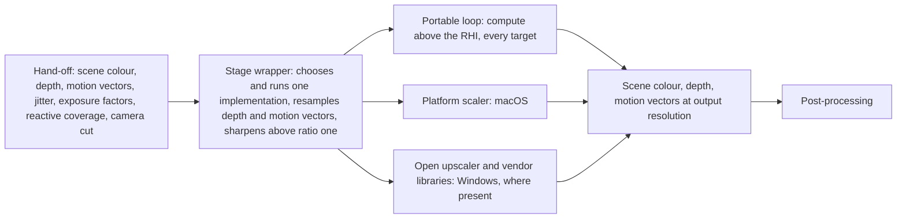
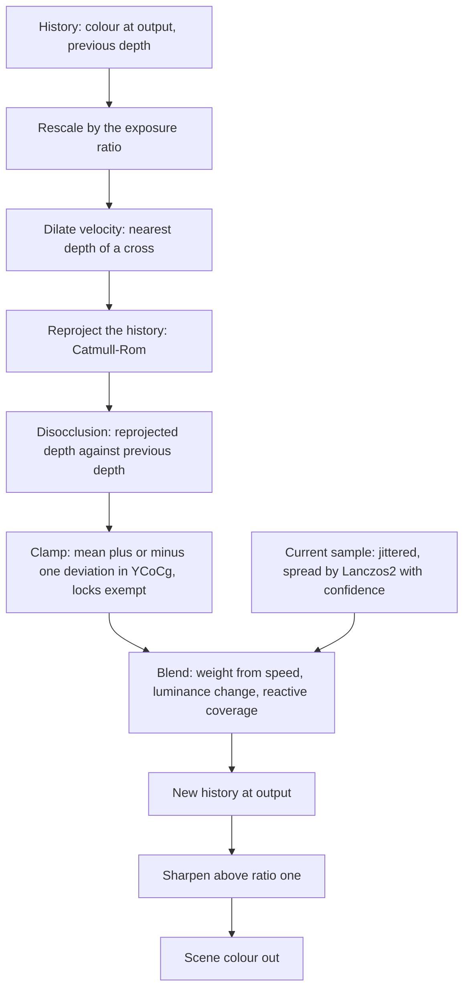

# Anti-aliasing and upscaling

How the temporal stage is implemented on each target. The frame hands the
stage one set of inputs at input resolution and takes back scene colour,
depth and motion vectors at output resolution. Behind that hand-off are
several implementations: the portable loop, written in the project's own
shaders and run on every target as the reference, and on some targets a
platform or vendor library. One is chosen at startup, reported, and kept
for the session.

A ratio is output resolution over input resolution along one axis; at a
ratio of one the stage is anti-aliasing alone. The history is what the stage
keeps from frame to frame. A lock is a per-pixel hold the loop places on a
thin feature so the neighbourhood clamp does not erase it.

## Position

The temporal stage of the [scene renderer](scene-renderer.md)'s frame, after
the distortion merge and before [post-processing](post-processing.md). The
portable loop is ordinary compute above the [RHI](rhi.md); a library
implementation is the RHI's temporal upscale operation, performed below the
contract. Fed by the forward pass's reactive coverage, the world's camera cut
flag and the exposure factor texture.

## Invariants

1. Every implementation takes the same hand-off and gives back the same
   outputs. Nothing above the stage can tell which ran, except by the report
   at startup and the image.
2. The portable loop runs on every target and is the reference for image
   comparison, headless included. It needs no typed unordered-access load,
   no 16-bit arithmetic and no wave operation, so the Xbox container runs
   it whatever its probe turns out to mean.
3. The loop keeps its history at output resolution as a 16-bit float colour
   texture, plus the previous frame's depth, since the hand-off carries only
   this frame's. The history is rescaled by this frame's exposure factor
   over the previous frame's before anything else reads it.
4. The loop, in order per pixel: dilate the velocity to the nearest depth of
   a cross; reproject the history by a Catmull-Rom filter; test disocclusion
   by the reprojected depth against the kept previous depth; clamp the
   history to the neighbourhood's mean plus or minus one standard deviation
   in YCoCg; weight by one over one plus luminance of the pre-exposed value;
   blend with a weight raised with speed, floored by the luminance change
   against the history, and raised toward one by the reactive coverage;
   spread the jittered sample over the output by a Lanczos2 kernel with a
   confidence from its jitter position.
5. A lock holds a thin feature: a per-pixel lifetime and the luminance at
   creation, made by a three-by-three luminance test, which keeps hair
   cards and wires against the clamp while the lock lives.
6. The history is dropped on a camera cut, a change of resolution, and a
   change of ratio or implementation.
7. The jitter is Halton in bases two and three centred on zero, with eight
   samples times the area ratio before it repeats. Texture sampling before
   the stage uses a mip bias of the base-two logarithm of input over output,
   minus one.
8. Above a ratio of one the wrapper sharpens the result with a
   contrast-adaptive five-tap sharpen with one parameter, as the stage's
   last step. At a ratio of one it does not.
9. The wrapper resamples depth and motion vectors to output resolution by
   nearest depth after whichever implementation ran, since a library
   produces colour alone. The passes after the stage read those.
10. The implementations per target are: macOS, the platform scaler;
    Windows, the portable loop, and where the library and the GPU are
    present, the open upscaler and the two vendor upscalers; Linux and the
    Xbox container, the portable loop. A library implementation is the RHI's
    temporal upscale operation over declared inputs and outputs, and the
    backend restores its tracked state on return.
11. A setting names the implementation. The default is the platform or
    vendor one where its library and GPU are present and the portable loop
    otherwise. The choice is reported at startup; an implementation that is
    chosen and cannot be created fails by name.
12. The ratio is one of five named steps, 1.0, 1.5, 1.7, 2.0 and 3.0, fixed
    until the setting changes. The platform scaler clamps to the range it
    reports. The input size is otherwise fixed; a per-frame input size is
    within what every implementation accepts, and the policy that would
    drive it is not in this document.
13. Every implementation takes the exposure factors as a texture. Every one
    that accepts a reactive mask takes the forward pass's coverage; the
    platform scaler takes it from macOS 14.4 and on earlier systems blended
    draws may trail.

## The loop

| Step | Reads | Writes |
|---|---|---|
| Rescale | the history, both exposure factors | the history in this frame's scale |
| Dilate | depth | the velocity each pixel reprojects by |
| Reproject | the history, the dilated velocity | the history sample at this pixel |
| Disocclusion | depth, the previous depth, the dilated velocity | a rejection where the surface changed |
| Clamp | the neighbourhood of the current sample, the locks | the clamped history |
| Blend | the clamped history, the current sample, speed, luminance change, reactive coverage | the new history, the locks updated |
| Sharpen | the new history | scene colour at output |

## Implementations per target

| Target | Default | Also available | Reference |
|---|---|---|---|
| macOS | the platform scaler | the portable loop | the portable loop |
| Windows | the vendor upscaler of the GPU, else the open upscaler, where its library is present | the portable loop | the portable loop |
| Linux | the portable loop | | the portable loop |
| Xbox container | the portable loop | | the portable loop |

## Settings

| Setting | Values | Effect |
|---|---|---|
| Implementation | one of the target's implementations | chosen at startup, reported, fails by name if it cannot be created |
| Ratio | 1.0, 1.5, 1.7, 2.0, 3.0 | input resolution, the jitter length, the mip bias; a change drops the history |
| Sharpness | 0 to 1 | the sharpen's one parameter, applied above ratio one |

## Components and ownership

| Component | Lives in | Consumed by |
|---|---|---|
| Stage wrapper: hand-off, choice, report, resample, sharpen | `src/engine/rendering/postprocess` | the frame |
| Portable loop and its shaders | `src/engine/rendering/postprocess`, shaders under `src/engine/rendering/shaders` | the wrapper |
| Temporal upscale operation and the library bindings | `src/engine/rendering/rhi`, one per backend | the wrapper |
| Jitter sequence and mip bias | `src/engine/rendering/scene`, as part of the main view | every pass before the stage |

## Boundaries

Above: the frame, which hands the stage its inputs and reads its outputs,
and the settings. Beside: the forward pass, which writes the reactive
coverage; the world, which publishes the camera cut; post-processing, which
reads the outputs. Below: the RHI, whose temporal upscale operation performs
a library implementation and whose descriptor arrays serve the loop. What a
library does inside, and the policy that would change the input size per
frame, are outside this document.
