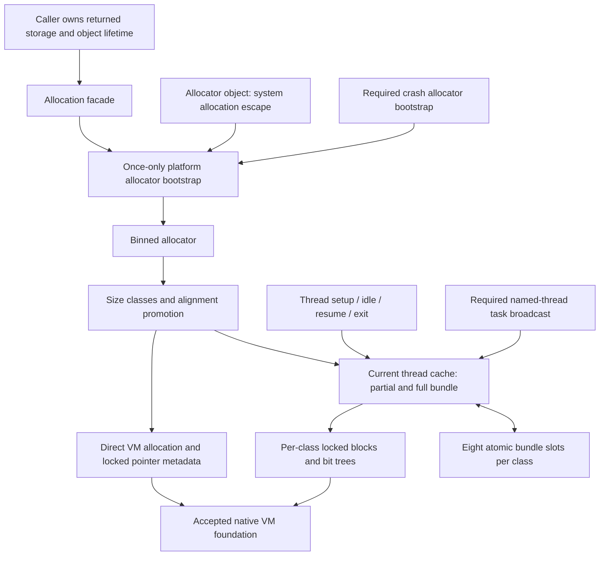

# General allocator

Accepted selected Mac general-allocation leaf. The
accepted virtual-memory/fatal foundation is committed as `99456b2`; the new
allocator consumes it without changing its behavior. Algorithms follow Unreal
`f45729c0b6f097038e72b52d366a62baeca3275b`. The leaf was accepted independently of the engine host. The subsequent
[allocator lifecycle](allocator-lifecycle.md) integrates host C++ allocation and
game-owner startup/shutdown; this remains short of the full memory subsystem.

## Selected configuration

The Mac game target selects Binned3. It reserves 1 GiB of virtual address space
per size class, with 77 classes: the 52 listed classes through 28,672 bytes plus
4 KiB increments through 128 KiB. These are virtual reservations, not 77 GiB of
physical commitment. The native page size determines block commitment. Mac does
not select the cached large-page allocator; large allocations use VM directly.
The source defaults enable thread caches, cap bundles at 64 nodes or 65,536
bytes, prefill up to 32 extra allocations, and retain at most eight recycler
bundles per class. `AGGRESSIVE_MEMORY_SAVING` defaults to zero. None of these
values is a project tuning choice.

Sources: `MallocBinned3.h:22–54`; `MallocBinnedCommon.h:27–85`;
`Misc/Build.h:454–457`; Mac selection in [Memory](memory.md).



## Source-defined implementation units

| Unit | Responsibility | Pinned source |
|---|---|---|
| A: size classes and bit tree | Native-page block sizing, sorted classes, size lookup, alignment promotion; 64-way summary bits find available blocks | `MallocBinnedCommon.cpp:27–459`; `MallocBinnedCommon.h:134–163,823–894` |
| B: synchronization | Mac recursive unfair lock for pool/metadata/registry; nonrecursive word mutex for cache ownership; manual-reset wait event | `AppleRecursiveMutex.h:26–79`; `WordMutex.h:20–77`; `WordMutex.cpp:12–164`; `GenericPlatformManualResetEvent.h:23–124` |
| C: allocator core | Reserved small-pool ranges, block metadata/free slots, allocation/exhaustion trees, direct large mappings and address hash | `MallocBinned3.cpp:65–1029`; `MallocBinnedCommon.h:207–263,645–760,943–971` |
| D: thread caches | Two bundles per class, shared CAS recycler, explicit current-thread setup/idle/resume/flush/clear | `MallocBinnedCommon.h:186–405,500–643,762–821`; `MallocBinnedCommonUtils.h:45–140` |
| E: facade and bootstrap | Public allocation operations, process-lifetime singleton construction through system allocation escape, platform initialization | `FMemory.inl:16–52,106–180`; `UnrealMemory.cpp:347–439,658–675`; `MemoryBase.h:19–28,56–127`; `MacPlatformMemory.cpp:68–175` |

Paths are relative to `Engine/Source/Runtime/Core/Public` or `Private` as indicated
by the source file's location. Method and significant-block comments identify the precise source function/range.
The tables below also identify extracted helpers and platform substitutions.

### A. Size and allocation policy

Build the listed class sizes with their original preferred block multiples,
convert those multiples to native pages, sort, then append the larger classes.
This is not power-of-two rounding of every allocation. The 8-byte class remains
8-byte aligned; default alignment is the source sentinel zero. Requests above
standard 16-byte alignment may promote to a naturally aligned class through
256-byte alignment. Otherwise they take the large path. Native VM alignment
limits still apply; the allocator does not invent arbitrary-alignment support.

A bit tree uses 64-bit words and summary rows whose set bits mean the child is
full. Initialization marks capacity padding unavailable. Allocation descends by
the first clear bit and propagates newly full summaries upwards. Release clears
the leaf and propagates availability upwards. Caller-owned backing storage and
external pool locking are required; this structure is not itself atomic.

### C. Small and large allocations

Constructor order is reserve the whole small-class address range, gather native
constants, initialize pointer-hash geometry, build size/block tables, allocate
metadata backing, initialize allocation/exhaustion trees and lookup arrays,
then allocate large-allocation hash buckets. The reference constructor enforces
one process-lifetime instance; its destructor does not release the global pools.
No test creates and destroys one allocator per scenario.

A small pointer's class comes from its offset in the reserved range. Allocation
first tries the owner's TLS cache/recycler. On a miss it locks only that class,
finds a non-exhausted committed block or commits a new one, allocates from the
block's free-slot chain, optionally prefills the TLS cache, and marks exhaustion.
When a class exhausts its reservation, source code promotes to the next class
and eventually the large path. This is an explicit source algorithm, not an
invented system-heap fallback.

A caller's free may be issued on a different thread after ownership transfer.
The freeing thread can retain the slot in its own cache: there is no return-to-
allocating-thread queue. Full bundles first try the shared recycler. Overflow
returns to the class under its mutex; each returned slot reduces the block's
outstanding count, and a completely returned block is decommitted. A slot held
in a cache still counts as outstanding at block level. Consequently caller-free
and OS reclamation are different events.

Large allocations round to native commit size, map/commit through the accepted
VM API, and record requested bytes, committed bytes, VM page count and canary in
pointer-indexed metadata. The hash owns collision buckets and page arrays;
metadata is allocated directly through VM to avoid allocator recursion. It is
not an `unordered_map` using the general heap.

Reallocate-to-zero frees and returns null. A small allocation remains in place
only when the new request remains in the same class and meets alignment. Large
allocations remain in place only while they fit the committed range without a
page-saving shrink or small-pool conversion. Otherwise allocate, copy the source-
specified minimum payload, then free. Size queries return class capacity or OS
committed bytes, not the original requested payload. Null size queries fail.

### B/D. Ownership and concurrency

Pool and external metadata locks follow the selected Mac recursive unfair-lock
implementation: identify the current Mach thread; recursively increase depth for
its owner; otherwise acquire the native unfair lock with the reference adaptive
spin flag; release the native lock at depth zero. No `std::recursive_mutex`
substitution is assumed.

The TLS cache uses the source nonrecursive word mutex. Its fast path is atomic
acquire/release; the slow path tries up to 40 yields before queuing a stack waiter
and sleeping on a manual-reset event. It does not depend on ParkingLot. Mac's
selected manual-reset event is the generic `std::mutex`/`condition_variable`
implementation. Notify retains its lock through notification so the waking
thread cannot destroy the stack event while notification still accesses it.
Scheduler oversubscription suppression is a future scheduler integration, not a
reason to create worker threads here.

The cache owner holds its mutex while active. `Get` returns no cache while that
owner has marked it unused, so allocations from inside a wait implementation use
the ordinary locked allocator path. Mark-unused first flushes a changed trim
epoch then unlocks; mark-used relocks. Clear flushes, unregisters, unlocks,
destroys and releases VM metadata. Thread termination must call clear explicitly;
there is no invented TLS destructor that races allocator shutdown.

The shared recycler has eight atomic pointer slots per class. Successful CAS
transfers an entire bundle; the winner alone may read or mutate its nodes. Use
C++ atomic loads/CAS for the corresponding source interlocked protocol, not a
plain pointer load racing a writer. Recycler metadata is cache-line aligned
(128 bytes on selected Mac ARM64). Registry mutations have their own recursive
lock; active cache data is not made globally mutable for inspection.

### E. Bootstrap and dependency integration

The facade enters a function-local static initialization gate on first use,
publishes the selected Binned3 owner, then constructs the pooled crash allocator.
Allocator-object storage uses source `FUseSystemMallocForNew` with paired system
malloc/delete. This escape does not service client storage or metadata.
The published pointer uses C++ atomic acquire/release so crash replacement does
not introduce a plain-pointer data race. Normal bootstrap remains serialized.

[Crash memory](crash-memory.md) implements the selected generic pooled allocator:
14 source classes, separate small/bookkeeping reserves, and a 2 MiB large bump
reserve. This is distinct from the accepted zero backup OOM reserve. Activation
holds its crash lock, selects the crash owner thread, and replaces the facade.
Ordinary bootstrap only reserves it; it does not activate crash mode. Other
threads suspend allocation and skip frees under the source default policy.
Full guarded crash reporting and engine logging are still absent services.

[Named-thread dispatch](named-thread-dispatch.md) supplies the actual dependency
for desktop `Trim(false,false)`: increment epoch, run game-local flush immediately,
then enqueue high-priority callbacks on attached render/RHI owners. The named
owners process those callbacks themselves. Trim does not await their completion.
Before dispatch startup, the source runs only its game-local callback. The new
explicit owner registration/pump is the source named-thread dependency, not a
worker scheduler, full TaskGraph, renderer thread, or game-loop integration.

The registry uses the source dynamic pointer-array growth/removal policy described
below. There is no fixed thread count, default-heap vector, or local-only global
trim substitute. Mac recursive locks select the weak native lock-with-flags
symbol once; older systems use the source unfair-lock fallback. Publication is
atomic to avoid concurrent initialization races. WordMutex's source yield is a
CPU instruction (ARM ISB), not OS `sched_yield`.

Mac bootstrap also installs native memory-pressure observers on the main dispatch
queue. Their atomic status is exposed through the platform boundary; callbacks
require a host that services that queue. The current headless engine loop has not
been changed to provide such a host. Native physical memory/page constants size
the pointer hash. Allocator statistics/console dumps, optional tracing and guarded
crash-report integration are not claimed by this leaf.

## Implementation and verification

The preparation established architecture, headers, comment-only units and tests
before implementation was authorized. Expected missing-definition red remains in
ignored `research/evidence/allocator-structure-link-red.txt` and
`research/evidence/allocator-link-red.txt`; the crash/dispatch dependencies retain
their own red evidence. No substitute production/test-only method made those
links green.

`bw_allocator` now contains core allocation, synchronization, crash bootstrap and
the selected named-task dependency. Five executable suites are registered:

- Structural: bit-tree padding/exhaustion/reuse,4KiB/16KiB size tables/alignment,
  bounded local bundles and global recycler, basic synchronization.
- Allocator: original allocation/reallocation/cache/cross-thread cases, real
  facade bootstrap,32 simultaneous registry owners, and game/render/RHI trim.
- Synchronization: recursive ownership, stack-event lifetime, queued contention.
- Named dispatch: owner-local execution, asynchronous broadcast, priority/FIFO,
  concurrent publication, cross-thread task storage, bounded impossible request.
- Crash: real reserve/activation, source pool promotion/reuse/fills, large bump
  non-reclaim, prior-Binned reallocation, and bounded child failure/suspension.

The original four allocator behavioral groups remain unchanged; their instance
now comes from the actual facade so named-task consumers share the same heap.
No test creates a second allocator with shared process-global cache metadata.

Both C++ corpora were queried at design and implementation stages. Full rules
applied include Core C.32/CP.2/R.15 and Performance MEM.2/MEM.5. Synchronization,
crash and dispatch files name their additional full-rule applications. Source
class sizes, promotion and exhaustion policy remain authoritative over generic
examples in guidelines.

```sh
cmake -S . -B build-game-loop -DCMAKE_BUILD_TYPE=Debug
cmake --build build-game-loop --parallel
ctest --test-dir build-game-loop --output-on-failure
cmake --build build-game-loop --target format-check
cmake -S . -B build-memory-release -DCMAKE_BUILD_TYPE=Release
cmake --build build-memory-release --parallel
ctest --test-dir build-memory-release --output-on-failure
```

Final Debug and Release builds both pass fatal clang-tidy and all 23 standalone
header compilation units. Each configuration passes 23 CTest entries: the prior
18 plus five allocator/dependency suites. This is five new executable suites,
not a claim of 23 newly written allocator tests. Pinned format and whitespace
checks pass. Evidence is ignored under `research/evidence/allocator-debug-green.txt`
and `allocator-release-green.txt`. Root independently repeated Debug CTest 23/23,
format and whitespace checks. Release-only unused debug-check locals were
annotated or expressed with shared verify semantics; required side effects remain
present when debug checks compile out. Existing engine loop and VM bodies are
unchanged. No global `new/delete` override, engine-wide adoption, jobs scheduler,
GPU allocation, garbage collector or transient allocator is implied.

## Implementation dependency details

The cache registry now selects the source `TArray<cache*>` operations narrowly:
`ContainerAllocationPolicies.h:170-219` grows from four entries, then requested
count plus 3/8 plus 16, quantized through the general allocator. Pointer storage
reallocates through this Binned3 owner after TLS publication (same selected owner
as the facade). `Array.h:3343-3410` removes matching entries while preserving order
and does not shrink capacity. There is no fixed thread limit or libc container.
The registry owns this process-lifetime pointer array under its recursive mutex;
registered entries remain owned by their respective thread lifetime hooks.
