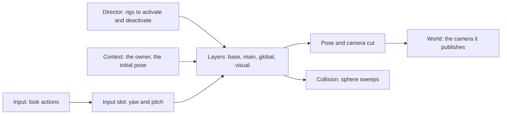
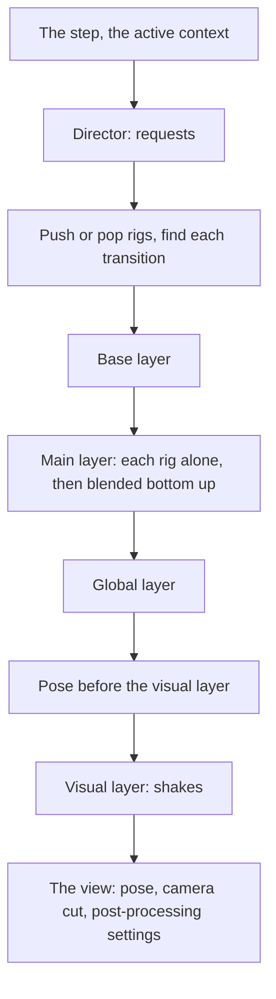

# Camera

How the view is made each tick. A camera is a rig: a list of nodes that
each change a pose, run in order. A director says which rig is active, a
stack blends from the old rig to the new one, and the result is the view
the renderer draws. The camera holds no rule about when the view changes:
that is the director's, and the director's rule is the game's.

| Term | Means |
|---|---|
| Pose | where the camera is and how it sees: location, rotation, field of view or focal length, near plane, aspect, aperture, shutter, focus distance, sensor size |
| Node | one step that reads the pose and writes it: attach, boom, offset, lens, collision |
| Rig | an ordered list of nodes that makes one pose, with its transitions |
| Context | what a rig is evaluated for: an owner, and the initial pose it gives |
| Director | what names the rigs to activate and deactivate this tick |
| Layer | one of four stacks of rigs evaluated in order: base, main, global, visual |
| Transition | from which rig to which, under what conditions, with which blend |
| Blend | a node that mixes a rig's result over what is beneath it by a factor over time |
| Input slot | a two-axis value a node reads: yaw and pitch, in degrees |
| Shake | a short-lived change to the pose, applied in the visual layer |

## Position

Below the game's code, which writes directors and rigs. Inside the
[world](world.md)'s tick, after everything has moved. Above
[physics](physics.md), which answers the sweeps its nodes make. Beside
[input](input.md), whose actions feed look input, and the
[scene renderer](scene-renderer.md) and
[post-processing](post-processing.md), which take the view.

## Invariants

1. The camera system is evaluated once a tick, where the world updates
   cameras: after every stage through after-simulation, so the pose is
   made from where its target is this tick.
2. An evaluation runs in this order: services before, the director, the
   node tree of every layer, services after. The result is one pose, a
   camera cut flag and the post-processing settings the rigs set.
3. The director runs each tick and returns requests: activate or
   deactivate a rig, on a layer, optionally with a transition of its own.
   A request on the main layer pushes the rig on that layer's stack.
4. A rig is evaluated alone: its nodes run in order, each given the step,
   whether this is the rig's first frame, whether it is the active rig,
   and the pose so far. A node keeps its own state between ticks.
5. The four layers run in order: base, main, global, then visual. The
   main layer's stack is transient: each rig is evaluated in isolation,
   the results are blended from the bottom up, and a rig is removed when
   one above it has reached full weight. The pose before the visual
   layer is kept beside the final one.
6. When a rig is pushed, its transition is found in this order: one the
   request carries, then the exit transitions of the rig on top, then
   the enter transitions of the new rig. The first whose conditions all
   hold is taken. With an empty stack, or with no transition, the new
   rig is at full weight at once.
7. A blend gives a factor from zero to one over its time. It mixes the
   whole result: location, rotation, field of view or focal length, the
   other numbers of the pose, variables and post-processing settings.
   Switches and choices flip at one half. A blend that ends at once is a
   cut.
8. The camera cut flag is set on a rig's first frame, by a blend that
   ends at once, and whenever any part of a cut carries weight in a
   blend. It is published with the frame and reaches the renderer's
   view.
9. An attach node sets the pose's location, and its rotation if asked,
   from the context's owner, or from one of its bones.
10. A boom node rotates about the incoming location by the input slot's
    yaw and pitch and applies its offset in that rotated frame. An
    interpolator may ease the boom's length as its pivot moves, within a
    forward and a backward limit.
11. An orbit node takes curves over pitch: the camera's offset from its
    pivot, an offset of its target, and an added rotation.
12. An input slot's value comes from the controller's control rotation,
    or is accumulated in the slot from a look action: the action's value
    times a speed times the step, added each tick, with an optional
    clamp and wrap per axis. The control rotation is held within the
    view's pitch, yaw and roll limits.
13. A collision node sweeps a sphere from a safe position, the pivot by
    default, to the camera, and moves the camera toward the safe
    position by a factor. One interpolator eases the factor when it
    rises and another when it falls. With neither, it moves at once.
14. A shake is requested with a scale and a space and runs in the visual
    layer, on top of the blended pose. Its change to pitch is held so
    the view stays short of straight up or down.
15. The field of view comes from the focal length and the sensor when a
    focal length is set, and from the field of view otherwise. A blend
    between two poses that both use focal length mixes the focal length.
16. A rig naming a node, a curve or an action that does not exist fails
    by name when it is loaded.

## An evaluation

| Node | Reads | Writes |
|---|---|---|
| Attach | the context's owner or a bone | location, and rotation if asked |
| Boom | the input slot, the incoming location, its offset | location and rotation, a yaw and pitch joint |
| Orbit by pitch | the input slot, curves over pitch | location, rotation, target |
| Offset | a vector in a named space | location |
| Lens and field of view | focal length or field of view, aperture, focus | the pose's lens values |
| Collision push | a safe position, the camera, a sphere radius | location |
| Occlusion | what lies between the camera and its target | a material on what it hits |
| Shake | amplitude and frequency per axis, an envelope | location, rotation, field of view, in the visual layer |

| Blend | Factor over its time |
|---|---|
| Pop | one at once, and a cut |
| Linear | the fraction of the time elapsed |
| Smooth | the smoothstep or smootherstep of that fraction |
| Easing | a named easing curve of that fraction |
| Location and rotation | one blend for location, one for rotation, one for the rest |
| Orbit | the driving blend, with the camera kept turning about the point both rigs aim at |

## Components and ownership

| Component | Lives in | Consumed by |
|---|---|---|
| The evaluator, contexts, layers, blend stacks | `src/engine/camera` | the world |
| Pose and its blending | `src/engine/camera` | every node |
| Nodes: attach, boom, orbit, offset, lens, input slots, collision, shakes | `src/engine/camera` | rigs |
| Blends and transition conditions | `src/engine/camera` | rigs |
| Rigs, directors and their values | `src/game` | the evaluator |
| Collision queries | `src/engine/physics` | collision nodes |

## Boundaries

Above: the game's code, which writes each rig, its transitions and the
director that picks among them. Below: [physics](physics.md), which
answers sweeps.
Beside: the [world](world.md), which evaluates cameras after everything
has moved and publishes the view and the cut; [input](input.md), whose
look actions feed input slots; the controller, whose control rotation a
slot may read; the [scene renderer](scene-renderer.md) and
[post-processing](post-processing.md), which read the view. Which rig is
active when, what a rig's numbers are, and what requests a shake are
outside this document.
