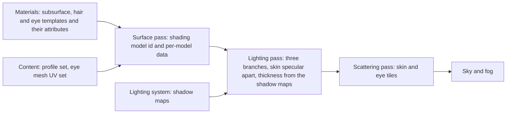
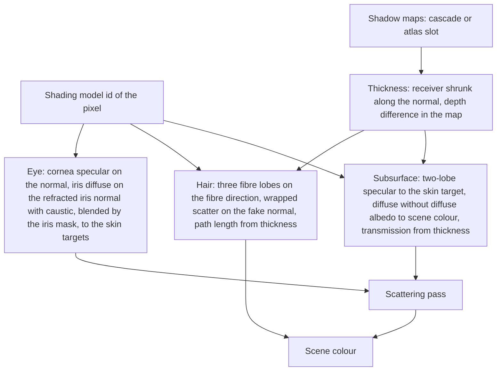
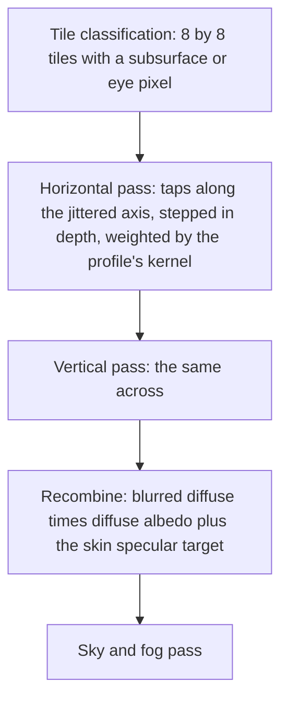

# Character shading

The three shading models a character needs beyond lit and unlit: subsurface
for skin, hair for cards, eye for the eyeball. Each is an id in the surface
data with its own per-pixel data, a branch in the lighting function, and, for
skin and eyes, a scattering pass that blurs diffuse light across the surface
after the lighting pass. Subsurface and hair are opaque or masked, the eye
is opaque, and all three are drawn by the depth, surface and shadow passes
like any surface.

A profile is the per-material description of how skin scatters light. A card
is a masked, two-sided strip of hair geometry. The fibre direction is the
axis along a card's strands.

## Position

Inside the [scene renderer](scene-renderer.md)'s lighting function and
frame, as three branches of the lighting pass and one scattering pass after
it. Fed by [materials](materials.md), whose templates declare the model and
write its attributes, by [content](content.md), which cooks the profile set
and the eye mesh's UV set, and by the [lighting system](lighting.md), whose
shadow maps the lighting pass reads directly for thickness. Above the
[render graph](render-graph.md) and the [RHI](rhi.md).

## Invariants

1. Subsurface, hair and eye are shading model ids in the surface data. A
   template declares one. The lighting pass branches on the id; the forward
   pass never sees these models, because their templates are opaque or
   masked only.
2. For a subsurface or eye pixel the lighting pass writes diffuse light,
   direct and indirect, without diffuse albedo, into scene colour, and
   specular into the skin specular target, both carrying the frame's
   exposure factor. A subsurface template writes no emissive. The scattering
   pass blurs scene colour on skin tiles, multiplies by the surface data's
   diffuse albedo, and adds the skin specular target.
3. The scattering pass runs after the lighting pass and before the sky and
   fog pass, at input resolution, only on 8 by 8 tiles that hold a
   subsurface or eye pixel, and within a tile only subsurface and eye pixels
   are written and only they are read as taps, by the shading model id. It
   is one separable kernel applied as two one-dimensional passes, with
   importance-sampled taps whose inner part is jittered per pixel, a footprint from the pixel's
   projected size, and a step that follows the surface in depth.
4. A profile is content: per profile, a near and a far Gaussian radius per
   channel with a weight, a transmission tint and extinction, and the ratio
   of the second specular lobe's roughness to the first and the mix. A subsurface pixel
   carries an 8-bit profile id and a scatter scale that multiplies the
   kernel radius. Profile 0 is the default skin.
5. Skin specular is two GGX lobes. The template supplies one roughness; the
   profile derives the second lobe's roughness and the mix.
6. Thickness comes from the shadow maps, read directly by the lighting pass
   on every target: the receiver position shrunk along its normal is
   projected into the sun's cascade or the light's atlas slot, and the depth
   found there is subtracted from the receiver's depth; a light with no map
   that frame gives no thickness. The shadowing term is not involved and
   keeps its one meaning, visibility. For a subsurface
   pixel thickness becomes transmitted light through the profile's
   extinction and tint, for direct light only. Thickness is wrong where
   geometry overlaps along the light, and that is its stated limit.
7. Hair is the three-lobe fibre model: reflection, transmission and
   internal reflection as single Gaussian longitudinal lobes with
   closed-form azimuthal terms. Its attributes are diffuse albedo as
   absorption, roughness, F0 as the reflection scale, hair shift and hair
   scatter, the two rows the attribute table carries for hair, stored with
   the fibre direction in the shading model data. Multiple scattering is a
   wrapped diffuse term on a fake normal
   built from the view direction and the fibre direction, attenuated by the
   absorption path length.
8. A hair pixel's surface data holds the card normal in the normal slot and
   the fibre direction in the shading model data. The visibility terms read
   the card normal; the lighting function reads the fibre direction.
9. Hair pixels are the one exception to the rule that a term's traced and
   rasterized sources are indistinguishable: a hair pixel reads the shadow
   maps and the probe grids directly on every target, and every traced
   source skips it by shading model id. For a hair pixel the depth
   difference of invariant 6 is not compared against a threshold: it
   becomes an exponential falloff that is both the hair's shadow and the
   absorption path length of invariant 7; the shadowing term's target is
   not read for hair pixels. Hair's indirect light evaluates the fibre model
   at the fake light direction, the surface pass's probe lookup for a hair
   pixel uses the fake normal, and hair takes no environment reflection.
10. Hair cards are masked and two-sided, declared by the template, drawn in
    the surface pass. There is no edge pass and no dither of the card's
    mask; the temporal stage treats the cut edge as any masked edge.
11. An eye pixel is two layers blended by the iris mask: a cornea, lit as a
    GGX specular on the surface normal with a fixed reflectance of 0.025 at
    normal incidence and 1 at grazing, since the eye template writes no F0
    or F90, and an iris, lit as a diffuse on
    the iris normal at a position refracted by the iris height along the
    refracted view ray, with an analytic caustic from the iris and cornea
    normals. Eye pixels are scattered by the scattering pass with the
    profile the template names, the face's.
12. An eye pixel's surface data holds the profile id, the iris normal and
    the iris mask in the shading model data, and the iris height in the F0
    slot, which the eye model leaves free; the reflections term reads the
    shading model id and takes no F0 from an eye pixel.
13. An eye template requires a mesh with a frontal-projection UV set and the
    cornea bulge. A mesh without that UV set is a lit mesh of its own
    material, and the converter applies that rule; the original's eye draws
    carry no such set, so they are lit meshes of their materials.
14. Eyes cast and receive shadows like any surface. The eyelid's shadow on
    the eye is the ordinary shadow term.

## The lighting pass branches

| Model | Reads | Writes |
|---|---|---|
| Subsurface | diffuse albedo, normal, roughness, profile id, scatter scale, thickness, light grid, probe grids | diffuse light to scene colour, specular to the skin specular target |
| Hair | diffuse albedo, roughness, F0, hair shift, hair scatter, fibre direction, thickness, light grid, probe grids | lit colour to scene colour |
| Eye | normal, iris normal, iris mask, iris height, profile id, light grid, probe grids | diffuse light to scene colour, specular to the skin specular target |

## The scattering pass

| Property | Value |
|---|---|
| Resolution | input |
| Tiles | 8 by 8, classified from the shading model id |
| Kernel | near and far Gaussian per channel with a weight, from the profile; radius times the pixel's scatter scale |
| Taps | importance-sampled per pass, a quality setting, the inner taps' axis jittered per pixel and the outer taps fixed |
| Footprint | the kernel radius divided by the pixel's projected size at its depth |
| Depth | a tap's weight falls with its depth difference from the centre |
| Inputs | scene colour, depth, surface data, the skin specular target |

## Surface data per model

| Model | Normal slot | F0 slot | Shading model data |
|---|---|---|---|
| Subsurface | surface normal | F0 | profile id, scatter scale |
| Hair | card normal | F0, the reflection scale | fibre direction, hair shift, hair scatter |
| Eye | cornea normal | iris height | profile id, iris normal, iris mask |

## Content the models read

| Data | Form | Read by |
|---|---|---|
| Profile set | per profile: near and far radius per channel, weight, transmission tint, extinction, the second specular lobe's roughness ratio and mix | lighting pass, scattering pass |
| Eye mesh | a frontal-projection UV set and the cornea bulge in the geometry | eye template |
| Hair card mesh | masked cards with a fibre direction per vertex, as the tangent; the converter keeps the geometry as authored, so a card the content doubled in reverse winding draws both copies under the two-sided template | hair template |

## Components and ownership

| Component | Lives in | Consumed by |
|---|---|---|
| Subsurface, hair and eye branches of the lighting function | `src/engine/rendering/passes` | lighting pass |
| Thickness read from the shadow maps | `src/engine/rendering/lighting` | lighting pass |
| Scattering pass: tiles, kernel, recombine | `src/engine/rendering/passes` | render graph |
| Skin specular target | `src/engine/rendering/passes` | lighting pass, scattering pass |
| Profile set payload reader | `src/engine/rendering/materials` | content loading |
| Subsurface, hair and eye templates | `src/engine/rendering/materials/templates` | surface pass |

## Boundaries

Beside: the material system, which owns the templates and their attribute
tables; the lighting system, which owns the shadow maps the lighting pass
reads for thickness and the light grid and probes it reads for light; the
scene renderer, which owns the pass list, the surface data layout and the
lighting function these are branches of. Below: the render graph and the
RHI. Strand hair, cloth, and how a character's materials are authored are
outside this document.
