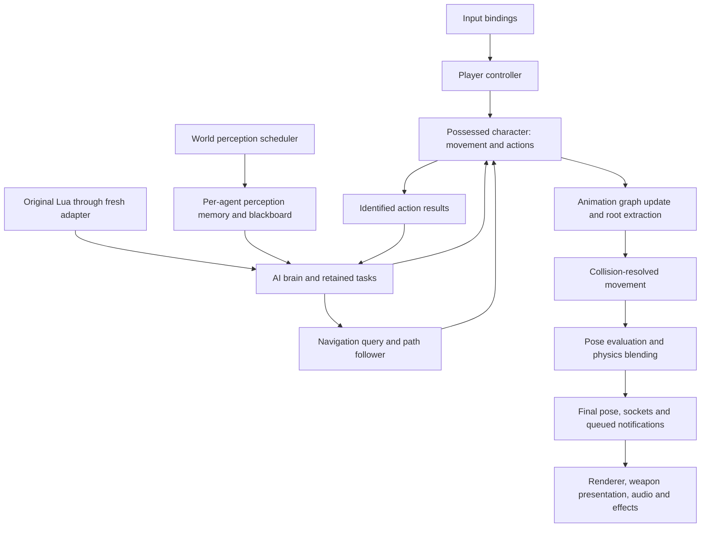

# Characters, animation and AI

Design seed; nothing described here is implemented. This document proposes a new runtime guided by the Unreal source references below. It does not reproduce the previous Bullet Witch engine design.

All prior Bullet Witch implementation code, helpers, services, wrappers, build targets and test oracles are excluded. Original game assets and scripts are inputs to newly written importers and runtime consumers. There is no fallback to the previous implementation.

## Connected ownership

The diagram expresses dependencies, not one serial loop for every actor. World scheduling owns prerequisites and completion fences. Player and AI controllers share physical character mechanisms. Neither writes bones or renderer state. A civilian uses the same character mechanisms with different capabilities and behavior data.

## What Unreal actually supplies

References are pinned to Epic commit `f45729c0b6f097038e72b52d366a62baeca3275b`; links require Epic repository access.

| Verified mechanism | Source anchor |
| --- | --- |
| Possession establishes controller/pawn relationships; movement tick depends on controller tick. Player input is routed through an ordered input stack. | [Controller: Possess / AddPawnTickDependency][controller]; [PlayerController: ProcessPlayerInput][player] |
| Perception queues and ages stimuli. Sight queries are ordered and limited by trace counts and elapsed budget. | [Perception system: Tick][perception]; [Sight: Update][sight] |
| Behavior definitions are cached templates; agents have separate node memory. Blackboard changes notify observers. Active tasks support execution, latent completion and abort. Ticking follows the next required deadline and can disable entirely. | [BehaviorTreeManager: LoadTree][templates]; [BehaviorTreeComponent: TickComponent / AbortCurrentTask][brain] |
| Move tasks observe their target and cancel matching requests. Path following reports completion and submits movement input or requested velocity to movement components. | [BTTask_MoveTo][move-task]; [PathFollowingComponent: FollowPathSegment][path] |
| Character movement owns acceleration, physical modes, collision and root-motion application. | [CharacterMovementComponent: PerformMovement][movement] |
| Animation updates gather state, advance montages and evaluate through a proxy. Pose evaluation can run on workers; root-motion dependencies can require immediate update. Finalized bones precede queued socket-dependent notifications. | [AnimInstance: UpdateAnimation][animation]; [SkeletalMeshComponent: FinalizeBoneTransform][finalize] |

Unreal does not provide a complete Bullet Witch enemy, weapon or Lua interpreter by constructing an AI controller. Its mechanisms are the implementation references; our game policies and content mappings must be explicit.

## Proposed fresh contracts

**Actor and controller.** World owns actor lifetime and stable generation-bearing identity. A controller possesses one character. Control/view direction, physical body orientation and animation-facing inputs are distinct. Losing possession cancels requests and subscriptions before destruction. Neither culling nor a missed decision update destroys actor state.

**Perception and decisions.** Shared world services schedule sensing; each agent retains observations with source, position, timestamp and expiry. No query this frame means no new observation, not target disappearance. Shared immutable behavior definitions are prepared before activation. Each agent owns only its blackboard, execution memory and subscriptions. Changed facts and due services request reevaluation; inactive nodes do not repeatedly execute.

**Tasks and scripting.** Tasks have start, running, cancel-pending and terminal states. Results carry actor generation and request identity. Cancellation releases observers and action ownership. The fresh Lua adapter preserves original script meanings through documented bindings; it does not import old runtime bodies. A Lua scoring/state program is not automatically an Unreal behavior tree. Its mapping to conditions, selectors and retained tasks must be specified from the script inputs. Scripts cannot mutate physics, pose or rendering memory.

**Navigation and locomotion.** Navigation owns prepared navigation data and routes; path following owns progress and arrival. Character movement owns realized velocity and swept collision. Unreal's inspected `MoveTo` can find paths synchronously; our proposed runtime separates expensive preparation from activation and schedules path work explicitly. In-place locomotion follows realized movement, not an invented displacement from requested speed.

**Root motion.** When an action supplies root motion, animation advances and extracts the full local translation and rotation before movement. The movement owner consumes that transform once, transforms it with the current mesh/world basis immediately before physical use, resolves translation against collision and applies root rotation under its rotation policy. It must not redirect a scalar displacement magnitude toward a navigation goal. Subsequent pose evaluation must not advance time again.

**Animation.** Fresh skeleton/clip import, sampling, blending, additive references and retargeting use declared spaces and units. The proposed graph contains locomotion, action slots, additive aiming/recoil and skeletal controls; content determines masks and ordering. Unreal's [aim-offset implementation][aim] uses an authored mesh-space additive blendspace. It is not a universal gun-aim function. [Two-bone IK][ik] explicitly converts effector/pole spaces and solves the limb. The available original assets determine which supported technique is appropriate; no previous aim solver is retained.

**Pose and physics.** Workers evaluate prepared inputs without mutating the live world. Finalization publishes component/world transforms and sockets, then dispatches queued notifications once. Weapon attachments consume that finalized state. Ragdoll explicitly transfers pose authority to physics and blends resulting bodies back; character locomotion cannot continue driving the same body. See [Unreal skeletal physics lifecycle][ragdoll].

## Implementation order and review evidence

1. Fresh actor lifetime, possession and input; show possession changes without stale commands.
2. Fresh skeletal import and pose pipeline; verify bind pose, animated pose, sockets and coordinate spaces independently of AI.
3. Character movement and animation graph; demonstrate player and scripted movement, collision, turns and full-transform root-motion actions without sliding or double advancement.
4. Navigation and perception; show obstacle routes, blocked/aborted requests, moving goals and stable civilian lifetime.
5. Behavior templates, per-agent tasks and fresh Lua adapter; show reactive transitions and cancellation while movement continues independently.
6. Shared combat actions and physics handoff; see [runtime services](runtime-services.md).

Native acceptance includes sustained ordinary play with multiple actors, complete action transitions, visible aim/hand/muzzle alignment, interruption and death. Frame-time traces cover preparation, admission and steady state; there must be no runtime content compilation or hidden navigation cooking in an actor update. Builds and unit tests alone do not establish these outcomes.

[controller]: https://github.com/EpicGames/UnrealEngine/blob/f45729c0b6f097038e72b52d366a62baeca3275b/Engine/Source/Runtime/Engine/Private/Controller.cpp#L320
[player]: https://github.com/EpicGames/UnrealEngine/blob/f45729c0b6f097038e72b52d366a62baeca3275b/Engine/Source/Runtime/Engine/Private/PlayerController.cpp#L2742
[perception]: https://github.com/EpicGames/UnrealEngine/blob/f45729c0b6f097038e72b52d366a62baeca3275b/Engine/Source/Runtime/AIModule/Private/Perception/AIPerceptionSystem.cpp#L160
[sight]: https://github.com/EpicGames/UnrealEngine/blob/f45729c0b6f097038e72b52d366a62baeca3275b/Engine/Source/Runtime/AIModule/Private/Perception/AISense_Sight.cpp#L257
[templates]: https://github.com/EpicGames/UnrealEngine/blob/f45729c0b6f097038e72b52d366a62baeca3275b/Engine/Source/Runtime/AIModule/Private/BehaviorTree/BehaviorTreeManager.cpp#L263
[brain]: https://github.com/EpicGames/UnrealEngine/blob/f45729c0b6f097038e72b52d366a62baeca3275b/Engine/Source/Runtime/AIModule/Private/BehaviorTree/BehaviorTreeComponent.cpp#L1698
[move-task]: https://github.com/EpicGames/UnrealEngine/blob/f45729c0b6f097038e72b52d366a62baeca3275b/Engine/Source/Runtime/AIModule/Private/BehaviorTree/Tasks/BTTask_MoveTo.cpp
[path]: https://github.com/EpicGames/UnrealEngine/blob/f45729c0b6f097038e72b52d366a62baeca3275b/Engine/Source/Runtime/AIModule/Private/Navigation/PathFollowingComponent.cpp#L1116
[movement]: https://github.com/EpicGames/UnrealEngine/blob/f45729c0b6f097038e72b52d366a62baeca3275b/Engine/Source/Runtime/Engine/Private/Components/CharacterMovementComponent.cpp#L2772
[animation]: https://github.com/EpicGames/UnrealEngine/blob/f45729c0b6f097038e72b52d366a62baeca3275b/Engine/Source/Runtime/Engine/Private/Animation/AnimInstance.cpp#L669
[finalize]: https://github.com/EpicGames/UnrealEngine/blob/f45729c0b6f097038e72b52d366a62baeca3275b/Engine/Source/Runtime/Engine/Private/Components/SkeletalMeshComponent.cpp#L5167
[aim]: https://github.com/EpicGames/UnrealEngine/blob/f45729c0b6f097038e72b52d366a62baeca3275b/Engine/Source/Runtime/AnimGraphRuntime/Private/AnimNodes/AnimNode_AimOffsetLookAt.cpp
[ik]: https://github.com/EpicGames/UnrealEngine/blob/f45729c0b6f097038e72b52d366a62baeca3275b/Engine/Source/Runtime/AnimGraphRuntime/Private/BoneControllers/AnimNode_TwoBoneIK.cpp#L75
[ragdoll]: https://github.com/EpicGames/UnrealEngine/blob/f45729c0b6f097038e72b52d366a62baeca3275b/Engine/Source/Runtime/Engine/Private/SkeletalMeshComponentPhysics.cpp#L3419
