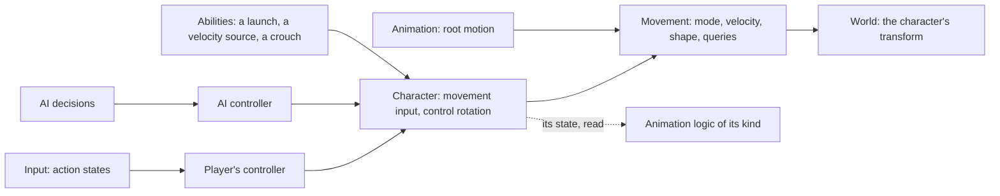
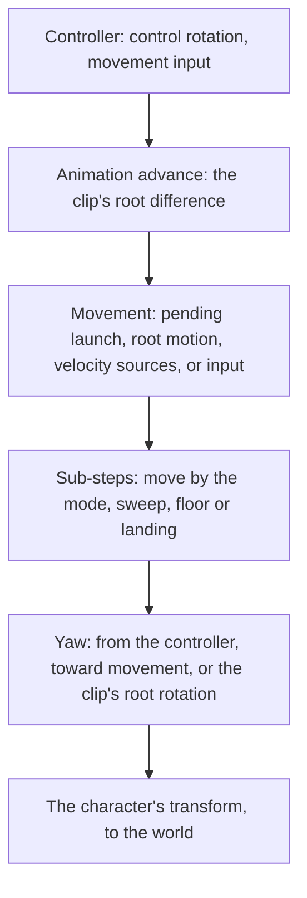

# Characters

Who controls a character and how it moves. A controller possesses a
character and gives it intent. The character's movement turns that
intent, its clips' root motion and gravity into a transform each tick. A
character knows nothing of animation: the animation logic of its kind
reads the character's state. What a character can do is not here: an
[ability](abilities.md) is a thing of its own that acts through a
character. The same mechanisms serve the player's character and every
other one: only the controller differs.

| Term | Means |
|---|---|
| Controller | what decides for a character: a player's, driven by actions, or an AI's |
| Possession | the tie between one controller and one character |
| Control rotation | the direction a controller looks and aims, kept on the controller |
| Movement input | a direction and a strength a controller gives its character for this tick |
| Movement mode | walking, falling, a custom mode, or none |
| Launch | a velocity given to a character once, which puts it in the air |
| Velocity source | a velocity set for a time, over or on top of the character's own |

## Position

Below the game's code, which says what its controller decides. Beside
[abilities](abilities.md), which act on a character through the same
doors a controller does, and the animation logic of its kind, which
reads its state. Above [physics](physics.md), which answers the
collision queries movement makes. Inside the
[world](world.md)'s tick, which orders the controller, movement and the
skeleton.

## Invariants

1. A controller possesses at most one character and a character has at
   most one controller. Possessing a character takes it from its former
   controller, sets the controller's rotation to the character's facing,
   and restarts the character: its movement stops and its pending input
   is dropped. Unpossessing drops its pending input.
2. A controller holds the control rotation. A character holds what it
   was told to do this tick. A player's controller turns action states
   into control rotation and movement input, and passes the actions
   bound to abilities on to them. An AI controller gives the same from
   its own decisions, and nothing in the character can tell which it
   has.
3. Movement input accumulates on the character within a tick and is
   consumed once, by movement.
4. A character is in one movement mode. Walking keeps it on a floor it
   finds by a downward sweep each step, within a walkable angle and a
   step height. When no walkable floor is found it is falling. Entering
   and leaving a mode are events, and landing is one of them.
5. The tick's velocity comes from one of these, in this order. A pending
   launch replaces or adds to the velocity, per its horizontal and
   vertical flags, and puts the character in the air. A clip's root
   motion replaces the velocity, except that in the air the vertical
   part stays gravity's. A velocity source that overrides replaces it,
   the one of highest priority alone; sources that add are summed on top.
   With none of these, movement input accelerates the character up to a
   speed scaled by the input's strength, and friction and braking slow
   it.
6. A clip's root translation is a vector in the mesh's own axes, carried
   to the world by the mesh's transform. The character's facing never
   comes from the translation. A clip's root rotation is applied to the
   character after it has moved.
7. On the ground only the horizontal part of the velocity moves the
   character, and the floor gives its height. A velocity that would lift
   it by more than gravity takes back in the step puts it in the air.
8. A velocity source has a duration, a priority, whether it overrides or
   adds, whether its direction is the world's or the character's, and
   what it leaves behind when it ends: the last velocity, a clamped one
   or a set one.
9. A character's yaw is set in one of three ways: taken from the control
   rotation as it is, turned toward its movement at a rate, or turned
   toward the control rotation at a rate. While root motion drives it,
   turning at a rate is off unless the character allows it.
10. Crouching shortens the shape and lowers the top speed. Standing up
    needs room, tested by an overlap of the standing shape, and is
    refused without it.
11. In the air gravity adds to the vertical velocity each step, movement
    input steers by an air control fraction, and the velocity is capped
    at a terminal speed. The landing test ends it.
12. Movement runs in sub-steps no longer than a maximum, up to a maximum
    count.
13. Movement asks four things of collision: a sweep of the character's
    shape along a move, returning where and against what normal it
    stopped. A downward sweep and a line trace for the floor. An overlap
    with a shape. A push out of what it penetrates. Two characters that
    overlap are pushed apart.
14. A character names no clip, layer or blend time and calls nothing in
    animation. Its state is there to be read: velocity, facing, movement
    mode, crouched. The animation logic of its kind reads it each update.
15. An ability is not part of a character. It reaches one only through
    what this document states: a launch, a velocity source, a crouch,
    movement input.

## A character's tick

| Mode | Velocity | Ends when |
|---|---|---|
| Walking | horizontal, along the floor | no walkable floor is found, a launch, or a lift past gravity's step |
| Falling | horizontal kept or steered, vertical by gravity | the landing test finds a floor |
| Custom | the character's own rule | the character says |
| None | no movement | the mode is set |

## Components and ownership

| Component | Lives in | Consumed by |
|---|---|---|
| Controllers and possession | `src/engine/characters` | game code |
| Movement: modes, velocity sources, launch, crouch, yaw | `src/engine/characters` | the world, abilities |
| Collision queries | `src/engine/physics` | movement, the camera |
| A kind of character's values and controller | `src/game/characters` | the engine's mechanisms |

## Boundaries

Above: the game's code, which sets a kind of character's values and
writes its controllers. Below: [physics](physics.md), which answers
queries. Beside:
[abilities](abilities.md), which are granted to an owner and act through
a character. The animation logic of its kind, which reads its state.
[Animation](animation.md), from which movement takes root motion.
[Input](input.md), whose action states a player's controller reads. The
[world](world.md), which orders the tick and owns the transform movement
produces. What an AI decides and what a character can do are outside
this document.
