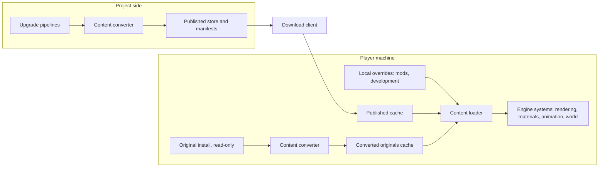
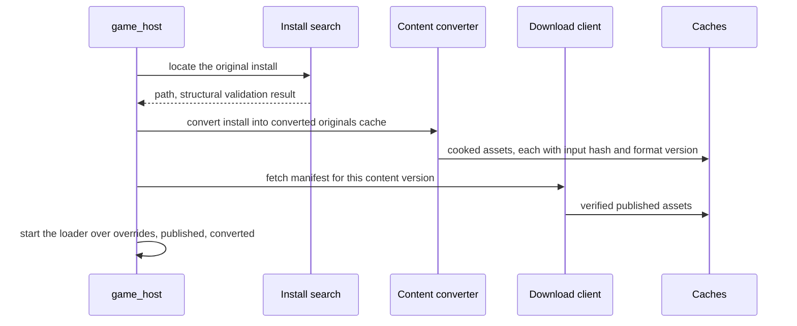
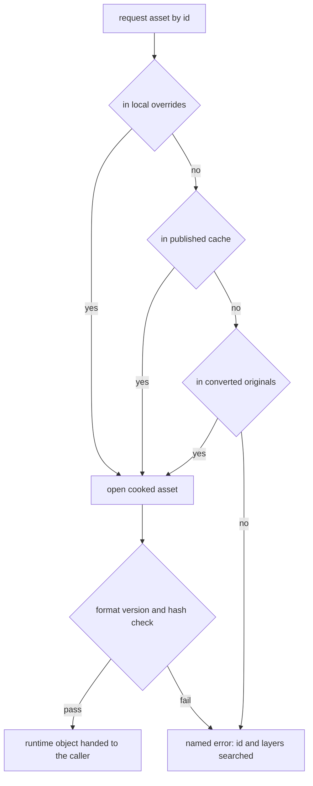
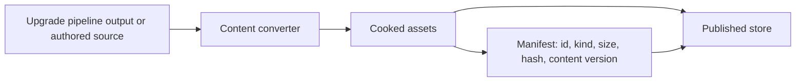

# Content

How assets reach the game. The game reads one format, ours. A converter
tool writes that format from two inputs: the player's own original install,
converted once on their machine, and the assets we author or upgrade,
published from our side. At run time the loader resolves each asset by id
across layers in a fixed order and hands engine systems runtime objects that
carry no trace of where they came from.

## Position

## Invariants

1. The runtime reads the cooked content format and nothing else. Readers of
   the original game's formats exist in the converter tool alone; no runtime
   module links them.
2. Every asset has a logical id derived from the original's path and split
   below container level: a texture inside a model container is its own
   asset. A replacement is a cooked asset with the same id in an earlier
   layer; assets with no original counterpart take `remaster.` ids.
3. Layers resolve per id in one order: local overrides, then the published
   cache, then converted originals. The first layer that holds the id
   answers. Nothing above the loader can tell which layer answered.
4. Original content is never redistributed. Converted originals are produced
   on the player's machine from the player's install into a cache local to
   that machine. The published store carries only assets we authored or
   upgraded.
5. The original install is located once by search, validated by structure,
   recorded by path, and opened read-only. No release version is pinned: any
   install that holds the content the converter needs passes.
6. The game requires a converted-originals cache that records the install it
   was built from. Without one it fails by name and points at the converter.
7. The converter is deterministic: the same input bytes and the same format
   version produce the same output bytes. Every cooked asset carries its
   input hash and format version; conversion reruns per asset when either
   changes, never wholesale.
8. Published assets are verified. A manifest per content version lists each
   asset's id, kind, size and hash. The client fetches the manifest for its
   own content version, downloads what is missing or changed, verifies by
   hash, and admits nothing to the published cache without a manifest row.
9. Play needs no network. The loader runs on whatever the caches hold; the
   download client is a separate step that can be skipped, resumed or
   repeated.
10. A missing asset is a named error carrying the id and the layers searched.
    What a system shows in its place is that system's visible choice, never
    the loader's silent substitute.
11. The cooked format carries a version. A mismatch between a cached asset
    and the loader fails by name; the converter and the download client are
    the only writers of the caches.

## First run

The converter and the download client are separate steps with separate
progress. Either can run again later: the converter after an install
changes, the client after a new content version is published.

## Loading an asset

## Layers

| Layer | Written by | Lives in | Holds |
|---|---|---|---|
| Local overrides | the player, a mod, a developer | a directory the settings name | cooked assets, any id |
| Published cache | the download client | local app data | assets we authored or upgraded, verified against a manifest |
| Converted originals | the converter | local app data | the player's install in cooked form, with the install path and hash summary recorded |

## Asset kinds

| Kind | Cooked form | Consumer |
|---|---|---|
| Mesh | vertex streams in the vertex-pulling layout, 16-bit index buffer, draw list with base vertex and material ids, bounds, the skeleton id it binds to | rendering, animation |
| Texture | block-compressed or raw texel data with mip chain, format, color space | rendering |
| Material | template name, static switch values, parameter values, texture ids | materials |
| Shader artifact | the shader system's artifact, built by `shader_compiler` | shader system |
| Skeleton and animation | bone hierarchy, bone maps per draw, animation tracks | animation |
| Script, audio, text, level data | defined by their slices in the same cooked-asset frame | their systems |

Every kind shares the asset header: id, kind, format version, input hash,
payload size. Readers of the payload are per kind and live with the
consuming system's loader.

## Identity

| Original | Asset ids |
|---|---|
| the mesh record of `graphics/chara/PW0/model/mesh.cpr` | `model.pw0.mesh`, `model.pw0.mesh.material.<n>`, `model.pw0.mesh.skeleton`, `model.pw0.mesh.shapes.<n>` |
| a texture record in `graphics/chara/PW0/texture/texture.cpr` | `model.pw0.texture.dds.<name>` |
| a texture shared between models | `shared_texture.<group>.dds.<name>` |
| a record with no name of its own | the container path from the data root, lower-cased, dots for slashes, plus the record's short name |
| an asset we author with no original | `remaster.<path>` |

Ids are the names the original content already carries for its records,
lower-cased: dotted, unique across the install, and indexed by its own
catalog files. Assets the converter splits out of one record take that
record's id plus a suffix. The converter assigns them; the manifest and the
overrides use the same ones.

## Material mapping

What the converter maps from the original game's material data onto the
[material system](materials.md). The original data decides the values; the
mapping is ours, and the material system knows none of it.

| Original material data | Maps to |
|---|---|
| Base texture, second base texture with its blend, third base texture with a mask | base color inputs and a layer switch |
| Normal texture | normal input, a static switch |
| Texture in the ambient-occlusion slot | the lit template's packed occlusion and reflectance texture and its static switch |
| Specular exponent and coefficient, reflectivity, Fresnel constants | roughness and the reflectance curve of the lit template |
| Reflection tint and base-brightness weights | the lit template's specular tint and its base-luminance weight on reflectance |
| Alpha Fresnel constants | the lit template's opacity curve |
| Environment reflection controls, subsurface marker and its level | recorded by name with their values; no parameter is derived from them |
| Environment and illuminance texture slots | recorded by name with the texture id |
| Constant color, illuminance, ambient | base color tint, emissive, and an ambient term that belongs to the renderer |
| Blend marker and the base texture's alpha | blend mode: a marked material is translucent or additive by the marker's tag; an unmarked one whose base alpha is binary is masked; every other is opaque |
| Light list, spherical harmonics, lightmaps, shadow and fog constants | nothing in the material; lighting data for the scene renderer |
| Effect and post-process materials | renderer passes with their own parameter blocks, not materials |

The 14 feature axes of the original collapse onto a handful of switches
because several axes only add lighting inputs. The converter records every
original field it leaves unmapped, by name, in a file of its own beside the
converted material; the cooked material carries none of them and the game
never opens that file. The mapping carries a revision that enters each
material's input hash, so a change to it reconverts materials and nothing
else.

## Substitution

A replacement is a cooked asset with the same id in an earlier layer. It may
reference assets that have no original counterpart under `remaster.` ids,
which exist only in the layer that ships them. Nothing is edited in place
and nothing is re-converted.

| Case | Authored source | Cooked asset the converter writes | What else changes |
|---|---|---|---|
| One texture, a 4K repaint of `graphics/chara/PW0/texture/pw0_body_d` | PNG or EXR | a texture with that same id | nothing: the mesh and material keep referencing the id |
| One material, a new look on the same mesh | material text: template, switches, parameters, texture ids | a material with the same id | may reference new `remaster.` textures published with it |
| A character model, re-authored on the original rig | glTF with the original skeleton's bone names | a mesh with the original mesh id, its skeleton id unchanged, its new textures and materials under `remaster.chara.pw0...` | the original animations still bind |
| A character model with its own rig | glTF with skeleton and animations | mesh, skeleton and animations under new ids, the mesh id the original one | the game's reference to the character resolves to the new rig as a set |

A pipeline that upgrades many assets states a rule instead of writing each
replacement: "every material whose base texture has normal, roughness and
metallic maps published becomes the lit template bound to those maps". The
converter knows every reference from the original material blocks and emits
the replacement materials, each under its original id, in the same content
version as the maps they reference.

The cooked mesh names the skeleton id it binds to; a mesh whose skeleton id
is absent from every layer fails to load by name. The converter accepts
authored sources, glTF, PNG and EXR, material text, beside the original
formats, and writes the same cooked assets from either.

A developer or a modder points the converter at a source directory and it
writes the cooked assets into the local overrides directory, which the
loader searches first. Iterating on a texture is: save, convert that
directory, relaunch.

## Publishing

A content version is published whole: a manifest and the assets it lists.
The game build names the content version it reads. Older versions stay in
the store until no supported build names them.

## Components and ownership

| Component | Lives in | Consumed by |
|---|---|---|
| Cooked format: asset header, per-kind payload layouts, format version | `src/engine/content/public/bw/content` | loader, converter, every consuming system |
| Asset id scheme | `src/engine/content/public/bw/content` | loader, converter, manifest |
| Loader: layers, resolution, header and hash checks, handles | `src/engine/content` | engine systems |
| Install search and structural validation | `src/engine/content` | `game_host`, converter |
| Download client and manifest | `src/engine/content` | `game_host` |
| Content converter: original-format readers, per-kind writers, manifest writer | `tools/content_converter` | the player's first run, the project side |
| Upgrade pipelines | outside this repository | the converter, as input |

## Boundaries

Above: every engine system that owns an asset kind reads its payload through
a handle the loader gives it, and never a path. Below: the file system and
the network, behind the caches and the download client. Beside: the
converter, the only code that reads original formats, which shares the
format and id code with the runtime and nothing else. The original install
is never written, never copied whole, and never leaves the player's machine.
