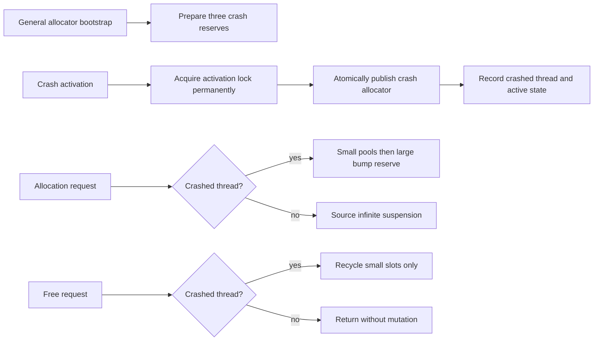

# Crash allocation

The selected allocator bootstrap creates a process-lifetime `CrashAllocator`
before ordinary allocations proceed. It follows Unreal commit
`f45729c0b6f097038e72b52d366a62baeca3275b`,
`Core/Private/GenericPlatform/GenericPlatformMallocCrash.cpp` and the matching
public header. This is the pooled variant selected on Mac, not the alternate
stack allocator or the accepted VM failure path's zero-byte backup reserve.

## Storage and ownership

Bootstrap maps three separate regions with the selected Apple
`BinnedAllocFromOS` path (`ApplePlatformMemory.cpp:639–647`): 2 MiB for large
requests, the native-page-rounded sum of small slot storage, and the rounded sum
of slot bookkeeping. This path uses the source Binned OS mapping tag and flags;
it is not substituted with the virtual-reservation API. Mapping failure and bad
alignment use the accepted critical-exit route. The reserve remains for process
lifetime; the source destructor destroys pool descriptors but does not unmap it.

Fourteen size/count pairs match the Mac table (`GenericPlatformMallocCrash.cpp:
74–90`): 64/224, 96/144, 128/80, 192/560, 256/384, 384/208, 512/48, 768/32,
1024/32, 2048/32, 4096/32, 8192/32, 16384/16, 32768/16. Linux's count multiplier
is not selected. Fixed descriptors belong to the one singleton; representing
its descriptor storage as a fixed member array removes no source lifetime or
allocation behavior. Bookkeeping holds requested size and slot pointer.

The first non-exhausted fitting pool is selected. Allocation scans that pool for
size zero, stores the requested size, updates usage counters, and fills those
bytes with `0xfe`. Free fills the requested bytes with `0xcd`, clears their size
and decrements used count. Pointer-to-pool lookup is upper-bound binary search
on sorted storage bases. Pool exhaustion promotes to larger pools and then the
large reserve. Large allocations align the bump cursor to 16 and prepend a
size/pointer record. Their frees deliberately do not reclaim reserve space,
matching the source. No normal-heap fallback is permitted.

## Activation and thread policy

Activation retains its recursive lock, swaps the facade pointer, then records
owner thread and active state (`cpp:311–326`). The source default is
`SuspendAllocationsAndSkipFrees`: other threads suspend on allocate/reallocate
but skip free so TLS teardown can continue. There is no editable console mode
in this extraction. Thread ID and active observation use C++ atomics.

Reallocate allocates/copies/frees. The previous allocator's supported source
family includes Binned3; this selected build expresses that capability with a
`BinnedAllocator*`, rather than allowing an arbitrary allocator with an invented
name. Previous allocations remain in their original heap after copying. Invalid
size queries are fatal. Crash size queries report recorded requested bytes;
unknown pointers report zero. Alignment above 16 is unsupported. The current
headless critical-failure route replaces debugger-specific break/report UI,
without adding recovery or silently satisfying unsupported requests.

`quantize` returns the request unchanged and cache/trim methods do nothing,
exactly the inherited `FMalloc` defaults (`MemoryBase.h:145–196`). This is not a
substitute for the general allocator's required real global trim.

## Preparation and verification

Architecture precedes `crash_allocator.hpp`, comments-only implementation, then
native behavior tests. Both C++ corpora were queried; full Core R.1 and
Performance MEM.2 were read. Process-lifetime reserve ownership and permanent
activation-lock ownership are explicit source exceptions to ordinary scope
cleanup. MEM.2 motivates reserved storage, but its example free-list and null
exhaustion policy do not replace the reference scan/promotion/fatal algorithm.

Tests cover exact requested sizes and fill, slot reuse/promotion, large
non-reclaim, realloc from both heaps, facade activation, non-owner free skipping,
and bounded subprocess checks for non-owner suspension and fatal exhaustion.
Implementation is present and the native `crash_allocator_tests` target passes
with the real Binned allocator and facade. The test was first compiled against
the comments-only unit; expected missing-definition link evidence remains at
ignored `research/evidence/crash-allocator-link-red.txt`.

The ordinary child passed the storage, promotion, realloc, activation and
non-owner-free checks. An oversize reserve request exited with the accepted
critical code 3. Another child wrote a readiness marker immediately before its
non-owner allocation and remained suspended until the parent terminated it;
this distinguishes the intended wait from stalled bootstrap. Build uses fatal
clang-tidy; formatting and whitespace checks pass. No game was launched.

Implementation-stage queries read full Core R.15 and Performance MEM.5 in
addition to the design-stage rules. The source class table is authoritative;
MEM.5's generalized power-of-two description is not applied to these classes.
Native diagnostics use the accepted headless failure route. Optional LLM,
MemoryTrace and debug pool-usage printouts are not implemented; allocation
counters and source debug metadata checks are retained.
