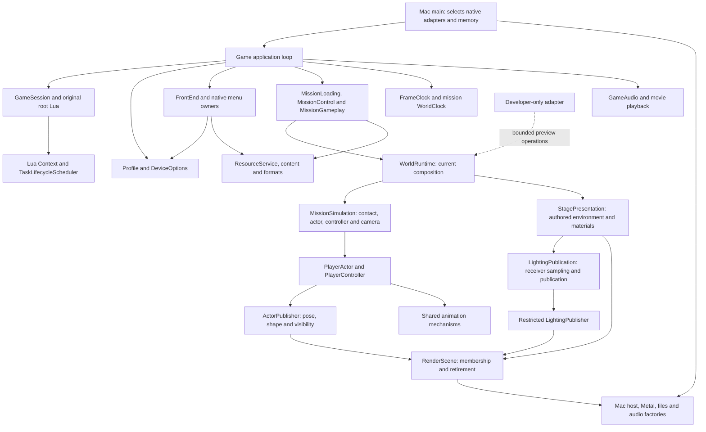
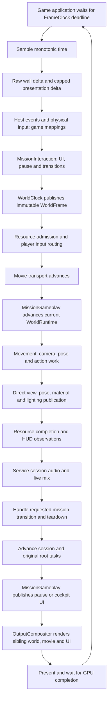
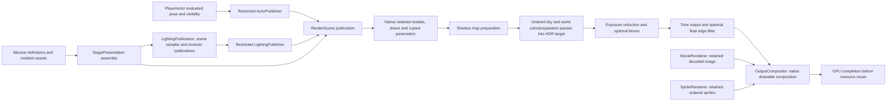
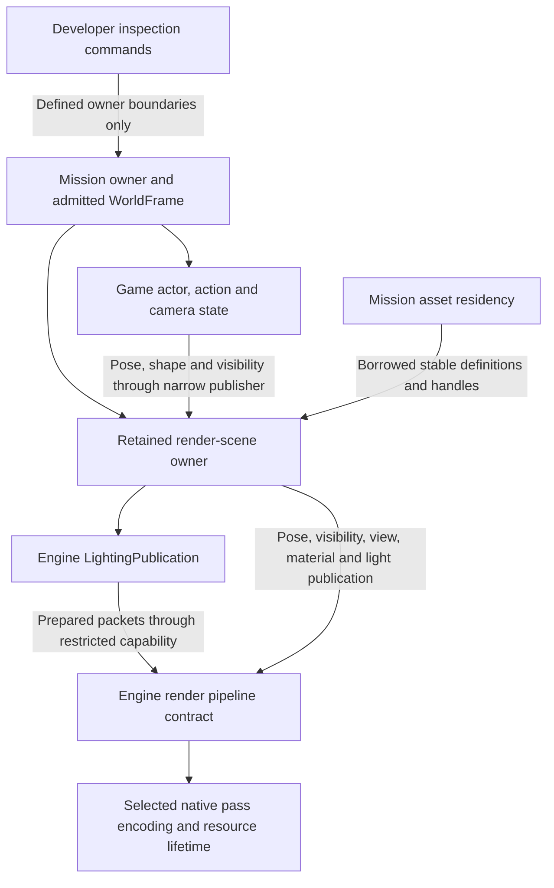

# Current systems and ownership review

> **Revised slice 3 implemented and accepted October 26, 2026.** The earlier
> mechanical grouping was rejected. The explicit engine/game/platform/developer
> layout and ownership repairs replace that proposal. Both configuration gates
> and purchased-data checks pass; the user authorized the scoped commit.

**October 26, 2026 · revised ownership and physical layout implemented.**
The accepted baseline is mission/presentation `fd773fb` and lighting/output
`a5577bb`. The initial mechanical grouping was rejected; the approved
[whole-repository redesign](../../research/engine/subsystems/architecture-layout-proposal.md)
now replaces it. The diagrams and paths below describe the integrated working
implementation. Both build configurations and purchased-content checks pass;
the user accepted this revision. Earlier grouping checks are historical.

[Approved boundaries](proposed-boundaries.md) and the
[reorganization plan](reorganization-plan.md) define scope. The broader
[target architecture](logical-overview.md) includes future capabilities that are
not made real by naming a directory. No complete entity registry or generic
EngineInstance aggregate is claimed.

## Current system context

Arrows are current source dependencies/composition, not threads or inheritance.
There is no implemented aggregate `EngineInstance`, entity registry or complete
mission `World` corresponding to the earlier target diagrams.

Portable engine contracts remain under `include/bw/`; implementations now live
under `src/engine/`. Concrete Bullet Witch behavior lives under `src/game/`.
`platform/macos/main.cpp` selects native services and invokes game application
composition. Native acquisition publishes physical observations, never gameplay
or menu actions. Developer implementations are build-selected outside game code.

| Responsibility | Concrete current files / build targets | Status and boundary |
| --- | --- | --- |
| Process/application | [Mac entry](../../src/platform/macos/main.cpp), [application](../../src/game/application/application.cpp); `bullet-witch`, `bw_game_application` | Game `run_application` composition with `ApplicationOptions` and `ApplicationMemory`; one loop selects setup and teardown. |
| Session/root | [GameSession](../../src/game/session/session_services.hpp), [RootDriver](../../src/game/session/root_driver.hpp); `bw_game` | Implemented root-task and mission handoff. Not a complete world/entity lifecycle. |
| Mission authority | [MissionGameplay](../../src/game/mission/mission_gameplay.hpp), [MissionControl](../../src/game/mission/mission_control.hpp), [MissionLoading](../../src/game/mission/loading/mission_loading.hpp) | Implemented admission, pause/reentry, assets and current Alicia scene. Authored mission/entity startup and complete checkpoint restoration remain partial. |
| Rendering | [portable contracts](../../include/bw/render/scene/world.hpp), [native renderer](../../src/platform/macos/render/world_renderer.hpp), [postprocess](../../src/platform/macos/render/world_postprocess.hpp); `bw_render`, `bw_world_renderer_macos` | Working admitted geometry/shadow/HDR pipeline. RenderScene controls current registration/replacement/removal/retirement; the native backend retains the sole draw registry. General gameplay entities remain future. |
| Lighting | [LightingPublication](../../include/bw/lighting/lighting_publication.hpp), [SceneLighting](../../include/bw/lighting/scene_lighting.hpp), [Environment](../../include/bw/spatial/environment.hpp); `bw_lighting` | Engine sampler and sealed receiver publication own light packets/caches/draw distribution. Game source-channel interpretation remains outside it. |
| Animation/game actors | [animation](../../include/bw/animation/), [PlayerActor](../../src/game/actors/alicia/player_actor.hpp), [Alicia policy](../../src/game/actors/alicia/actions/alicia_action_policy.hpp); `bw_animation`, `bw_game` | Shared pose/playback/event mechanisms; current game integration centers on Alicia. Not a complete generic actor or NPC runtime. |
| UI/settings/persistence | [FrontEnd](../../src/game/ui/frontend/frontend.hpp), [Options](../../src/game/ui/options/options.hpp), [Profile](../../src/game/profile/profile.hpp), [HUD](../../src/game/ui/hud/gameplay_hud.hpp) | Accepted frontend and gameplay pause/HUD. Original screen behavior remains game policy; shared sprite submission is an engine render contract. |
| Audio/media | [GameAudio](../../src/game/session/audio/game_audio.hpp), [audio contract](../../include/bw/audio/output.hpp), [video player](../../include/bw/video/player.hpp); `bw_audio_fact`, `bw_video`, decoder targets | One session game-audio runtime with menu/music and later mission bank admission; movie transport has its own PCM/timestamp synchronization. |

Memory, resource, math, input, physics, AI, effects and jobs status is maintained
in the linked inventory rather than duplicated as a second universal checklist.

## Current frame and time flow

Solid arrows show order/data for the implemented serial update. No asynchronous
render thread or fixed-step world accumulator is implied.

The diagram summarizes ordinary order. UI/resource admission can branch before
simulation; restart/retirement handling after audio can skip the normal later
session/presentation path. Loading has its own presentation pump. These branch
orders must survive reorganization. See [world timing](world-timing.md) for exact admission rules.

- The game application selects a 16,666,667 ns presentation period and calls
  `sleep_until`; [FrameClock](../../src/engine/timing/frame_clock.cpp) calculates deadlines
  and samples afterward. Its presentation delta caps at 100 ms; wall delta does
  not. A missed deadline rebases rather than inventing catch-up ticks. A 60 Hz
  presentation target is not a fixed 60 Hz physics simulation.
- [WorldClock](../../src/engine/timing/world_clock.cpp) applies scale and publishes one
  owner-tagged frame; admitted simulation alone advances world total. Game
  `MissionControl` owns pause/input policy. Animation and material cursors consume
  that frame, not independent wall clocks. Actor-local movement subdivisions
  remain local and must not become another authoritative world clock.
- Loading pumps presentation/input/audio without world admission. Explicit
  rebasing excludes the resource transaction from subsequent simulation elapsed.
- UI and exposure adaptation use presentation time. Movie sample selection uses
  media timestamps/audio consumption; neither movie nor audio clocks lead world
  simulation. Pause gates mission cue policy while session/UI audio remains serviced.
- Native drawing currently waits for each Metal command buffer to complete.
  Overlapped frames, render threads and worker scheduling are future performance
  decisions, not prerequisites for making these ownership boundaries explicit.

## Lighting and the render pipeline

Lighting is a subsystem, not merely scattered shader utilities. Its public
contract owns prepared fields, emitters, receiver evaluation and copied lighting
packets. The [lighting drill-in](lighting.md) retains source numerical behavior.
Game-owned [stage environment](../../src/game/world/presentation/stage_environment.hpp) translates
original channel identities and published bounds/transforms. Controllers must
not select probes, rank lights or compensate brightness. Rendering consumes
lighting; the backend owns GPU representations and shaders.

**Current implemented render data flow:**

[WorldRenderer::prepare_presentation](../../src/platform/macos/render/world_renderer.mm)
encodes shadow then scene work; [WorldPostprocess](../../src/platform/macos/render/world_postprocess.mm)
handles exposure/bloom/tone/filter resources. Shared `bw_render` calculates
material, view, shadow and output semantics. Actual pass encoding and retained
draw storage remain native. `MovieRenderer` and `SpriteRenderer` own their
separate resources; [OutputCompositor](../../include/bw/render/output/output_compositor.hpp)
accepts a fixed immutable frame request and orders the three siblings before
waiting for native completion. The window host forwards producer operations and
retains neutral input/audio/clock observations. There is no generic frame graph. See
[output composition](../../research/engine/subsystems/output-composition.md).

Actor animation state and rendering have separate owners. `MissionSimulation`
owns actor/controller/camera/contact state; `StagePresentation` borrows const
actor observations and copied camera values. Actors receive `ActorPublisher`
for pose, shape and visibility only. `RenderScene` controls registration,
replacement/removal and retirement while the native backend retains the sole
draw registry. Existing preview state belongs to a build-selected developer adapter; production
world hooks do not own or link its implementation. A centralized
full-world copy is not required. See the
[slice 1 record](../../research/engine/subsystems/mission-presentation-ownership.md)
for validation and acceptance status.

**Implemented owner integration (slice 2 accepted):**

“Completed observations” does not prescribe a full-world copy, ECS, double buffer
or worker thread. Preserve stable asset borrowing and current synchronous
completion first. Define permitted publication phases and the registration/removal/retirement owner
before choosing storage. Native pass implementations remain native; shared
headers describe semantics without importing Metal or a lowest-common API.

## Current lifetime and authority

These are actual responsibilities, not new aggregate class declarations:

| Lifetime | Owns / mutates | Borrows / must release first |
| --- | --- | --- |
| Process and application composition | Target backends, memory capabilities, resources, session audio and frame clock | Original installation stays read-only; adapters survive their consumers. |
| Session | Root Lua/task state; Profile and device settings are separate stable authorities supplied by composition | Frontend uses narrow save/settings controls; renderer never mutates progression. |
| Mission | Asset/model residency, mission control, world clock and current gameplay instances | Scene/actor/menu borrowers retire before mission assets and native handles. Reentry tears down and reconstructs supported mission state. |
| Mission simulation | Static contact, actor/controller/camera, actions and appearance transactions | Borrows admitted clock/resource capabilities; survives presentation retirement. |
| Stage presentation | RenderScene lifetime, authored environment/material adapters and receiver registration | Borrows const actor and resident assets; copied camera observations; retires submitted work before asset retirement. |
| Actor | Motion/action playback, logical pose and attachments | Borrows resident resources; publishes completed values through restricted ActorPublisher. Scene membership and retirement stay with RenderScene. |
| Scene lighting publication | Prepared fields/emitters, receiver packet distribution and strict-placement caches | Borrowed RenderScene lighting capability; receiver publications die before sampler and reflection resources. |
| Native output | World, movie and sprite owners retain separate GPU resources; compositor owns current command submission | Compositor dies before borrowed producers. Every successful submission completes before resource reuse; unavailable drawable retains producer state for retry. |

Settings save capabilities distinguish System from Record; Costume does not save
pending parent Options edits. Development overrides must remain temporary and
must not rewrite progression. Neither folder moves nor a new “world” name may
widen these accepted authority boundaries.

## AI, effects and future content

[AI research](../../research/engine/subsystems/ai-runtime.md) maps original tree
structure, Lua evaluation and native actions; it is not a live NPC runtime.
`npc_palette` prepares material variations only. Concrete AI traversal/actions stay game-side until a proven shared contract
warrants engine extraction; enemy/boss decisions and authored parameters belong
to Bullet Witch. Actor animation mechanisms may be reused without
making NPCs inherit Alicia's controller or declaring an unproven universal actor API.

Static/character collision is implemented. Dynamic bodies, destruction and full
physics-provider integration remain planned. Particle/effect formats and original
lifecycle are researched; there is no complete live effects system. A task
lifecycle scheduler is implemented, but no general job pool. These systems must
join the admitted mission/world phases when implemented, not independent clocks.

[Resource resolution and replacement packs](memory-and-residency.md) separates
current purchased installation/catalog/script loading from the future enhanced
asset/script layer. Optional packs must not substitute for validation of the
required original installation. Pack precedence, compatibility and script API
validation require an explicit design before runtime replacement is implemented.

## Grouped game source responsibilities

These are physical owners in the revised implementation, not new engine services.
The [exact file map](../../research/engine/subsystems/architecture-layout-file-map.json)
records the pre-reorganization paths and splits; the earlier grouping report is
historical rejected work.

| Group | Responsibility and representative owners |
| --- | --- |
| `src/game/application/` | Application composition, launch settings and one main loop |
| `src/game/session/` | GameSession, root driver, original RNG and game audio bank admission |
| `src/game/mission/`, `mission/loading/` | Mission admission/pause/reentry/effective state and retained content transactions |
| `src/game/world/` | WorldRuntime, MissionSimulation, static-contact assembly and explicit initial-placement shim |
| `src/game/world/presentation/` | StagePresentation, original environment/light/shadow adapters and RenderScene lifetime |
| `src/game/actors/animation/` | Common original motion/catalog/event adapter, with explicit actor-specific semantic policy |
| `src/game/actors/alicia/{actions,animation,audio}/` | Alicia action state, authored modifiers and voice/surface/action cue policy |
| `src/game/player/{input,camera}/` | Human input mapping/routing and camera policy |
| `src/game/content/original/` | Original loader/namespace/channel policy; contains code, never game asset data |
| `src/game/ui/{startup,frontend,loading,power_up,pause,hud,options,common,audio}/` | Actual screen roles, shared Options transactions and UI cue policy |
| `src/game/profile/`, `settings/` | Permanent profile/progression and device/binding settings |
| `src/developer/animation_review/` | Build-selected existing diagnostics; production hooks are inert |

Engine implementation families sit under `src/engine/`, with lighting/spatial/timing
separate and render scene/materials/shadows/postprocess explicit. `binary_reader.hpp`
is a portable bounded binary-schema primitive. macOS implementations are grouped
by window/input/audio/files/memory/render responsibility; shaders stay native.

`ControllerInput` holds the single UI repeat history and consumes both wall and
presentation deltas from the application. `WindowHost` and its native `InputSource`
return only neutral `InputFrame` observations. Loading advances the same mapper
without delivering actions; no duplicate clocks or repeat owners are introduced.
See [input ownership](../../research/engine/subsystems/neutral-input-boundary.md).

Current build owners include `bw_game_content`, `bw_profiles`, `bw_game`,
`bw_game_playback`, `bw_game_presentation`, `bw_game_application`, and selected
native backends. The host is `bw_window_host_macos`; `bullet-witch` is the game
executable; `bw_metal_shaders` produces `bullet_witch.metallib`. Build dependency
repair and owner-mirrored tests are part of this revision, not postponed slice 4.
Integrated checks pass; the user accepted this revision on October 26, 2026.

## Evidence used for this proposal

Original behavior remains primary. [World timing](../../research/engine/subsystems/world-timing-source.md),
[lighting producer contracts](../../research/engine/subsystems/lighting-scene-producer-contract.md),
[render-pass contracts](../../research/engine/subsystems/scene-lighting-pass-contract.md)
and [AI runtime](../../research/engine/subsystems/ai-runtime.md) constrain order,
state and asset semantics. The accepted source organization comparison is
[recorded separately](../../research/engine/subsystems/source-organization.md);
its Quake/Doom integrated game/engine direction remains applicable.

The existing authorized Unreal reference records pin commit
`f45729c0b6f097038e72b52d366a62baeca3275b`. They document inspected
`UEngine::UpdateTimeAndHandleMaxTickRate`, `UWorld::Tick` and player pause/input
ownership in [timing references](../../research/engine/subsystems/world-timing-reference.md),
and `FScene`, `FIndirectLightingCache`, `FPrimitiveSceneInfo` and
`FBasePassMeshProcessor` in [lighting references](../../research/engine/subsystems/lighting-reference-boundaries.md).
These support separation of mutation, completed observations, scene membership
and pass preparation. They do not require copying Unreal source, class names,
threading, Lumen or its directory layout. The input boundary additionally records inspected pinned native/player input
functions in its dedicated contract. No new engine framework is implied.
