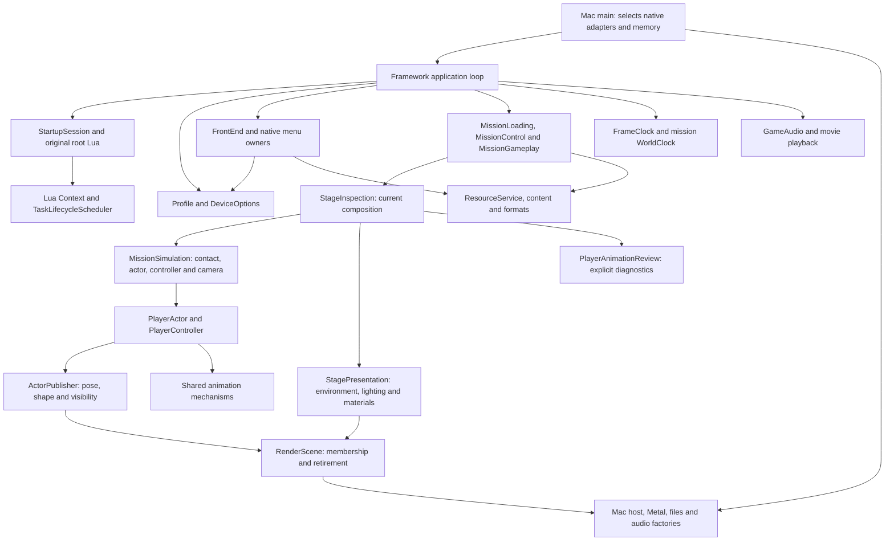
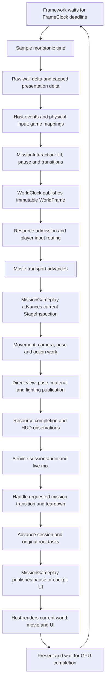
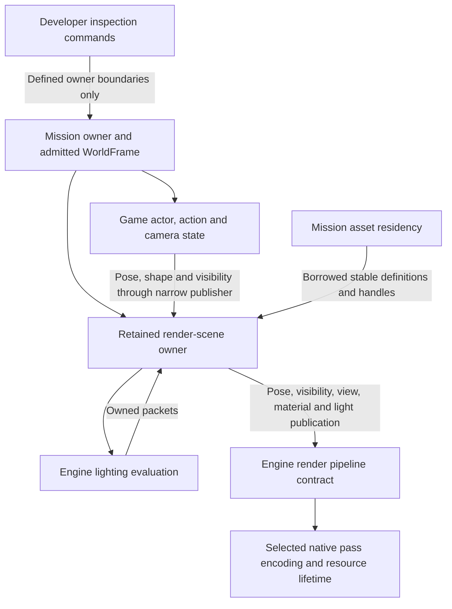

# Current systems and ownership review

**October 26, 2026 · current implementation plus proposed repairs for review.**
Baseline: accepted frontend commit `cac036f`, with slice 1 ownership changes now
implemented in the working tree and awaiting native acceptance. The accepted
plan is `79d7a72`; this map does not expand its execution scope. Begin here
before using the broader [target architecture](logical-overview.md). The
[source inventory](../../research/engine/subsystems/runtime-subsystem-inventory.md)
records implemented, partial and planned responsibilities with concrete owners.

See [complete proposed boundaries](proposed-boundaries.md) for the whole-system
design, lifetime ownership and proposed frame flow. The diagrams below first
establish current implementation; the later extraction diagram is only one repair.

## Current system context

Arrows are current source dependencies/composition, not threads or inheritance.
There is no implemented aggregate `EngineInstance`, entity registry or complete
mission `World` corresponding to the earlier target diagrams.

Current public engine contracts remain under `include/bw/`; implementations are
peer families under `src/`. Game-private headers stay with their implementation.
The current source scan found no engine implementation importing concrete game
classes; `platform/macos/main.cpp` deliberately imports framework composition.
Scene being outside game is therefore meaningful, not a misplaced game folder.

| Responsibility | Concrete current files / build targets | Status and boundary |
| --- | --- | --- |
| Process/application | [Mac entry](../../src/platform/macos/main.cpp), [application](../../src/framework/startup_application.cpp); `bw-startup`, `bw_startup_framework` | Implemented composition. The shared loop also explicitly selects game setup and teardown; its name is narrower than its current mission role. |
| Session/root | [StartupSession](../../src/game/startup_services.hpp), [RootDriver](../../src/game/root_driver.hpp); `bw_game` | Implemented root-task and mission handoff. Not a complete world/entity lifecycle. |
| Mission authority | [MissionGameplay](../../src/game/mission_gameplay.hpp), [MissionControl](../../src/game/mission_control.hpp), [MissionLoading](../../src/game/mission_loading.hpp) | Implemented admission, pause/reentry, assets and current Alicia scene. Authored mission/entity startup and complete checkpoint restoration remain partial. |
| Rendering | [portable contracts](../../include/bw/render/world.hpp), [native renderer](../../src/platform/macos/world_renderer.hpp), [postprocess](../../src/platform/macos/world_postprocess.hpp); `bw_render`, `bw_world_renderer_macos` | Working admitted geometry/shadow/HDR pipeline. Complete dynamic render-scene membership and an explicit extraction owner are missing. |
| Lighting | [SceneLighting](../../include/bw/scene/lighting/scene_lighting.hpp), [Environment](../../include/bw/scene/environment.hpp); `bw_scene` | Identifiable implemented engine subsystem. Game source-channel interpretation remains outside it. |
| Animation/game actors | [animation](../../include/bw/animation/), [PlayerActor](../../src/game/player_actor.hpp), [Alicia policy](../../src/game/alicia_action_policy.hpp); `bw_animation`, `bw_game` | Shared pose/playback/event mechanisms; current game integration centers on Alicia. Not a complete generic actor or NPC runtime. |
| UI/settings/persistence | [FrontEnd](../../src/game/frontend.hpp), [Options](../../src/game/pause_options.hpp), [Profile](../../src/game/profile.hpp), [HUD](../../src/game/gameplay_hud.hpp) | Accepted frontend and gameplay pause/HUD. Original screen behavior remains game policy; shared sprite submission is an engine render contract. |
| Audio/media | [GameAudio](../../src/game/game_audio.hpp), [audio contract](../../include/bw/audio/output.hpp), [video player](../../include/bw/video/player.hpp); `bw_audio_fact`, `bw_video`, decoder targets | One session game-audio runtime with menu/music and later mission bank admission; movie transport has its own PCM/timestamp synchronization. |

Memory, resource, math, input, physics, AI, effects and jobs status is maintained
in the linked inventory rather than duplicated as a second universal checklist.

## Current frame and time flow

Solid arrows show order/data for the implemented serial update. No asynchronous
render thread or fixed-step world accumulator is implied.

The diagram summarizes ordinary order. UI/resource admission can branch before
simulation; restart/retirement handling after audio can skip the normal later
session/presentation path. Loading has its own presentation pump. These branch
orders must survive reorganization. See [world timing](world-timing.md) for exact admission rules.

- The framework currently selects a 16,666,667 ns presentation period and calls
  `sleep_until`; [FrameClock](../../src/timing/frame_clock.cpp) calculates deadlines
  and samples afterward. Its presentation delta caps at 100 ms; wall delta does
  not. A missed deadline rebases rather than inventing catch-up ticks. A 60 Hz
  presentation target is not a fixed 60 Hz physics simulation.
- [WorldClock](../../src/world/world_clock.cpp) applies scale and publishes one
  owner-tagged frame; admitted simulation alone advances world total. Game
  `MissionControl` owns pause/input policy. Animation and material cursors consume
  that frame, not independent wall clocks. Actor-local movement subdivisions
  remain local and must not become another authoritative world clock.
- Loading pumps presentation/input/audio without world admission. Explicit
  rebasing excludes the resource transaction from subsequent simulation elapsed.
- UI and exposure adaptation use presentation time. Movie sample selection uses
  media timestamps/audio consumption; neither movie nor audio clocks lead world
  simulation. Pause gates mission cue policy while session/UI audio remains serviced.
- Native drawing currently waits for each Metal command buffer to complete.
  Overlapped frames, render threads and worker scheduling are future performance
  decisions, not prerequisites for making these ownership boundaries explicit.

## Lighting and the render pipeline

Lighting is a subsystem, not merely scattered shader utilities. Its public
contract owns prepared fields, emitters, receiver evaluation and copied lighting
packets. The [lighting drill-in](lighting.md) retains source numerical behavior.
Game-owned [stage environment](../../src/game/stage_environment.hpp) translates
original channel identities and published bounds/transforms. Controllers must
not select probes, rank lights or compensate brightness. Rendering consumes
lighting; the backend owns GPU representations and shaders.

**Current implemented render data flow:**

```mermaid
flowchart LR
  Definition[Mission definitions and resident assets] --> Assembly[StagePresentation assembly]
  Animation[PlayerActor evaluated pose and visibility] --> Publisher[Restricted ActorPublisher]
  Publisher --> Updates[RenderScene publication]
  Assembly --> Lighting[SceneLighting view and receiver evaluation]
  Lighting --> Updates
  Assembly --> Updates
  Updates --> Retained[Native retained models, draws and copied parameters]
  Retained --> Shadow[Shadow map preparation]
  Shadow --> Color[Ordered sky and world color/preparation passes into HDR target]
  Color --> Output[Exposure reduction and optional bloom]
  Output --> Tone[Tone output and optional final edge filter]
  Tone --> Compose[Drawable, movie and ordered UI composition]
  Compose --> Retire[GPU completion before resource reuse]
```

[WorldRenderer::prepare_presentation](../../src/platform/macos/world_renderer.mm)
encodes shadow then scene work; [WorldPostprocess](../../src/platform/macos/world_postprocess.mm)
handles exposure/bloom/tone/filter resources. Shared `bw_render` calculates
material, view, shadow and output semantics. Actual pass encoding and retained
draw storage remain largely native. There is no generic frame graph to move.

Actor animation state and rendering have separate owners. `MissionSimulation`
owns actor/controller/camera/contact state; `StagePresentation` borrows const
actor observations and copied camera values. Actors receive `ActorPublisher`
for pose, shape and visibility only. `RenderScene` controls registration,
replacement/removal and retirement while the native backend retains the sole
draw registry. `PlayerAnimationReview` owns existing preview state. A centralized
full-world copy is not required. See the
[slice 1 record](../../research/engine/subsystems/mission-presentation-ownership.md)
for validation and acceptance status.

**Remaining proposed integration, building on the implemented owner split:**

“Completed observations” does not prescribe a full-world copy, ECS, double buffer
or worker thread. Preserve stable asset borrowing and current synchronous
completion first. Define permitted publication phases and the registration/removal/retirement owner
before choosing storage. Native pass implementations remain native; shared
headers describe semantics without importing Metal or a lowest-common API.

## Current lifetime and authority

These are actual responsibilities, not new aggregate class declarations:

| Lifetime | Owns / mutates | Borrows / must release first |
| --- | --- | --- |
| Process and application composition | Target backends, memory capabilities, resources, session audio and frame clock | Original installation stays read-only; adapters survive their consumers. |
| Session | Root Lua/task state; Profile and device settings are separate stable authorities supplied by composition | Frontend uses narrow save/settings controls; renderer never mutates progression. |
| Mission | Asset/model residency, mission control, world clock and current gameplay instances | Scene/actor/menu borrowers retire before mission assets and native handles. Reentry tears down and reconstructs supported mission state. |
| Mission simulation | Static contact, actor/controller/camera, actions and appearance transactions | Borrows admitted clock/resource capabilities; survives presentation retirement. |
| Stage presentation | RenderScene lifetime, lighting/environment and materials | Borrows const actor and resident assets; copied camera observations; retires submitted work before asset retirement. |
| Actor | Motion/action playback, logical pose and attachments | Borrows resident resources; publishes completed values through restricted ActorPublisher. Scene membership and retirement stay with RenderScene. |
| Native submission | GPU resources and current command buffer | Current serial completion precedes resource reuse; future asynchronous retirement needs its own explicit contract. |

Settings save capabilities distinguish System from Record; Costume does not save
pending parent Options edits. Development overrides must remain temporary and
must not rewrite progression. Neither folder moves nor a new “world” name may
widen these accepted authority boundaries.

## AI, effects and future content

[AI research](../../research/engine/subsystems/ai-runtime.md) maps original tree
structure, Lua evaluation and native actions; it is not a live NPC runtime.
`npc_palette` prepares material variations only. Concrete AI traversal/actions stay game-side until a proven shared contract
warrants engine extraction; enemy/boss decisions and authored parameters belong
to Bullet Witch. Actor animation mechanisms may be reused without
making NPCs inherit Alicia's controller or declaring an unproven universal actor API.

Static/character collision is implemented. Dynamic bodies, destruction and full
physics-provider integration remain planned. Particle/effect formats and original
lifecycle are researched; there is no complete live effects system. A task
lifecycle scheduler is implemented, but no general job pool. These systems must
join the admitted mission/world phases when implemented, not independent clocks.

[Resource resolution and replacement packs](memory-and-residency.md) separates
current purchased installation/catalog/script loading from the future enhanced
asset/script layer. Optional packs must not substitute for validation of the
required original installation. Pack precedence, compatibility and script API
validation require an explicit design before runtime replacement is implemented.

## Repair order before directory moves

| Priority | Proposed change | Kind and invariant |
| --- | --- | --- |
| 1 | Identify mission/session lifetime and split current StageInspection roles: actor/camera simulation, scene presentation and diagnostics | Ownership refactor. Preserve frame admission, source update order, asset borrows, costume/restart transactions and teardown. No general world registry implied. |
| 2 | Make retained render membership/publication/retirement explicit; name lighting as the engine subsystem it already is | Ownership refactor. Preserve CPU/GPU work placement, numeric lighting and native pass order. Do not add a generic frame graph or new lighting model. |
| 3 | Group permanent frontend, shared Options/dialogs, HUD, input/settings/persistence and session audio | Primarily mechanical. Shared Options must remain one owner; game cue/bank policy stays outside engine audio backend. Rename startup/pause-only names only where their permanent shared roles are established. |
| 4 | Align CMake names/dependencies and tests with the accepted owners | Mechanical unless dependencies actually change. `bw_profiles` currently includes menu policy; `bw_startup_presentation` includes permanent HUD/Power Up. Do not equate a folder with a required separate library. |
| 5 | Agree the physical grouping | Mechanical after the above decisions. Retain one implementation root, portable include contracts and target-owned entry; native shaders stay with their backend. No empty future subsystem skeleton. |

The [finalized reorganization plan](reorganization-plan.md) settles the physical
choices and supersedes the exploratory alternatives: peer engine families,
`scene/lighting`, grouped game responsibilities and explicit retained render-scene
ownership. Its four implementation slices separate behavioral repairs from moves.
Existing native acceptance scenarios remain the behavioral baseline.

## Evidence used for this proposal

Original behavior remains primary. [World timing](../../research/engine/subsystems/world-timing-source.md),
[lighting producer contracts](../../research/engine/subsystems/lighting-scene-producer-contract.md),
[render-pass contracts](../../research/engine/subsystems/scene-lighting-pass-contract.md)
and [AI runtime](../../research/engine/subsystems/ai-runtime.md) constrain order,
state and asset semantics. The accepted source organization comparison is
[recorded separately](../../research/engine/subsystems/source-organization.md);
its Quake/Doom integrated game/engine direction remains applicable.

The existing authorized Unreal reference records pin commit
`f45729c0b6f097038e72b52d366a62baeca3275b`. They document inspected
`UEngine::UpdateTimeAndHandleMaxTickRate`, `UWorld::Tick` and player pause/input
ownership in [timing references](../../research/engine/subsystems/world-timing-reference.md),
and `FScene`, `FIndirectLightingCache`, `FPrimitiveSceneInfo` and
`FBasePassMeshProcessor` in [lighting references](../../research/engine/subsystems/lighting-reference-boundaries.md).
These support separation of mutation, completed observations, scene membership
and pass preparation. They do not require copying Unreal source, class names,
threading, Lumen or its directory layout. This review introduces no concrete C++
API/header contracts and does not claim a fresh Unreal source audit.
