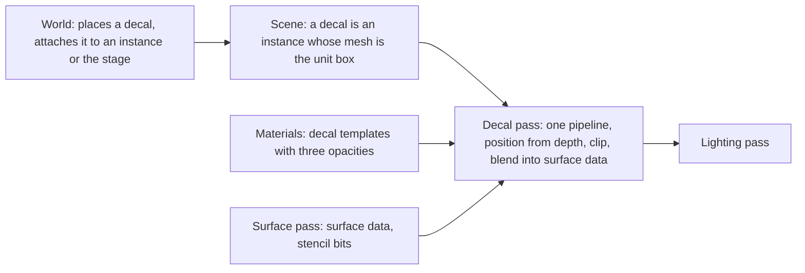
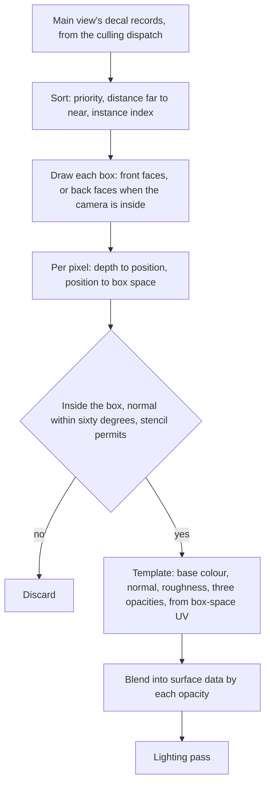

# Decals

How a mark is projected onto surfaces that already exist: a scorch, a bullet
impact, blood on a wall. A decal is a box in the scene. After the surface
pass has written every opaque pixel, the decal pass draws each visible box,
finds the surface under each of its pixels from depth, and blends the
decal's base colour, normal and roughness into the surface data. The
lighting pass then lights the result and never knows a decal was there.

## Position

Inside the [scene renderer](scene-renderer.md)'s frame, as the decal pass
between the surface pass and the light grid. Fed by the [scene](scene.md),
whose culling dispatch writes the main view's decal records, and by
[materials](materials.md), whose decal templates are the shaders. Placed by
the world. Above the [render graph](render-graph.md) and the [RHI](rhi.md).

## Invariants

1. A decal is an instance of the scene whose mesh is the unit box and whose
   material is a decal template. It is culled, ordered and drawn through
   the same dispatch and the same counted multi-draw as every instance.
2. The decal pass runs after the surface pass and before the light grid and
   the lighting pass. It reads depth and the stencil bits and writes base
   colour, normal and roughness of the surface data, each blended by its
   own opacity. It writes no depth and no motion vector.
3. The decal pass is one pipeline across decal templates; the pixel stage
   branches on the template id read from the instance record. It draws the
   main view's decal records in the sort order of the forward pass: the
   instance's sort priority, then distance far to near, then instance
   index. The world sets a later placement's sort priority above the ones
   it overlaps, so later marks land on top.
4. A pixel receives a decal only if its reconstructed position lies inside
   the box and its surface normal is within sixty degrees of the box's
   projection axis. Beyond that angle the pixel is clipped, so a decal does
   not stretch along a surface it grazes.
5. The decal's normal replaces the surface normal by a normalized linear
   blend weighted by the normal opacity. Base colour and roughness blend
   linearly by their opacities.
6. A decal is attached to a rigid instance or to the stage, never to a
   skinned instance. Attached to an instance, its transform is that
   instance's transform times its own; attached to the stage, its own.
7. A pixel of a skinned instance, rigid-to-bone clusters included, receives
   no decal. The surface pass writes a stencil bit for those pixels and the
   decal pass does not draw over it. A surface template may further
   declare that it refuses normal or roughness changes, and the surface pass
   writes that in the stencil bits too.
8. A decal changes what the lighting pass sees and nothing the surface pass
   already read. On a mover lit by the probe grids, the probe lookup used
   the undecalled normal, so the decal's normal reaches direct light and
   reflections and not the indirect term.
9. Decals are correct under baked light because the surface pass writes
   irradiance into the indirect light target, not lit colour, and the
   lighting pass multiplies it by the base colour the decal pass left.

## The pass

| Step | Reads | Writes |
|---|---|---|
| Sort | the main view's decal records, instance records | records in order |
| Box draw | the instance's transform, depth, stencil, the template's textures and block | base colour, normal, roughness of surface data |

## Decal template

| Output | Blend | Opacity |
|---|---|---|
| Base colour | linear | colour opacity |
| Normal | normalized linear blend with the surface normal | normal opacity |
| Roughness | linear | roughness opacity |

A decal template writes the three outputs and their three opacities from the
box-space UV, the two axes across the projection axis. A template that
writes no normal leaves the surface normal as it is. A decal has a fade along
the projection axis over the outer quarter of the box so its end faces do
not cut a hard line.

## Decal receivers

| Pixel | Receives |
|---|---|
| Opaque or masked surface of a rigid instance | every decal output the surface template allows |
| Surface whose template refuses normal or roughness changes | base colour alone, or base colour and the one it allows |
| Skinned instance, rigid-to-bone cluster included | nothing |
| Blended surface, particle, sky | nothing, since no surface data holds them |

## Components and ownership

| Component | Lives in | Consumed by |
|---|---|---|
| Decal pass, sort, pipeline | `src/engine/rendering/passes` | render graph |
| Decal instance kind and the unit box mesh | `src/engine/rendering/scene` | culling, the decal pass |
| Stencil bits for receivers | `src/engine/rendering/passes`, written by the surface pass | the decal pass |
| Decal templates | `src/engine/rendering/materials/templates` | the decal pass |

## Boundaries

Above: the world, which decides when a mark is made, where, on what, how
long it lasts, and removes it. Beside: the scene, which culls and records
decals as instances; the material system, which owns decal templates and
the receiver declaration of surface templates; the surface pass, which
writes the data decals blend into and the stencil bits. Below: the render
graph and the RHI. How the game decides to place a mark, how many it keeps,
and how it fades one out are outside this document.
