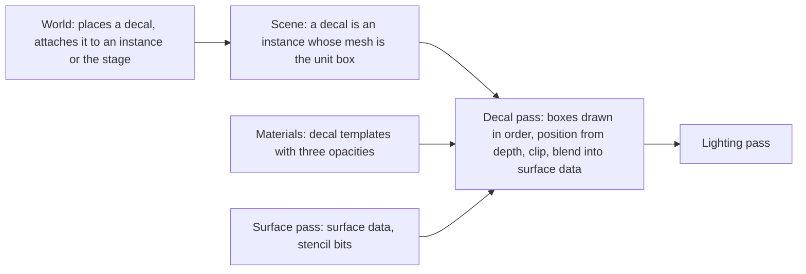
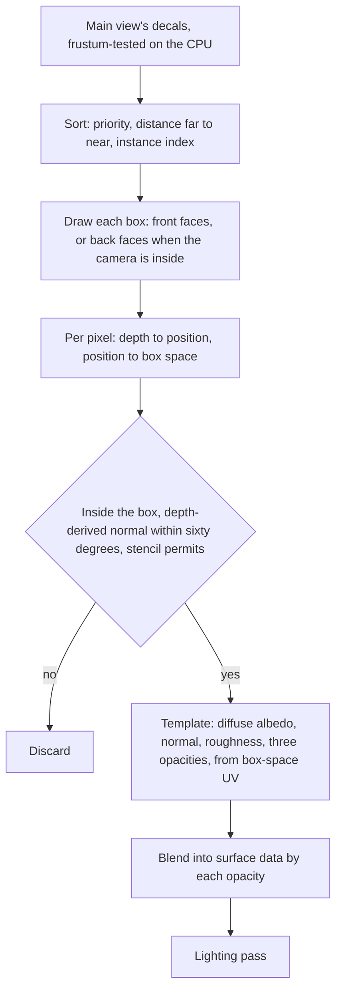

# Decals

How a mark is projected onto surfaces that already exist: a scorch, a bullet
impact, blood on a wall. A decal is a box in the scene. After the surface
pass has written every opaque pixel, the decal pass draws each visible box,
finds the surface under each of its pixels from depth, and blends the
decal's diffuse albedo, normal and roughness into the surface data. The
lighting pass then lights the result and never knows a decal was there.

## Position

Inside the [scene renderer](scene-renderer.md)'s frame, as the decal pass
between the surface pass and the light grid. Fed by the [scene](scene.md),
which holds the decals the CPU tests and orders, and by
[materials](materials.md), whose decal templates are the shaders. Placed by
the world. Above the [render graph](render-graph.md) and the [RHI](rhi.md).

## Invariants

1. A decal is an instance of the scene whose mesh is the unit box and whose
   material is a decal template. Like a blended instance, the CPU tests its
   bounds against the main view's frustum, orders it and issues its draw, as
   [scene](scene.md) invariant 5 states.
2. The decal pass runs after the surface pass and before the light grid and
   the lighting pass. It reads depth and the stencil bits and writes base
   colour, normal and roughness of the surface data, each blended by its
   own opacity. It writes no depth and no motion vector.
3. The decal pass draws the main view's decals in the sort order of the
   forward pass: the instance's sort priority, then distance far to near,
   then instance index, each draw with its own template's pipeline. The
   world sets a later placement's sort priority above the ones it overlaps,
   so later marks land on top.
4. A pixel receives a decal only if its reconstructed position lies inside
   the box and the normal derived from the depth around it is within sixty
   degrees of the box's projection axis. Beyond that angle the pixel is
   clipped, so a decal does not stretch along a surface it grazes. The pass
   reads depth and stencil and no target it writes.
5. The decal's normal blends into the stored normal by fixed-function alpha
   weighted by the normal opacity, and the stored normal is normalized when
   read. Diffuse albedo and roughness blend linearly by their opacities.
6. A decal is attached to an instance or to the stage. Attached to an
   instance, its transform is that instance's transform times its own, and
   it follows the instance, not any bone of it; attached to the stage, its
   own. A mark on a part a bone later moves stays where it was made.
7. A pixel of a dispatched instance receives no decal. The surface pass
   writes a stencil bit for those pixels and the decal pass does not draw
   over it. Rigid-to-bone clusters receive decals like any rigid surface. A
   surface template may further declare that it refuses normal or roughness
   changes, and the surface pass writes that in the stencil bits too.
8. A decal changes what the lighting pass sees and nothing the surface pass
   already read. On a mover lit by the probe grids, the probe lookup used
   the undecalled normal, so the decal's normal reaches direct light and
   reflections and not the indirect term.
9. Decals are correct under baked light because the surface pass writes
   irradiance into the indirect light target, not lit colour, and the
   lighting pass multiplies it by the diffuse albedo the decal pass left.

## The pass

| Step | Reads | Writes |
|---|---|---|
| Sort | the decals' bounds and sort priority, the main view | the draw order |
| Box draw | the instance's transform, depth, stencil, the template's textures and block | diffuse albedo, normal, roughness of surface data |

## Decal template

| Output | Blend | Opacity |
|---|---|---|
| Diffuse albedo | linear | colour opacity |
| Normal | fixed-function alpha blend on the stored normal, normalized on read | normal opacity |
| Roughness | linear | roughness opacity |

A decal template writes the three outputs and their three opacities from the
box-space UV, the two axes across the projection axis. A template that
writes no normal leaves the surface normal as it is. A decal has a fade along
the projection axis over the outer quarter of the box so its end faces do
not cut a hard line.

## Decal receivers

| Pixel | Receives |
|---|---|
| Opaque or masked surface of a rigid instance or a rigid-to-bone cluster | every decal output the surface template allows |
| Surface whose template refuses normal or roughness changes | diffuse albedo alone, or diffuse albedo and the one it allows |
| Dispatched instance | nothing |
| Blended surface, particle, sky | nothing, since no surface data holds them |

## Components and ownership

| Component | Lives in | Consumed by |
|---|---|---|
| Decal pass and its order | `src/engine/rendering/passes` | render graph |
| Decal instance kind and the unit box mesh | `src/engine/rendering/scene` | the decal pass |
| Stencil bits for receivers | `src/engine/rendering/passes`, written by the surface pass | the decal pass |
| Decal templates | `src/engine/rendering/materials/templates` | the decal pass |

## Boundaries

Above: the world, which decides when a mark is made, where, on what, how
long it lasts, and removes it. Beside: the scene, which culls and records
decals as instances; the material system, which owns decal templates and
the receiver declaration of surface templates; the surface pass, which
writes the data decals blend into and the stencil bits. Below: the render
graph and the RHI. How the game decides to place a mark, how many it keeps,
and how it fades one out are outside this document.
