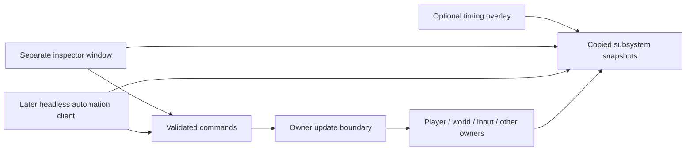

# Developer tools

Status: initial design agreed for later implementation. This document does not
claim a working overlay, inspector or automation interface. Original gameplay
pause has user acceptance; developer controls remain separate from it.
Key bindings, detailed layouts and activation controls have not been selected.

## Purpose and boundaries

Developer builds may expose an optional in-game HUD overlay, initially showing
FPS and frame timing, and a separate inspector window. Either view can be hidden
independently. The inspector observes player, world and entity snapshots and can
request temporary development overrides: all spells unlocked, unlimited ammunition
or magic, and invulnerability. Enemy health inspection joins it when authoritative
entities exist. These are temporary runtime policies; they never rewrite saved
progression or make the original gameplay menu a development menu.

A common command and snapshot interface serves both the inspector and later
headless automation. Each owning subsystem publishes copied observations and
admits validated commands at defined update boundaries. Neither UI nor automation
receives mutable state pointers or directly edits another owner's fields. Command
results report actual admission, rejection and completion rather than implying
success before the owner applies a request. World pause and presentation timing
retain their existing owners; tools do not advance a second game clock.

Production builds exclude inspector implementation, automation listener and
registration, overlay resources and feature activation. Instrumentation hooks
retained at shared call sites compile to no-ops. This is an explicit compile-time
boundary; capture or logging switches cannot enable developer behavior.

## Implementation sequence

1. Establish the compile-time boundary and shared observation/command contracts,
   then implement the timing overlay, separate inspector and explicitly owned
   temporary overrides. Design the actual UI and activation controls with the
   user before implementing them. Trace existing engine ownership and consult
   the required source references and C++ corpora when writing those contracts.
2. Add automation commands, input sequences and capture coordination through the
   same interface. The automation client may run without a UI while controlling
   the normal rendered, audible game for clips. This does not require a second
   simulation or an offscreen renderer. Full offscreen rendering is deferred.

Verification must cover production exclusion, command ownership, snapshot
lifetimes, pause boundaries, override teardown and unchanged saved progression.
The original gameplay pause menu must work identically with tools absent.

## Existing preview compilation boundary

The architecture redesign places the existing animation review implementation in
`src/developer/animation_review`. `BW_DEVELOPER_VIEWS` is allowed only in Debug
configurations. Ordinary builds retain inert request/status/catalog hooks and
contain no concrete preview owner, capability implementation or menu resources.
The enabled adapter receives bounded commands and const observations; no mutable
actor/controller borrow is returned. This does not add the planned overlay,
inspector, automation listener or new activation controls. See
[the implementation evidence](../../research/engine/subsystems/developer-compilation-boundary.md).
