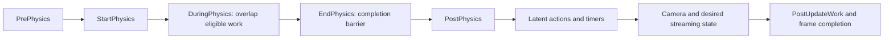

# Engine loop and time

Status: proposed contracts and inspected reference behavior; no implementation.

## Unreal reference

- [LaunchEngineLoop.cpp](https://github.com/EpicGames/UnrealEngine/blob/f45729c0b6f097038e72b52d366a62baeca3275b/Engine/Source/Runtime/Launch/Private/LaunchEngineLoop.cpp#L4747):
  `FEngineLoop::Init` creates and initializes the engine, then starts it;
  `FEngineLoop::Tick` owns the outer host frame and frame-end synchronization.
- [GameEngine.cpp](https://github.com/EpicGames/UnrealEngine/blob/f45729c0b6f097038e72b52d366a62baeca3275b/Engine/Source/Runtime/Engine/Private/GameEngine.cpp#L1768):
  `UGameEngine::Tick` handles travel/world updates, streaming, viewports and audio.
- [UnrealEngine.cpp](https://github.com/EpicGames/UnrealEngine/blob/f45729c0b6f097038e72b52d366a62baeca3275b/Engine/Source/Runtime/Engine/Private/UnrealEngine.cpp#L2980):
  `UEngine::UpdateTimeAndHandleMaxTickRate` measures real elapsed time, computes
  the remaining interval for a maximum rate, waits, then measures again. Fixed
  timestep and fixed frame-rate modes are explicit alternatives.
- [ApplePlatformTime.cpp](https://github.com/EpicGames/UnrealEngine/blob/f45729c0b6f097038e72b52d366a62baeca3275b/Engine/Source/Runtime/Core/Private/Apple/ApplePlatformTime.cpp#L29):
  `FApplePlatformTime::InitTiming` obtains the Mach timebase;
  `Seconds` converts `mach_absolute_time` ticks.
- [GenericPlatformProcess.cpp](https://github.com/EpicGames/UnrealEngine/blob/f45729c0b6f097038e72b52d366a62baeca3275b/Engine/Source/Runtime/Core/Private/GenericPlatform/GenericPlatformProcess.cpp#L414):
  `FGenericPlatformProcess::SleepNoStats` uses BSD sleep for a positive interval
  and yields for zero. Apple inherits this path through its platform process
  classes. Unreal's host pacing uses coarse sleep followed by yielding near its
  deadline; its historical constants are not universal OS accuracy guarantees.

## First proposed slice

The lowest dependency is a monotonic clock and deadline waiting, using OS or
standard-library facilities directly. It does not require custom math,
allocators, a renderer, a world, or an asset reader. Its small fixed runtime state
can live in stack values; this does not select the general engine allocation
policy.

| New owner | Contract |
|---|---|
| Platform time | Monotonic timestamp, elapsed duration, and deadline wait; no game state |
| Frame types | Distinct timestamp/duration/frame-index values; explicit unit conversion |
| EngineLoop | Sole host frame driver; configurable maximum fps, default 60 |
| Frame context | Immutable measured start, elapsed interval, frame index and pacing observations |

Proposed pacing algorithm: record the previous frame start, compute the next
allowed start from that point and the configured period, wait only for the
remaining interval, sample the actual start after waiting, then deliver the
measured elapsed interval once to the frame callback. If already late, do not
wait or run a burst of compensating host frames. Rebase to the actual start.
This follows Unreal's measured elapsed-time/cap separation; exact wait mechanics
are selected in the new platform implementation, not inherited from old code.

A 60 fps cap means a target minimum frame interval, not a guarantee of 60 fps
under load. It does not mean `delta = 1/60` for animation or gameplay. Vsync/GPU
backpressure later participates in pacing without adding a second full-period
sleep. Stop, pause, configuration changes and suspend/resume have explicit
contracts; system sleep must not silently become gameplay catch-up work.

Fresh build, formatting, fatal clang-tidy and tests accompany this slice.
Checks cover early/late waits, oversleep, cap changes, stop behavior and elapsed
intervals. Native cadence checks report observed timing and CPU idle behavior;
a fake clock alone cannot validate OS waits. No game or window is needed yet.

## World scheduling, later

[LevelTick.cpp](https://github.com/EpicGames/UnrealEngine/blob/f45729c0b6f097038e72b52d366a62baeca3275b/Engine/Source/Runtime/Engine/Private/LevelTick.cpp#L1502)
`UWorld::Tick` establishes the ordered phases below.
[TickTaskManager.cpp](https://github.com/EpicGames/UnrealEngine/blob/f45729c0b6f097038e72b52d366a62baeca3275b/Engine/Source/Runtime/Engine/Private/TickTaskManager.cpp#L2622)
`FTickFunction::QueueTickFunction`, `AddPrerequisite`, `StartFrame` and
`RunTickGroup` build dependency-constrained execution. Worker eligibility is
explicit. Actors do not each own a clock or a busy-wait loop.

[PhysLevel.cpp](https://github.com/EpicGames/UnrealEngine/blob/f45729c0b6f097038e72b52d366a62baeca3275b/Engine/Source/Runtime/Engine/Private/PhysicsEngine/PhysLevel.cpp#L137)
`SetupPhysicsTickFunctions` adds the physics prerequisite;
`FEndPhysicsTickFunction::ExecuteTick` completes after physics results are ready.
This is the reference for a new physics/world integration boundary, not an
instruction to put solver steps in controllers.

The proposed WorldScheduler owns phase membership, dependencies, thread affinity
and completion. Character and animation dependencies attach to it. Workers use
immutable inputs or exclusively owned buffers; result publication occurs before
the consuming phase. Dependency failure, cancellation and actor retirement
cannot leave tasks touching expired state.

## Time domains and pause

Unreal records real, audio, dilated and paused-world time separately in
`UWorld::Tick`. Real time advances during pause; ordinary world time does not.
`RunPauseFrame` runs only eligible paused ticks. Normal world timers run after
PostPhysics and are skipped while paused.

[TimerManager.cpp](https://github.com/EpicGames/UnrealEngine/blob/f45729c0b6f097038e72b52d366a62baeca3275b/Engine/Source/Runtime/Engine/Private/TimerManager.cpp#L1107)
`FTimerManager::Tick` separates active, pending and paused timers and supports
explicit looping catch-up policy. Our new WorldTime will derive game time from
host elapsed time with explicit pause/dilation/suspend rules. Local animation
positions consume supplied game time. Physics substeps, when introduced, have
an explicit policy independent of the presentation cap. None of these systems
is implemented or selected merely by creating the first host loop.

## Jobs and memory

[Tasks/Task.h](https://github.com/EpicGames/UnrealEngine/blob/f45729c0b6f097038e72b52d366a62baeca3275b/Engine/Source/Runtime/Core/Public/Tasks/Task.h) supplies
`Launch`, prerequisites, task results and nested completion as the job reference.
[UnrealMemory.cpp](https://github.com/EpicGames/UnrealEngine/blob/f45729c0b6f097038e72b52d366a62baeca3275b/Engine/Source/Runtime/Core/Private/HAL/UnrealMemory.cpp#L347)
selects the platform allocator;
[MemStack.cpp](https://github.com/EpicGames/UnrealEngine/blob/f45729c0b6f097038e72b52d366a62baeca3275b/Engine/Source/Runtime/Core/Private/Misc/MemStack.cpp#L309)
provides temporary thread-local allocation. New persistent resources, actor state,
job scratch and GPU-retired allocations need separate lifetime contracts.
Memory and math are parallel foundation leaves, not invented dependencies for
reading a monotonic clock.
