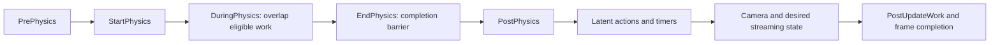

# Future world scheduling

The authoritative host lifecycle and timing architecture is [Game loop](engine/runtime/game-loop.md).
The rejected custom-loop design and verification have been removed. Material
below concerns future world, jobs and memory work only; none is implemented.

## World scheduling, later

[LevelTick.cpp](https://github.com/EpicGames/UnrealEngine/blob/f45729c0b6f097038e72b52d366a62baeca3275b/Engine/Source/Runtime/Engine/Private/LevelTick.cpp#L1502)
`UWorld::Tick` establishes the ordered phases below.
[TickTaskManager.cpp](https://github.com/EpicGames/UnrealEngine/blob/f45729c0b6f097038e72b52d366a62baeca3275b/Engine/Source/Runtime/Engine/Private/TickTaskManager.cpp#L2622)
`FTickFunction::QueueTickFunction`, `AddPrerequisite`, `StartFrame` and
`RunTickGroup` build dependency-constrained execution. Worker eligibility is
explicit. Actors do not each own a clock or a busy-wait loop.

[PhysLevel.cpp](https://github.com/EpicGames/UnrealEngine/blob/f45729c0b6f097038e72b52d366a62baeca3275b/Engine/Source/Runtime/Engine/Private/PhysicsEngine/PhysLevel.cpp#L137)
`SetupPhysicsTickFunctions` adds the physics prerequisite;
`FEndPhysicsTickFunction::ExecuteTick` completes after physics results are ready.
This is the reference for a new physics/world integration boundary, not an
instruction to put solver steps in controllers.

The proposed WorldScheduler owns phase membership, dependencies, thread affinity
and completion. Character and animation dependencies attach to it. Workers use
immutable inputs or exclusively owned buffers; result publication occurs before
the consuming phase. Dependency failure, cancellation and actor retirement
cannot leave tasks touching expired state.

## Time domains and pause

Unreal records real, audio, dilated and paused-world time separately in
`UWorld::Tick`. Real time advances during pause; ordinary world time does not.
`RunPauseFrame` runs only eligible paused ticks. Normal world timers run after
PostPhysics and are skipped while paused.

[TimerManager.cpp](https://github.com/EpicGames/UnrealEngine/blob/f45729c0b6f097038e72b52d366a62baeca3275b/Engine/Source/Runtime/Engine/Private/TimerManager.cpp#L1107)
`FTimerManager::Tick` separates active, pending and paused timers and supports
explicit looping catch-up policy. Our new WorldTime will derive game time from
host elapsed time with explicit pause/dilation/suspend rules. Local animation
positions consume supplied game time. Physics substeps, when introduced, have
an explicit policy independent of the presentation cap. None of these systems
is implemented or selected merely by creating the first host loop.

## Jobs and memory

[Tasks/Task.h](https://github.com/EpicGames/UnrealEngine/blob/f45729c0b6f097038e72b52d366a62baeca3275b/Engine/Source/Runtime/Core/Public/Tasks/Task.h) supplies
`Launch`, prerequisites, task results and nested completion as the job reference.
[UnrealMemory.cpp](https://github.com/EpicGames/UnrealEngine/blob/f45729c0b6f097038e72b52d366a62baeca3275b/Engine/Source/Runtime/Core/Private/HAL/UnrealMemory.cpp#L347)
selects the platform allocator;
[MemStack.cpp](https://github.com/EpicGames/UnrealEngine/blob/f45729c0b6f097038e72b52d366a62baeca3275b/Engine/Source/Runtime/Core/Private/Misc/MemStack.cpp#L309)
provides temporary thread-local allocation. New persistent resources, actor state,
job scratch and GPU-retired allocations need separate lifetime contracts.
Memory and math are parallel foundation leaves, not invented dependencies for
reading a monotonic clock.
