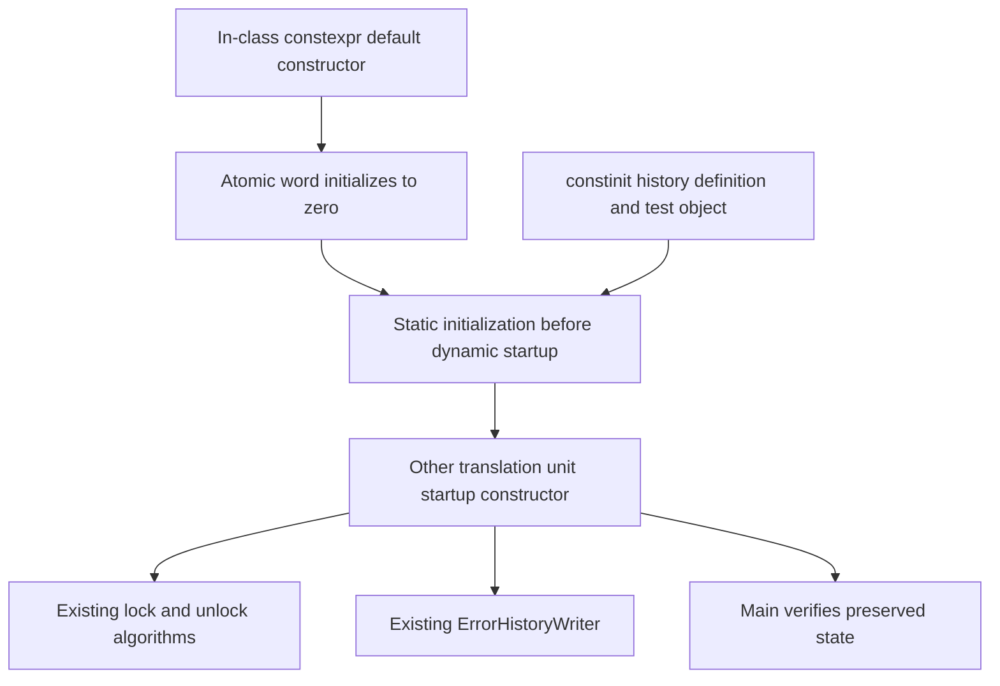

# WordMutex initialization and lifetime

Status: **accepted, implemented and verified**. Error history is
accepted as `abadd90`. This slice resolves the initialization prerequisite named
in [error history](../diagnostics/error-history.md), without changing locking,
allocator policy or implementing the general assertion path.

## Source algorithm and missing guarantee

Pinned Unreal `f45729c0b6f097038e72b52d366a62baeca3275b`, paths relative to
`Engine/Source/Runtime/Core/`:

| Source | Required correspondence |
|---|---|
| `Public/Async/WordMutex.h:23` | Constructor is constexpr and defaulted at its first, in-class declaration |
| `WordMutex.h:77` | Atomic word initializes to zero: unlocked, no queued waiters |
| `WordMutex.h:20–78` | Noncopyable, nonrecursive, unfair mutex with no destructor |
| `Private/Misc/AssertionMacros.cpp:58–60` | Process failure mutex selected because it initializes without dynamic startup work and has no destructor |
| `AssertionMacros.cpp:64–68` | Failure handling can run before ordinary command-line/engine startup |

Before this change the rebuild declared an ordinary constructor in the header
and defaulted it out of line. Its static storage was initially zero-filled, but its
constructor still had dynamic initialization semantics. That was insufficient:
another translation unit can use it before construction, and later construction
could reset a state already modified during startup. Optimizer promotion or one
successful startup execution does not establish the required language guarantee.

The implementation is exactly the source in-class constexpr defaulted constructor
and the existing zero member initializer. The out-of-line constructor definition
is removed. No lock method, memory ordering, waiter storage, event ownership,
layout, fairness or allocation algorithm changes.

## Initialization contract

C++ static initialization precedes dynamic initialization. A variable declared
`constinit` must satisfy static initialization; the compiler must reject dynamic
initialization even if it could optimize it away. These are language guarantees,
not a runtime branch or a promise that atomic lock operations become constexpr.
See the standard draft's [static initialization](https://eel.is/c++draft/basic.start.static)
and [constinit](https://eel.is/c++draft/dcl.constinit) clauses. This project compiles
as C++20 and the actual selected compiler checks the production type.

The history mutex definition now has `constinit` as our compile-time enforcement
of the source guarantee. It remains mutable during locking. `constinit` is an
explicit verification constraint, not extra locking behavior or an Unreal claim
about the spelling used for its global. Plain history storage is already static
zero-initialized and does not require a changed policy.

No function-local static, singleton accessor, guard variable, heap allocation,
priority attribute or manually ordered startup registration is introduced. The
mutex remains trivially destructible; there is no destructor-order dependency
for this object. That does not establish lifetime guarantees for every future
logger, stack service or error device.

Core I.22 addresses cross-unit startup hazards; C.48 retains the existing shared
zero member initializer. Performance LIFE.6 describes the hazard and guard cost
of the function-local-static alternative. Its alternative is not selected here:
the pinned source already supplies constant initialization, without a first-use
check. Both corpora were queried and these full rules read before contract edits and again before implementation.

## Implementation boundary

Preparation recorded the exact constructor change in comments while retaining
accepted behavior. The real `constinit WordMutex` fixture failed compilation,
establishing the missing guarantee without a parallel implementation. After user
approval, the in-class definition replaced the declaration and the out-of-line
constructor was removed. The actual history mutex definition gained constinit.

| File | Implemented change |
|---|---|
| `src/engine/core/concurrency/public/bw/concurrency/word_mutex.hpp` | Source in-class constexpr default constructor and adjacent source contract |
| `src/engine/core/concurrency/word_mutex.cpp` | Removed only the out-of-line constructor; lock bodies unchanged |
| `src/engine/core/diagnostics/error_history.hpp` | Current static-initialization contract |
| `src/engine/core/diagnostics/error_history.cpp` | constinit enforcement at the actual history mutex definition |
| `tests/engine/core/concurrency/startup/` | Prepared multi-unit tests unchanged |
| `tests/CMakeLists.txt` | Both object-order compositions promoted to default build/CTest |

## Verification coverage

A storage translation unit declares a real `constinit WordMutex`. This failed
compilation with the previous non-constexpr constructor. The error was the actual
missing guarantee, not an artificial assertion, sentinel, stub or link failure.
All test translation units now compile under fatal lint.

A separate translation unit's dynamic constructor acquires that same mutex and
leaves it held until main. Main checks that the state survives startup, rejects
another try-lock and then releases/reacquires normally. The startup constructor
also writes real error history; main checks the completed text and released
history lock. Fixtures use constant-initialized observation storage, not a fake
mutex or injected scheduling backend. Failure observations are reported in main.

Two executable compositions reverse the storage/probe object order without
constructor-priority extensions. They are native integration checks, not the
proof of constant initialization: the constinit compilation requirement provides
that proof. Both compositions now run in the normal suite alongside the accepted tests.

Object inspection checks the fixture storage and actual diagnostics objects for
absence of mutex dynamic-initialization/guard code, without claiming startup
benchmark results. Full Debug/Release regressions preserve existing memory,
contention and history behavior. This change does not complete formatted history,
source output/error devices, assertion configuration/coordinator or checked
quaternion inverse.

## Verification results

Debug and Release full builds pass fatal clang-tidy, 36 standalone headers and
11 consumer include-boundary probes. Both configurations pass all 36 CTest
entries, including both native pre-main/object-order scenarios. The production
constinit definitions compile, and prepared startup/history test hashes remain
unchanged. Root independently reviewed the final source correspondence and
confirmed the lock bodies are unchanged.

For each configuration, nm/otool inspection of the real fixture-storage and
production-history objects found no dynamic-initialization/guard symbols and no
module-initializer section. The separate probe intentionally has dynamic startup
code; no claim is made that the whole program has no dynamic initialization.
These checks establish this mutex's source lifetime behavior, not a performance
benchmark or a complete assertion system.

Formatting, whitespace and DOM-backed Mermaid parsing pass. Historical red and
current green evidence remain ignored under `research/evidence/word-mutex-lifecycle/`.
User accepted this implementation and authorized its commit; no push or game
launch. Next preparation covers the complete usable shared assertion capability
and its predictable dependencies together.
