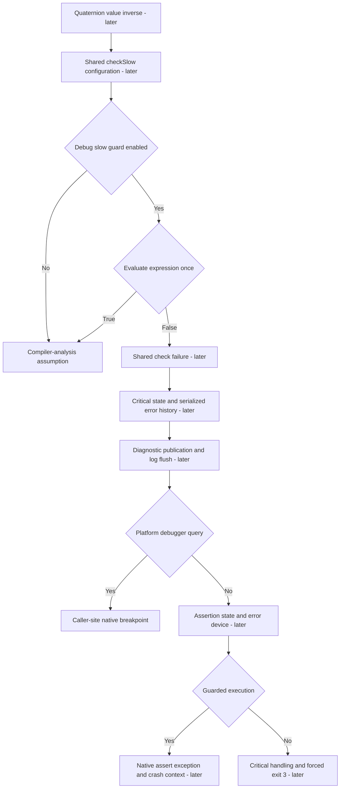

# Assertions and debugger primitives

Status: **primitive slice accepted, implemented and verified**.
Quaternion values are accepted as
`71717b4`. Their value inverse remains absent until its source slow-check path is
available. This document maps that path; the current implementation slice is only
its platform debugger and compiler-analysis prerequisites. Nothing here claims a
complete assertion, crash reporter or error-device subsystem.

## Source flow and owners

All references use Unreal `f45729c0b6f097038e72b52d366a62baeca3275b` under
`Engine/Source/Runtime/Core/`. No old Bullet Witch implementation is used.

| Stage | Source | Required behavior and owner |
|---|---|---|
| Value inverse | `Public/Math/Quat.h:1262–1270` | Shared math calls `checkSlow(IsNormalized())` before register unit inverse |
| Guard configuration | `Public/Misc/Build.h:242–247,270–275` | Debug slow/check enabled; Development slow disabled but ordinary check enabled |
| Slow/check macros | `Public/Misc/AssertionMacros.h:228–246,332–340` | Shared diagnostics evaluates enabled condition once; failure requests breakpoint if handler returns true; disabled slow path uses CA_ASSUME |
| Failure orchestration | `Private/Misc/AssertionMacros.cpp:749–798` | Publish failure, flush existing log, query debugger; absent debugger takes assertion/error-device route; attached debugger returns a break decision |
| Critical-state gate | `AssertionMacros.cpp:464–471` | Do not repeat assertion-history publication during critical shutdown |
| Error history | `AssertionMacros.cpp:196–342` | Source WordMutex serializes bounded error-history writes; script callstack hook, selected native callstack and output precede final history termination |
| Assert state/error device | `AssertionMacros.cpp:175–192` | Mark asserted; if GError exists, preserve program counter and serialize expression/location/description |
| Mac error device | `Private/Mac/MacErrorOutputDevice.cpp:21–112` | Conditional debug break, critical/reentry state, guarded exception or unguarded critical handling and forced exit |
| Mac assert exception | `Private/Mac/MacPlatformMisc.cpp:2647–2653` | Store assert context and raise native exception; later crash subsystem dependency |
| Forced critical exit | `MacPlatformMisc.cpp:712–740` | Flush existing log and `_Exit(3)` for critical error, distinct from ordinary exit |
| Debugger query | `Private/Apple/ApplePlatformMisc.cpp:32–48` | Source ignore flag short-circuits; sysctl current PID process info and inspect P_TRACED |
| Raw breakpoint | `Public/Apple/ApplePlatform.h:32` | `__builtin_debugtrap()` at the calling site, independent of debugger detection |
| Conditional break | `Public/GenericPlatform/GenericPlatformMisc.h:45–49` | Non-shipping conditional break queries debugger; shipping/non-editor compiles it out; not the same as raw platform break |
| Compiler assumption | `Public/Clang/ClangPlatformCodeAnalysis.h:11–15,43–50,83`, `Public/Misc/CoreMiscDefines.h:107–126` | Analyzer marks false paths as nonreturning; ordinary compilation checks expression type through sizeof without evaluating it |

The platform owns debugger observation and trap delivery, not shared error
history, assertion state, configuration or continuation decisions. Shared
`engine/core/diagnostics` will own those decisions. Existing memory-specific
`BW_ALLOCATOR_CHECK` and `memory_check_failed` remain private accepted memory
facilities; they are not a substitute for this general assertion path.

## Current bounded primitive slice

Implements only current-process native debugger query, caller-site raw breakpoint
and compiler-analysis assumption. Ordinary Clang code must not evaluate the
assumption expression, add a runtime branch or claim optimizer unreachable
semantics. The separate source analyzer-only nonreturn marker is mapped but not
implemented by this ordinary compiler slice.
The raw breakpoint must remain at its caller; an out-of-line wrapper changes the
stop location and is not the intended implementation.

The selected non-shipping source-default `GIgnoreDebugger` is false
(`Private/Misc/CoreGlobals.cpp:478`). Configurable ignore-debugger ownership is
part of the later assertion/configuration layer, not a fake debugger injection
mechanism in tests. Shipping inherits the generic false query; this slice must
state its build selection instead of equating optimized Release with Shipping.
Both current Debug and optimized Release builds select the non-shipping query;
optimization does not choose Shipping. Shared checks, conditional debug-break
policy, assertion failure formatting/history and quaternion inverse are not implemented by these primitives.

### Approved native-query departure

The pinned Apple query declares `kinfo_proc Info` without initialization and
ignores `sysctl`'s return value. Its successful result is well defined; failure
can read indeterminate storage. The user approved checking the native return
value and returning false on query failure without reading output. This means
unavailable detection is treated as no debugger. It is an explicit departure
from undefined source behavior, not a claim that Unreal defines this fallback.
The successful P_TRACED interpretation is unchanged. No extra error logger,
retry loop, exception, cached observation or synthetic query was added.

## Full assertion dependencies still ahead

The bounded [error-history implementation](error-history.md) covers only
serialized same-encoding plain text and termination. It does not implement a
shared failure handler. The linked mutex lifecycle change resolves static initialization. Formatting/
conversion, publication and installed error-device lifecycle remain explicit
dependencies before general assertions or checked quaternion inverse.

The complete failure path requires shared bounded error-history storage and its
source lock, critical/asserted state, source-selected logger flush and error-device
handling, debugger decisions and guarded/unguarded host composition. These are
real dependencies even if the present host is headless. Current stdout reporting
alone does not satisfy them. WordMutex exists in the fresh foundation, but using
it and defining initialization/error-state ownership are later implementation
work, not an invitation to import an old handler.

Some services are genuinely optional in source: GLog and GError are tested before
use, and their null states must be distinguished from a deliberately configured
host that has installed them. Mac inherits an empty remote-debug prompt
(`Public/GenericPlatform/GenericPlatformMisc.h:1500–1502`); that is a source no-op,
not missing UI disguised as implemented behavior. Callstack selection also needs
explicit host classification: generic `AllowsCallStackDumpDuringAssert()` returns
`IsProgram()` (`GenericPlatformProperties.h:319–322`), so a tool host must not
silently inherit game-host assumptions. Guarded exceptions/crash reporting and
unguarded `_Exit(3)` are different paths and must not be collapsed.

## Implementation ownership

Architecture, contracts, comments-only plans and honest red tests preceded
implementation. Both C++ corpora were queried for design and implementation;
full I.5/E.26/GEN.6 were read for design, I.5/E.28/GEN.6 for implementation.
Native return checking avoids an errno-based side channel. GEN.6 supports
caller-site intrinsic visibility and generated-code inspection, not blanket
forced inlining of the later failure subsystem.

- `src/platform/diagnostics/public/bw/platform/diagnostics/debugger.hpp` owns the
  native-query and raw-break contracts plus platform selection.
- `src/platform/os/macos/diagnostics/debugger.cpp` queries the current process.
  The `bw_platform_debugger` library owns this implementation and exports only its
  platform diagnostics contract. `debugger.inl` defines the caller-site trap.
- `src/platform/compiler/public/bw/platform/compiler/assume.hpp` and
  `src/platform/compiler/clang/assume.inl` preserve the ordinary unevaluated bool
  conversion. Analyzer mode is future tooling; no reserved flags are simulated.
- `tests/platform/diagnostics/debugger_tests.cpp`, `breakpoint_tests.cpp`, and
  `tests/platform/compiler/assume_tests.cpp` now run in default builds/CTest.
  No engine host uses the new assertion primitives yet.

## Verification

Debug/Release full builds pass fatal clang-tidy, 35 standalone headers, 11
consumer include-boundary probes and all 33 CTest entries. Native debugger tests
use actual untraced and PT_TRACE_ME children. The trap test observes a real
SIGTRAP stop, then terminates and reaps its own tracee. Denied tracing is a test
failure, never a silent skip. Ordinary assumption tests prove side effects are
not evaluated and an undeclared-at-link-time function call is not emitted.

One prepared test defect was corrected transparently: after successfully
observing SIGTRAP, its plain kill(SIGKILL) cleanup hung in waitpid on Darwin.
A diagnostic-only copy recorded that exact stopped state; the local ptrace(2)
manual specifies PT_KILL as continuation delivering SIGKILL. The fixture now
uses PT_KILL and retains its original SIGTRAP and reaped-SIGKILL assertions.
Production breakpoint behavior was not changed to fit the fixture.

Optimized caller inspection shows `brk` followed by the caller's add/return path;
the raw trap is not treated as nonreturning. The assumption caller contains only
its result arithmetic and return, without a runtime check, increment or external
call. These are code-generation observations, not a claim that debugger resume
was exercised: the native test intentionally kills the stopped child.

Formatting, whitespace and DOM-backed Mermaid parsing pass. Evidence is ignored
under `research/evidence/assertion-platform/`; historical query link-red and
macro compile-red precede these green results. The sysctl failure branch was
reviewed structurally; no failure injection or coverage claim is made for that
native error case. Complete shared assertions, history/error devices, analyzer
mode, Shipping/configuration and checked quaternion inverse remain later work.

Root independently reviewed the final native implementation and Darwin cleanup,
inspected both optimized callers and repeated the complete Debug suite: 33/33.
User accepted the primitive implementation and authorized its commit.
