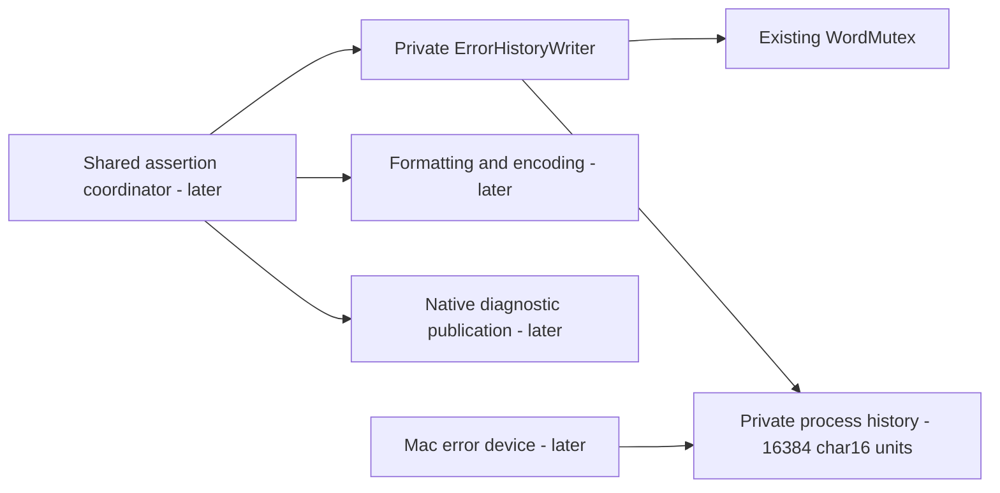

# Assertion error history

Status: **accepted, implemented and verified**. The accepted platform
primitives are `bbb4e82`. This is the next bounded prerequisite within the
[assertion flow](assertions.md), not a complete assertion or error device.

## Selected source and scope

Reference: Unreal `f45729c0b6f097038e72b52d366a62baeca3275b`, paths below relative
to `Engine/Source/Runtime/Core/`. Only the same-encoding plain-text writer,
fixed storage and serialized lifetime are implemented. Formatted and cross-encoding
operations remain absent, rather than accepting inputs they cannot implement.

| Operation | Pinned source | Selected algorithm |
|---|---|---|
| Storage | `Private/Misc/CoreGlobals.cpp:70` | Process-lived zero-initialized 16,384-code-unit history |
| Character type | `Public/Mac/MacPlatform.h:12–18`; `Public/HAL/Platform.h:1235–1239` | Mac WIDECHAR and TCHAR are `char16_t`; native four-byte `wchar_t` is not the history type |
| Mutex | `Private/Misc/AssertionMacros.cpp:58–60` | WordMutex serializes complete writer lifetimes |
| Construction | `AssertionMacros.cpp:199–202,273–276` | Cursor starts at zero; acquire mutex; do not clear old history yet |
| Plain append | `AssertionMacros.cpp:221–230` | Measure input, choose minimum of length-plus-terminator and remaining capacity; if at least two units fit, copy bounded text and advance by copied units excluding terminator |
| Termination | `AssertionMacros.cpp:210–219` | Reserve suffix plus terminator by rewinding cursor if necessary; append suffix and explicitly terminate |
| Destruction | `AssertionMacros.cpp:204–208` | Terminate with empty suffix before unlocking |
| String copy | `Public/Misc/CString.h:1033–1036`, `Private/GenericPlatform/GenericWidePlatformString.cpp:33–66` | Selected wide-character bounded copy, with the final destination unit terminated |

No engine-wide TCHAR alias or new encoding policy is introduced. The internal
history contract uses `char16_t`, exactly the selected source configuration. Its
capacity counts code units, including the terminal zero; it is not a byte count
or a Unicode-character count. Append does not validate or repair surrogate pairs.
A capacity boundary can split a pair, as in the source code-unit algorithm.

## Ownership and lifetime

The diagnostics module owns the history and mutex in a private header. They are
not exported through its public include root, and game/tool consumers receive no
mutable access. The writer owns the lock, never the caller's input. It cannot be
copied or moved, nested on the same thread, or shared between threads. The lock
is nonrecursive; serialization spans construction through destruction. Later
error-device access must preserve its source shutdown and reentry protocol;
this leaf does not advertise an independently thread-safe global read API.

History is statically zero-initialized. The accepted WordMutex has an out-of-line
constructor initializing its atomic word to zero; unlike Unreal's stated
zero-initialization-only mutex, that existing implementation has a dynamic
initialization step. This slice neither changes that accepted implementation
nor promises cross-translation-unit use before its initialization. There is no
new function-local singleton, initialization guard or heap-owned history. The
source mutex has no destructor and the accepted mutex is trivially destructible.

**Required next lifecycle dependency:** resolve the accepted mutex initialization
difference before exposing general assertions during library/static startup. A
source assertion can run before ordinary engine initialization; a history writer
that depends on constructor order is not sufficient for that claim. This
implementation does not alter the accepted mutex or declare startup assertions ready.

The current build keeps WordMutex implementation in the accepted `bw_allocator`
cluster. The `bw_diagnostics` implementation target privately links that existing
dependency and its header contract; it does not split the cluster or expose
allocator internals. Tests link the production diagnostics module and explicitly
receive its private header root. No private include path is exported by the module.

## Contract details

- Inputs are non-null, readable, zero-terminated `char16_t` sequences and must
  not overlap history. Length arithmetic must fit the source signed 32-bit
  cursor. No new validation, exception, clamp or repair was added.
- Plain append truncates to remaining capacity minus one. Empty append and an
  append to a full buffer do nothing, including no eager clearing of old text.
- Construction resets only the writer cursor. An empty writer clears the first
  history unit when its destructor terminates it; prior trailing storage remains.
- `terminate_with` appends its suffix if it fits, otherwise replaces the tail so
  the complete suffix and final zero fit. Suffix length must be below capacity;
  source callers use empty text, newline, and CRLF-CRLF. Oversized suffixes are
  outside the source operation's valid arithmetic, not a newly invented fallback.
- Borrowed input is used only during the call. Observation in tests occurs while
  holding the writer lock or after all writers have joined.

Core CP.20 applies through the writer's RAII lifetime; I.5 makes input/lifetime
preconditions explicit. Performance EMB.2 supports fixed-capacity storage with no
heap growth, but does not replace source truncation with an embedded overflow
policy or justify another container dependency. Both corpora were queried and
these full rules read before header design and again before implementation.

## Remaining assertion dependencies

`FErrorHistWriter::Append<CharType>` at 232–244 accepts a converted append only if
its entire converted sequence fits. It is **not** the truncating same-encoding
append. ANSI expression/native-stack text and UTF-8 descriptions therefore need
real source character conversion before the full coordinator can call them.
`AppendV`/`Appendf` at 246–281 additionally require the selected formatting
implementation and its error/truncation return behavior, plus a mutex-protected
static UTF-8 scratch buffer. None of those overloads or scratch storage is
introduced as a stub here.

The full source ordering remains: script stack first, optional native stack
capture, writer acquisition, error/expression/location/message formatting,
low-level output of that text, native-stack append, CRLF-CRLF termination,
optional error-device program-counter publication, and writer destruction.
This leaf does not format assertion messages, collect stacks, write output,
flush logs, set critical state or terminate the process. The accepted headless
stdout math sink is not substituted for native low-level debug output.

The coordinator's nullable GLog/GError checks do not make installed error-device
requirements optional: the Mac device calls GLog->Panic and has guarded versus
unguarded error lifecycles. Those owners, host composition, critical/asserted
state, configuration and crash handling remain pending. Checked quaternion
inverse remains absent until the actual shared assertion path is available.

## Implementation files and verification

- `src/engine/core/diagnostics/error_history.hpp`: private contracts and storage
  declarations, unchanged apart from implementation status.
- `src/engine/core/diagnostics/error_history.cpp`: source algorithms beside each
  function/significant copy step, including the used char16_t length/copy
  operations extracted from the selected generic wide-string implementation.
- `src/engine/core/diagnostics/CMakeLists.txt`: concrete private diagnostics owner.
- `tests/engine/core/diagnostics/error_history_tests.cpp`: unchanged prepared
  tests, promoted into default build and CTest against production definitions.

Preparation first established real missing-definition linker failures in both
configurations, after fatal-lint compilation. No stubs or failing sentinels were
used. The earlier test-only empty catch was resolved during preparation by
checking the expected fixture exception text; implementation does not change
those prepared assertions.

Debug/Release full builds pass fatal clang-tidy, 36 standalone headers and the
existing 11 consumer include-boundary probes. Both configurations pass all 34
CTest entries, including the production history tests. Prepared tests are
byte-for-byte unchanged. They cover exact code-unit/truncation/suffix outcomes,
construction versus destructor reset, actual lock ownership/release, unwinding
and concurrent serialized writes. No general assertion or startup test is claimed.

Root independently reviewed source correspondence and module ownership, checked
the unchanged test hash, and repeated Debug 34/34. Formatting, whitespace and
DOM-backed Mermaid parsing pass. Historical red evidence and current green logs
are ignored under `research/evidence/error-history/`. User accepted the implementation and authorized its commit; no push or graphical
launch. The next preparation resolves source static-initialization-safe locking
before further assertion integration.
