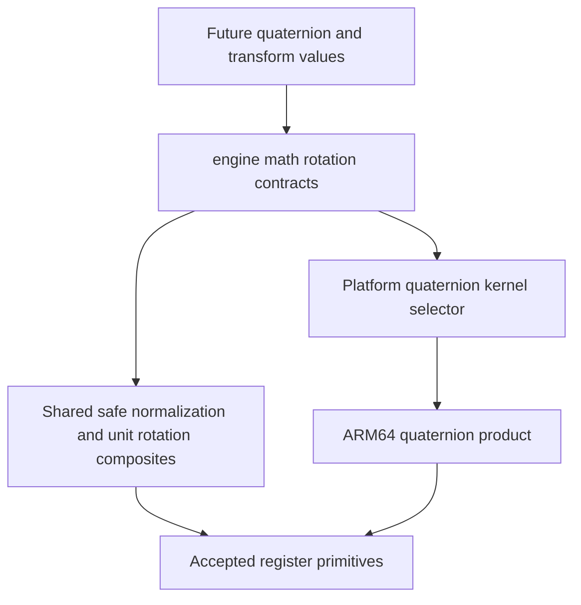

# Quaternion register algebra

Status: **accepted**. This is the lowest remaining
rotation dependency after accepted native register composition and source-layout
migration `f383fbb`. It does not implement a quaternion value class or transforms.

## Source map and bounded scope

All references use Unreal commit
`f45729c0b6f097038e72b52d366a62baeca3275b` under
`Engine/Source/Runtime/Core/Public/Math/`. Source is inspected locally, not bundled.

| API | Reference | Implemented algorithm |
|---|---|---|
| `normalize_safe` | `UnrealMathVectorCommon.h.inl:425–440`, VectorNormalizeSafe | Dot4, ordered GE against precision-specific squared threshold, refined reciprocal square root, multiply, bit-select normalized value or supplied fallback |
| `normalize_quaternion` | Common:599–608, VectorNormalizeQuaternion | Safe normalization with XYZW identity (0,0,0,1) |
| `quaternion_multiply` | `UnrealMathNeon.h:2318–2335`, VectorQuaternionMultiply2 | Start A.W times B; add A.X/Y/Z times swizzled B and source sign vectors in that order using multiply then fused multiply-add |
| `quaternion_inverse` | Common:719–727, VectorQuaternionInverse | Multiply XYZW by (-1,-1,-1,+1); assumes unit quaternion |
| `quaternion_rotate` | Common:741–773, VectorQuaternionRotateVector | T=2 cross(Q,V); fused Q.W*T+V; add cross(Q,T) |
| `quaternion_inverse_rotate` | Common:783–797, VectorQuaternionInverseRotateVector | Unit inverse then forward rotation |

Actual consumers include `Quat.h:1042,1213,1267` and
`TransformVectorized.h:1185,1446–1450,1633,1758`. These justify this algebra;
interpolation, public quaternion construction/diagnostics, matrices, decomposition,
transform scaling and matrix inverse remain separate preparation. No whole-engine
math inventory is being imported.

`UnrealMathVectorConstants.h.inl:43,61` defines float/double identities;
46 uses `1.e-8f` and 64 uses `1.e-8` for the squared-length thresholds.
83–84 defines inverse signs. 86–91 defines product signs:
(+1,-1,+1,-1), (+1,+1,-1,-1), (-1,+1,+1,-1) in each precision.
These literals must not narrow double through float. Internal immutable values
are constructed using existing register loads/broadcasts; no public constant
API or mutable initialization state is needed. This is a local representation of
source constants, not a different numerical policy.

## Contracts and ownership

Registers remain owned XYZW values; operands are passed and returned by value,
with no borrowed storage, allocation, mutation of callers or runtime dispatch.
The shared header exposes float and double overloads. Source common composites
belong in engine math; the source ARM64 product belongs behind the platform
selector in CPU/arm64, not macOS. Intrinsics never enter the shared contract.

Quaternion multiplication A*B applies B first, then A. Neither product nor inverse
normalizes implicitly. Inverse is conjugation for a unit quaternion, not a general
inverse dividing by squared length. Rotation requires a unit quaternion and a
vector whose W is zero. No new assertions, repair, clamping or diagnostics are
added to these raw source operations. Value-class diagnostics are a later owner.

Safe normalization is four-dimensional and compares squared length **>=** the
source threshold. It computes reciprocal and normalized lanes even when the
fallback will be selected. There is no scalar early return, exception suppression
or floating-point-status guarantee. NaN squared length compares false and selects
the fallback bits; infinity is not specially repaired. The caller fallback is
returned unchanged, including signed zero and payload bits. Quaternion
normalization supplies identity; it does not choose a sign hemisphere.

ARM64 float and double retain their accepted dot4 grouping and two-step reciprocal
square-root refinement. Double does not gain an invented full-precision square
root. Unit inverse uses numeric sign multiplication, not a new bit-flip algorithm.
Product preserves separate first multiplication followed by fused sign-times-term
accumulation; algebraic equivalence is insufficient to reorder rounding.

## Files and implementation

Architecture, contracts, comments-only plans and red tests preceded implementation.
Source algorithm comments now accompany their methods and significant steps:

- `src/engine/core/math/public/bw/math/rotation/quaternion_register.hpp`: shared API.
- Adjacent `quaternion_register.inl`: shared composite implementations.
- `src/platform/math/public/bw/platform/math/quaternion_register.inl`: compile-time
  kernel selector.
- `src/platform/cpu/arm64/math/simd/quaternion_register.inl`: native product
  implementation using accepted primitives without a scalar fallback.
- `tests/engine/core/math/quaternion_register_tests.cpp`: native contract target
  linked to `bw_math`, included in the default build and CTest.

Both C++ corpora were queried for header design and again for implementation; full F.8, F.20 and GEN.6 read.
Value ownership and side-effect-free algebra follow F.8/F.20. Header-visible
kernels allow the inliner to see the selected operations; no broad force-inline
or flatten policy is introduced. Code-generation checks below confirm the selected operations; no frame-time or
benchmark improvement is claimed. Four targeted clang-tidy signature suppressions
retain the source operand order for same-register value/fallback and
quaternion/vector arguments; all other checks remain fatal.

## Verification

Native float/double tests cover Hamilton basis products and noncommuting order,
known non-unit products (no implicit normalization), unit inverse and signed zero,
axis rotations, composition and inverse round trips, W0 preservation, safe
normalization above/below the source threshold, unchanged fallback bits, NaN
fallback and quaternion identity fallback. Numerical rotation checks use fixed
fixture-specific error budgets selected before implementation (2e-6 float,
2e-9 double), allowing the accepted two-refinement kernel approximation. These
are test choices, not Unreal-defined accuracy guarantees or a claim of double
machine-epsilon normalization. Exact algebra fixtures use
exact assertions and do not share production formulas as their oracle.

Preparation tests compiled and failed at actual missing-definition linking in
Debug and Release. Implementation makes the same assertions pass; no prepared
test assertion changed. Debug and Release full builds now pass fatal clang-tidy,
32 standalone header checks, all 11 actual-consumer include-boundary probes and
**29/29 CTest entries each**. Formatting, whitespace and DOM-backed Mermaid
parsing pass.

Eight optimized float/double callers cover product, safe normalization, forward
and inverse rotation. Native multiply/FMA sequences retain product accumulation
order; native dot, compare, reciprocal-square-root estimate plus two refinements
and bit-select implement normalization. Rotation and inverse compose inline.
There are no operation calls, scalar fallback, heap calls, initialization guards
or stack copies in these callers. Immutable typed arrays use static constexpr
storage: local automatic double arrays originally induced stack copies around
paired loads, and static constant storage removes those copies without changing
arithmetic. Constants remain read-only with no dynamic initialization.

Evidence stays ignored under `research/evidence/quaternion-registers/`:

- `debug-red.txt`, `release-red.txt`: preparation missing-definition failures.
- `implementation-debug-build.txt`, `implementation-release-build.txt`: full
  fatal-lint builds, headers and boundary probes.
- `implementation-debug-tests.txt`, `implementation-release-tests.txt`: 29/29
  native contract results, including the unchanged prepared quaternion tests.
- `codegen.cpp`, `codegen-command.txt`, `codegen.s`: eight bounded consumers built
  using the actual Release target options; native instruction review.

No quaternion value class, interpolation, matrix, transform, game launch or
future tooling implementation is part of this slice. Those remain separate
architecture/header/test preparation. User accepted the implementation and authorized its commit.

Root independently reviewed all bodies against the pinned source, inspected the
final eight optimized callers and repeated Debug CTest with 29/29 passing.
