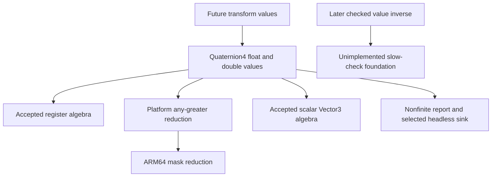

# Quaternion values

Status: **accepted; implemented and verified**. Accepted register
algebra is `95cba2a`. This slice supplies the aligned value layer required to pass
rotations into and out of future transforms, without implementing transforms.

## Source and scope

References use Unreal `f45729c0b6f097038e72b52d366a62baeca3275b`, under
`Engine/Source/Runtime/Core/`. The original Bullet Witch implementation is not a
dependency. `Public/Math/TransformVectorized.h:170–179,207–216,1211–1216` consumes
aligned quaternion values, establishing this layer before transform construction.

| Value operation | Source | Selected algorithm |
|---|---|---|
| Layout and default | `Public/Math/Quat.h:37–68` | 16-byte-aligned XYZW scalar members; ordinary default initialization leaves them uninitialized |
| Forced zero/identity | `Quat.h:866–869` | XYZ = 0, W = 0 or 1 according to force-init choice; no diagnostic |
| Splat/components | `Quat.h:90–98,871–880` | Initialize all components, then nonfinite diagnostic |
| Register construction/factory | `Quat.h:100–113,882–887` | Protected constructor stores aligned native register, then diagnostic; public factory returns it |
| Explicit precision conversion | `Quat.h:728–733` | Cast each component and delegate to component constructor, including its diagnostic |
| Identity constants | `Private/Math/UnrealMath.cpp:27–28` | Per-precision const specialization with (0,0,0,1) constructor |
| Product and compound product | `Quat.h:1025–1048` | Aligned register inputs/product/store, diagnostic result; compound operator returns a value copy |
| Normalize/copy | `Quat.h:385,393,1104–1143` | Dot4, GE against caller tolerance, refined reciprocal root, multiply, select identity, store; copy variant normalizes a copy |
| Is-normalized | `Quat.h:1146–1155` | Abs(1-dot4) compared to source threshold; negate any-greater result |
| Dot/length | `Quat.h:1097–1101,1159–1169` | Scalar component product sum; length takes scalar platform square root |
| Rotate/unrotate | `Quat.h:1235–1258` | Scalar TVector cross/add/scale chain, with negated XYZ for unrotate |
| Contains-nonfinite/diagnostic | `Quat.h:588–607,1391–1399` | Scalar finite checks; selected Debug diagnostic logs once per template callsite, preserving values |
| Native any-greater | `Public/Math/UnrealMathNeon.h:2225–2235` | Ordered greater masks; float unsigned max reduction; double OR XY/ZW masks then unsigned max |

The API provides construction, identity, product, normalization, magnitude,
rotation and validity observations. Matrix/rotator/axis-angle constructors,
interpolation, serialization, string parsing and comparison conveniences are
outside this slice. They remain named future work rather than undocumented stubs.

**Value-level inverse is deliberately absent.** `Quat.h:1262–1270` calls
`checkSlow(IsNormalized())`. `Misc/Build.h:242–244,270–272` selects that guard in
Debug but not Development; `Misc/AssertionMacros.h:332–337` routes it into the
assertion system. That assertion/crash dependency is not implemented yet. Prepare
that dependency before adding the value method; do not silently omit its check or
invent a math-only throw. The accepted raw register unit-inverse remains available
for later transform internals with its own unchecked source contract.

## Representation and ownership

`Quaternion4<T>` is a plain owned value with public x/y/z/w components and
`alignas(16)`, restricted to float/double as in the existing vector API. Aliases
are `Quaternion4f`, `Quaternion4d` and source-default double `Quaternion`. Layout tests
require size 16/32, alignment 16, standard layout, expected component offsets and
trivial copyability. Default construction performs no numeric work; tests must
not read an uninitialized object. Braced value initialization still zeroes its
components through normal C++ semantics. Identity is an explicit initialization
choice, not the default.

Existing `ZeroInit` is reused and an `IdentityInit` tag spells the other source
force-init choice. Tags are a typed API spelling of EForceInit, not a new
numerical behavior. Explicit cross-precision conversion prevents accidental
narrowing. Register construction remains protected; the named factory exposes it.
A private register helper is unnecessary: the source operations visibly perform
their own aligned loads/stores, with no hidden policy or retained pointer.

Scalar value RotateVector/UnrotateVector are intentionally distinct from the
accepted SIMD register rotation composite. The pinned source uses TVector algebra
for these methods even when register intrinsics are enabled. Do not substitute
the available register rotation function or silently change arithmetic grouping.
Scalar dot also keeps its left-associated component sum. Product and normalization
use the selected native paths as mapped above.

Normalization default is `static_cast<T>(1.e-8f)` from
`UnrealMathUtility.h:130`, including float rounding promoted to double. This is
not the raw double normalize-safe literal 1.e-8. Custom tolerances receive no new
positive-value guard, unit fast path, finite repair or exception suppression.
The candidate is computed before selection. Normalize itself has no post-call
diagnostic in source. Identity fallback comes from the source (0,0,0,1), including
its exact float-to-double representability.

IsNormalized uses `0.01f` (`UnrealMathUtility.h:215`, vector constants:54), promoted
when the input is double. It accepts the boundary by rejecting only greater
error. Ordered comparisons mean NaN error can return true; contains_non_finite is
a separate predicate. Do not conflate them. The new shared any_greater API returns
bool for the source nonzero/zero meaning; it does not expose mask integer magnitude.

## Diagnostics and build ownership

The existing `bw_math` target propagates one Debug diagnostic definition to every
consumer. `Quaternion4<T>::diagnostic_check` follows the same selected source
`GEnsureOnNANDiagnostic=false` branch already used by Vector3: source exceptional
unsynchronized static once-state per precision/callsite, real nonfatal report,
then remember it was reported. Constructors and products diagnose; force-init,
implicit copy and normalization do not add extra checks. Non-Debug omits the
calls, while explicit contains_non_finite remains functional.

The quaternion reporter lives with engine/core/diagnostics. It uses the existing real headless stdout sink,
with XYZW formatting from `Quat.h:890–894` (nine fractional digits), bounded
formatting/publication per the existing `CoreMisc.cpp:503–522` source map. This is
the established headless logging adaptation, not full Unreal logging/ensure UI.
No mutation, clamp, throw, callback injection or silent identity repair.

## Implementation and verification

Architecture preceded contracts, comments-only plans and independently compiled
red tests. Authorized bodies now live in `rotation/quaternion.inl`, with identity
specializations in `math/rotation/quaternion.cpp`. The native predicate is in the
existing ARM64 composition file behind platform selection; reporting belongs to
diagnostics. `bw_math` owns the value constants and report implementation and
propagates one consistent diagnostic configuration to all consumers.
`quaternion_tests` now participates in the default build and CTest.

Both C++ corpora queried; full C.49/F.20/GEN.6 read. Initialize members directly,
return owned results and keep source inline bodies visible. Source no-init default
and register-store constructor deliberately retain their source semantics rather
than impose C.49 as a new algorithm. No broad force-inline policy.

Independent tests cover layout, explicit conversion, identity/zero/splat/factory,
noncommuting products and compound return values, scalar dot grouping, vector
rotation, custom normalization equality/unit override, double default-tolerance
precision, NaN normalization/observations and native predicate lanes. A real child
process captures stdout to verify Debug report-once and non-Debug silence while
nonfinite components remain unchanged. Test tolerances are fixed fixture budgets,
not Unreal accuracy claims. All 30 tests pass in Debug and Release, including the previous 29 suites.

## Verification results

Debug and Release full builds pass fatal clang-tidy, 33 standalone header checks
and the existing 11 actual-consumer include-boundary checks. All 30 CTest entries
pass in each configuration. Prepared test assertions are unchanged byte-for-byte;
the recorded missing-definition red runs preceded these green runs. Root
independently reviewed source correspondence and repeated Debug 30/30. Formatting,
whitespace and DOM-backed Mermaid parsing pass. Ignored evidence is under
`research/evidence/quaternion-values/`.

Ten bounded optimized ARM64 callers cover float/double product, normalization,
normalized predicate, scalar dot and scalar value rotation. Native product/FMA,
refined reciprocal-root and mask reductions inline without operation calls, heap,
initialization guards. The double product caller retains a 32-byte stack return
temporary; this is recorded compiler output, not a reason to alter the source API.
Scalar value expressions retain their
source path; ordinary compiler contraction is visible in generated scalar code.
These are code-generation checks, not a performance benchmark or full engine test.

Source destination no-initialization followed by complete register store has a
narrow lint annotation rather than added zeroing. Component constructor ordering
and native-store construction also retain their documented source exceptions.
The value identity uses source ordinary construction; normalization's immutable
static constexpr lane constant spells the exact source register identity without
depending on dynamic initialization of the value identity.

User accepted the implementation and authorized its commit. Value inverse still awaits its
source slow-assertion dependency; no matrix, interpolation, transform or host
integration has been added.
