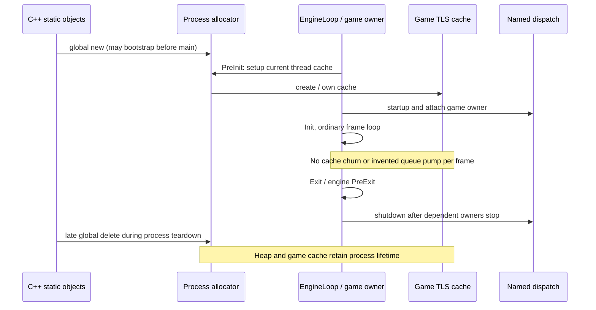

# Allocator adoption and thread ownership

Status: implemented, verified and accepted. The accepted allocator
`76c8b03` now serves the headless host's executable-local C++ allocation operators.
PreInit establishes the game owner's cache and starts accepted named dispatch;
Exit stops dispatch after engine PreExit while retaining process memory lifetime.
No per-frame memory work, worker pool, rendering thread or general scheduler was
added. Architecture, headers, comment plans and red tests preceded these bodies.

## Reference and selected sequence

All paths below are under `Engine/Source/Runtime` at Unreal
`f45729c0b6f097038e72b52d366a62baeca3275b`. Algorithms are described in our own
words; the reference source is not distributed here.

| Source | Selected behavior and our owner |
|---|---|
| `Core/Public/Modules/Boilerplate/ModuleBoilerplate.h:20-70`; `Core/Public/HAL/PerModuleInline.inl:9-10` | Replacement operators compiled once into this monolithic executable. Eight allocation and sixteen deallocation forms route through the memory facade. |
| `Core/Public/HAL/Platform.h:1043-1053` | Throwing and nothrow signatures remain distinct. C++20 `noexcept` expresses the source empty exception specification. |
| `Core/Private/HAL/UnrealMemory.cpp:347-439,576-608` | Allocation may initialize the heap before main. Explicit cache setup initializes it if needed; clear/used/unused only forward when the heap already exists. |
| `Launch/Private/LaunchEngineLoop.cpp:1790,2592-2593` | PreInit sets up the calling game-thread cache before task graph startup and game-thread attachment. Our accepted dispatch startup includes game attachment. |
| `Launch/Private/LaunchEngineLoop.cpp:5010-5065,5215` | Exit first stops engine activity and calls engine PreExit, then shuts down task dispatch after dependent owners have stopped. No render/pool stop is invented while those owners do not exist. |
| `Core/Private/Async/TaskGraph.cpp:629-638,965-975` | Worker task entry sets up eligible caches; task runnable exit clears them. These are future worker integration sites, not game-thread shutdown instructions. |
| `Core/Private/Async/Fundamental/WaitingQueue.cpp:106-126` | Actual worker wait releases cache ownership before the event wait and reacquires it afterward. This does not wrap frame pacing sleeps. |

The accepted dispatch is the named-thread dependency needed by desktop trim, not
Unreal's entire TaskGraph. This integration starts no worker, render or RHI
thread. Future owners must attach, service their source-defined queue/wait sites,
stop and detach before engine dispatch shutdown. No new game-thread queue pump
is inserted in Tick: the inspected Launch loop supplies no such insertion point.

## Allocation rules

Every ordinary scalar/array allocation substitutes one byte for a zero request.
Default alignment uses the original requested size: at most eight bytes requests
alignment eight, otherwise the compiler default new alignment (at most sixteen,
asserted as in the source). Explicit aligned forms pass their requested alignment.
Nothrow forms use the same selected allocator and fatal failure semantics; they
do not invent a recoverable allocation mode. Every matching delete form ignores
its redundant size/alignment and frees through the same facade. Placement new
into caller storage remains the standard library operation.

The operator unit belongs to the executable, not the allocator library. This
prevents accidental global replacement in every independent test/tool consumer.
A dedicated executable test links the exact same operator unit as the eventual
host. The allocator object's existing system-storage new/delete remains the
bootstrap escape specified by the reference, not a fallback for client objects.
The normal allocator and crash reserves survive static destruction; engine Exit
does not destroy the heap or clear the game cache.

Core R.15 requires matching allocation/deallocation families. R.1 guides ownership
pairing without inventing scope destruction for process-lifetime reference
resources. Performance MEM.6 supports a single allocation facade; it does not
replace the selected source global routing with a different injected policy.
Both corpora were queried and those full rules read separately for the header
and implementation phases.

## Implementation boundaries

- `engine/core/memory/public/bw/memory/global_allocation.hpp/.cpp` declares and defines the complete
  operator family. The same unit is linked directly into `engine_host` and its
  real native operator test, never transitively into every allocator consumer.
- `engine/core/memory/public/bw/memory/allocator.hpp/.cpp` exposes four thread-cache lifecycle forwards.
  Only setup can bootstrap; the other three inspect the existing private
  published allocator pointer. No public mutable singleton or fake injection.
- `engine/runtime/public/bw/runtime/engine_loop.hpp/.cpp` owns PreInit cache/dispatch startup and
  Exit dispatch shutdown. Its timing and Tick bodies remain unchanged.
- `tests/integration/runtime/global_allocation_tests.cpp` checks actual heap ownership for all
  allocation families, all matching delete families, early static allocation,
  native EngineLoop PreInit/Init/Tick/Exit and late static deletion after main.
- `tests/integration/runtime/allocator_lifecycle_tests.cpp` checks facade cache transitions and native
  engine lifecycle ordering. Tick does not pump the game queue; accepted dispatch
  shutdown drains it. Cache and allocator remain usable after engine Exit.

## Scope and review

Not implemented by this slice: general worker scheduler, worker creation,
render/RHI lifecycle, all-module/DLL allocation replacement, third-party C
allocator wrappers, GPU/GC/arena adoption, or application recovery from OOM.
The selected Mac allocator algorithms remain unchanged. Native memory-pressure
callbacks still require a future Cocoa/main-dispatch host: this headless loop does
not service that OS queue. Allocator hooks are available for future source-defined
worker wait/exit sites, but no such worker integration is claimed. Process routing
is verified for the executable and opted-in test, not arbitrary external DLLs or
third-party C allocations.

## Verification

Before implementation, both new targets compiled under fatal clang-tidy then
failed to link: global operators lacked the four source-specific sized+nothrow
deletes, and lifecycle lacked four facade definitions. Standard libc++ operator
resolution was explicitly not treated as proof of engine routing.

After implementation:

- Debug and Release full builds, fatal clang-tidy and all 24 standalone headers
  pass. Both configurations pass 25/25 CTest entries: the accepted 23 plus the two
  native integration suites. Their prepared assertions were not weakened.
- The operator test validates allocator ownership metadata, zero/small/large and
  aligned storage, all operator families, early static allocation and late static
  deletion after a real native engine lifecycle. The lifecycle test validates
  source ownership without fake allocator/clock implementations.
- `nm -gU` confirms 24 strong global allocation/deallocation definitions in the
  actual headless host. A bounded `engine_host --seconds 0.05` native run exits0
  after normal lifecycle cleanup; its source-default cap remains zero. This was
  a headless test, not a game/window launch or frame-performance benchmark.
- The Mermaid sequence diagram uses the participant identifier `EngineOwner`
  instead of reserved `Loop`; the corrected text passes the Mermaid parser.
  Parser tooling was temporary outside the repository; no dependency was added.
- Formatting and whitespace checks pass. Logs and symbol evidence remain ignored
  under `research/evidence/allocator-lifecycle/`. User acceptance authorizes this
  slice's commit; no push is authorized.
