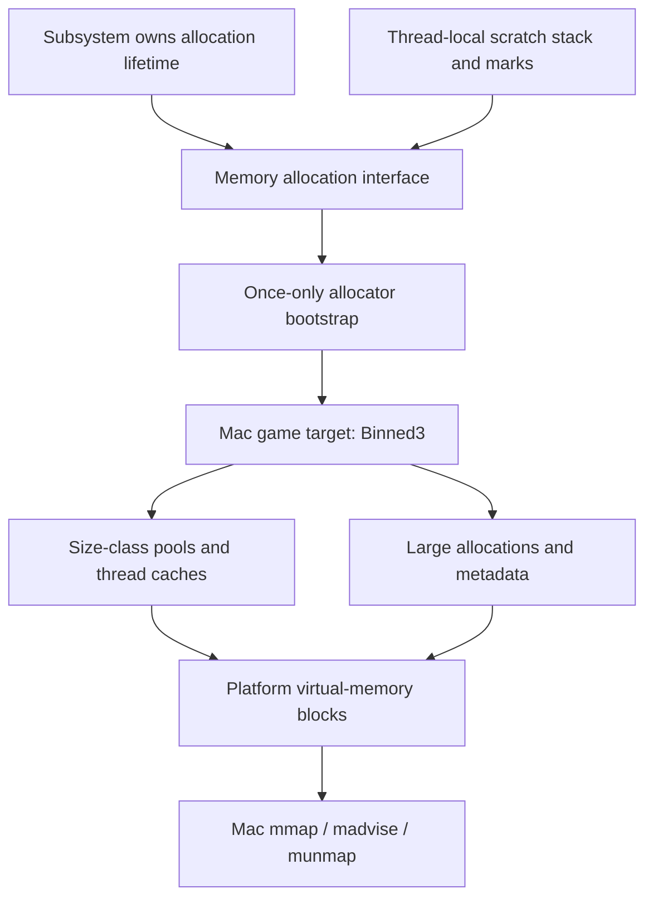

# Memory

The first memory foundation implements native Mac virtual-memory blocks and their
fatal failure path. Binned3 allocation, bootstrap and thread caches are mapped in the next
[general allocator](binned-allocator.md).
The accepted [game loop](../../runtime/game-loop.md) remains unchanged. This document describes
our subsystem using Unreal commit
`f45729c0b6f097038e72b52d366a62baeca3275b` as the algorithm reference. None of the
previous Bullet Witch implementation is an input to this work.

## Selected path

The pinned Mac build selects **Binned3** when the target has not selected another
static allocator: `UEBuildMac.cs`, `MacPlatform.ValidateTarget`, lines 294–297.
`UEBuildTarget.cs`, lines 6728–6744, converts that selection into the allocator
preprocessor definitions. This is the game target path. The separate editor,
program, instrumentation, sanitizer and command-line alternatives in
`FMacPlatformMemory::BaseAllocator` do not make a headless game host a mimalloc
program target.



`FMemory_MallocInline` (`HAL/FMemory.inl`, lines 16–52) forwards to the selected
allocator, entering the external initialization path when the allocator does not
exist yet. `FMemory::GCreateMalloc` (`HAL/UnrealMemory.cpp`, lines 430–439) uses
function-local static initialization for once-only thread-safe construction.
The constructor path at lines 347–417 selects the platform allocator, establishes
crash/tracing hooks and adds a synchronization proxy only when the chosen
allocator is not internally thread safe. Binned3 reports that it is thread safe
(`HAL/MallocBinned3.cpp`, lines 592–595).

Binned3 reserves a contiguous virtual address range for its small size classes;
it does not eagerly allocate that much physical RAM. Its constructor establishes
size classes, metadata and allocation/exhaustion bit trees (`MallocBinned3.cpp`,
lines 443–549). Committing and decommitting individual blocks is delegated to
the platform (lines 555–588). The Mac configuration uses the platform virtual
block directly for large allocations (`MallocBinned3.h`, lines 22–48 and 70–84).
Thread caches and their lifetime are part of the allocator, not independent
per-controller heaps (`MallocBinnedCommon.h`, `FPerThreadFreeBlockLists`, lines
500–583; cache setup/teardown, lines 778–819).

Scratch storage is a separate lifetime mechanism. `FMemStackBase` keeps its page
allocator alive, grows through page-sized chunks, and returns chunks when a mark
is unwound (`Misc/MemStack.cpp`, lines 312–396). It is not a replacement for the
general allocator. GPU resources, garbage collection, asset residency and job
scratch lifetimes are later consumers, not implemented by this foundation.

## First memory dependency: virtual-memory blocks

The first implemented memory dependency is the platform block used by Binned3.
It does not substitute an ANSI allocator or an arena for Binned3 and does not
claim the engine has a complete memory subsystem. Pool management, the public
allocation facade, lazy bootstrap and thread caches follow this dependency.

The inspected Apple implementation is
`Engine/Source/Runtime/Core/Private/Apple/ApplePlatformMemory.cpp`:

| Operation | Source | Algorithm and observable contract |
|---|---|---|
| Virtual and commit alignment | 733–743 | Both return the native OS page size. No fixed 4 KiB or 16 KiB assumption. |
| Allocate virtual | 745–760 | Round size to native pages, record page count, require requested alignment no larger than one OS page, map read/write private anonymous pages with `MAP_NORESERVE`. |
| Free virtual | 764–778 | If present, unmap the complete recorded region, then clear address and page count. Empty handles do nothing. |
| Commit | 780–785 | Check page-aligned in-range offset/size, then advise `MADV_FREE_REUSE`. The source does not check the advice return value. |
| Decommit | 787–796 | Check the same range contract, then advise `MADV_FREE_REUSABLE`; advice failure enters fatal memory handling. |

The mapping is readable and writable from creation on this platform. “Commit”
does not introduce Windows-style access permission transitions. “Decommit”
makes pages reclaimable while retaining the virtual range; it does not promise
immediate reclamation, zeroed bytes, or an access fault. Clients must consider
decommitted contents discarded and initialize reused storage. These distinctions
belong in the platform contract and tests.

`MmapWithTag` (same file, lines 65–77) passes the Apple virtual-memory allocation
tag through the anonymous mapping call. Native operations stay in the Mac target
implementation; future targets must implement their own platform semantics.

## Ownership and failure boundaries

The reference block is a low-level value handle containing a pointer and a
32-bit page count (`GenericPlatformMemory.h`, lines 469–500). It can describe an
existing mapping and is copyable. It does not release memory in a destructor.
One allocator/caller owns the mapping's release; copied handles alias that
mapping and cannot independently free it. Free clears the handle on which it is
called, not every alias. Operations on one block require caller synchronization;
this leaf is not an allocator locking mechanism.

The header preserves that source contract. It does not quietly add
reference counting, a new move-only ownership policy, an injected allocator,
suballocation, realloc, or a per-frame reset. Future owning allocator objects
are responsible for their storage lifetime. R.1 and I.11 guidance was read to
make the ownership boundary explicit; it does not authorize changing the
reference handle's semantics.

Allocation, unmap and decommit failures reach `OnOutOfMemory` in the reference.
Its full implementation depends on emergency reserves, memory statistics,
logging, delegates and crash machinery (`GenericPlatformMemory.cpp`, lines
247–305). Inspection of the selected Mac configuration resolves the dependency:
`GetBackMemoryPoolSize` is inherited from `GenericPlatformMemory.h:344–348` and
returns zero. `SetupMemoryPools:220–230` therefore creates no emergency reserve.
We do not invent a reserve size or bring in an allocator to release one.

The implemented headless fatal path is:

1. Enter the source once-only function-local static initialization
   (`CoreMiscDefines.h:180–181`, `UE_CALL_ONCE`). Concurrent callers wait for
   that initialization while the fatal thread reports/exits. If it returns,
   `GenericPlatformProcess::SleepInfinite:427–434` parks in `pause()`.
   No atomic winner/loser protocol or recursive initialization policy is added.
2. Retain size/alignment/system error on the winning fatal thread. No external
   mutable global record is exposed. The source's optional `GLog` panic and
   registered delegates have no installed service/observers in this host.
3. Gather native host memory, swap and process footprint/virtual size through
   the calls in `MacPlatformMemory::GetStats:178–225`; collect system error text
   through bounded `strerror_r` (`ApplePlatformMisc:87–104`).
4. Report the actual fields through Mac native `os_log`, corresponding to
   `ApplePlatformMisc::LocalPrint:74–84`. The headless build explicitly selects
   a stdout output device using the `fwrite`/`fflush` operations from
   `OutputDeviceStdOut.cpp:33–36`, so terminal and child-process diagnostics are
   observable. Fixed stack formatting extracts the current diagnostic payload;
   it does not claim the full structured logger has been reconstructed.
5. Follow the unguarded critical failure branch: `MacErrorOutputDevice::Serialize`
   at 69–74 calls fatal handling and `RequestExit(true)`; `MacPlatformMisc.cpp`
   at 725–735 terminates critical failure with `_Exit(3)`. No `abort` substitution,
   normal engine-loop shutdown, retry or fallback allocation is introduced.

Full engine logging, guarded exception/crash collection, interactive submission,
allocator dumps and failure observers are later services. They are not installed
as fake callbacks. This extraction implements native failure reporting and
termination for the current unguarded headless host. Debug precondition failures
use the distinct fatal assertion route and must not be reported as OOM.

The shared failure entry/record live in `src/engine/core/memory/public/bw/memory/memory_failure.hpp/.cpp`.
The target boundary is declared in `src/platform/memory/public/bw/platform/memory/memory_failure.hpp`; native
reporting, statistics and termination live in
`src/platform/os/macos/memory/memory_failure.cpp`. None is called during successful
allocation or the game loop. E.26, E.28 and MEM.7 were queried and read in full
for this extension; they explain failure and virtual-memory boundaries without
selecting different algorithms.

The fatal report is the first statistics sample in this foundation, so its peak
fields equal the current sample. This is not a historical high-water mark; the
reference updates those fields across calls to its statistics service. The
native calls and their return statuses are real. No periodic statistics service
or full crash-report subsystem is claimed here.

## Implemented files and verification

The architecture was written first, followed by headers, comments-only
implementation units, then tests. Missing-definition link failures were recorded
before method bodies were written, including the failure-path extension.

| File | Responsibility |
|---|---|
| `src/platform/memory/public/bw/platform/memory/platform_memory.hpp/.cpp` | Common address/page-count descriptor and explicit alias lifetime |
| `src/platform/os/macos/memory/public/bw/platform/os/macos/platform_memory.hpp/.cpp` | Native virtual-block operations and source preconditions |
| `src/engine/core/memory/public/bw/memory/memory_failure.hpp/.cpp` | Shared fatal record and once-only failure entry |
| `src/platform/memory/public/bw/platform/memory/memory_failure.hpp` | Target reporting, fatal assertion and terminal wait declarations |
| `src/platform/os/macos/memory/memory_failure.cpp` | Native statistics, diagnostic sinks and critical exit |
| `tests/engine/core/memory/memory_tests.cpp` | Native behavior and child-process failure scenarios |
| `CMakeLists.txt` | Memory library, independent header checks and registered native test executable |

Six native success scenarios cover the empty descriptor, native alignment/page
rounding, access throughout the mapped extent, subrange reuse, whole-region
reuse and explicit release/descriptor alias behavior. They do not assume
zeroing after decommit. The test-only `MappingOwner` pairs release on failures;
it does not add automatic ownership to the production descriptor.

Seven child-process cases cover zero-size mapping failure, decommit of an
unmapped range, misaligned unmap, the source's unchecked commit advice result,
debug alignment and range preconditions, and concurrent fatal callers. Real OS
failures check the reported size, alignment and expected error value; concurrent
callers produce one report. Debug assertions use a distinct report. Child
watchdogs bound failure cases without exhausting host memory.

The first native run exposed an incorrect test expectation: decommit of an
unmapped range returns `EINVAL` on Darwin, not the test's assumed `ENOMEM`.
The installed `madvise(2)` documentation specifies `EINVAL` for a range containing
unallocated regions and `ENOMEM` for an address/length outside the allowed virtual
address range. Only that expected test value changed; the production algorithm
was unchanged.

The full build, eight independent header units, fatal clang-tidy, pinned format
and whitespace checks pass. CTest has **18 entries: 17 unchanged game-loop tests
and one memory executable** containing the scenarios above. All pass, including
an independent root-agent run. Ignored evidence records the red links in
`research/evidence/memory-preparation-link-red.txt` and
`research/evidence/memory-failure-link-red.txt`, followed by the native green run
in `research/evidence/memory-native-green.txt`.

```sh
cmake -S . -B build-game-loop -DCMAKE_BUILD_TYPE=Debug
cmake --build build-game-loop --parallel
ctest --test-dir build-game-loop --output-on-failure
cmake --build build-game-loop --target format-check
```

Two narrow lint exceptions preserve the inspected platform API: adjacent size
and alignment parameters, and the Darwin anonymous-mapping VM tag carried in the
file-descriptor argument. The generic static analyzer incorrectly treats that
tag as an invalid descriptor. Neither exception disables checks for the module.

No general allocator, fragmentation policy, thread cache or gameplay correctness
claim follows from this leaf. Existing game-loop implementation and behavioral
tests are unchanged. This foundation is accepted. The next slice prepares Binned3 allocation, bootstrap
and thread-cache contracts before implementation review.

Both C++ corpora were queried for header design and implementation. Full rules
read: Core R.1, I.11, E.26 and E.28; Performance MEM.6, MEM.1 and MEM.7. E.26 and
MEM.7 were read again for implementation. The rules informed explicit lifetime,
error capture and native VM boundaries without substituting another algorithm.
MEM.6's constructor-injection recommendation is not substituted for Unreal's
selected bootstrap. MEM.1 describes scoped arenas; that different lifetime is
why it is not selected as our persistent allocator.

## Pinned references

All paths above are relative to `Engine/Source/Runtime/Core`, except build-tool
paths under `Engine/Source/Programs/UnrealBuildTool`.

- [Mac allocator selection](https://github.com/EpicGames/UnrealEngine/blob/f45729c0b6f097038e72b52d366a62baeca3275b/Engine/Source/Programs/UnrealBuildTool/Platform/Mac/UEBuildMac.cs#L294)
- [Allocator definition generation](https://github.com/EpicGames/UnrealEngine/blob/f45729c0b6f097038e72b52d366a62baeca3275b/Engine/Source/Programs/UnrealBuildTool/Configuration/UEBuildTarget.cs#L6728)
- [Mac allocator construction and alternatives](https://github.com/EpicGames/UnrealEngine/blob/f45729c0b6f097038e72b52d366a62baeca3275b/Engine/Source/Runtime/Core/Private/Mac/MacPlatformMemory.cpp#L68)
- [Virtual-memory block algorithms](https://github.com/EpicGames/UnrealEngine/blob/f45729c0b6f097038e72b52d366a62baeca3275b/Engine/Source/Runtime/Core/Private/Apple/ApplePlatformMemory.cpp#L733)
- [Binned3 initialization](https://github.com/EpicGames/UnrealEngine/blob/f45729c0b6f097038e72b52d366a62baeca3275b/Engine/Source/Runtime/Core/Private/HAL/MallocBinned3.cpp#L443)
