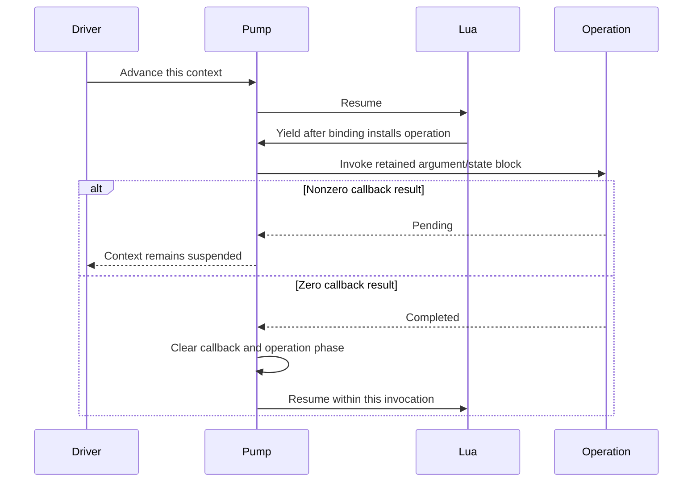

# Execution and lifetime contracts

**Design · working baseline · October 22, 2026.**
[Engine structure](logical-overview.md) · [Runtime owners](runtime-model.md) ·
[World model](world-and-simulation.md) · [Source mapping](file-mapping.md).

These contracts specify how the proposed runtime owners exchange state, work
and memory. They complement the structural architecture; they do not prescribe
reconstruction order. Recovered rules retain their local scope. The implemented resource/task/Lua/root subset is identified in
[startup runtime](../startup-runtime.md); other systems below remain proposed.

## Control, simulation and presentation domains

The application control domain services host events and advances the session's
selected mode schedule. That schedule invokes task, script and world phases.
World state has a declared writer for each phase; jobs may not mutate arbitrary
actors while a hierarchy or query consumer is reading them. A parallel system
needs its input snapshot/borrow, output ownership and completion edge specified
before it participates in a consuming phase.

```mermaid
flowchart LR
    Host["Host events and time"] --> Schedule["Session mode schedule / task passes"]
    Schedule --> World["World phases and script drivers"]
    Schedule --> Resource["Resource requests and completion observations"]
    Resource --> Worker["Resource worker and phase callbacks"]
    Worker --> Registry["Synchronized publications / status"]
    Registry --> World
    World --> Prepare["Scene / UI / media preparation"]
    Prepare --> Packet["Sealed render packet"]
    Packet --> Render["Render consumer"]
    Render --> Device["Device work and presentation"]
    Render --> CPU["CPU consumption completion"]
    Device --> GPU["Device-use completion"]
    CPU --> Reuse["Permitted storage reuse / retirement"]
    GPU --> Reuse
```

Arrows are handoffs, not a fixed global frame sequence. A packet's particular
storage uses determine which completion it needs; not every CPU byte requires a
GPU fence. The render-publication task remains positioned by the recovered task
schedule rather than assumed to follow every world update.

| State / domain | Writer or mutation authority | Reader / handoff constraint |
|---|---|---|
| Session/mode and ordinary live world | Control-domain schedule and its explicitly ordered callbacks | Other domains consume a stable borrowed phase or owned/versioned result |
| Resource registry and loaded records | Resource service serializes mutation, including worker callbacks | Publication/status reads synchronize; observed readiness is not queue emptiness |
| Script context and pending operation | Its driver/pump and defined native continuation | Async work owns arguments/results, not borrowed Lua stack slots |
| Pose / model instance data | Required animation/model phase | Attachments read after the required evaluation; async render input cannot later change |
| Physics scene | Physics service's mutation/step/fetch sequence | Queries and callbacks obey that sequence and backend access rules |
| Render packet / CPU arena | Producer until seal, then consumer under submission contract | Producer reuses only when all accesses to that storage have completed |
| Native graphics resources | Selected device implementation under declared affinity | Every submitted use retains its resource until sufficient device completion |
| Audio/video samples and state | Media service/backend plus defined screen/world operations | Consumers retain samples and synchronize playback-status observations |
| Hide/trace worker output | Dedicated worker domain | Required reader/join edges remain unresolved; a work signal is not a join |

This defines exclusive mutation responsibilities, not a requirement that every
row has a dedicated thread. Moving resource/device work or collapsing an async
worker into the control thread can change observable timing and must be assessed
against its recovered contract. Startup construction can occur while a world is
not active; that is different from unsynchronized mutation of a live world.

The implemented startup path uses measured monotonic elapsed time. Recovered
render-list publication `0x40f920` caps the screen/fade delta at 0.1 seconds
after waiting for prior render completion; it does not establish a fixed logical
timestep. Host pacing and game delta are separate from the movie's audio/PTS
clock. Exact full-engine mode cadence remains unresolved. See the
[clock evidence](../../research/engine/subsystems/bootstrap-and-tasks.md#startup-clock-and-presentation-pacing).

## Update phases and clocks

Maintain distinct host elapsed time, game-mode timestep, animation/controller
progress, physics timing configuration and presentation pacing. Pass the value
required by each recovered path; do not derive a universal fixed tick from one
constant. Pause/menu/fade gates are mode/task policy and may affect different
systems differently.

A mode schedule names its ordered phase callbacks, eligibility predicates and
work completion prerequisites. It preserves separate task lifecycle/active/later
passes, both hierarchy walks and same-invocation state transitions. This can be
ordinary explicit code; it does not require a general dependency-graph scheduler.

The known `0x45f070` actor/effect sequence and `0x4617e0` game/physics sequence are
local schedule witnesses. They constrain their reconstructed mode path. They do
not supply an all-mode universal frame order. Detailed actor/physics invariants
appear under [task passes](#task-passes-and-local-scheduling); complete mode
cadence and auxiliary worker readers remain identified research work.

## Resource lifecycle

Maintain separate identities for a logical resource, its catalog entry, its
containing file, its archive record and its constructed runtime object. The
logical name alone cannot identify the owner of an existing publication.

| Layer | Recovered state / rule | Proposed representation boundary |
|---|---|---|
| Catalog selection | ASCII query folding in current corpus; lower key first; equal-key order unresolved | Catalog lookup returns an exact catalog/resource identity or explicit absence/ambiguity |
| Resource entry | Requested and available are separate bits; publication stores payload/record pointers | Request state is distinct from a typed publication with owning-record identity |
| File entry | Requested 0x01, opened 0x02, phase 1 complete 0x04, phase 2 complete 0x08, open failure 0x10 | Named state fields preserve those distinctions and their permitted transitions |
| CALL record | Per-record completed phase; failed callback is retried | Handler continuation records phase and required inputs; an unfinished callback remains unfinished |
| Lifetime | Tag selects files for unload; release checks current publication identity | Group ownership and retained consumers govern physical release independently of logical availability |

The native masks describe the evidence. They need not be copied into an identical
host struct, but transitions observable by callers must be preserved. A single
`loaded` boolean or success result for the whole queue cannot represent this.

A resource request proceeds as follows:

1. Resolve the name using currently mounted catalogs and explicit priorities.
   The current reader reports winning equal-key conflicts as ambiguous; this
   is a declared restriction pending a recovered tie-order contract.
2. If it has not already been requested or made available, mark it requested
   before walking its direct dependencies. Convert local dependency indices
   to full names and use the same global lookup path. Retain the source order.
3. Mark the containing file requested. Coalesce repeated requests for the same
   selected entry/file without losing the owners waiting on it. Do not substitute
   a new global topological ordering for the original marking/phase passes.
4. Open requested eligible files, validate their containers, and invoke supported
   record constructors. The original file pass skips opened and open-failed files.
5. Run the original phase-1 pass and then the phase-2 pass over eligible loaded
   files. Record completion per CALL; retries must preserve the callback's state.
6. Publish an object only at its handler's supported publication point. Consumers
   that require availability must not use the unready lookup as a ready getter.

**Important failure boundary:** original phase loops have no mapped bounded retry,
and worker callbacks can finish without every resource becoming available. The
new engine must expose diagnostics for no progress/failure. It must not silently
turn either condition into success. A watchdog, cancellation result or changed
failure outcome needs an explicit compatibility decision when implemented; no
arbitrary timeout is chosen here.

The current inspector can describe an unknown FourCC; it cannot execute its
handler. Runtime construction of an unsupported required record is an explicit
unsupported result, not a placeholder object. Parsing an archive with unknown
records and running that archive are different support claims.

On tag unload, call the relevant release handlers, including CALL phase 3. Clear
publication only if the current owner still matches the releasing record. Keep
backing bytes alive while objects, callbacks or submitted commands refer to them.
Partial construction needs a record of acquired ownership so local cleanup can
release initialized parts without double release. The original partial-failure
and cancellation outcomes remain [unresolved](../../research/engine/OPEN-QUESTIONS.md).

[Resource evidence](../../research/engine/subsystems/resource-dispatch.md).

## Script continuation

Each root, mission or AI context owns its execution state and any pending native
operation. Native bindings use explicit argument/result schemas. They borrow
engine/game services through a context whose lifetime contains the operation.
Do not retain pointers into transient marshaling storage or a Lua stack slot
after a yield unless the runtime explicitly retains that storage.

This preserves the recovered bridge/pump sequence. It does not establish a frame
rate, thread affinity, or a requirement to wait one tick before the first poll.
A binding may itself introduce a phase boundary, as `_WaitTitle` does.

Immediate APIs return synchronously to Lua, even when they enqueue background
work. Yielding APIs suspend until their native continuation permits resumption.
API naming is not enough to select a bridge. Retain the root, mission and AI
registration sets and their argument/result behavior separately from the generic
execution machinery.

Before destroying a context, stop its driver and resolve ownership of pending
operations and retained Lua values. Cancellation must prevent future callbacks
from touching the context. The exact script-visible cancellation/error semantics
remain binding-specific work; the runtime must not invent a universal success,
exception or retry convention.

[Script evidence](../../research/engine/subsystems/execution-and-scripts.md).

## Task passes and local scheduling

Tasks have requested and current lifecycle state. Lifecycle transitions run
before active callbacks; start/stop/destroy are distinct transitions. Both active
passes have eligibility gates, and the later pass also has an application-state
gate. A screen's completion/result and its physical destruction can occur at
different points. The scheduler supplies ordering, while each task supplies its
specific state machine.

The proposed schedule representation must preserve explicit ordering and conditional
calls from the recovered mode, including same-invocation transitions. It should
make unsupported modes visible rather than falling back to a convenient generic
update order. Task keys alone do not close every equal-key/order question.

Selected local invariants to preserve:

- The hierarchy walk visits a parent before its children and supplies the parent's
  transform to the child context. A separate second walk must not be folded into it.
- Model motion advancement, pose/controller work, motion events and bone attachment
  consumption retain their mapped order for the selected actor family.
- Deferred entity retirement advances on maintenance calls. The ordinary mapped
  path destroys an entry on the third later call after admission to bucket 2;
  this is not necessarily three rendered frames.
- Physics timing configuration uses `min(dt, 0.06666667f)`, but the later simulation
  call receives the original `dt`, followed by a blocking result fetch in the
  mapped service. Do not propagate the timing clamp into simulation by accident.
- The particle RNG advances on every original draw, including branches that draw
  twice for a guard and assignment. Pack binding overwrite order, simulation order
  and RNG call order are behavior, not implementation trivia.

These rules apply at their mapped scope. All-mode cadence, some worker joins and
several numerical branches still need targeted evidence before their source bodies
are reconstructed. [Bootstrap](../../research/engine/subsystems/bootstrap-and-tasks.md) ·
[actors](../../research/engine/subsystems/actor-lifecycle.md) ·
[physics](../../research/engine/subsystems/physics-and-collision.md) ·
[particles](../../research/engine/subsystems/particle-runtime-contracts.md).

## Work domains and handoffs

| Domain | Owns work | Required exchange contract |
|---|---|---|
| Application/task driver | Mode selection, task passes, context pumping and game scheduling | Calls services through explicit results/state; does not infer readiness from unrelated queue activity |
| Shared resource worker | Queued resource callbacks and owned copied arguments | Pending includes queued and running work; keep callback/argument ownership through callback return |
| Render producer/consumer | Command building, submitted lists and command execution | Retain list storage and resource references until consumer completion; device work can extend lifetime |
| Physics service | Scene mutations, simulation and result access | Preserve queued mutation/step/fetch ordering; blocking fetch is not a join of unrelated workers |
| Auxiliary workers | Mapped hide/trace and other asynchronous work | A work signal is not completion; precise producers, readers and join points must be specified |
| Audio/video services | Banks/cues, decode samples, playback state and output work | Distinguish request acceptance, frame/cue readiness, completion and storage release |

These are logical execution domains, not a proposed thread per row. Native
thread/event facts are retained in the research maps. Actual adapter affinity
and synchronization belong in the implementation contract for each boundary.
There is no general event bus or unrestricted global service locator in this design.

**Proposed resource synchronization:** registry mutations are serialized by the
resource service. Consumers obtain synchronized publication state and stable
owned/retained references. Which operations execute on the resource worker,
task driver or selected device thread must be specified before implementing that
path. Do not claim a lock-free registry or force GPU work onto a thread without
checking the backend contract and recovered publication order.

The original resource queue has 128 callback slots and a 0x4000-byte argument
arena. Its pending count includes running callbacks, whose slots remain occupied
until return. A new queue representation must preserve required ordering and
capacity semantics. The mapped full-slot lock-release and argument-ownership
failure branches are hazardous and not dynamically verified. They are not a
reason to reproduce a memory error or report false success; isolate the unresolved
exceptional behavior and make rejection explicit in the proposed API.
[Worker evidence](../../research/engine/subsystems/background-resource-worker.md).

## Ownership and release

The following are proposed logical owners, not existing classes or a recovered
object graph. An implementation can use a different layout if it preserves these
lifetimes and the original observable behavior.

| Owner | Owns | Must outlive / release condition |
|---|---|---|
| Application composition | Selected service instances, scheduler, game driver, workers | All calls and jobs using those services; joins precede destruction |
| Content/catalog registry | Mounted catalogs and their selection metadata | Requests/lookups retaining catalog identity; unloading blocks new uses first |
| Loaded archive | Immutable bytes, record metadata and construction/release bookkeeping | Borrowed payload views and runtime objects that retain those bytes |
| Resource group | The game's tag-based retention/unload relationship | Its active consumers; release is not equated with immediate byte deallocation |
| Script context | Lua state/coroutine, retained values, pending native operation | Driver/poll callbacks and any job retaining context-owned state |
| Mission instance | Mission context, world and stage resource-group lease | Mission work and world quiescence before release |
| World | Registry/hierarchy, stage instances, simulation and render/audio associations | Updates, deferred retirement, queries and submitted work referencing its data |
| Effect instance | Active parts/particles, children and pack/model references | Emission, simulation and geometry consumers; graceful stop differs from destruction |
| Submitted command storage | Command records and required retained inputs | Render consumer completion and any device use of referenced resources |
| Save operation | Snapshot/serialized bytes and operation result | File completion and UI consumers; buffer size and used length remain distinct |

A resource service may own an archive longer than a mission; a render submission
may retain an object after its world owner stops using it. Make these cross-owner
edges explicit through handles/retention. Do not assume the runtime ownership
graph is the same as the source dependency graph, or that shared ownership of
every object is necessary.

Normal shutdown: stop accepting new work, advance supported stop paths, drain
or safely cancel jobs, wait for outstanding consumers, release context/world/
resource ownership, join and destroy workers at the appropriate service boundary,
then destroy host services. Exact ordering among independent owners must be
established from their retained references. The PC render stop/join path is
recovered; all secondary workers and exceptional initialization exits are not.

A single-thread test executor can test ordering contracts, but does not validate
thread races, platform timing or complete shutdown. Missing host capabilities
remain explicit. No null graphics/physics/audio service may masquerade as faithful
execution of a path that needs the real result.

## Memory, allocation and residency

The [runtime model](runtime-model.md) defines logical ownership. Allocation
strategy must preserve that ownership and the original observable limits; a
single global heap is not a lifetime model. The required
[memory subsystem](memory-and-residency.md) owns allocation routing, backing
storage, budgets and accounting. Subsystems select lifetime-appropriate arenas,
pools or reclaimable allocations through that contract. Implicit default-heap
allocation is not the final engine policy; current standard-container allocations
remain an explicit migration gap. Exact pool sizes and target budgets require
measurement rather than reproduction of original x86 addresses.

| Memory scope | Contents | Reuse / release boundary |
|---|---|---|
| Process / engine | Service instances, registrations, selected device/middleware state | Dependent sessions and work domains have quiesced |
| Content definition | Archive bytes, decoded metadata, shared model/motion/effect/bank definitions | Last instance/request/submission use released, subject to supported cache policy |
| Mission / world | Entity storage, stage membership, local physics and effect/model instances | Correct retirement/destructor ordering plus quiescence of external uses |
| Instance | Components, controller/pose state, particle children, cue/player state | Instance teardown and outstanding consumer obligations |
| Task / operation | Continuation state, copied job arguments, save snapshot | Completion or defined safe cancellation; result readers retain what they need |
| Phase scratch | Temporary evaluation/query/command-preparation values | No reference may escape the declared phase without promotion/copy |
| Submission arena | Commands and copied/retained presentation inputs | CPU consumption and any device access to that storage have completed |
| Device residency | Textures, buffers, shader/pipeline objects and uploaded media | Last device use completes; CPU publication removal alone is insufficient |

Resource groups describe mission/tag retention. They are not necessarily one
physical arena that can be freed in bulk. Eviction requires no outstanding use
and must preserve supported reload/publication behavior. No LRU eviction policy,
streaming budget or automatic quality downgrade is selected by this architecture.

Request coalescing retains all required consumers. Byte reads, decoded-definition
availability, handler construction, deferred phases, publication and device
readiness remain separate progress states. Resource streaming therefore connects
the worker, resource registry and subsystem constructors without granting the
worker unrestricted authority over a live world.

Record capacity and rejection at the owner: original 128 resource callback slots,
0x4000-byte argument arena, entity handle slots, deferred spawn records and particle
caps are distinct limits. Allocation failure cannot become success or trigger an
unrecorded behavior-changing fallback. Preserve the last stable state and expose
the affected operation's failure; script/game outcomes still require their own
recovered contracts. Exact allocator fragmentation and some failure branches are
unresolved and stay attached to those owners.

Diagnostics identify owner/instance/request/submission, current state, retained
bytes and outstanding consumers. Estimates use actual archive bytes, entity/
particle counts, pose sizes and command volume; no target memory or frame-time
budget is asserted without measurement. Diagnostic state must not control game
behavior or require exposing raw pointers in the game-facing API.

## Fidelity checks and cost accounting

Each implemented path needs its inputs, expected state changes and independent
reference source recorded. Existing format inventories validate the reader;
future state-machine, numerical and runtime claims require their own evidence.
Do not use a count of assertions as a count of reconstructed behaviors.

Before implementing a performance-sensitive path, count costs in its inputs:
archive bytes read/retained, metadata allocations, request graph visits, copied
job arguments, active actor/particle work, pose storage, command bytes, uploads,
synchronization and device readback. Distinguish estimates from measurements.
The current reader copies metadata and per-record arguments; it is a functional
baseline, not a measured streaming/residency design. Optimize behind the same
contracts after a concrete cost is identified.

Unresolved arithmetic stays local: animation interpolation and SIMD differences,
particle scalar terminal selection, float-to-integer/RNG ordering, shader state
and legacy physics behavior need appropriate comparisons. Cross-platform source
portability alone does not establish numerical or gameplay equivalence.
