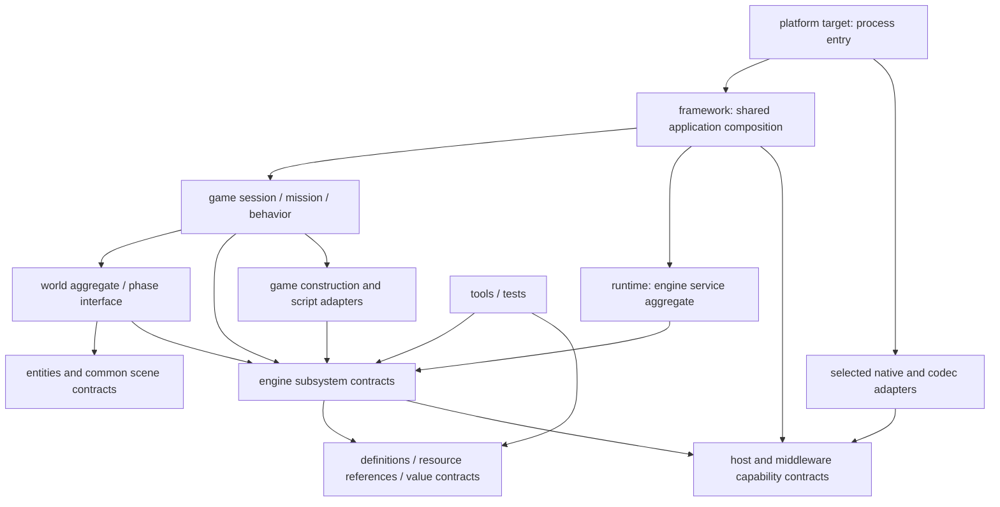
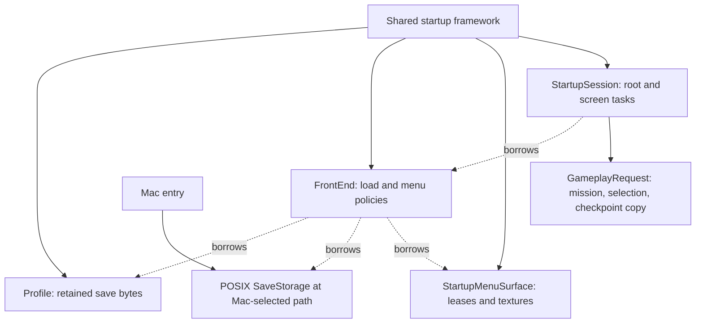
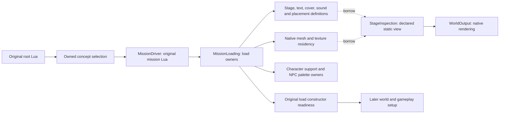

# Source ownership and dependency mapping

**Target architecture · working baseline · October 22, 2026.**
[Engine structure](logical-overview.md) · [Runtime ownership](runtime-model.md) ·
[Change axes](change-axes.md).

Source boundaries follow runtime responsibilities and reasons for change. They
are not reconstruction stages. A library/module can serve startup, play and
shutdown; no milestone has its own parallel engine implementation.

## Naming and provenance

Name reconstructed engine types, functions and files for their responsibility.
Readers should not need the original engine's vocabulary to understand an API.
Use descriptive words; preserve established public terminology such as Lua.
Do not invent expansions for unexplained original abbreviations.

Original extensions, signatures, record tags and Lua-visible binding names remain
at compatibility boundaries because the purchased data/scripts require those exact
values. Document their relationship to the engine's concepts here and in decoder
contracts. Original-engine research retains the identifiers needed to trace evidence.

| Engine concept / type | Responsibility | Original identifier |
|---|---|---|
| `ResourceArchive` / `ResourceArchiveRecord` | Own an archive's bytes and expose bounded resource records/payloads | `.cpr`, `CPR1` |
| `ResourceCatalogData` | Decode catalog names, file references and dependencies | `.rat`, `RAT ` |
| `ResourceCatalog` | Own decoded catalog data and index it for lookup | RAT-backed catalog |
| `NamedFilePackage` / `PackageMember` | Access individual named files inside a package | `.dpk`, `dpk\0` |
| `ModelDefinition` | Retain original mesh records and decode bounded streams, indexed draws, materials and constants | `VFX2`, `CNKH`, `DIP`, `kns2`, `CF1I` |
| `StageDefinition` | Resolve catalog-selected model/texture definitions and retain explicit auxiliary inputs | Native stage/sky loading namespaces and texture `table._tm` |
| `SectionTable` | Borrow bounded row/column sections with typed optional cells | `STBL`, placement/cover/score tables |
| `TextTable` | Validate immutable text-tree links and string pools for registration | `STMANAGE` |
| `AudioBankDefinition` | Construct typed wave, cue, sound, track and event definitions with borrowed payloads | `FBSC` wrapper, XACT sound/wave banks |
| `WorldTextureImage` | Preserve original ordinary and packed half-float pixel interpretation before device upload | CPR texture metadata; D3D A8R8G8B8 / A16B16G16R16F |
| `TaskLifecycleScheduler` | Advance lifecycle, active-update and late-update passes on one thread | Recovered task-dispatch functions |
| `CompanyLogoFlow` | Advance the ordered logo movie/fade/input update policy | CompanyLogo task update |
| `StartupCheckFlow` | Advance the PC startup UI check phases and result | MemoryCardCheck task update; no storage I/O in this update |
| `Profile` / `ProfileLoadFlow` | Retain compatible save bytes and drive loading/error choices | System/Record files and CharacterLoad task |
| `MenuFlow` / `FrontEnd` | Select game actions and compose profile, persistence, fades and presentation | TitleMenu and its native child screens |
| `GameplayRequest` | Own the validated mission selection and optional retained checkpoint | Original root `_StartMission` boundary |

The matching files are `formats/resource_archive`, `formats/resource_catalog`,
`formats/named_file_package` and `tasks/task_lifecycle_scheduler`. Content entry
points are `open_archive` and `open_catalog`. The source API uses these names
throughout; there are no aliases retaining the old opaque type names.
The inspector's existing `cpr`/`rat` commands, JSON format labels and diagnostic
signatures remain file-format identifiers, preserving existing research tooling.

`TaskLifecycleScheduler` creates no threads and has no locking. All calls require
one owning thread; even a query must not race with mutation. Its recursion flag
is not synchronization. A future worker/job executor has a separate responsibility.

## Source families

The tree is the target organization; the implemented subset is listed below. Public portable contracts
live under `include/bw/`, their implementations under matching `src/` families.
Game-private declarations stay next to the concrete game implementation. A
logical owner can be an aggregate; the map does not mandate a class per row.

```text
bullet-witch/
  include/bw/                  Portable engine contracts
    runtime/                   Engine instance, service lifetime and diagnostics
    world/                     World aggregate, stage instances and phase context
    scene/                     Transform/bounds membership and query views
    entities/                  Identity, hierarchy, state/message dispatch, retirement
    ai/                        Evaluation, controllers and action interface
    animation/                 Motion instances, tracks, poses, events, attachments
    effects/                   Pack definitions, instances, simulation and children
    physics/                   Engine collision, scene/query/mutation/provider contracts
    render/                    Scene projection, views, visibility, materials,
                               pass construction, commands, queue and device contracts
    ui/                        Sprite/text/layout primitives and UI scene
    input/                     Observations, action masks, edges/repeats/deadzones
    audio/                     Banks, cues, spatial bindings and device contract
    video/                     Player, sample ownership and backend contract
    memory/                    Allocation domains, budgets, arenas, pools and leases
    tasks/                     Lifecycle passes, work queue and completion contracts
    script/                    Context, compatible runtime adapter, bridge/operations
    resources/                 Catalog, service, groups, typed references, handlers
    content/                   Mounted/virtual location and access policy
    formats/                   RAT/CPR/DPK/AMB container views
    assets/                    Model/motion/effect/UI/media/save payload families
    math/                      Shared operations with explicit numerical conventions
    platform/                  File, clock, thread/event, window and raw input contracts
  src/                         One game/engine implementation root
    framework/                 Shared application composition and frame orchestration
    video/                     Shared player/sample transport
      ffmpeg/                  Selected software codec backend and factory
    platform/                  Concrete adapters selected by target
      files/                   Shared read-only files and POSIX save storage
      macos/                   Mac entry, window/input, Metal, AudioQueue and shaders
    game/                      Bullet Witch behavior; private headers alongside code
      session/                 Session owner, root driver and progression state
      mission/                 Mission owner, stage assembly, outcomes and events
      modes/                   Explicit mode schedules and startup/root transitions
      screens/                 Concrete title/menu/dialog task state machines
      actors/                  Player/enemy/vehicle/boss factories and components
      actions/                 Concrete native AI action families
      camera/                  Gameplay camera controllers and view requests
      bindings/                Root/mission/AI native API schemas and adapters
      persistence/             Capture/restore, save operations and checkpoint policy
      progression/             Mission advancement, records and unlock policy
      resources/               Typed/CALL construction adapters and registrations
  tools/                       Consumers of production engine/data contracts
  tests/                       In-process contracts and bounded integration coverage
  docs/architecture/           Target architecture and supporting views
  research/                    Original-engine evidence, authored tools, ignored outputs
```

The root `game/` remains reserved by the existing ignore policy for local data;
authored game code is proposed under `src/game/`. The change from the previous
proposed top-level game-code location does not move any existing implementation.
Do not create empty files to materialize this tree. `memory/` and `math/` receive
only concrete shared contracts; they are not miscellaneous utility buckets.

## Runtime owner to source responsibility

| Runtime unit | Source owner | Boundary | Change axes |
|---|---|---|---|
| ApplicationHost | `src/platform/<target>/` entry and `src/framework/` | Target selects adapters; shared framework composes engine/session and owns run/stop coordination | C1/P1 |
| EngineInstance | `runtime/` | Own shared service lifetimes; expose explicit dependencies, not a service locator | E13 |
| GameSession | `src/game/session/`, `modes/`, `screens/` | Root/modes/screens/progression and current mission relationship | G1/G5 |
| MissionInstance | `src/game/mission/` | Mission context, world and stage group; game-specific stage assembly | G1 |
| World | `world/` | Aggregate world-local instances and phase context; no game behavior implementation | E13 |
| Scene membership | `scene/` | Common transform/bounds observations; consumer-specific queries remain distinct | E14 |
| Actor identity/dispatch | `entities/` with `src/game/actors/` | Engine owns mechanics; game owns concrete component/state behavior | E3/G3 |
| AI mechanism/actions | `ai/` with `src/game/actions/` | Controller/evaluator depends on action interface, not concrete enemy classes | E4/G3 |
| Model/animation/effects | `animation/`, `effects/` | Shared instance mechanisms with explicit pose/event/query consumers | E5/E6 |
| Physics scene/service | `physics/` plus selected adapter | Engine collision/mutation rules above middleware implementation | E7/P1 |
| RenderScene, views, materials, passes | `render/` | Scene projection through command encoding; device contract separates native API | R1/R2/R3/E8 |
| UI scene / screen tasks | `ui/` / `src/game/screens/` | Shared draw/layout mechanism versus navigation/modal/game policy | E15/G1 |
| Audio/video | `audio/`, `video/` plus adapters | Logical playback and sample ownership above native output/codec operations | E9/E11/P1 |
| Resources | `resources/`, `content/`, `formats/`, `assets/` | Definition/selection/lifetime separate from world instances and device internals | A1/A2/A3/A4/A5 |
| Script bindings | `src/game/bindings/` | Root/mission/AI schemas and operation adapters above the generic VM bridge | G2 |
| Handler integration | `src/game/resources/` | Connect typed definitions, resource phases and subsystem construction | A6 |
| Execution/memory | `tasks/`, `script/`, `memory/` | Explicit phase/continuation/storage contracts used by owners | E1/E12/E2/E16 |
| Input service | `input/` and selected device sampler | Engine interpretation above raw platform observations | E10/P1 |
| Game camera | `src/game/camera/` | Gameplay policy producing view requests | G6 |
| Persistence/progression | `src/game/persistence/`, `progression/` | Snapshot/restore and advancement/unlock policy remain separate | G4/G5 |
| Shared math | `include/bw/math/vector.hpp`, `matrix.hpp` (`bw_math`) | Precision-preserving fixed vectors and row-vector matrices; caller-owned tolerances and policies | E17 |
| Inspection/verification | `tools/`, `tests/`, authored `research/tools/` | Consumers of production contracts and independent evidence | V1 |

## Dependency rules



Arrows mean source dependencies. `Interfaces` groups multiple subsystem modules;
it is not an actual umbrella header/library that every consumer imports.

1. `src/game/` can use engine contracts. Portable engine implementations do not
   include concrete game classes. Composition injects actions, binding handlers,
   resource constructors and schedules through the corresponding narrow contract.
2. World/runtime aggregates know the systems they compose. Individual systems
   receive identity, observations and service contracts rather than including the
   aggregate to find arbitrary dependencies. This avoids world ↔ system cycles.
3. Entity identity and scene observation types do not include concrete actors,
   AI controllers, render backends or the resource-service implementation.
4. Rendering reads scene/pose/material inputs; it cannot own or mutate actor
   gameplay. Game camera controllers produce view descriptions through the view
   contract. Material/pass interpretation does not reside in native adapters.
5. Effects use shared animation, physics-query and presentation contracts. AI
   uses action/environment interfaces. Neither imports concrete game policies.
6. Pure formats/assets decode bounded bytes. Catalog selection owns name policy;
   content access owns location policy; resource service owns runtime publication.
   No parser opens a device or constructs an actor.
7. Resource service depends on the handler interface, never on registered concrete
   handlers. Typed reference/definition contracts are separately usable by the
   renderer/physics/audio services without including their own constructors back.
8. Adapter implementations depend on the capability they implement. Only composition
   selects concrete adapters. Native OS/API/SDK types remain inside that adapter
   or a documented backend-private bridge.
9. Tools/tests depend on production contracts; production never imports a test
   fixture, inspector, Python research parser or decompiler export.
10. Cross-system requests/events are typed at the owning boundary with specified
    delivery semantics. A global event bus or generic service locator is not a
    substitute for these dependencies.

Build visibility should enforce these boundaries as modules are implemented.
No include-boundary checker or unimplemented modular build is claimed today.

## Contract assignment

These IDs identify architectural contracts, not C++ signatures. Each implementation
header must define inputs, outputs, lifetime, failure and ordered steps using the
[workflow](../process/workflow.md), including both MCP consultations.

| Contract | Owning source family | Required semantics |
|---|---|---|
| C01 Container view | `formats/` | Bounds and original byte ownership; file offsets distinct from host pointers |
| C02 Content access | `content/` | Mount/virtual location and read-only content versus writable user data |
| C03 Catalog selection | `resources/catalog` | Exact selected identity, precedence and global dependency-name lookup |
| C04 Resource lifecycle | `resources/service`, `groups`, `reference` | Separate request/file/phase/publication and retained-use states |
| C05 Construction handler | Handler contract + `src/game/resources/` | Phase/result ownership, subsystem construction and matching teardown |
| C06 Task/work progression | `tasks/` | Lifecycle gates, owned arguments, capacity and queued/running/completed distinctions |
| C07 Script context/operation | `script/` | Compatible Lua, marshaling, pending state and same-pump resumption |
| C08 Session/mission/game transitions | `src/game/session`, `mission`, `modes`, `bindings` | Context/world ownership, mode policy and recovered status meanings |
| C09 Entity/behavior identity | `entities/`, `ai/` and game adapters | Validated identity, hierarchy/state/message/action lifetimes and retirement |
| C10 Animation data/instances | `assets/`, `animation/` | Shared definitions, instance pose/motion state, numerical and consumer contracts |
| C11 Effects | `effects/` | Binding/RNG/emission/children and simulation/presentation lifetime |
| C12 Collision/physics | `physics/` | Query/mutation schema, scene authority, timing/step/fetch and release |
| C13 Input | `input/` + platform sampler | Observation identity, action edges/repeats/deadzones and sampling gates |
| C14 Render submission/device | `render/commands`, `queue`, `device` | Ordered commands, stable inputs, CPU/device completion and reuse |
| C15 Media | `audio/`, `video/` | Bank/cue/sample lifetime and distinct acceptance/readiness/completion/failure |
| C16 Persistence | `src/game/persistence/` + asset/file contracts | Phase-consistent capture, schema, restore and operation status |
| C17 Progression | `src/game/progression/` | Advancement, records and unlock policy independent of discovered assets |
| C18 Runtime ownership | `runtime/`, `world/` + session/mission composition | Explicit owner tree, service dependencies, partial initialization and quiescence |
| C19 Scene/spatial observations | `scene/`, world bindings | Authoritative transforms/bounds, consumer membership and phase-valid query results |
| C20 View/material/pass preparation | `render/` + game camera | Camera request, visibility, material/light interpretation and pass dependencies |
| C21 UI presentation | `ui/` + screen adapters | Layout/draw state independent of navigation and script-facing screen result |
| C22 Memory/residency | `memory/`, native backing providers and subsystem domains | Scoped allocation, retention, capacity/rejection and completion-based reuse |
| C23 Shared numerical operations | `math/` and owning subsystem | Coordinates, units, rounding and exact versus approximate operation contracts |

## Build composition and implementation state

Proposed build groups follow dependency direction; a target is not a milestone:

| Group | Role / dependencies |
|---|---|
| Pure data contracts | Formats, asset definitions and catalog operations; no application/device dependency |
| Engine mechanisms | Runtime/world/entity/simulation/presentation/resource services through narrow contracts |
| Bullet Witch game | Session/mission/modes, actors/actions/camera, bindings, progression and integration |
| Selected adapters | Native libraries implementing engine capabilities |
| Game executable | Compose game, engine and selected adapters |
| Inspector / tests | Link only production contracts needed by their purpose |

Target granularity can be refined during implementation without changing these
boundaries. Keep CPU format tests and the inspector buildable without initializing
a device or world. Do not create a new test-only loader, renderer or simulation.

**Implemented today:** `bw_resources`, `bw_runtime`, `bw_profiles`, `bw_game`, `bw_images`,
`bw_startup_presentation`, `bw_video`,
`bw_video_ffmpeg`, `bw_startup_playback`, `bw_startup_framework`,
`bw_save_storage_posix`, the Mac `bw_save_directory_macos`,
`bw_media_audio_macos` and `bw_startup_host_macos`, `bw-resource`, `bw-startup`,
their tests and the engineering tooling. The [resource contract](../resources.md)
and [startup contract](../startup-runtime.md) describe the implemented subsets.
The completed [migration](../../IMPLEMENTATION.md#migrating-src-01) and subsequent
reconstruction sequence live in IMPLEMENTATION, not this architecture.

## Implemented boundary migration

The former combined `src/resources.cpp` is split into `src/formats/`
(CPR/RAT/common errors), `src/resources/catalog.cpp`, `src/content/access.cpp`
and `src/platform/files/host.cpp`, with corresponding public headers. ResourceCatalogData
owns decoded metadata; ResourceCatalog owns that value and an index. Public type
names retain the `bw::resources` namespace for compatibility. The file
capability is injected at the content boundary. This is implemented; other
proposed files in the mapping remain proposals until documented otherwise.

The implemented startup subset adds `formats/named_file_package`, `resources/service`,
`script/chunk`, `script/context`, `tasks/task_lifecycle_scheduler` and `src/game/root_driver`
(with its private header alongside it). CMake targets preserve dependency order:
`bw_game` → `bw_runtime` → `bw_resources`; the script adapter privately links
`bw_lua502`. A1 owns DPK layout, A3/A4 resource lifecycle/USER construction, E1
task progression, E2 Lua mechanics, and G1/G2 root policy/native bindings.
The `StartupSession` implementation now owns the root, scheduler and concrete
logo/check/advertise/title screen flows. It borrows `FrontEnd` for character-load
and title-menu tasks, validates the original root mission request, and owns the
resulting `GameplayRequest`. See [startup runtime](../startup-runtime.md).

`src/game/startup_flows` adds `CompanyLogoFlow` and `StartupCheckFlow` to `bw_game`.
They own recovered game update policy and borrow explicit observations from a
media/fade capability. They do not choose a backend, draw, mutate session globals
or remove scheduler tasks. `startup_services` supplies those session/lifecycle
operations. `startup_playback` supplies only game-relative paths and recovered
fade policy, delegating transport to the reusable `video::Player`.

`src/video/player.cpp` owns generic transport, clock and completion rules;
`src/video/ffmpeg/decoder.cpp` owns demux, audio decode and video decode workers
with separate bounded compressed queues. `src/video/pcm_buffer` owns timestamped
PCM transfer to the audio consumer. `include/bw/video/` contains the common
decoder, player and output contracts.
`src/platform/macos/startup_host.mm` implements window/input and Metal presentation;
`src/platform/macos/media_audio.mm` implements the independently serviced AudioQueue
output behind a portable declaration. Both are selected only by the Apple build
branch. `src/platform/macos/shaders/movie.metal` is independently compiled GPU source.
`src/platform/macos/main.cpp` owns process entry, native service construction
and explicit FFmpeg selection. It calls `src/framework/startup_application.cpp`,
which composes read-only resources, playback, profile, front end, presentation
and the original-root session, and owns the startup loop. The target injects
writable save storage separately from game files. The framework is application composition and
can depend on game code; engine mechanisms cannot. Future target entries reuse
that composition through common contracts.

`bw_video` contains shared player/PCM mechanisms; `bw_video_ffmpeg` alone links
the codec libraries. Player and the game adapter require an injected decoder
factory. The Mac executable selects the concrete factory and native targets;
shared playback tests link without FFmpeg. This is dependency separation, not
a claim of a Windows/Xbox backend or hardware decoder.
The original-root integration retains its full-route fixtures and also exercises
the concrete session through profile loading, costume 5 selection, actual save
I/O/reload and the original Lua new-game handoff, with controlled media and
synthetic rendering. Native manual costume 1 selection/handoff is separately
observed; this is not world execution.

The [memory subsystem](memory-and-residency.md) has common CPU/domain/allocator,
bounded coalescing-heap and device-budget contracts in `include/bw/memory/`.
`src/memory/` owns admission, accounting and recovered first-fit split/coalesce.
`src/platform/macos/cpu_backing.*` selects native CPU backing, and
`texture_allocation.*` owns Metal resources and their portable budget tokens.
`src/script/context.cpp` and the pinned Lua patch preserve context association.
Catalogs/resources, task nodes and retained snapshots, owned image/video/PCM
buffers and presentation state now carry domains. `StartupMemory` in the shared
framework receives capabilities chosen in the Mac entry. Virtual-page backing,
world/AI pools and asynchronous GPU retirement await their consumers. See
[the current implementation record](../../research/engine/subsystems/memory-migration-completion.md)
for coverage and verification.

## Implemented stage content boundary

`formats/model` owns retained CPU mesh bytes, declarations, indexed draws,
material references/constants and original record ordering. `content/stage`
selects definitions through mounted catalogs and resolves the original runtime
texture tables. `formats/stage_definitions` binds collision geometry, physics
reference graphs, AREA/FLAN views and material-animation tables; `StageInput`
keeps typed construction readiness separate from device residency. Unknown
present consumers retain explicit unresolved reasons, while absent optional
requests remain absent. Texture-only palette sets share the runtime table loader.
`formats/stage_environment` resolves the original customization hierarchy into
small typed lighting, sky and tone-mapping values. The primary stage retains one
customization archive; dependency mesh loads do not duplicate this owner.
These belong to `bw_resources`. `formats/world_texture` in `bw_images` decodes
ordinary RGBA8 and packed HALF4 pixels, including six-face cubes, using original resource metadata. None
of these types contains native device objects, actor instances or visibility
policy. Native rendering borrows their stable definitions and owns its own
device allocations; CPU definition readiness does not imply full stage readiness.
See [stage decoding evidence](../../research/engine/subsystems/stage-content-decoding.md)
for original source anchors, supported subsets and acceptance boundaries.

## Implemented world device boundary

| File | Responsibility |
|---|---|
| `include/bw/render/world.hpp` | Singular portable model/texture ownership, explicit residency and ordered material draw contract |
| `include/bw/render/world_material.hpp`, `src/render/world_material.cpp` | Shared classification of exact recovered static material families and required textures/attributes; unknown variants reject |
| `include/bw/render/world_output.hpp`, `src/render/world_output.cpp` | Authored HDR display parameters and portable sampled luminance adaptation; bounded history, explicit elapsed input and output-only limits. Native backends own image reduction, readback and final composition |
| `src/platform/macos/world_postprocess.hpp/.mm`, `src/platform/macos/shaders/world_output.metal` | Accounted HDR/intermediate target owners and recovered luminance, bloom, exposure and gamma passes; device completion gates reuse and scalar readback |
| `src/platform/macos/world_renderer.hpp/.mm` | Native immutable uploads, selected surface/depth pipelines, original draw addressing and submission validation |
| `src/platform/macos/buffer_allocation.hpp/.mm` | Retained native vertex/index bytes with transactional device admission and reconciled accounting |
| `src/platform/macos/texture_allocation.hpp/.mm` | Shared sampled color/packed-half textures and private depth attachments with device charges |
| `src/platform/macos/shaders/world_color.metal` | Static transforms and original geometric/normal/layered/sky equations, cube reflection and alpha coverage/blending |
| `src/platform/macos/shaders/world_depth.metal` | Original projected constant/slope-biased depth output |
| `src/platform/macos/startup_host.mm` | World pass followed by existing movie/UI composition and completion-safe retirement |

Game stage selection and inspection-camera/material policy remain in `src/game/`.
Device classes do not own gameplay visibility or infer lighting. See the
[renderer drill-in](world-renderer-reconstruction.md#implemented-static-geometry-and-surface-boundary)
for implemented flow, supported material coverage and remaining pass semantics.

## Implemented title presentation

`bw_images` owns shared bounded PNG and original FONT decoding under
`src/formats/`. `bw_startup_presentation` owns game title resource selection,
construction and draw data in `src/game/startup_title_surface`. It depends on
portable `render::SpriteOutput` and the resource service, not Metal.
`AdvertiseFlow` and `TitleFlow` remain in `bw_game`; `TitleSurface` injects
resource readiness and presentation without coupling the flow to a codec or
renderer. Mac implementation and standalone shaders remain under
`src/platform/macos/`. Native texture handles and bounded ordered commands
and static world geometry/material draws are implemented renderer subsets. The
full world pass graph remains proposed.


## Implemented profile, menu and handoff ownership

`bw_profiles` contains `src/game/profile` and `profile_load_flow`: original save
field compatibility and character-load policy remain game code. The portable
`include/bw/platform/save_storage.hpp` capability knows leaf filenames and byte
buffers, not Bullet Witch structures. `src/platform/files/save_storage.cpp`
implements bounded POSIX reads and temporary-file replacement. The Mac target
chooses its Application Support location in `save_directory.mm`; other targets
must choose their own storage implementation and location.

`MenuFlow` and `FrontEnd` are in `bw_game`. The former consumes profile fields and
an explicit achievement snapshot; the latter sequences loading, menu resources,
fades, retry/continue-without-saving choices, persistence and result publication.
`MenuSurface` is the borrowed presentation contract. `StartupMenuSurface` in
`bw_startup_presentation` retains menu/font/costume resources, decodes images and
emits portable sprite commands. Costume previews use original authored images;
selecting one records the later player-resource choice, not a rendered actor.

Arrows below denote ownership or the labeled borrow, not source dependencies:



`_StartMission` and `_WaitMission` are part of the 19 root bindings. The former
validates the confirmed campaign or concept selection; the latter remains
pending until an implemented mission outcome exists. The framework now consumes
One Shot Kill through `MissionDriver` and `MissionLoading`; other routes still
report the request boundary. `StageInspection` borrows mission-owned models and
textures and owns only the submitted static view. Original load readiness is
independent of that view; unsupported constructors remain explicit. Achievement
providers, omitted option screens and game/menu audio remain explicit gaps in the
[startup contract](../startup-runtime.md#profile-menu-and-gameplay-handoff).


## Implemented mission and inspection ownership

| File | Responsibility |
|---|---|
| `src/game/mission_driver.hpp/.cpp` | Original mission/default-callback Lua context, serial native waits and cancellation |
| `src/game/mission_loading.hpp/.cpp` | Serial native load requests, CPU definition and device residency ownership, readiness and cancellation; safe loading-presentation pulses and the authored concept-mission checkpoint placement boundary |
| `src/game/startup_loading_surface.hpp/.cpp` | Title-selected portrait, original repeated sliding artwork, localized loading tip and default Xbox icon presentation; resident textures and bounded draw commands |
| `src/game/mission_package_inputs.cpp` | Package text/cover/placement consumers, sound-bank registration and model dependency preloads |
| `src/game/npc_palette.hpp/.cpp` | Compatible NPC material-variation registry linked to resident textures |
| `include/bw/formats/section_table.hpp`, `src/formats/section_table.cpp` | Shared bounded placement, cover and score table access |
| `include/bw/formats/text_table.hpp`, `src/formats/text_table.cpp` | Text-tree construction and registration data without pointer relocation |
| `include/bw/formats/audio_bank.hpp`, `src/formats/audio_bank.cpp` | Typed sound/wave bank metadata; no audio voices or playback |
| `src/game/stage_inspection.hpp/.cpp` | Retained stage/player presentation, original custom traversal, live camera and borrowed device publication |
| `src/game/player_targeting.hpp/.cpp` | Original two-mode targeting selection and camera request, independent of raised posture lifetime |
| `src/platform/macos/gamepad_actions.hpp/.mm` | Native GameController action sampling and fixed press-edge history |
| `src/game/animation_review.hpp`, `stage_animation_review.cpp` | Explicit in-scene presentation previews, hardware action intent routing and paused weapon candidate publication; no combat outcomes |



Inspection never completes the original mission's load or starts gameplay.
Device owners retire before their borrowed host; the Lua context retires before
load-service captures and tagged scripts. See
[mission launch](../../research/engine/subsystems/mission-launch.md).


## Implemented character support construction

| File | Responsibility |
|---|---|
| `include/bw/formats/animation_definition.hpp`, `src/formats/animation_definition.cpp` | Bounded motion/shape relocation and skeleton bind-transform construction; no sampling |
| `include/bw/content/character_support.hpp`, `src/content/character_support.cpp` | Native support-name aliases, ordered lists and retained archive/USER ownership |
| `include/bw/animation/pose.hpp`, `src/animation/pose.cpp` | Prepared immutable channels, explicit-time sampling, reusable local/world/skin poses |
| `src/game/player_actor.hpp/.cpp` | Selected costume, original motion bindings, actor/model basis, right-hand weapon and one combined secondary/support-arm pose publication |
| `src/game/alicia_support_arm.hpp/.cpp` | Prepared authored weapon grip/pole targets; value-only left-arm overrides under caller-owned action permission |
| `include/bw/math/two_bone.hpp` | Reusable analytic two-link geometry and shortest-arc rotations, without actor state or pose mutation |
| `src/game/mission_loading.hpp/.cpp` | Mission-owned body/weapon definitions, support and device residency |

See [actors and animation](actors-and-animation.md). The actor presentation is
fixed at the recovered script placement until the movement owner is implemented.
Skin palettes and unskinned attachment transforms are separate outputs; motion
selection never substitutes for floor contact or jump trajectory.

Model definitions retain ordinary and shape streams separately. Skeletal draws
consume rest-shape positions explicitly; animated shape deformation remains a
separate unimplemented consumer. See
[character load constructors](../../research/engine/subsystems/character-load-constructors.md).


### Initial game camera and static spatial query

| Source | Responsibility |
|---|---|
| `include/bw/formats/customization.hpp`, `src/formats/customization.cpp` | Shared immutable customization tree and bounded authored payload lookup |
| `include/bw/formats/player_camera.hpp`, `src/formats/player_camera.cpp` | Original initial player camera preset and general frustum settings |
| `include/bw/scene/spatial/static_collision.hpp`, `src/scene/spatial/static_collision.cpp` | Static collision part registration, original triangle/clearance query; borrowed definition lifetime |
| `src/game/camera/initial_camera.hpp/.cpp` | Initial scripted-pose camera composition, ordered original clearance and renderer view output |

The stage content owner retains generic customization bytes; game camera policy
selects its own authored paths. Initial inspection supplies the recovered script
pose explicitly until the actor/start owner executes it. This bounded static
snapshot does not imply player traversal or a complete camera controller. Source
contracts and limitations are in [player camera initialization](../../research/engine/subsystems/player-camera-initialization.md).


Launch option parsing lives in `src/framework/startup_options.cpp`; it produces
the owned `StartupOptions` declared alongside application composition. The
optional inspection pose crosses into `StageInspection` only during view setup.
It adds no input controller or replacement gameplay-camera owner. Keeping the
parser independent of the native loop permits in-process configuration checks
without launching a window or reading game files.

The bounded traversal lifetime connects `src/game/player_controller.*`
(authoritative position/velocity and action phases), `src/game/camera/player_camera.*`
(live look/follow/clearance), `src/game/placed_collision.*` (authored prop shape
preparation), and `src/scene/spatial/character_collision.cpp` (shared custom
capsule contact). `StageInspection` retains those owners with the mission scene.
`WorldOutput::update_world_view` publishes world/sky constants over retained draws;
`StartupInput` exposes movement/look axes and jump/pause edges separately from
front-end action masks. This entry does not complete the original mission start.

### Engine timing and mission admission

| Files | Responsibility |
| --- | --- |
| `include/bw/timing/frame_clock.hpp`, `src/timing/frame_clock.cpp` | Monotonic elapsed observation, source presentation clamp, pacing deadlines and explicit loading rebase |
| `include/bw/world/world_clock.hpp`, `src/world/world_clock.cpp` | Single scaled interval publication, immutable frame identity and admitted world time |
| `include/bw/input/action_repeat.hpp`, `src/input/action_repeat.cpp` | Shared original held/pressed repeat bank using explicit presentation time; devices supply masks |
| `src/game/mission_control.hpp/.cpp` | Stable original user/script/pad pause authority, shared saved-state stack, hardware/neutral admission and restricted UserPauseControl handle |
| `src/game/pause_menu.*`, `developer_review_flow.*`, `mission_driver.*`, `stage_inspection.*` | Native pause and separate developer navigation receive only user-pause commands; driver and scene borrow const control/time observations |
| `src/game/pause_help.*`, `pause_options.*` | Native child navigation; narrow Help read capability and authoritative settings transaction/save capabilities |
| `src/game/controller_settings.*`, `device_options.*`, `controller_options.*` | Original System mapping compatibility, separate PC device settings persistence, and native controller child policy |
| `src/game/controller_input.*`, `include/bw/input/physical_state.hpp` | Game mapping of neutral physical samples through copied settings; platform never reads Profile |
| `src/game/menu_dialog.*`, `menu_audio.*` | Shared original confirmation state/layout and source cue scheduling on presentation time |
| `src/game/mission_transition.hpp` | Typed full mission teardown/reentry request; root wait remains active for restart |

| `src/game/mission_pause_presentation.hpp`, `mission_pause_surface.*`, `pause_*_surface.*` | Restricted pause output and mutually exclusive native view resources; original artwork and font/glyph publication |
| `src/game/developer_views.hpp`, `run`, `CMakeLists.txt` | Explicit build-time diagnostic separation, default off; user-facing interface/admission pending design; capture only controls logging |
| `src/framework/startup_application.cpp` | Retains owners in lifetime order, samples native time/input, waits and dispatches current consumers |

Time publication belongs to `bw_timing`, the shared repeat bank to `bw_input`,
and game policy to `bw_game`. They decompose the recovered timer/render publication, base-game
delta producer and pause/input fields. Local animation cursors remain consumers.
See [world timing](world-timing.md) for original ownership and bounded reference
choices; this does not introduce a completed entity/world scheduler.

### Shared CPU math implementation

`bw_math` is a header-only engine target used by resources/formats, scene,
rendering and animation. `include/bw/math/vector.hpp` owns typed fixed-vector
arithmetic; `matrix.hpp` owns row-vector composition, affine construction and
explicitly promoted point transformation. No virtual dispatch or runtime
allocator enters numerical operations. Format decoding retains malformed-input
errors; animation retains source interpolation policy; camera/collision/rendering
retain their own thresholds and fallback directions.

The common numerical contract and pinned Unreal reference inspection are in
[shared math](../../research/engine/subsystems/shared-math.md). CPU target
specialization can replace these implementations later without duplicating
algorithms among consumers or changing public storage. Such substitutions must
preserve declared precision/order or explicitly revise and verify that contract.

### Character animation runtime

`animation/clip_catalog`, `playback_ring`, `pose`, `event_timeline` and
`shape_pose` own reusable prepared resources, clocks, layered pose composition,
ordered event dispatch and CPU shape deformation. `formats/motion_events` and
`model_shape_offsets` retain exact FPA0/TS2V compatibility layouts.
`game/character_animations` maps publications/aliases, while
`character_motion_player` binds current-only game receivers to retained rings.
`game/alicia_action_policy`, `motion_presentation` and `facial_animation` own
original selection, typed event meaning and facial bank policy. PlayerActor
composes these owners with secondary motion and native palette/shape publication;
it does not make the engine evaluator depend on Alicia action names. See
[actors and animation](actors-and-animation.md).


`game/alicia_action_owner` arbitrates exclusive base families over the stable
player lifetime. `alicia_reaction_policy`, `scripted_jump_policy` and
`spell_presentation_policy` retain family-specific completion, contact and
external-observation contracts. `game/aim_posture` owns raised target/lifetime
policy; the engine `animation/pose` owns its pre-hierarchy chain operation.
The source parent/model interval boundary is documented in
[clock order](../../research/engine/subsystems/actor-model-clock-order.md).

`include/bw/audio/output.hpp` defines game cue output independently of movie
media audio. `audio/fact` owns the pinned original-bank scheduler and native
output; prepared wave decoding uses the existing shared FFmpeg dependency.
`game/mission_audio` owns bank preparation, `character_audio` owns source
SE/VO policy, and `source_random` supplies a session-owned random stream.
`PlayerActor` supplies emitter/contact observations; framework injects the
target factory and preserves teardown order. See [game audio](../game-audio.md).

### Explicit initial-placement exception

`src/game/initial_placement_shim.hpp/.cpp` is the sole temporary shim authorized
for the animation slice: fresh `cm01_00` / `st04_c` only, with checkpoint requests
rejected. The framework injects its owned pose into the actor; reusable Stage
inspection requires explicit placement when no actor is supplied. Replace this
boundary with genuine mission Lua placement after the startup gates described
in `research/engine/subsystems/mission-start-admission.md` are implemented.

### Source local-light producers and character publication

`PhysicsCollisionDefinition::local_light` decodes the original flagged PHIT
emitter record. `src/game/placed_lighting.hpp/.cpp` resolves its authored joint
against actual placed body-world matrices, rejecting an unavailable fallback
rather than inventing an object transform. `scene::LocalLights` prepares source
selection storage inside `scene::SceneLighting`, which owns scene fields,
emitters, shared directional values and view admission. Stage supplies
body/weapon group bounds and model transforms, then publishes the resulting
`WorldLightingUpdate`. Controllers do not own lighting. The original supported material loop
consumes up to four direct lights separately from sampled spatial SH.
See `research/engine/subsystems/placed-local-lights.md` and
`research/engine/subsystems/character-light-sampling.md` for source admission,
settings and producer boundaries.


`include/bw/scene/environment.hpp` and `src/scene/environment.cpp` own spatial
region selection, scalar-track bindings and retained environment transitions.
`scene/spatial/area_regions` and `animation/scalar_animation` prepare reusable
region queries and curve sampling. `src/game/stage_environment.hpp/.cpp` maps
original AREA/STBL/FLAN channel semantics into typed stage values, supplying the
source transition policy without moving engine state into a controller.
`scene/lighting/scene_lighting` receives resulting light definitions/intensities;
portable world-view/output packets carry fog, sky, shadow and pre-tone color
state to the native renderer. See [scene lighting](lighting.md).


### Permanent progression and mission player state

The [progression drill-in](player-progression.md) decomposes the original Record,
power-up/result, mission application and save-task responsibilities. `src/game/progression.*`
owns fixed typed values and source rules; `progression_save.*` owns only mapped
Record/checkpoint compatibility; `Profile` remains the sole permanent authority.
`mission_player_state.*` owns effective mission levels, selected equipment and
script/context restrictions. These are game policies in `bw_profiles`, not new
engine storage or rendering responsibilities. `StartupSession` captures permanent
values in its owned request; the framework selects the explicit entry profile,
then publishes weapon selection only after resource/action success. Engine
`SaveStorage` continues to know only filenames and bytes.

### Live player resources and native cockpit

The [gameplay drill-in](player-gameplay.md) separates these original owners:

The game integration adapters are `player_input_routing.*` (original player
ring/input arbitration), `player_cockpit.*` (resource publication to cockpit),
`mission_interaction.*` (pause/equipment transactions), and `mission_gameplay.*`
(ordered mission phases). The framework invokes those phases and supplies
neutral platform observations; it does not implement their decisions. This
responsibility repair precedes the separate planned directory/layout discussion.

| Reconstructed file | Responsibility |
| --- | --- |
| `src/game/player_resources.*` | Live health/magic lanes, all four weapons' ammunition/cadence and narrow action transactions |
| `src/game/gameplay_hud.*`, `ammunition_hud.*` | Source native cockpit observations, gauge/notice/reticle/cartridge animation and ordered sprite commands |
| `src/game/spell_selection.*` | Native ring navigation and typed selection requests; no resource or action authority |
| `src/game/gameplay_hud_surface.*`, `sprite_text.*` | Prepared original sprite/font residency and shared text submission |
| `src/game/power_up_flow.*` (separate unaccepted work; excluded from HUD commit) | Native post-result category/confirmation policy, UI transition ownership and restricted permanent purchase capability |
| `src/game/power_up_presentation.hpp`, `power_up_surface.*` (separate unaccepted work; excluded from HUD commit) | Copied power-up observations and original art/font/localization/input-glyph rendering; no purchase or clock authority |

The game coordinator brackets action dispatch with the existing world frame and
the cockpit adapter publishes copied observations afterward. `StageInspection`
borrows only action transactions;
its former independent weapon cadence gate is removed. The engine sprite backend
owns alpha/additive blend state; game UI supplies ordered values. Pause-only menu
residency excludes frontend title/stage art so HUD, ring and costume assets share
the existing texture budget. These names describe reconstructed responsibilities,
not recovered original C++ class names.
