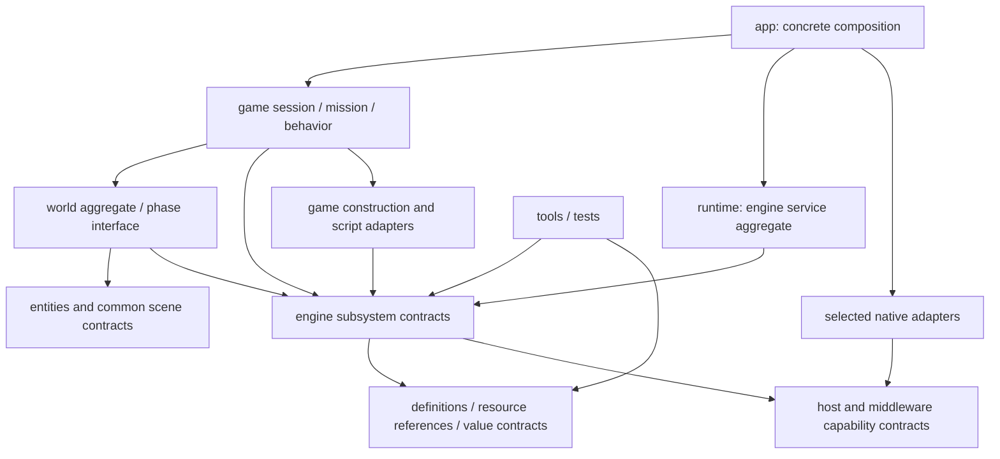

# Source ownership and dependency mapping

**Target architecture · working baseline · October 22, 2026.**
[Engine structure](logical-overview.md) · [Runtime ownership](runtime-model.md) ·
[Change axes](change-axes.md).

Source boundaries follow runtime responsibilities and reasons for change. They
are not reconstruction stages. A library/module can serve startup, play and
shutdown; no milestone has its own parallel engine implementation.

## Source families

The tree is the target organization; the implemented subset is listed below. Public portable contracts
live under `include/bw/`, their implementations under matching `src/` families.
Game-private declarations stay next to the concrete game implementation. A
logical owner can be an aggregate; the map does not mandate a class per row.

```text
bullet-witch/
  app/                         Executable composition and process entry
  include/bw/                  Portable engine contracts
    runtime/                   Engine instance, service lifetime and diagnostics
    world/                     World aggregate, stage instances and phase context
    scene/                     Transform/bounds membership and query views
    entities/                  Identity, hierarchy, state/message dispatch, retirement
    ai/                        Evaluation, controllers and action interface
    animation/                 Motion instances, tracks, poses, events, attachments
    effects/                   Pack definitions, instances, simulation and children
    physics/                   Engine collision, scene/query/mutation/provider contracts
    render/                    Scene projection, views, visibility, materials,
                               pass construction, commands, queue and device contracts
    ui/                        Sprite/text/layout primitives and UI scene
    input/                     Observations, action masks, edges/repeats/deadzones
    audio/                     Banks, cues, spatial bindings and device contract
    video/                     Player, sample ownership and backend contract
    tasks/                     Lifecycle passes, work queue and completion contracts
    script/                    Context, compatible runtime adapter, bridge/operations
    resources/                 Catalog, service, groups, typed references, handlers
    content/                   Mounted/virtual location and access policy
    formats/                   RAT/CPR/DPK/AMB container views
    assets/                    Model/motion/effect/UI/media/save payload families
    memory/                    Required lifetime/arena interfaces and accounting
    math/                      Shared operations with explicit numerical conventions
    platform/                  File, clock, thread/event, window and raw input contracts
  src/                         Implementations corresponding to the above families
    game/                      Bullet Witch behavior; private headers alongside code
      session/                 Session owner, root driver and progression state
      mission/                 Mission owner, stage assembly, outcomes and events
      modes/                   Explicit mode schedules and startup/root transitions
      screens/                 Concrete title/menu/dialog task state machines
      actors/                  Player/enemy/vehicle/boss factories and components
      actions/                 Concrete native AI action families
      camera/                  Gameplay camera controllers and view requests
      bindings/                Root/mission/AI native API schemas and adapters
      persistence/             Capture/restore, save operations and checkpoint policy
      progression/             Mission advancement, records and unlock policy
      resources/               Typed/CALL construction adapters and registrations
  platform/                    Concrete adapters selected only by composition
    files/ timing/ execution/ window/ input/ services/
    graphics/ physics/ audio/ video/
  tools/                       Consumers of production engine/data contracts
  tests/                       In-process contracts and bounded integration coverage
  docs/architecture/           Target architecture and supporting views
  research/                    Original-engine evidence, authored tools, ignored outputs
```

The root `game/` remains reserved by the existing ignore policy for local data;
authored game code is proposed under `src/game/`. The change from the previous
proposed top-level game-code location does not move any existing implementation.
Do not create empty files to materialize this tree. `memory/` and `math/` receive
only concrete shared contracts; they are not miscellaneous utility buckets.

## Runtime owner to source responsibility

| Runtime unit | Source owner | Boundary | Change axes |
|---|---|---|---|
| ApplicationHost | `app/`, selected `platform/` factories | Compose adapters, engine and session; process event/run/stop coordination | C1/P1 |
| EngineInstance | `runtime/` | Own shared service lifetimes; expose explicit dependencies, not a service locator | E13 |
| GameSession | `src/game/session/`, `modes/`, `screens/` | Root/modes/screens/progression and current mission relationship | G1/G5 |
| MissionInstance | `src/game/mission/` | Mission context, world and stage group; game-specific stage assembly | G1 |
| World | `world/` | Aggregate world-local instances and phase context; no game behavior implementation | E13 |
| Scene membership | `scene/` | Common transform/bounds observations; consumer-specific queries remain distinct | E14 |
| Actor identity/dispatch | `entities/` with `src/game/actors/` | Engine owns mechanics; game owns concrete component/state behavior | E3/G3 |
| AI mechanism/actions | `ai/` with `src/game/actions/` | Controller/evaluator depends on action interface, not concrete enemy classes | E4/G3 |
| Model/animation/effects | `animation/`, `effects/` | Shared instance mechanisms with explicit pose/event/query consumers | E5/E6 |
| Physics scene/service | `physics/` plus selected adapter | Engine collision/mutation rules above middleware implementation | E7/P1 |
| RenderScene, views, materials, passes | `render/` | Scene projection through command encoding; device contract separates native API | R1/R2/R3/E8 |
| UI scene / screen tasks | `ui/` / `src/game/screens/` | Shared draw/layout mechanism versus navigation/modal/game policy | E15/G1 |
| Audio/video | `audio/`, `video/` plus adapters | Logical playback and sample ownership above native output/codec operations | E9/E11/P1 |
| Resources | `resources/`, `content/`, `formats/`, `assets/` | Definition/selection/lifetime separate from world instances and device internals | A1/A2/A3/A4/A5 |
| Script bindings | `src/game/bindings/` | Root/mission/AI schemas and operation adapters above the generic VM bridge | G2 |
| Handler integration | `src/game/resources/` | Connect typed definitions, resource phases and subsystem construction | A6 |
| Execution/memory | `tasks/`, `script/`, `memory/` | Explicit phase/continuation/storage contracts used by owners | E1/E12/E2/E16 |
| Input service | `input/` and selected device sampler | Engine interpretation above raw platform observations | E10/P1 |
| Game camera | `src/game/camera/` | Gameplay policy producing view requests | G6 |
| Persistence/progression | `src/game/persistence/`, `progression/` | Snapshot/restore and advancement/unlock policy remain separate | G4/G5 |
| Shared math | `math/` or subsystem-local operations | Only genuinely shared numerical contracts | E17 |
| Inspection/verification | `tools/`, `tests/`, authored `research/tools/` | Consumers of production contracts and independent evidence | V1 |

## Dependency rules



Arrows mean source dependencies. `Interfaces` groups multiple subsystem modules;
it is not an actual umbrella header/library that every consumer imports.

1. `src/game/` can use engine contracts. Portable engine implementations do not
   include concrete game classes. Composition injects actions, binding handlers,
   resource constructors and schedules through the corresponding narrow contract.
2. World/runtime aggregates know the systems they compose. Individual systems
   receive identity, observations and service contracts rather than including the
   aggregate to find arbitrary dependencies. This avoids world ↔ system cycles.
3. Entity identity and scene observation types do not include concrete actors,
   AI controllers, render backends or the resource-service implementation.
4. Rendering reads scene/pose/material inputs; it cannot own or mutate actor
   gameplay. Game camera controllers produce view descriptions through the view
   contract. Material/pass interpretation does not reside in native adapters.
5. Effects use shared animation, physics-query and presentation contracts. AI
   uses action/environment interfaces. Neither imports concrete game policies.
6. Pure formats/assets decode bounded bytes. Catalog selection owns name policy;
   content access owns location policy; resource service owns runtime publication.
   No parser opens a device or constructs an actor.
7. Resource service depends on the handler interface, never on registered concrete
   handlers. Typed reference/definition contracts are separately usable by the
   renderer/physics/audio services without including their own constructors back.
8. Adapter implementations depend on the capability they implement. Only composition
   selects concrete adapters. Native OS/API/SDK types remain inside that adapter
   or a documented backend-private bridge.
9. Tools/tests depend on production contracts; production never imports a test
   fixture, inspector, Python research parser or decompiler export.
10. Cross-system requests/events are typed at the owning boundary with specified
    delivery semantics. A global event bus or generic service locator is not a
    substitute for these dependencies.

Build visibility should enforce these boundaries as modules are implemented.
No include-boundary checker or unimplemented modular build is claimed today.

## Contract assignment

These IDs identify architectural contracts, not C++ signatures. Each implementation
header must define inputs, outputs, lifetime, failure and ordered steps using the
[workflow](../process/workflow.md), including both MCP consultations.

| Contract | Owning source family | Required semantics |
|---|---|---|
| C01 Container view | `formats/` | Bounds and original byte ownership; file offsets distinct from host pointers |
| C02 Content access | `content/` | Mount/virtual location and read-only content versus writable user data |
| C03 Catalog selection | `resources/catalog` | Exact selected identity, precedence and global dependency-name lookup |
| C04 Resource lifecycle | `resources/service`, `groups`, `reference` | Separate request/file/phase/publication and retained-use states |
| C05 Construction handler | Handler contract + `src/game/resources/` | Phase/result ownership, subsystem construction and matching teardown |
| C06 Task/work progression | `tasks/` | Lifecycle gates, owned arguments, capacity and queued/running/completed distinctions |
| C07 Script context/operation | `script/` | Compatible Lua, marshaling, pending state and same-pump resumption |
| C08 Session/mission/game transitions | `src/game/session`, `mission`, `modes`, `bindings` | Context/world ownership, mode policy and recovered status meanings |
| C09 Entity/behavior identity | `entities/`, `ai/` and game adapters | Validated identity, hierarchy/state/message/action lifetimes and retirement |
| C10 Animation data/instances | `assets/`, `animation/` | Shared definitions, instance pose/motion state, numerical and consumer contracts |
| C11 Effects | `effects/` | Binding/RNG/emission/children and simulation/presentation lifetime |
| C12 Collision/physics | `physics/` | Query/mutation schema, scene authority, timing/step/fetch and release |
| C13 Input | `input/` + platform sampler | Observation identity, action edges/repeats/deadzones and sampling gates |
| C14 Render submission/device | `render/commands`, `queue`, `device` | Ordered commands, stable inputs, CPU/device completion and reuse |
| C15 Media | `audio/`, `video/` | Bank/cue/sample lifetime and distinct acceptance/readiness/completion/failure |
| C16 Persistence | `src/game/persistence/` + asset/file contracts | Phase-consistent capture, schema, restore and operation status |
| C17 Progression | `src/game/progression/` | Advancement, records and unlock policy independent of discovered assets |
| C18 Runtime ownership | `runtime/`, `world/` + session/mission composition | Explicit owner tree, service dependencies, partial initialization and quiescence |
| C19 Scene/spatial observations | `scene/`, world bindings | Authoritative transforms/bounds, consumer membership and phase-valid query results |
| C20 View/material/pass preparation | `render/` + game camera | Camera request, visibility, material/light interpretation and pass dependencies |
| C21 UI presentation | `ui/` + screen adapters | Layout/draw state independent of navigation and script-facing screen result |
| C22 Memory/residency | Each owning system + necessary `memory/` helpers | Scoped allocation, retention, capacity/rejection and completion-based reuse |
| C23 Shared numerical operations | `math/` and owning subsystem | Coordinates, units, rounding and exact versus approximate operation contracts |

## Build composition and implementation state

Proposed build groups follow dependency direction; a target is not a milestone:

| Group | Role / dependencies |
|---|---|
| Pure data contracts | Formats, asset definitions and catalog operations; no application/device dependency |
| Engine mechanisms | Runtime/world/entity/simulation/presentation/resource services through narrow contracts |
| Bullet Witch game | Session/mission/modes, actors/actions/camera, bindings, progression and integration |
| Selected adapters | Native libraries implementing engine capabilities |
| Game executable | Compose game, engine and selected adapters |
| Inspector / tests | Link only production contracts needed by their purpose |

Target granularity can be refined during implementation without changing these
boundaries. Keep CPU format tests and the inspector buildable without initializing
a device or world. Do not create a new test-only loader, renderer or simulation.

**Implemented today:** `bw_resources`, `bw-resource`, their C++/CLI tests and the
engineering tooling. The current combined resource source spans format, catalog,
content and filesystem responsibilities. The [module contract](../resources.md)
describes its behavior. Its [migration plan](../../IMPLEMENTATION.md#migrating-src-01)
and subsequent reconstruction sequence live in IMPLEMENTATION, not this architecture.

## Implemented boundary migration

The former combined `src/resources.cpp` is split into `src/formats/`
(CPR/RAT/common errors), `src/resources/catalog.cpp`, `src/content/access.cpp`
and `src/platform/files/host.cpp`, with corresponding public headers. RatData
owns decoded metadata; RatCatalog owns that value and an index. Public type
names retain the `bw::resources` namespace for compatibility. The file
capability is injected at the content boundary. This is implemented; other
proposed files in the mapping remain proposals until documented otherwise.

The implemented startup subset adds `formats/dpk`, `resources/service`,
`script/chunk`, `script/context`, `tasks/scheduler` and `src/game/root_driver`
(with its private header alongside it). CMake targets preserve dependency order:
`bw_game` → `bw_runtime` → `bw_resources`; the script adapter privately links
`bw_lua502`. A1 owns DPK layout, A3/A4 resource lifecycle/USER construction, E1
task progression, E2 Lua mechanics, and G1/G2 root policy/native bindings.
Actual startup services remain abstract capabilities; fixture implementations
exist only in the provisioned integration test. See `docs/startup-runtime.md`.
