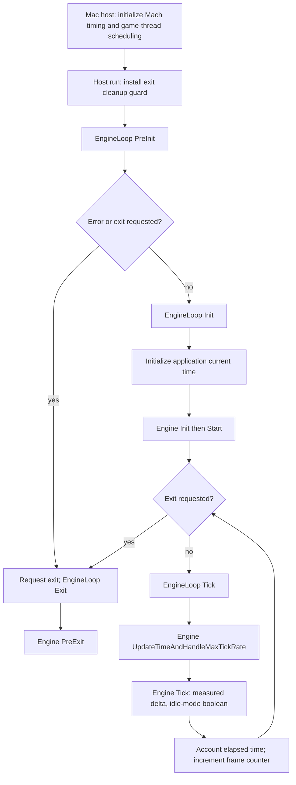

# Game loop

Status: headless game-loop implementation accepted in `d20097a`. The 17
prepared behavioral scenarios pass without assertion changes. Native timing,
formatting, fatal lint and independent root review are recorded below.
The subsequent [allocator lifecycle](allocator-lifecycle.md) adds source PreInit
cache/dispatch startup and Exit shutdown; Tick and timing algorithms are unchanged.
This is not a game/window/world implementation.

Reference commit: `f45729c0b6f097038e72b52d366a62baeca3275b`.
This is our authoritative game-loop architecture. Unreal supplies the inspected
algorithm and lifecycle reference; the selected flow must not deviate. Implementation is written anew, not copied Unreal source. No existing
Bullet Witch code is imported or called.

## Ownership and call flow



| Source | Selected behavior and owner |
|---|---|
| [GuardedMain, Launch.cpp:123–194](https://github.com/EpicGames/UnrealEngine/blob/f45729c0b6f097038e72b52d366a62baeca3275b/Engine/Source/Runtime/Launch/Private/Launch.cpp#L123) | Host cleanup guard; PreInit; early error/exit check; Init; repeat Tick until exit requested |
| [EngineExit, Launch.cpp:66–72](https://github.com/EpicGames/UnrealEngine/blob/f45729c0b6f097038e72b52d366a62baeca3275b/Engine/Source/Runtime/Launch/Private/Launch.cpp#L66) | Request exit before EngineLoop cleanup |
| [FEngineLoop::InitTime:4698–4740](https://github.com/EpicGames/UnrealEngine/blob/f45729c0b6f097038e72b52d366a62baeca3275b/Engine/Source/Runtime/Launch/Private/LaunchEngineLoop.cpp#L4698) | Initialize current platform time and loop accounting; optional seconds limit |
| [FEngineLoop::Init:4818–4890](https://github.com/EpicGames/UnrealEngine/blob/f45729c0b6f097038e72b52d366a62baeca3275b/Engine/Source/Runtime/Launch/Private/LaunchEngineLoop.cpp#L4818) | InitTime, Engine Init, Engine Start; loop owns lifecycle |
| [FEngineLoop::Tick timing:5702](https://github.com/EpicGames/UnrealEngine/blob/f45729c0b6f097038e72b52d366a62baeca3275b/Engine/Source/Runtime/Launch/Private/LaunchEngineLoop.cpp#L5702) | Call engine timing/pacing before engine work |
| [FEngineLoop::Tick engine work:5858](https://github.com/EpicGames/UnrealEngine/blob/f45729c0b6f097038e72b52d366a62baeca3275b/Engine/Source/Runtime/Launch/Private/LaunchEngineLoop.cpp#L5858) | Engine Tick receives measured float delta and **boolean idle mode**, not idle duration |
| [FEngineLoop::Tick accounting:6073–6135](https://github.com/EpicGames/UnrealEngine/blob/f45729c0b6f097038e72b52d366a62baeca3275b/Engine/Source/Runtime/Launch/Private/LaunchEngineLoop.cpp#L6073) | Accumulate elapsed time after first six ticks; increment frame counter once per tick |
| [FEngineLoop::Exit:5055–5065](https://github.com/EpicGames/UnrealEngine/blob/f45729c0b6f097038e72b52d366a62baeca3275b/Engine/Source/Runtime/Launch/Private/LaunchEngineLoop.cpp#L5055) | Engine PreExit if an engine has been initialized |
| [RequestEngineExit, CoreGlobals.cpp:325–341](https://github.com/EpicGames/UnrealEngine/blob/f45729c0b6f097038e72b52d366a62baeca3275b/Engine/Source/Runtime/Core/Private/Misc/CoreGlobals.cpp#L325) | Exit request completes the current outer iteration; no cancellation token |
| [FAppTime defaults, AppTime.h:80–103](https://github.com/EpicGames/UnrealEngine/blob/f45729c0b6f097038e72b52d366a62baeca3275b/Engine/Source/Runtime/Core/Public/Misc/AppTime.h#L80) | Engine owns application current/last/delta/idle/overshoot/game-time state; read-only access outside owner |

## Frame timing

[UEngine::UpdateTimeAndHandleMaxTickRate, UnrealEngine.cpp:2980–3220](https://github.com/EpicGames/UnrealEngine/blob/f45729c0b6f097038e72b52d366a62baeca3275b/Engine/Source/Runtime/Engine/Private/UnrealEngine.cpp#L2980)
selects this ordinary real-time runtime-client path:

```text
On first timing update, previous_real_time = seconds() - 0.0001.
last_application_time = current_application_time.
current_real_time = seconds().
real_elapsed = float(current_real_time - previous_real_time).
If real_elapsed is negative, warn and substitute 0.01.
If maximum_fps > 0, wait = max(1.0f / maximum_fps - real_elapsed, 0).
Otherwise wait = 0.
If wait > 0:
    Start measuring actual idle time.
    deadline = current_real_time + wait.
    If wait > 0.005f, sleep(wait - 0.002f) once.
    While seconds() < deadline, sleep(0).
    current_real_time = seconds().
    Finish measuring actual idle time.
current_application_time = current_real_time.
delta = current_application_time - previous_real_time.
idle_overshoot = max(actual_idle_time - wait, 0).
If delta is negative, warn and substitute 0.01.
previous_real_time = current_real_time.
game_time += delta.
```

This includes pacing the first frame. There is no zero-delta initial dispatch,
resumable run, catch-up host-frame loop, or callback-returned scheduling decision.
Frame work consumes the next frame's available budget naturally through actual
elapsed time. Exit requests do not interrupt this wait.

[GetMaxTickRate and t.MaxFPS, UnrealEngine.cpp:12136–12250](https://github.com/EpicGames/UnrealEngine/blob/f45729c0b6f097038e72b52d366a62baeca3275b/Engine/Source/Runtime/Engine/Private/UnrealEngine.cpp#L12136)
provide the setting semantics. Positive `t.MaxFPS` overrides smoothing. The
ordinary game configuration has `bSmoothFrameRate=false` in
[BaseEngine.ini:351](https://github.com/EpicGames/UnrealEngine/blob/f45729c0b6f097038e72b52d366a62baeca3275b/Engine/Config/BaseEngine.ini#L351),
so nonpositive values disable this maximum-rate cap. This does not disable
future display synchronization or GPU backpressure. The
maximum-FPS setting starts at **zero**, exactly the source cvar default.
There is no project override.
Float seconds for rate/wait arithmetic and double platform timestamps follow
the reference. The rejected nanosecond rounding and validation policy is removed.

## Mac timing and startup

- [ApplePlatformTime.cpp:29–43](https://github.com/EpicGames/UnrealEngine/blob/f45729c0b6f097038e72b52d366a62baeca3275b/Engine/Source/Runtime/Core/Private/Apple/ApplePlatformTime.cpp#L29):
  initialize `mach_timebase_info`; read `mach_absolute_time`; convert ticks to
  double seconds. [ApplePlatformTime.h:43](https://github.com/EpicGames/UnrealEngine/blob/f45729c0b6f097038e72b52d366a62baeca3275b/Engine/Source/Runtime/Core/Public/Apple/ApplePlatformTime.h#L43)
  supplies the `16777216.0` offset.
- [CoreGlobals.cpp:399–400](https://github.com/EpicGames/UnrealEngine/blob/f45729c0b6f097038e72b52d366a62baeca3275b/Engine/Source/Runtime/Core/Private/Misc/CoreGlobals.cpp#L399):
  native timing initializes before main. Our host constructs its platform clock
  before starting the engine lifecycle; this explicit construction order replaces
  Unreal's process-global startup object.
- [GenericPlatformProcess.cpp:414–424](https://github.com/EpicGames/UnrealEngine/blob/f45729c0b6f097038e72b52d366a62baeca3275b/Engine/Source/Runtime/Core/Private/GenericPlatform/GenericPlatformProcess.cpp#L414):
  truncate float seconds to microseconds; positive values call `usleep`, otherwise
  `sched_yield`. Mac inherits this through Apple. No condition-variable substitute.
- [CocoaThread.cpp:358–369](https://github.com/EpicGames/UnrealEngine/blob/f45729c0b6f097038e72b52d366a62baeca3275b/Engine/Source/Runtime/Core/Private/Mac/CocoaThread.cpp#L358):
  read the game thread's current scheduler policy, request priority 45 using
  that policy. The host records actual return codes and observed priority;
  failure will not be reported as a successfully applied setting.
- [WindowsPlatformMisc.cpp:1075–1076](https://github.com/EpicGames/UnrealEngine/blob/f45729c0b6f097038e72b52d366a62baeca3275b/Engine/Source/Runtime/Core/Private/Windows/WindowsPlatformMisc.cpp#L1075):
  Windows calls `timeBeginPeriod(1)`. No analogous timer-coalescing policy was
  found in the inspected Mac launch/platform paths. No substitute is proposed.

## Current scope

This implements the timing and host lifecycle spine. `Engine::tick` is an
abstract contract; the headless host implements an explicitly empty world-work
seam. There is no world, renderer, input, audio, Cocoa window, asset pipeline,
task graph or simulation scheduler. The host runs this lifecycle on its current
thread; a Cocoa main/game-thread split belongs to the later platform slice.

Fixed timestep, fixed frame rate, smoothing, editor throttling, dedicated-server
limits, modular timing handlers, timecode and world-dependent delta clamps are
not implemented by this selected first slice. Negative-delta handling follows
the inspected warning/substitute path rather than the rejected exception policy.

## File manifest

Paths are relative to the repository root.
The preserved original checkout is not modified.

Header contracts:

- `src/platform/platform_time.hpp`
- `src/platform/macos/platform_time.hpp`
- `src/engine/runtime/engine.hpp`

Loop header:

- `src/engine/runtime/engine_loop.hpp`

Production implementation and headless host:

- `src/platform/macos/platform_time.cpp`
- `src/engine/runtime/engine.cpp`
- `src/engine/runtime/engine_loop.cpp`
- `src/hosts/macos/engine_host.cpp`

Behavioral tests:

- `tests/engine_loop_tests.cpp`

Native measurement tool:

- `tools/engine_loop_probe.cpp`

Removed rejected custom implementation/contracts:

- `src/core/time/time.hpp`
- `src/core/time/time.cpp`
- `src/platform/monotonic_time.hpp`
- `src/platform/standard/native_monotonic_time.hpp`
- `src/platform/standard/native_monotonic_time.cpp`
- `src/platform/standard/detail/deadline_wait.hpp`
- `src/platform/standard/detail/deadline_wait.cpp`

The prior custom implementation is removed; these paths contain the fresh
source-derived implementation and prepared contract tests. Rejected files are
preserved only as ignored evidence in
`research/evidence/engine-loop/replaced-custom-design/`, not as dependencies.

Build/documentation changes:

- `CMakeLists.txt`
- `README.md`
- `docs/architecture/game-loop.md` (this authoritative architecture)
- `docs/architecture/engine-loop.md`
- `docs/architecture/README.md`
- `docs/architecture/implementation-order.md`
- `docs/process/MEMORY.md`
- `docs/process/QUEUE.md`

The existing fresh LLVM 21.1.8 formatting/fatal-tidy configuration remains.
The current AGENTS/workflow source-correspondence rule remains. Neither is
copied from the old project.

## Verification

The ordered review preparation was completed first: architecture, headers,
comments-only implementation units, then tests. Later explicit authorization
allowed implementation. The initial fresh test link failed with missing
production definitions. That is **link-stage red**, not behavioral failures;
no no-op production stubs were supplied to manufacture a runnable red suite.

Fresh production definitions made all **17 prepared scenarios pass without
changing their assertions**. They cover source defaults, lifecycle ordering,
first-frame timing/pacing, work consuming the budget, late-frame rebasing, the
strict 5 ms coarse threshold, oversleep, rate changes, disabling the cap,
application-time publication, negative-time fallback, exit timing and source
seconds-limit accounting. The native clock/sleep scenario also passes.

Four independent public-header translation units compile. The complete runtime,
host, tests and probe build with fatal compiler warnings and fatal clang-tidy;
LLVM 21.1.8 formatting passes. Root independently repeated CTest, formatting and
whitespace checks and reviewed source correspondence and ownership.

One native probe with an **explicit test input of 60 FPS** measured 120 intervals:

| Measurement | Observed |
|---|---:|
| Mean cadence | 59.439217 FPS |
| Minimum / mean / maximum interval | 16.666666 / 16.823909 / 25.713000 ms |
| Maximum measured wait overshoot | 9.046251 ms |
| Whole-run wall time | 2.035905 s |
| Process CPU time | 0.115985 s |
| CPU use relative to one core | 5.696976% |
| Scheduler read / set / verify return codes | 0 / 0 / 0 |
| Observed scheduler policy / priority | 1 / 45 |

The reference priority request succeeded. This short sample demonstrates normal
cadence with scheduling jitter; it is not a hard real-time guarantee or evidence
about rendered/game performance. No thresholds, wait policy or defaults were
changed to obtain it. A separate bounded host run exited using the source
seconds-limit accounting and reported maximum FPS zero, as required.

Ownership review: the host/probe own native time/process objects, then engine,
then loop in lexical lifetime order. Engine and loop borrow those longer-lived
objects. Engine alone writes application timing; consumers receive a const view.
The game thread owns exit/frame state. There is no cross-thread cancellation,
worker publication, world clock or renderer synchronization claim in this slice.

Ignored evidence lives in `research/evidence/engine-loop/`:

- `source-flow-red-link.txt`: expected missing-definition failure.
- `source-flow-green-tests.txt`: 17 passing prepared scenarios.
- `source-flow-build.txt`, `source-flow-full-build.txt`: fatal-lint compilation.
- `source-flow-native-60.txt`, `source-flow-native-host.txt`: native observations.
- `preparation-compile.txt`, `preparation-status.json`: prior preparation checks.

Both C++ corpora were queried at header and implementation stages. Full header
rules I.1/R.1/MEM.9 informed explicit ownership and fixed-size timing state.
Implementation full-rule reads E.6/MEM.9 informed scope cleanup and allocation
discipline. Neither selected or altered the reference pacing algorithm.
