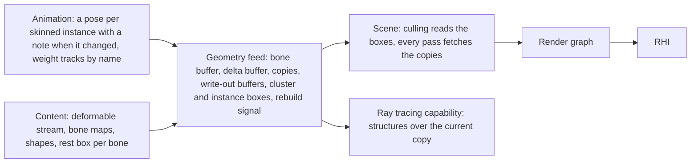
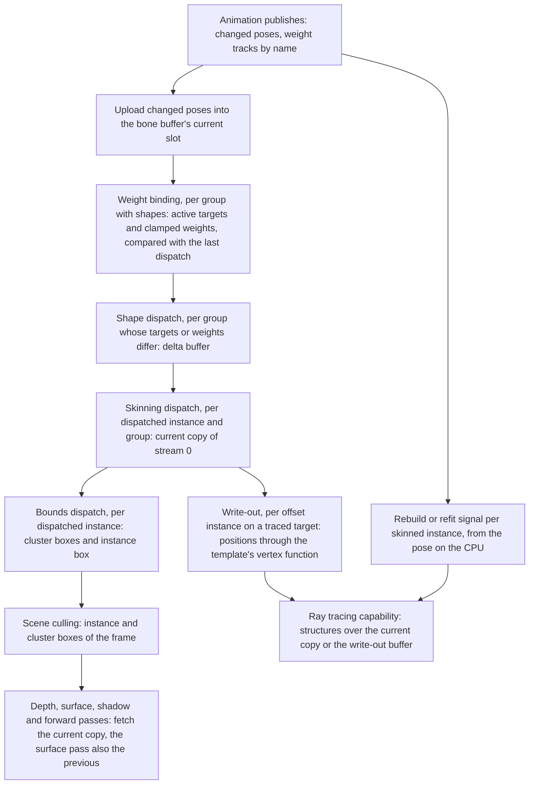
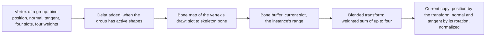

# Geometry feed

How an instance's vertices are made each frame when they move. Animation
publishes a pose and named weight tracks; the feed binds the tracks to shape
targets and turns pose and shapes, once per frame and before culling, into
this frame's positions, normals and tangents in buffers
that every pass reads as if the mesh were rigid. The same buffers give the
frame's bounds for culling, the previous frame's positions for motion
vectors, and the geometry a traced target's acceleration structures are
built from.

A pose is one skinning transform per bone of a skeleton. A shape is a set of
position deltas over one group of a mesh with a weight. Three kinds of
instance pass through the feed, and one instance can be all three:

| Term | Means | Gets |
|---|---|---|
| Skinned instance | its mesh is skinned and animation publishes a pose for it | a range in the bone buffer, uploaded when the pose changes |
| Dispatched instance | a skinned instance with at least one weighted draw, or any instance with an active shape; it stays one until it has neither, and its copies are released after the frame that rewrote its last delta buffer to zero | two copies of stream 0, the shape, skinning and bounds dispatches |
| Offset instance | its template writes a vertex offset, on a traced target | a position write-out buffer for the acceleration structure |

A shape is active while the absolute value of its weight is above
0.00000001. A rigid instance is none of these and reads its mesh's own
streams. A weighted draw is one whose vertices weight more than one bone,
or one bone below full weight; a draw whose every vertex has one influence at full
weight is rigid to that bone.

## Position

Between [animation](animation.md), which owns the pose, and the [scene](scene.md), which
culls what the feed bounds and draws what the feed wrote. Fed by
[content](content.md), which cooks the deformable stream, the bone maps, the
shapes and the per-bone rest boxes. Beside [materials](materials.md), whose
templates own the vertex offset. Above the [render graph](render-graph.md)
and the [RHI](rhi.md).

## Invariants

1. A dispatched instance's vertices are computed once per frame, in
   compute, before culling. No raster vertex shader skins or morphs: the
   depth phases, the surface pass, every shadow view and the forward pass
   fetch the same copy.
2. A deformable mesh is cooked with stream 0 holding position, normal and
   tangent and stream 1 holding every other attribute. The feed writes a
   copy of stream 0 per dispatched instance; stream 1 is the mesh's and is
   shared by all its instances. A rigid mesh keeps its streams as authored.
3. Each dispatched instance owns two copies of stream 0, current and
   previous. A frame that dispatches the instance writes the current copy
   and the other holds the frame before. The surface pass reads the previous
   copy for the motion vector.
4. An instance dispatched for the first time has both copies written that
   frame, so its deformation contributes no motion that frame. An instance
   not dispatched this frame has its previous copy index set equal to its
   current copy index, and the copies are not swapped.
5. The feed uploads a pose only when animation states that it changed, and
   compares no poses. Shape weights it compares itself, per instance and
   group: the shape dispatch of an instance's group runs when the group's
   active targets or their weights differ from those of that instance's
   last dispatch of it, a weight differing when the difference is
   0.00000001 or more. An instance is dispatched when its pose changed or
   the shape dispatch of one of its groups ran.
6. The feed binds animation's weight tracks to a group's targets by name.
   A target's weight is the value of the track of its name, and zero when
   no such track is published; a track that names no target of the group
   is ignored. An active weight is clamped to between minus and plus the
   settings' maximum shape weight, which is 5 unless set.
   Shapes are applied before bones. For a group with active shapes, a
   per-vertex dispatch sums weight times delta over every active target in
   target order into a delta buffer, with no atomics; the skinning dispatch
   adds the delta to the bind-pose position and then applies the bones.
   Shapes move positions and nothing else. When a group's last active
   target stops being active the dispatch runs once more and rewrites the
   delta buffer to zero.
7. A vertex's skinning transform is the weighted sum of its influences'
   transforms, resolved through its draw's bone map as cooked. Normals and
   tangents are transformed by the blended three-by-three and normalized,
   and never recomputed from triangles.
8. Poses live in one bone buffer with a range per skinned instance and two
   slots, current and previous. Only poses that changed are uploaded, and
   an upload swaps that instance's slots first, so its previous slot is the
   pose before. An instance with no upload this frame reads its current slot
   for both, so its bones contribute no motion. The skinning dispatch reads
   the current slot; rigid-to-bone clusters read both. The instance record
   carries the range, or none.
9. After skinning, one dispatch per dispatched instance writes the box of
   each of its weighted clusters from the deformed positions in the cluster's
   index range, and the instance box as the union of those and of its
   rigid-to-bone clusters' transformed boxes, each padded by the template's
   declared maximum displacement. These are the boxes culling tests for
   that frame; the mesh's cooked boxes are not used for a dispatched
   instance's weighted clusters. The boxes are in the instance's own space
   and culling applies the instance's transform to them. An instance not
   dispatched in a frame keeps the boxes of its last dispatch, with its
   previous boxes set equal to them, so it is culled where it now stands by
   the shape it last had.
10. A draw whose every vertex has one influence at full weight is cooked as
    rigid to that bone, and its clusters carry the bone index into the draw
    record. Such a cluster is never skinned by the feed. Every pass's vertex
    shader applies the bone's current transform after the instance
    transform; the previous slot gives its motion vector; culling transforms
    the cluster's cooked box by that one bone. A skinned instance whose every
    draw is rigid to a bone has a bone range and nothing else from the feed;
    its bounds are computed on the CPU from its pose, as the scene states. A
    dispatched instance's rigid-to-bone clusters follow this rule and its
    weighted clusters the dispatch; the unit of every per-cluster rule is
    the cluster.
11. On a traced target a dispatched instance's acceleration structure is
    built over its current copy; the feed signals refit each frame, and
    rebuild when the summed surface area of the pose-transformed per-bone
    rest boxes exceeds the value at the last build by the settings ratio;
    an instance with no weighted draw has no structure of its own to signal
    for. A rigid-to-bone draw is its own acceleration-structure instance
    over the mesh's stream 0 under the instance transform times its bone's;
    when its template writes a vertex offset, its write-out applies the
    bone's transform as every vertex shader does. How structures are built
    and owned belongs to the ray tracing capability.
12. A template's vertex offset is a function of the vertex, the instance
    transform and the frame values it is given, and nothing else. Every
    raster pass evaluates it in its vertex shader through one function; the
    surface pass evaluates it a second time with the previous transform and
    previous frame values for the motion vector. A template that writes an
    offset declares its maximum displacement, and the scene pads the bounds
    of every instance of it by that amount. An offset instance's raster
    draws fetch what every other instance fetches; the write-out buffer is
    read by the acceleration structure alone. The write-out runs the
    template's vertex function over the instance's current copy when it is
    dispatched, and over the mesh's stream 0 otherwise, applying a
    rigid-to-bone draw's bone, and writes positions.
13. Every dispatch is sized from counts the mesh and the instance carry. A
    copy, a delta buffer, a write-out buffer or a bone range that cannot be
    allocated fails by name; nothing is skipped or drawn in bind pose in its
    place.

## The frame

| Step | Reads | Writes | Runs for |
|---|---|---|---|
| Pose upload | the poses animation marked changed | the bone buffer's current slot, the instance's range | every skinned instance with a changed pose |
| Weight binding | animation's weight tracks, the group's target names, the active targets and weights of the group's last dispatch | the group's active targets and their clamped weights, and whether they differ | every group with shapes of every instance, on the CPU |
| Shape dispatch | the group's shape deltas, the active weights | the group's delta buffer, one position delta per vertex, zero when no target is active | every group whose active targets or weights differ from its last dispatch |
| Skinning dispatch | stream 0 of the mesh, the delta buffer if any, the draw's bone map, the bone buffer's current slot | the instance's current copy: position, normal, tangent | every dispatched instance whose pose changed or whose shape dispatch ran |
| Bounds dispatch | the current copy, the mesh's cluster index ranges, the bone buffer for rigid-to-bone clusters, the instance's maximum displacement | the instance's cluster boxes and instance box for this frame, the previous frame's kept beside them for phase one | the same instances |
| Write-out | the template's vertex function with current frame values, over the current copy or the mesh's stream 0, with a rigid-to-bone draw's bone | the instance's write-out buffer of positions | every offset instance on a traced target |
| Rebuild signal | the pose, the mesh's rest box per bone | refit or rebuild for the instance this frame | every dispatched skinned instance on a traced target |

Before the dispatches run, the per-instance slot swap of invariant 8 and
the previous-copy rule of invariants 3 and 4 are applied to the instance
records, so culling and the passes see the frame's indices.

## Skinning

| Datum | Form |
|---|---|
| Influence | four bone slots of one byte and four weights of one byte per vertex, as the vertex format stores them |
| Bone map | per draw, up to thirty-two skeleton bone indices, cooked with the mesh |
| Skinning transform | three rows of four floats per bone, model space times inverse bind, in skeleton bone order |
| Bone buffer | one buffer, a range per skinned instance, two slots per range |
| Delta buffer | one position delta of three floats per vertex of the group, rewritten when the shape dispatch runs |
| Copy of stream 0 | the mesh's own stream 0 layout, so the vertex fetch reads it with the mesh's attribute table |

A mesh with more influences per vertex than the format's slots fails to
convert by name.

## Bounds

| Box | From | Read by |
|---|---|---|
| Cluster box of a weighted cluster of a dispatched instance | the minimum and maximum of the current copy's positions over the cluster's index range | the scene's cluster stage, that frame |
| Instance box of a dispatched instance | the union of its cluster boxes | the scene's instance stage, that frame |
| Cluster box of a rigid-to-bone cluster | the cooked box transformed by its bone's current transform | the cluster stage |
| Rest box per bone | the cooked box of the vertices a bone influences, in bind pose | the rebuild signal |

Minimum and maximum are order-independent, so the boxes of a frame are the
same for the same pose whatever the dispatch order.

## Content the feed reads

| Data | Form | Written by |
|---|---|---|
| Deformable stream | stream 0 of a skinned or shaped mesh: position, normal, tangent | the converter |
| Bone maps | per draw, with the rigid-to-bone mark and bone index where every weight is one | the converter |
| Shapes | per group, position deltas for every vertex per target, named, as the morph set asset | the converter |
| Rest box per bone | per skinned mesh, one box per bone | the converter |
| Pose | skinning transforms per bone | animation, each frame it changes |
| Weight tracks | one float per named track | animation, every frame |

## Components and ownership

| Component | Lives in | Consumed by |
|---|---|---|
| Registry of skinned, dispatched and offset instances: copies, ranges, write-out buffers, the previous-copy rule | `src/engine/rendering/geometry` | the scene's instance records |
| Bone buffer and pose upload | `src/engine/rendering/geometry` | skinning dispatch, rigid-to-bone fetch |
| Binding of weight tracks to shape targets: the active rule, the clamp and the comparison with the last dispatch | `src/engine/rendering/geometry` | the shape dispatch |
| Shape, skinning and bounds dispatches and their shaders | `src/engine/rendering/geometry` | the scene's culling, every pass |
| Write-out buffers | `src/engine/rendering/geometry` | the ray tracing capability |
| Rebuild signal from the pose | `src/engine/rendering/geometry` | the ray tracing capability |
| Write-out run of a template's vertex function | `src/engine/rendering/geometry`, the function from `src/engine/rendering/materials/templates` | the ray tracing capability |
| Mesh, morph set and vertex stream payload readers | `src/engine/rendering/geometry` | content loading |

## Boundaries

Above: animation, which decides the pose and says when it changed, and
publishes weight tracks by name knowing nothing of shapes, and the world,
which decides which instances exist. Below: the
render graph and the RHI. Beside: the scene, which owns the instance records
and culling and takes the feed's boxes and copy indices as given; the
material system, which owns the vertex offset function and declares its
displacement; content, which cooks the stream split, the maps, the shapes
and the rest boxes and decides nothing about their use; the ray tracing
capability, which owns acceleration structures and takes the feed's copy and
signal. How a pose is produced, how blended draws are ordered, and how
particles make their vertices are outside this document.
