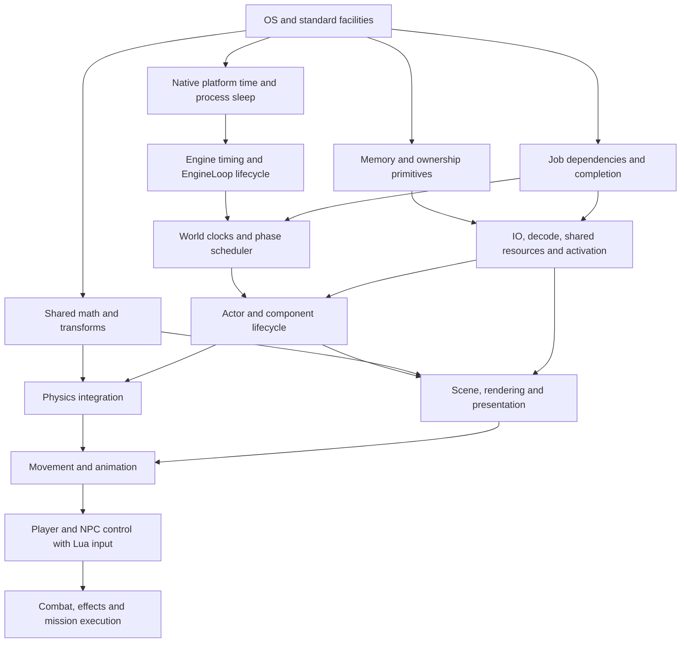

# Implementation order

This is the proposed sequence. The first slice implements the headless host
lifecycle, native Mac time/process primitives and engine timing. Its 17 contract
tests pass; native results and remaining scope are in [Game loop](game-loop.md).
The foundations slice has begun: [Memory](memory.md) maps the selected Mac
Binned3 path and implements its virtual-memory dependency and native fatal
handling. [General allocation](binned-allocator.md), crash reserves and its named-dispatch
trim dependency are accepted. [Allocator lifecycle](allocator-lifecycle.md)
implements executable adoption and source-owned game-thread startup/shutdown.
The [shared math leaf](math.md) is accepted as `1d3e5d9`: vector values, the ARM
Mac scalar-primitive selection and source-default nonfinite diagnostics pass
Debug/Release native checks. The next [native register foundation](math-registers.md)
is accepted: native ARM64 primitive algorithms pass
Debug/Release tests and code-generation checks. Remaining register composition
primitives, rotations/matrices/transforms,
general jobs and content preparation remain ahead.

## Start at the lowest dependency

**Slice 1: native platform time/process primitives → Engine timing → EngineLoop
lifecycle → Mac host.** [Game loop](game-loop.md) is authoritative. The selected
Unreal flow has no policy changes; maximum FPS defaults to the source value zero.
Custom math and memory are not prerequisites. The slice includes fresh build,
pinned formatting, fatal clang-tidy, header checks and behavioral tests.

Arrows show required contracts, not a mandate to serialize independent work.
Memory, math and jobs can proceed separately from pacing. Rendering and physics
can progress after their inputs/lifetime contracts exist. Real character work
requires working render, animation and physical integration, not a screenshot
placeholder that silently becomes production architecture.

## Subsequent slices

| Order | Deliverable | Completion evidence before dependent gameplay |
|---|---|---|
| 2 | Memory, math, jobs and new content preparation foundations | Explicit ownership, transform conventions, job completion/cancellation, validated decoded resource data |
| 3 | World clocks, dependency phases, actor lifecycle, resource activation | Pause and suspend behavior, ordered physics barriers, bounded activation, safe retirement under pending work |
| 4 | Host/window/input, new render/material/lighting pipeline and presentation | Known geometry/material outputs, correct color/normal/mip contracts, frame timing under load |
| 5 | Physics integration, skeletal animation, player movement and camera | Realized motion, blends/root motion/aim, contacts and coherent completed poses |
| 6 | AI decisions/tasks/perception/navigation and Lua integration | Retained task lifecycle, cancellation, multiple active actors and actual movement/action outcomes |
| 7 | Combat, effects, audio, media, HUD/frontend, save/progression and missions | Connected actions with effects/sound/state changes, streaming continuity, restart/restore and end-to-end play |

UI/media and other independent services may begin once their dependencies are
available; the table is an integration sequence, not an excuse to defer their
architecture until gameplay. [Runtime services](runtime-services.md) and the
other drill-ins define those boundaries now.

Every slice selects algorithms from inspected pinned Unreal functions and records
adaptations. No old project source, shader, helper, build file, fixture, cache or
adapter is reused. Third-party libraries are explicitly chosen and integrated
anew; none are silently inherited. Original engine quirks do not dictate this
architecture. Purchased assets and Lua remain external input contracts.

Each slice is reviewable before the next dependent implementation begins. Build
and lint success establish code checks; they do not substitute for the actual
behavior or frame-budget evidence the slice claims.
