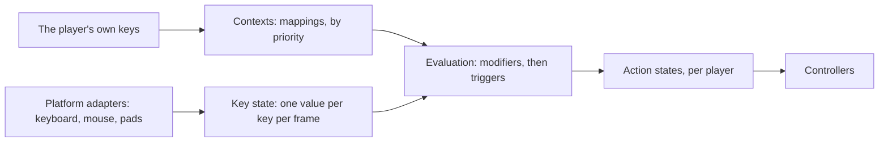
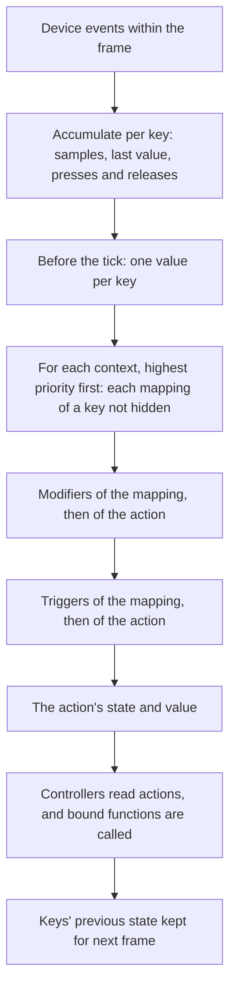

# Input

How what a player does on a device becomes something game code can read
without knowing the device. Input samples devices once a frame, maps keys
to named actions through contexts, conditions each value, decides when an
action fires, and hands controllers the state of each action. It holds no
binding of its own: which key does what is data.

| Term | Means |
|---|---|
| Device | a keyboard, a mouse or a pad, behind a platform adapter |
| Key | one input of a device: a button, an axis, or a pair of axes read as one |
| Action | a named thing a player can do, with a value type: a switch, one axis, two axes or three |
| Mapping | one key bound to one action, with modifiers and triggers |
| Context | a set of mappings, added to a player with a priority |
| Modifier | a step that changes a value: a dead zone, a scale, a negation |
| Trigger | a rule that decides from a value over time whether the action fires |
| Action state | none, started, ongoing, fired, completed or cancelled, with the action's value |

## Position

Below the controllers, which read action states. Above the platform's
window and device adapters. Beside the [world](world.md), which says when
in the frame devices are sampled and when controllers run.

## Invariants

1. Devices are sampled once a frame, before the world's tick. Events that
   arrive within a frame are accumulated: an analog key sums its samples,
   a button takes its last value, and presses and releases are counted.
2. A key holds one value a frame. A stick is two one-axis keys and one
   paired two-axis key. A mouse's movement is the same, and reads zero in
   a frame with no movement. A pad axis keeps its last value until the
   device reports another.
3. An action has a value type and a per-player state. Game code reads
   actions and never keys.
4. A context is a set of mappings. Contexts are applied to a player in
   order of priority, highest first. A key a higher context's action
   consumes is hidden from lower contexts. Several mappings of one key
   inside one context all apply.
5. A mapping's modifiers run in order on the key's value, then the
   action's own modifiers. The value is brought to the action's value
   type between modifiers.
6. A dead zone has a lower and an upper threshold. It acts on each axis
   alone, or on the vector's length while keeping its direction, and
   rescales what is left to the range from zero to one.
7. A trigger reads the modified value and the time it has held. With no
   trigger, an action fires while its value is not zero. Pressed fires on
   the frame the value passes its threshold. Released fires on the frame
   it falls back. Hold fires when the value has stayed past its threshold
   for the trigger's time. A chord fires only while another action is
   fired, and an action in a chord consumes no key.
8. Several mappings to one action combine by the action's rule: per
   axis the value of largest magnitude, or the sum.
9. Evaluation happens once a frame, in the player's controller, in the
   world's before-simulation stage: key state, then modifiers, then
   triggers, then each action's state. Functions bound to actions are
   called then.
10. An action may fire while the world is paused only if it says so.
11. A player may rebind a mapping's key. The player's key replaces the
    default when contexts are applied, and is kept per profile.
12. A mapping that names an action or a key that does not exist fails by
    name when its context is loaded.

## A frame

| Modifier | Does |
|---|---|
| Dead zone | removes values under a lower threshold and rescales up to an upper one, per axis or on the length |
| Scale | multiplies each axis by a factor |
| Negate | flips the sign of chosen axes |
| Swizzle | reorders axes |
| Smooth | averages the value over recent frames |
| Response curve | passes the value through a curve |
| Scale by step | multiplies by the frame's step |

| Trigger | Fires |
|---|---|
| Down | while the value is past its threshold |
| Pressed | on the frame the value passes its threshold |
| Released | on the frame the value falls back |
| Hold | once the value has stayed past its threshold for a time, once or every frame after |
| Hold and release | on release, if it was held long enough |
| Tap | on release, if it was held less than a time |
| Chord | only while another action is fired |

## Components and ownership

| Component | Lives in | Consumed by |
|---|---|---|
| Device adapters: keyboard, mouse, pads | `src/platform` | key state |
| Key state and accumulation | `src/engine/input` | evaluation |
| Actions, mappings, contexts, modifiers, triggers | `src/engine/input` | controllers, game code |
| A player's own keys, per profile | `src/engine/input` | contexts |
| The game's actions and default mappings | `src/game` | input |

## Boundaries

Above: controllers, which read action states and decide what a character
or a menu does. Below: the platform's adapters, which report device
events. Beside: the [world](world.md), which fixes when devices are
sampled and when controllers run. What an action means, which actions a
game has, and what a controller does with them are outside this document.
