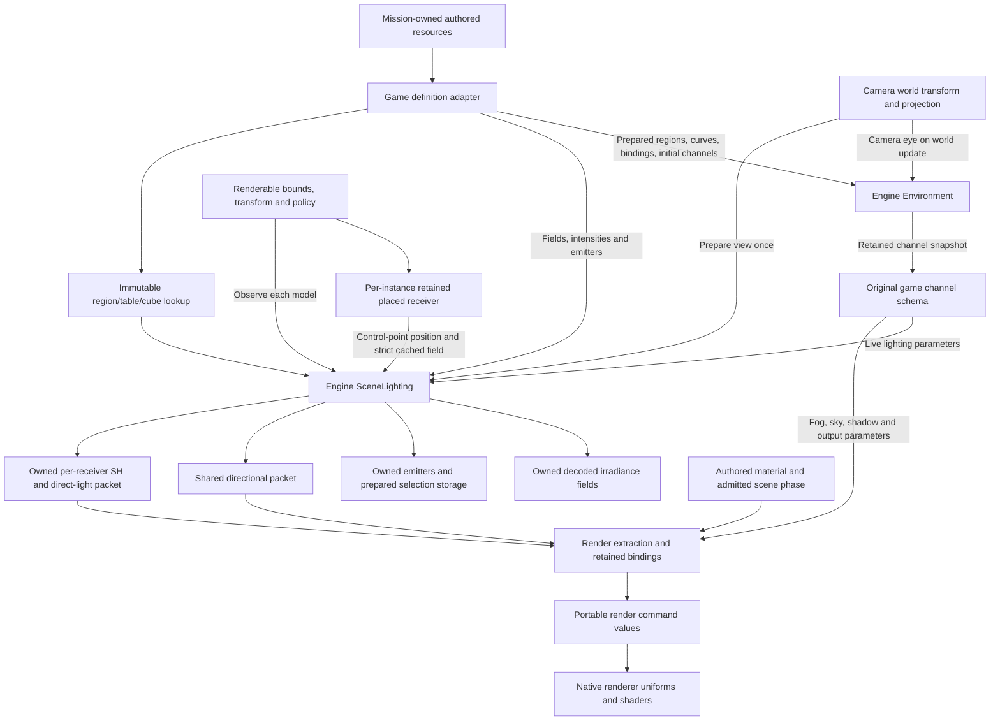

# Scene lighting

The [current ownership review](current-ownership.md#lighting-and-the-render-pipeline)
keeps lighting an identifiable implemented engine subsystem while separating
game-authored policy, scene-local light membership and native render consumption.
Slice 2 moves renderer packet packing and retained receiver publication into
[LightingPublication](../../include/bw/scene/lighting/lighting_publication.hpp).
Game presentation registers policy/bounds/destinations and supplies completed
model transforms. The engine seals per-receiver draw bindings, retains the strict
placement cache and publishes through a restricted RenderScene capability. The
original SceneLighting algorithms are unchanged. See the
[integration record](../../research/engine/subsystems/lighting-output-integration.md);
this ownership work introduces no visual adjustment.

**Reconstructed lighting baseline accepted · October 25, 2026.**

The completed [source audit](../../research/engine/subsystems/lighting-source-fidelity-investigation.md)
found structural deficiencies in surface preparation, receiver ownership,
material admission and pass execution. The implementation below replaces those
boundaries and has passed verification and user acceptance. Explicitly named
upstream owner dependencies remain future work. This redesign
supersedes the previous plan to defer those deficiencies until gameplay.
It preserves the original light model and authored values; a modern renderer
upgrade remains separate. Residual angle-dependent speckling and coarse shadows
are accepted baseline limitations, not established original-image parity. The
normalization and specular-filtering adaptations below remain explicit.

## Reconstruction contracts

The [acceptance ledger](../../research/engine/subsystems/lighting-redesign-acceptance.md)
tracks every audit boundary through design, implementation and evidence. A
passing shader equation replay cannot close receiver selection or whole-frame
fidelity. Known missing engine owners remain implementation work; only missing
original runtime observations are external evidence limits.

| Owner | Inputs and authority | Publication and lifetime |
|---|---|---|
| Mission environment | Authored channels, camera region and admitted root-update phase | Retained environment values; no independent lighting clock. User pause gates ordinary root publication; script pause must not silently replace that gate. |
| Scene lighting | Immutable prepared fields, emitter registry, live field intensities, explicit receiver policy | Terrain uses uniform SH/view lights; actors use blended spatial SH/model lights; placed props use strict first-containing five-point SH and per-control-point lights. Returned packets own values. |
| Placed receiver | Evaluated control-point-zero position and source field identity | Retains SH and reflection selection at the original four-lane position/intensity invalidation threshold. Direct-light selection remains per observation. State is per instance, never shared with terrain or Alicia. |
| Material preparation | Authored selector plus enabled source pass features | Exact supported effective program and independent resource requirements. Shadow reception, directional light, local specular and casting are separate decisions; unsupported variants reject. |
| Surface preparation | Declaration, influence selector, complete palette and original accumulation order | One consistent position/normal/tangent transform used by color, preparation and shadow passes. Three influences do not degrade to one or four. |
| View and caster selection | Region camera far, view/frustum, registered owner bounds/size and authored shadow settings | View projection and source caster admission; setup, cull and shader/raster bias are explicit state, separate from reception. |
| Pass preparation | Shared owner membership, source phase and authored blend/opacity | Ordered preparation then color commands. Preparation uses its depth-valued color and depth-mask policy; masked color tests final material alpha. These are not interchangeable coverage rules. |
| Native raster | Portable projection and target dimensions | API sample-center correspondence applies jointly to geometry and shadow mapping; fullscreen postprocess sampling remains its separate verified path. |
| Output history | Completed luminance observation, supplied presentation interval and explicit reset event | Disabling tone mapping preserves history; original event reset preserves sample timing. No material owner mutates exposure to compensate for input errors. |

Preparation replay restores the world target before its geometry executes.
Consequently it writes depth-valued RGBA to the world color attachment as well
as hardware depth. It is not a color-disabled depth prepass or geometry rendered
into the temporary R32F setup target. Source order and color-write state are
part of the contract even when later color normally overwrites those pixels.

The initial scene composition remains `StageInspection`, delegating authored
visual policy to `StagePresentation`, while genuine world
startup is reconstructed. It translates source resource identities and publishes
complete observations; field sampling, receiver retention, material algorithms,
pass policy and native output history belong to their engine owners. Do not add
another player-controller lighting path or a second mutable world clock.

Implementation proceeds through surface/material admission, receiver/view
publication, ordered native passes and output lifecycle, then integrated native
verification. The ledger also carries event AREA overrides, particle/storm
lighting, owner-opacity routing, overflow SH and optional composition settings.
Owner-opacity Main/Trans routing and the saved-setting-controlled final spatial
filter now have native implementations and source witnesses. The inspected
default/installed mip setting is off. The explicit launch option now captures
immutable preparation policy for world and front-end DDS resources, with source
base conversion, full-base-per-level filtering and native full-chain accounting.
Raw icon and movie construction remain distinct. See the mip ownership and
numerical reports linked by L25.
An absent gameplay producer must not become an always-active ambient substitute.
Their subsystem contracts and remaining prerequisites must be explicit before
this redesign can be presented for acceptance.

The engine scene owns lighting definitions, prepared sampling data and light
selection. Game code translates authored resources and publishes renderable
bounds, transforms and explicit lighting policy. Controllers do not evaluate
lighting. The native renderer consumes resolved values through portable render
contracts. This subsystem implements the recovered lighting mechanisms; it does
not establish whole-frame brightness parity.

## Ownership and data flow

Arrows below represent publication and data flow, not class inheritance or
thread creation. `StageInspection` currently composes these engine mechanisms;
it is not a completed world/entity owner.

The implemented owner is
[`scene::SceneLighting`](../../include/bw/scene/lighting/scene_lighting.hpp).
Its state separates the following responsibilities:

| State | Publication and consumer |
|---|---|
| Decoded fields and independent intensities | Construction registers fields in stable scene-local order. Game code maps original character/enemy resource names to `LightingFieldId`; the engine has no allegiance or player type. |
| Authored emitters and selection settings | Construction or explicit replacement owns copied values and prepared scratch. A view publication prepares the shared global packet and narrower active list used by spatial receivers. |
| Stage ambient and directional lighting | Parameter publication validates a complete replacement. Directional output contains prepared direction and unchanged authored diffuse/specular values, separately from receiver packets. |
| Reflection field | Borrowed immutable region/table/residency lookup outlives the scene. Model-center selection is independent of camera AREA selection; retained props refresh it with their SH cache. |
| View observation | `set_view` admits light spheres and prepares source ordering/ranking. Static and spatial queries require this observation; neither silently traverses an unfiltered light registry. |

`LightingReceiver` is a complete model observation, not a retained controller
reference. Its policy is explicit; the default unclassified policy rejects.
Spatial policy also requires a registered field identity.

- **Spatial:** transform the authored group-zero center by the submitted model
  transform once; retain its unscaled radius; sample the selected field with its
  live intensity; pack the original polynomial and select from the prepared
  active emitter list. Body and attached weapon observe independently.
- **Retained placed receiver:** query the first containing field with the source
  five-point X/Z kernel and no actor exclusion filtering. Retain coefficients
  and reflection slot while squared XYZ/intensity displacement is below .25;
  refresh direct lights and add overflow SH on every observation.
- **Stage ambient:** construct the recovered constant-field polynomial and copy
  the shared view-selected direct-light packet. Material feature admission
  determines whether that packet is consumed.
- **Sky white:** construct the recovered white polynomial with no local-light
  packet. This is a source render policy, not a missing-field fallback.

The shared `DirectionalLighting` packet preserves the recovered directional
command: add the authored Z bias, normalize and negate the vector, retain the
authored color components. It is prepared on parameter publication. Exposure,
material response, fog and shadow-projection geometry are separate contracts;
none is hidden in this light definition adapter.

## Lifetime, execution and allocation

The owner borrows source byte spans only during construction or replacement. It
owns decoded fields, copied emitters and their memory domain thereafter. Its
optional immutable reflection field is a separate lifetime borrow: the mission
composition retains that field until after scene destruction. Field IDs
are indices into that scene's immutable registration order; they are invalid for
another scene. Destruction releases prepared storage. Scene identity cannot be
copied or moved. Each retained placed receiver borrows that stable scene and
keeps its own cache; there is no shared model-level receiver registry.

Returned lighting packets own fixed values, contain no resource/controller
pointers and survive later queries or scene destruction. Extraction may reuse a
packet for that model's material draws. Native submission and GPU retirement
remain renderer responsibilities; the scene does not publish borrowed mutable
scratch to a device.

All owner updates and queries are serialized on the scene's owning thread.
Local-light selection reuses mutable prepared scratch, so concurrent const-looking
sampling must not be inferred from the value-shaped API. An asynchronous scene
extractor would require an explicit immutable observation/publication boundary
and lifetime rules before parallel use.

Construction and explicit emitter replacement may allocate from the retained
domain. Successful receiver evaluation, view preparation, parameter changes and
packet reads use prepared storage. Replacement constructs and validates a
candidate before publishing it; invalid parameters/view/emitter updates preserve
the previous complete observation. No controller or renderer query decodes
assets on demand.

## Evidence and remaining boundaries

Field sampling, independent intensities, constant-field policies, model-center
transforms, unscaled receiver radii, emitter admission/ranking and directional
preparation follow recovered original routines. The source producer trace also
distinguishes view-global candidates from the tighter active list used for model
queries. See the [source contracts](../../research/engine/subsystems/lighting-scene-producer-contract.md).

The ownership/publication design uses the pinned Unreal scene, precomputed-volume,
primitive and base-pass implementations as a concrete reference. That reference
supports separate scene/shared and per-primitive data, explicit preparation and
render consumption. It does not replace verified Bullet Witch SH interpolation,
shader equations or authored values. The
[reference boundary record](../../research/engine/subsystems/lighting-reference-boundaries.md)
contains revision, functions and normalization analysis.

This owner does not resolve material/pass admission, whole-scene HDR metering or
final output appearance by itself. Those belong to the
[world renderer](world-renderer-reconstruction.md). Special Costume 5 brightness
remains a separate native visual acceptance question; matching individual
original routines on supplied inputs cannot prove their upstream inputs or a
completed original scene. Any reference-derived fallback at an opaque producer
must be identified explicitly, not reported as recovered original behavior.

## Spatial environment lifetime

`scene::Environment` owns the prepared regions, scalar animation, region-to-key
bindings and current channel values. It selects and samples once per supplied
world update, then transitions continuous channels using the explicit source
policy. The table key is a curve coordinate, not an animation clock. Pausing
withholds the world update; there is no independent lighting tick or wall clock.

`game/stage_environment` maps original channel indices and initial CSTM values.
It contains no region math, interpolation or controller behavior. The Stage
composition supplies the camera eye, translates the engine snapshot, publishes
shared SceneLighting parameters and field intensities, then prepares view and
receiver packets before rendering. Static ambient and direct lights update
retained draw constants; shared directional/fog/sky/shadow values use retained
view publication. No geometry or material rebinding is needed for a transition.
The output owner retains adaptation history while authored parameters change.

The source scene-ready startup path (`43f16e→4829c0`) sets one immediate
publication request. The first query consumes it; subsequent world updates use
normal blending, including region crossings. Production follows that contract
without a fabricated frame count or independent environment clock. The native
output owner performs the source-selected RGB operation on retained HDR scene
color before metering, bloom and display, preserving exposure history across
ordinary parameter changes.

### Mutation authority at the renderer boundary

The renderer implements two separate command capabilities. Mission resource
preparation receives `WorldResources`, which admits, binds and retires model and
texture identities. Scene composition receives `WorldPresentation`, which
publishes draws, poses, lighting, visibility, view and output state using those
existing identities. Both share only the const readiness observation in
`WorldObservation`. The actual native host composes both as `WorldOutput`; game
borrowers cannot obtain the other command surface through their declared type.

The interfaces retain no data and cannot be copied or moved. Existing main-thread
ownership and completion-before-retirement rules remain in force. Typed
capability separation makes the source resource/scene owner distinction an API
constraint, rather than a comment or convention.

### Receiver projection execution boundary

The original surface vertex programs publish camera-relative position with
world-aligned axes. The pixel programs reconstruct shadow screen depth and
texture coordinates from that interpolated position. The earlier native path
interpolated a vertex-projected shadow coordinate instead, which changes float
execution order. The correction preserves the caster projection and prepares
separate camera-translated screen and texture matrices once on the CPU.

The native renderer retains derived matrix values with its accepted view;
fixed-space draws retain their own prepared values. Only the renderer can
replace them. Effective shadow-consuming draws require the source world-aligned
camera-relative basis. Unsupported rotated/scaled receiver bases fail before
publication; callers do not obtain a mutable matrix capability. The GPU performs
the original per-pixel dot products, followed by the separately documented
native shadow-footprint policy. Source evidence and unresolved visual attribution
are in `research/engine/subsystems/lighting-noise-reproduction.md`.

### Unit shading directions at the native lighting boundary

The recovered pixel equation separately normalizes the interpolated normal and
tangent, then combines them with the decoded tangent-space normal. Skinning and
interpolation do not preserve orthogonality, so that result is not necessarily
a unit direction. Actual-content captures demonstrate lengths above one and
specular dot products above one before saturation. The native boundary
normalizes the final combined direction before diffuse, specular, irradiance,
Fresnel and reflection consume it. This preserves its direction and authored
material/light parameters; zero remains zero.

This is an explicit native adaptation, not an assertion that the recovered
equation already normalizes. The reference is Unreal commit
`f45729c0b6f097038e72b52d366a62baeca3275b`,
`Engine/Shaders/Private/MaterialTemplate.ush`,
`TransformTangentNormalToWorld`. No new resource, mutable publication API,
controller policy or CPU/GPU transfer is introduced. Correcting the direction
invariant is separate from filtering subpixel normal variation; remaining
aliasing is measured against actual-content pixel-footprint integration.

The native specular consumer integrates four unit shading-normal samples over
the pixel footprint using tensor Gauss quadrature. The equal-area samples use
half-size texture gradients. Their centered normal variance supplies the
published Toksvig correction to the original power exponent and its energy
scale; directional and local lights reuse that one prepared result. Constant
normal fields preserve the authored exponent and amplitude exactly. Diffuse,
Fresnel and cubemap equations retain the center unit normal. No asset rewrite,
texture-option override, history or new resource is involved.

Only draws consuming a positive-power direct specular lobe perform this work.
Derivatives are prepared before coverage discard; controls are draw-uniform.
Consumed exponents must be finite and nonnegative at submission, before retained
state changes. This is a bounded native sampling adaptation, measured against
aligned sixteen-sample linear-HDR integration and small camera motion; source
algebra witnesses remain separate. See
`research/engine/subsystems/lighting-surface-filtering.md`.
