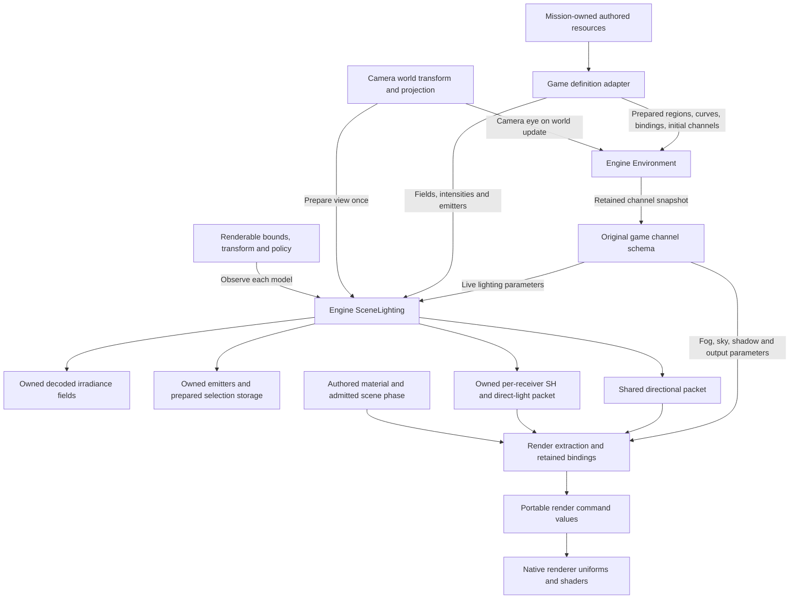

# Scene lighting

**Implemented owner and publication boundary · October 24, 2026.**

The engine scene owns lighting definitions, prepared sampling data and light
selection. Game code translates authored resources and publishes renderable
bounds, transforms and explicit lighting policy. Controllers do not evaluate
lighting. The native renderer consumes resolved values through portable render
contracts. This subsystem implements the recovered lighting mechanisms; it does
not establish whole-frame brightness parity.

## Ownership and data flow

Arrows below represent publication and data flow, not class inheritance or
thread creation. `StageInspection` currently composes these engine mechanisms;
it is not a completed world/entity owner.

The implemented owner is
[`scene::SceneLighting`](../../include/bw/scene/lighting/scene_lighting.hpp).
Its state separates four responsibilities:

| State | Publication and consumer |
|---|---|
| Decoded fields and independent intensities | Construction registers fields in stable scene-local order. Game code maps original character/enemy resource names to `LightingFieldId`; the engine has no allegiance or player type. |
| Authored emitters and selection settings | Construction or explicit replacement owns copied values and prepared scratch. A view publication prepares the shared global packet and narrower active list used by spatial receivers. |
| Stage ambient and directional lighting | Parameter publication validates a complete replacement. Directional output contains prepared direction and unchanged authored diffuse/specular values, separately from receiver packets. |
| View observation | `set_view` admits light spheres and prepares source ordering/ranking. Static and spatial queries require this observation; neither silently traverses an unfiltered light registry. |

`LightingReceiver` is a complete model observation, not a retained controller
reference. Its policy is explicit; the default unclassified policy rejects.
Spatial policy also requires a registered field identity.

- **Spatial:** transform the authored group-zero center by the submitted model
  transform once; retain its unscaled radius; sample the selected field with its
  live intensity; pack the original polynomial and select from the prepared
  active emitter list. Body and attached weapon observe independently.
- **Stage ambient:** construct the recovered constant-field polynomial and copy
  the shared view-selected direct-light packet. Material feature admission
  determines whether that packet is consumed.
- **Sky white:** construct the recovered white polynomial with no local-light
  packet. This is a source render policy, not a missing-field fallback.

The shared `DirectionalLighting` packet preserves the recovered directional
command: add the authored Z bias, normalize and negate the vector, retain the
authored color components. It is prepared on parameter publication. Exposure,
material response, fog and shadow-projection geometry are separate contracts;
none is hidden in this light definition adapter.

## Lifetime, execution and allocation

The owner borrows source spans only during construction or replacement. It owns
decoded fields, copied emitters and their memory domain thereafter. Field IDs
are indices into that scene's immutable registration order; they are invalid for
another scene. Destruction releases prepared storage. There is no persistent
receiver registry in this subset.

Returned lighting packets own fixed values, contain no resource/controller
pointers and survive later queries or scene destruction. Extraction may reuse a
packet for that model's material draws. Native submission and GPU retirement
remain renderer responsibilities; the scene does not publish borrowed mutable
scratch to a device.

All owner updates and queries are serialized on the scene's owning thread.
Local-light selection reuses mutable prepared scratch, so concurrent const-looking
sampling must not be inferred from the value-shaped API. An asynchronous scene
extractor would require an explicit immutable observation/publication boundary
and lifetime rules before parallel use.

Construction and explicit emitter replacement may allocate from the retained
domain. Successful receiver evaluation, view preparation, parameter changes and
packet reads use prepared storage. Replacement constructs and validates a
candidate before publishing it; invalid parameters/view/emitter updates preserve
the previous complete observation. No controller or renderer query decodes
assets on demand.

## Evidence and remaining boundaries

Field sampling, independent intensities, constant-field policies, model-center
transforms, unscaled receiver radii, emitter admission/ranking and directional
preparation follow recovered original routines. The source producer trace also
distinguishes view-global candidates from the tighter active list used for model
queries. See the [source contracts](../../research/engine/subsystems/lighting-scene-producer-contract.md).

The ownership/publication design uses the pinned Unreal scene, precomputed-volume,
primitive and base-pass implementations as a concrete reference. That reference
supports separate scene/shared and per-primitive data, explicit preparation and
render consumption. It does not replace verified Bullet Witch SH interpolation,
shader equations or authored values. The
[reference boundary record](../../research/engine/subsystems/lighting-reference-boundaries.md)
contains revision, functions and normalization analysis.

This owner does not resolve material/pass admission, whole-scene HDR metering or
final output appearance by itself. Those belong to the
[world renderer](world-renderer-reconstruction.md). Special Costume 5 brightness
remains a separate native visual acceptance question; matching individual
original routines on supplied inputs cannot prove their upstream inputs or a
completed original scene. Any reference-derived fallback at an opaque producer
must be identified explicitly, not reported as recovered original behavior.

## Spatial environment lifetime

`scene::Environment` owns the prepared regions, scalar animation, region-to-key
bindings and current channel values. It selects and samples once per supplied
world update, then transitions continuous channels using the explicit source
policy. The table key is a curve coordinate, not an animation clock. Pausing
withholds the world update; there is no independent lighting tick or wall clock.

`game/stage_environment` maps original channel indices and initial CSTM values.
It contains no region math, interpolation or controller behavior. The Stage
composition supplies the camera eye, translates the engine snapshot, publishes
shared SceneLighting parameters and field intensities, then prepares view and
receiver packets before rendering. Static ambient and direct lights update
retained draw constants; shared directional/fog/sky/shadow values use retained
view publication. No geometry or material rebinding is needed for a transition.
The output owner retains adaptation history while authored parameters change.

The source scene-ready startup path (`43f16e→4829c0`) sets one immediate
publication request. The first query consumes it; subsequent world updates use
normal blending, including region crossings. Production follows that contract
without a fabricated frame count or independent environment clock. The native
output owner performs the source-selected RGB operation on retained HDR scene
color before metering, bloom and display, preserving exposure history across
ordinary parameter changes.
