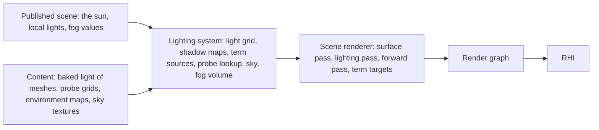
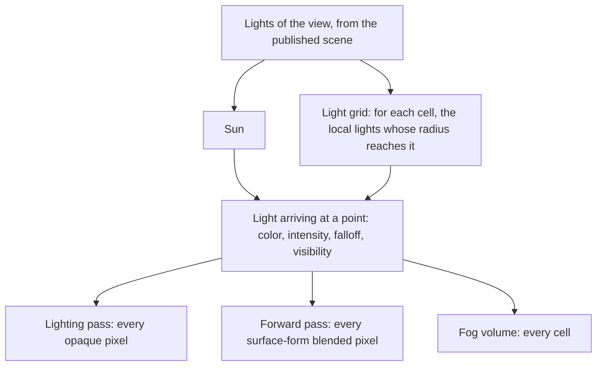
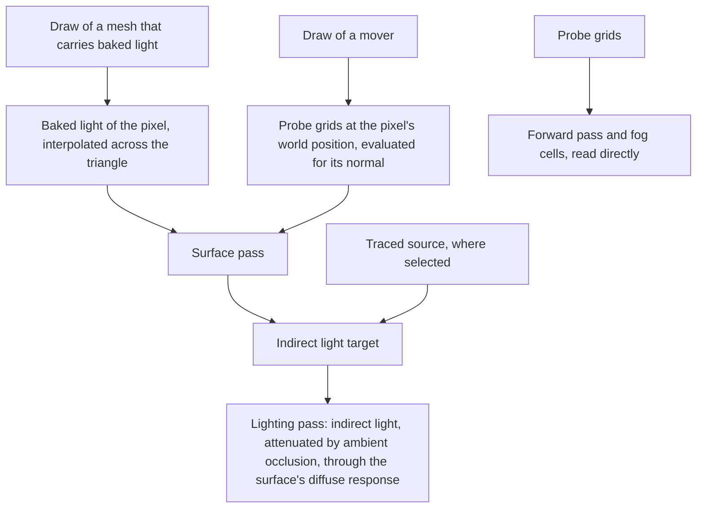
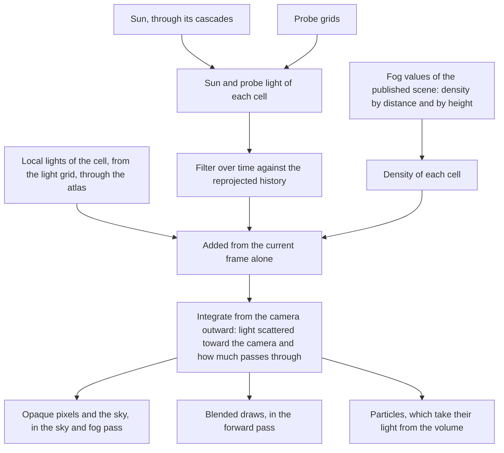

# Lighting

What lights exist, how a point finds the lights that reach it, how shadows,
ambient occlusion, reflections and indirect light are computed, and how the
sky and the fog are drawn. Direct light is evaluated each frame from the
lights the scene publishes. Indirect light is baked data applied per pixel,
or traced where a target reports ray tracing. Fog is a lit volume that the
sun, the probes and every local light scatter into.

The sun is the one directional light of a view. A local light is a point or
spot light. A mover is a draw whose mesh carries no baked light.

## Position

Beside the [scene renderer](scene-renderer.md), which owns the pass list,
the lighting function, the meaning of each term's target and the choice of
each term's source. Fed by the published scene, which carries the lights,
the sun and the fog values the world decides, and by [content](content.md),
which carries the baked data. Above the [render graph](render-graph.md) and
the [RHI](rhi.md).

## Invariants

1. A light is the sun, a point light or a spot light. It has one color and
   one intensity in photometric units; a source that carries two colors,
   one for diffuse and one for specular, is recorded by the converter and
   its diffuse color is the light's. Exposure changes the image once, at
   tone mapping, and no light is scaled for the display. Scene color is
   stored pre-multiplied by the previous frame's exposure for precision;
   renderer code applies that factor where light is written and removes it
   where light is read, as [post-processing](post-processing.md) states.
2. A local light has a radius. Its intensity falls with the square of
   distance inside a window that reaches zero at the radius, and it lights
   nothing beyond it. A spot light adds a cone with an inner and an outer
   angle.
3. The lighting system computes the light arriving at a point: color,
   intensity, falloff and visibility. What a surface does with arriving
   light is the lighting function, which belongs to the scene renderer.
4. The sun is evaluated for every pixel and is not in the light grid. Every
   local light is found through the light grid and in no other way.
5. The light grid's capacity is fixed. A frame whose lights exceed it
   reports how many were left out.
6. Shadow maps exist on every target: cascades for the sun and one atlas for
   local lights. Surface-form blended surfaces, the fog, hair pixels, and
   the lighting pass for a subsurface or hair pixel's thickness read them
   directly on every target, whichever source the shadowing term uses. A
   light with no map that frame gives no thickness and no transmission.
7. The sun's cascades are stable under camera motion: a cascade moves in
   whole texels and keeps its size.
8. The atlas has a fixed number of slots. Slots go to the casters that are
   largest on screen. A caster without a slot casts no shadow that frame,
   and the count is reported.
9. Ambient occlusion attenuates indirect light and never direct light.
10. Indirect diffuse light on a rasterized target is baked data, read and
    never computed. A mesh that carries baked light is lit by it. A mover is lit by
    the probe grids at each pixel's own world position and normal, never by
    one value for the whole draw.
11. Baked data is content addressed by id. The lighting system cannot tell
    how a baked set was made, and a set that replaces another under the same
    ids changes no code.
12. The surface pass writes each opaque pixel's baked indirect light into
    the indirect light target, on every target, so one surface shader
    serves all of them. Renderer code in the pass writes it; a material
    template never sees it. A traced source, where selected, writes the
    whole target after the surface pass, and nothing of the baked write
    remains. A hair pixel is left out of the traced write and keeps its
    probe lookup, made with the fake normal built from the view direction
    and the fibre direction, not the card normal.
13. Surface-form blended surfaces and fog cells read the probe grids
    directly on every target; surface-form blended surfaces also read the
    environment map for their reflection. A hair pixel's probe light is the
    surface pass's write into the indirect light target, made with the fake
    normal, which the traced indirect source leaves in place.
14. The sky is drawn from sky textures and is not computed from physical
    inputs. On a rasterized target the diffuse light of the sky is in the
    baked data, and no pass computes it; a traced gather that leaves the
    scene reads the sky textures as its miss. The sky and fog pass writes
    far depth and the camera's rotation as the motion vector for every sky
    pixel, so the temporal stage and motion blur treat the sky as a surface.
15. Fog is one volume aligned to the view. Opaque pixels, blended surfaces
    and particles all read that volume, and nothing else fogs a pixel.
16. In the fog volume the sun's light and the probes' light are filtered
    over time; the kept history is pre-exposed, reused by the ratio of the
    two frames' exposure factors, and dropped on a camera cut. Light from
    local lights is computed from the current frame alone and added after
    that filter; only its shadowing is filtered over time, in a history of
    its own.
17. No screen-space pass adds bounced diffuse light. Diffuse light from a
    local light bounces only where a traced source runs; the reflections
    term's screen trace is the one bounced specular on a rasterized target.

## Lights

| Light | Carries | Found by | Shadow |
|---|---|---|---|
| Sun | direction, color, illuminance | every pixel evaluates it | cascaded shadow maps |
| Point | position, radius, color, intensity | light grid | a slot in the atlas, if published as a caster |
| Spot | position, direction, radius, inner and outer angle, color, intensity | light grid | a slot in the atlas, if published as a caster |

The world decides which lights exist, which are casters, and what the sun
and the fog values are at any moment. The lighting system reads them from
the published scene each frame and keeps no light state of its own.

## Direct light

The grid divides the view into screen cells by depth slices spaced
logarithmically. A cell holds a short list of light indices. A light's
record carries its shadow channel, or none.

## Shadows

| Caster | Map | Filtering | Read by |
|---|---|---|---|
| Sun | cascades fitted to slices of the view, each stable under camera motion | percentage-closer | shadowing term, forward pass, fog, hair pixels, thickness |
| Local light published as a caster | one slot of the atlas, sized by the light's size on screen | percentage-closer | shadowing term, forward pass, fog, hair pixels, thickness |
| Local light not published as a caster | none | | |

For a subsurface or hair pixel the lighting pass also reads the cascade or
atlas slot for thickness: the receiver position shrunk along its normal is
projected into the map and the depth found there is subtracted from the
receiver's depth. The shadowing term is not involved; [character
shading](character-shading.md) states what each model makes of the value.

## Visibility terms

What each term's target means, and what each source computes. The scene
renderer selects the source; both write the same target.

| Term | Target holds, per opaque pixel | Rasterized source | Traced source | Blended surfaces and fog |
|---|---|---|---|---|
| Shadowing | visibility of the sun, and of each caster by its channel; hair pixels skipped, they read the maps | shadow maps resolved to the screen | rays toward each light, filtered | sample the shadow maps |
| Ambient occlusion | how much of the hemisphere is open, for hair pixels too, from whichever source ran | depth and normals at half resolution, filtered over time, upsampled bilaterally | rays over the hemisphere, filtered | none |
| Reflections | light arriving along the reflected direction; nothing at a hair pixel, which takes no reflection | a screen trace through a depth hierarchy over the previous frame's scene color, the environment map where the trace misses or the surface is rough | the same screen trace, then rays into the scene where it misses | the environment map |
| Indirect light | diffuse light arriving from the surroundings; hair pixels skipped, they keep the probe lookup | baked light, written by the surface pass | rays gathering light from the scene, filtered | the probe grids |

## Indirect light

A probe grid is a lattice of probes in an oriented box. A probe holds nine
spherical harmonic coefficients per color channel. A probe set is the asset
that holds the probe grids of one stage; it is apart from the stage's meshes
and from its level data, and the stage names it by id. A point inside a box is
lit by the eight probes around it. A point inside no box takes the values at
the nearest box's edge.

## Sky and fog

| Part | Rule |
|---|---|
| Sky | sky textures drawn as an unlit dome wherever no opaque surface covers the pixel |
| Fog density | from the published fog values. There is no second fog. |
| Volume | cells follow the view, thinner near the camera, sampled with a per-frame jitter |
| History | the filtered part alone is kept for the next frame, pre-exposed, reused by the exposure ratio. A cell with no history takes more samples. |
| Particles | a particle samples the volume for its light and evaluates no light itself |

## Content the lighting system reads

| Data | Form | Read by |
|---|---|---|
| Baked light of a mesh | a vertex stream of the mesh, holding linear light values | surface pass |
| Probe set | the probe grids of one stage, each an oriented box, a lattice size and spherical harmonic coefficients per probe | surface pass for movers, forward pass, fog |
| Environment map | a cube texture with a mip chain by roughness | reflections |
| Sky | sky textures | sky |

## Components and ownership

| Component | Lives in | Consumed by |
|---|---|---|
| Light records, falloff and cone evaluation | `src/engine/rendering/lighting` | lighting pass, forward pass, fog |
| Light grid | `src/engine/rendering/lighting` | lighting pass, forward pass, fog |
| Shadow maps: cascades, atlas, slot assignment | `src/engine/rendering/lighting` | shadowing term, forward pass, fog, the lighting pass for hair and thickness |
| Sources of the four terms and their filters | `src/engine/rendering/lighting` | scene renderer's term targets |
| Probe grid lookup | `src/engine/rendering/lighting` | surface pass, forward pass, fog |
| Sky and fog volume | `src/engine/rendering/lighting` | sky and fog pass, forward pass, particles |
| Probe set payload reader | `src/engine/rendering/lighting` | content loading |

## Boundaries

Above: the world, which owns light state and decides the sun, the local
lights and the fog values of each moment, and publishes them. Beside: the
scene renderer, which owns the pass list, the lighting function, each term's
target and the selection of its source; the material system, which supplies
surface attributes and never sees a light; content, which delivers baked
data and decides nothing about how it is used. Below: the render graph and
the RHI. How baked data is made, how the game chooses a stage's sun and fog,
and how particles are drawn are outside this document.
