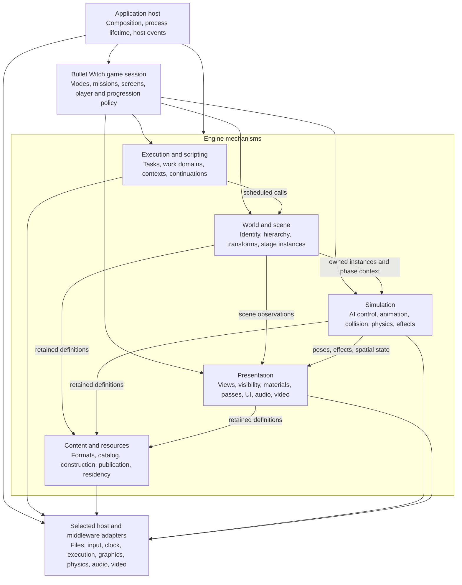

# Engine architecture

**Target architecture · working baseline · October 22, 2026.**
[Architecture index](README.md).

The target is a native Bullet Witch engine with a defined runtime structure:
a process hosts an engine instance and a game session; the session owns mission
and screen lifetimes; a mission owns a world; that world integrates actors,
spatial state, animation, collision, effects and presentation. Shared engine
services provide resources, execution, scripts and devices across those lifetimes.
This structure describes the finished engine regardless of reconstruction order.

It is a reconstruction of this game's engine. Its actor/component/message model,
script continuations, resource publication and task passes preserve recovered
semantics. The architecture does not require replacing them with an ECS, a new
fixed-step loop or a general-purpose editor framework. The proposed ownership
boundaries make the recovered behavior explicit without copying x86 addresses
or global variables into the new public interfaces.

## System structure

Arrows show composition or directed service/data use, as labelled. They do not
specify call order or imply one thread per box. Simulation and presentation use
narrow host contracts; only composition selects their implementations. The
[source dependency view](file-mapping.md#dependency-rules) defines allowed imports.

## Architectural units and boundaries

| Unit | Owns | Exposes to collaborators | Does not own |
|---|---|---|---|
| Application host | Selected adapters, engine and session lifetimes, process startup/shutdown | Host events, capability selection and run/stop control | Mission rules or frame-level actor behavior |
| Engine instance | Shared resources, task/work services, script machinery, renderer/device service, input and media services | Explicit service references and factories for world/context/playback instances | Current mission outcome or player progression |
| Game session | Root script driver, game modes, screen stack/tasks, player/session state, progression and current mission | Mode transitions, actor factories, bindings and game-specific schedules | Generic hierarchy, parser or device implementation |
| Mission instance | Mission context, world, stage resource group and checkpoint relationship | Mission events, load/start/outcome transitions and world lifetime | Process-wide rendering/audio devices or root progression |
| World | Entity identity/hierarchy, stage instances and world-local subsystem instances | Entity operations, phase-scoped scene observations, spatial/query services | Global catalog selection, UI navigation or platform APIs |
| Simulation systems | AI controller/action state, animation instances, collision/physics scene and effects | Behavior commands, poses, events, query results and presentation inputs | Game-specific rules hidden inside generic mechanisms |
| Presentation systems | Render scene projection, views, material instances, pass/command construction, UI presentation and media output | Submitted work, presentation completion and diagnostic state | Authoritative actor state or mission readiness |
| Resource service | Selected asset identities, archive/record state, handler execution, publications and retained backing data | Requests, typed retained results, status and group release | Actor lifetime or shader/physics semantics embedded in a generic loader |
| Host adapters | Native device, OS and middleware objects behind declared contracts | Files, time, events, raw input and concrete graphics/physics/media operations | Game policy or resource-name precedence |

These are logical units, not mandatory base classes or a service locator.
`EngineInstance` is an aggregate lifetime boundary. Systems receive the specific
services they need; they do not reach through it to arbitrary global state.

## The world is the integration boundary

The world has an authoritative entity registry and transform hierarchy. Actors
own their state/component dispatchers and concrete behavior. Models, attachments,
physics associations and effects participate through explicit instance bindings.
The world also holds stage/area instances and the membership used by rendering,
collision and actor-query paths. A render-visible object is not thereby an actor,
and a hierarchy parent is not automatically a collision or visibility partition.

AI, animation, physics and effects are cooperating systems within this structure.
They do not each maintain an independent copy of the gameplay world. Game code
supplies concrete actor/actions and event policy; engine mechanisms execute their
contracts. [World and simulation](world-and-simulation.md) specifies identity,
state authority, spatial membership, model/pose ownership and the interaction paths.

## Rendering is an engine subsystem

The renderer receives scene projections, camera/view descriptions, poses,
materials, lights/environment data and ordered UI/video/effect contributions.
It owns visibility evaluation, pass construction, command submission and device
resource use. A graphics adapter executes that contract on a selected API.
Material/shader semantics and render-pass dependencies belong above that adapter.

A render scene references world instances without owning gameplay actors. A
submitted packet freezes or retains the exact data needed until consumption
completes. Actor mutation, CPU command completion and GPU completion are separate
boundaries. [Rendering and presentation](rendering-and-presentation.md) defines
these units, including the unknowns in the original camera, visibility, lighting
and postprocess behavior. Those unknowns cannot be filled with a generic modern
pipeline and still be described as faithful reconstruction.

## Data and ownership layers

| Representation | Authority / lifetime | Main consumers |
|---|---|---|
| Content bytes and decoded definitions | Resource service retains archives and supported immutable definitions | Instance constructors and tools |
| Runtime instance state | Session/mission/world or an individual subsystem instance | Scripts, game behavior and simulation |
| Scene observations | Borrowed under a declared phase/lifetime, or copied when crossing an asynchronous boundary | Queries, rendering, audio and effects |
| Submitted work | Work domain owns arguments, command storage and retained resource uses until completion | Workers, render consumer and devices |
| Persistent snapshot | Save operation owns a consistent captured game-state representation | Serializer, storage adapter and restore path |

Definition, instance and submission are distinct identities. An immutable mesh
can be shared by many model instances; each model has its own pose and overrides;
multiple submissions can retain that model's resources after its actor retires.
This separation also governs effect packs/instances, sound banks/cues and script
packages/contexts. It is the basis for memory ownership and streaming, rather
than treating every object as a globally shared asset.

## Execution model

The application control domain advances the selected game mode through recovered
task passes. The mode schedule calls world/system phases and script drivers at
explicit points. Resource work and the render consumer have separate handoffs;
physics stepping has its own mutation/flush/simulate/fetch contract. Hide/trace
workers remain distinct domains with unresolved completion edges.

A simulation phase is not assumed to equal a rendered frame. Hierarchy update,
pose generation, resource phase completion, render-list consumption and device
completion each carry their own validity boundary. Neither a universal 60 Hz
step nor parallel execution of every subsystem is established by the evidence.
The [execution contracts](execution-contracts.md) define ordering, publication,
thread ownership, memory scopes and quiescence. [Runtime scenarios](runtime-scenarios.md)
trace startup, mission execution, persistence and shutdown through these owners.

## Architecture decisions and unresolved contracts

| Topic | Proposed architectural decision | Evidence or remaining choice |
|---|---|---|
| Runtime ownership | Application → engine/session; session → mission/screens; mission → world | Explicit reconstruction ownership; not asserted original class layout |
| World object model | Generation-checked identities, ordered hierarchy, state/component/message dispatch | Grounded in recovered actor lifecycle; exact variant behavior remains local |
| Simulation authority | One authoritative writer per state domain with explicit phase handoffs | Recovered local orders retained; full all-mode schedule and auxiliary joins remain open |
| Presentation | World scene projection → view/visibility → pass/commands → consumer/device | Command path recovered; camera, full lighting and pass semantics remain incomplete |
| Resource integration | Immutable definitions shared; instances and submissions retain their own uses | Recovered publication/tag unload constrains reconstructed lifetime management |
| Platform boundary | Behavior above narrow selected host contracts | Graphics API, legacy physics/audio/video implementation and packaging remain decisions |
| Fidelity and upgrade | Keep reconstructed behavior contracts stable; make later changes explicit | Source reconstruction/direct port/then upgrades is the project direction |

Structural decisions can be reviewed now. Unresolved behavioral equations or
host choices remain attached to their owning subsystem. Their existence does
not turn the architecture into a feasibility study, and a diagram does not close
them. The [original-engine map](../../research/engine/ARCHITECTURE.md) remains the
evidence source; [IMPLEMENTATION](../../IMPLEMENTATION.md) owns delivery order
and the migration of existing code.
