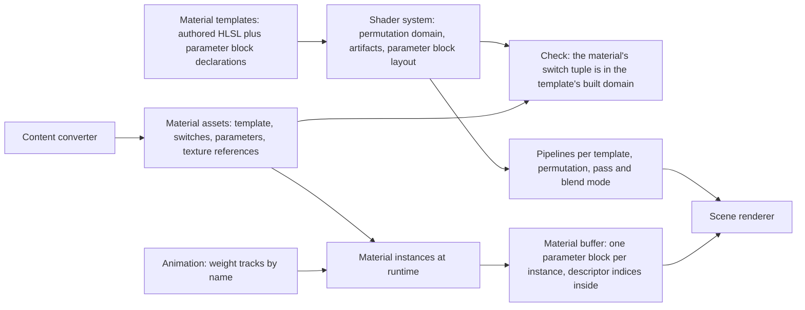
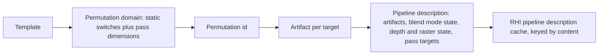
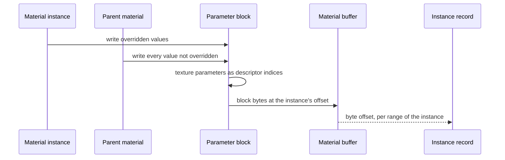

# Materials

How a surface's appearance is described, parameterized, compiled and bound.
A material is data that selects an authored material template, fixes its
static switches, and supplies parameter values; it contains no shader code.
There is no material graph and no shader generated from material data: the
game's materials are a small family that authored templates cover.

## Position

Above the [shader system](shaders.md), which compiles the templates and
owns their permutation domains and parameter blocks; beside the scene
renderer and the lighting system, which own the lighting function, the
passes, shadows and fog and consume material attributes, and
post-processing, which runs the screen-effect templates; fed by the content converter, which writes material
assets in these terms, and by [animation](animation.md), whose published
weight tracks it binds to parameters. The RHI sees only
buffers, descriptor indices and pipeline descriptions.

## Invariants

1. A material template is authored HLSL with a declared parameter block and
   a declared permutation domain. Templates are the only material shader
   source; no shader code is generated from material data.
2. A material is data: one template, a value for every static switch of that
   template, and parameter values. Static switches select a permutation;
   parameters never do.
3. Every switch combination a template's predicate admits is a built
   permutation before the game runs. Content can only select within that
   domain: a material whose switch tuple the predicate does not admit fails
   by name when it is converted and when it is loaded. The game never meets
   a combination that was not built.
4. Scalar, vector and texture parameters live in one parameter block per
   template, declared in C++ and laid out by the shader system. Texture
   parameters are 32-bit descriptor indices in that block. The layout hash is
   checked at load.
5. A material instance overrides parameter values of its parent at runtime
   without any compilation. An override of a static switch is not an
   instance; it is a different material, resolved by the converter.
6. The attribute set a template writes is fixed per shading model and blend
   mode by one table in code, and the blend mode is a permutation dimension
   so that each blend mode's shader writes its own set. A template that
   writes an attribute its shading model does not read fails to compile, by
   name.
7. Lighting inputs are not material parameters. Lights, light lists,
   spherical harmonics, lightmaps, shadows and fog are scene and view data
   owned by the scene renderer; a material supplies attributes to the
   lighting model and nothing else.
8. Materials never read the original game's formats and carry none of its
   fields. The content converter writes material assets in the terms of
   this document; what it maps from is its own
   ([content](content.md), "Material mapping").
9. A template may declare a texture-coordinate set it reads as moving.
   For each such set its block holds an offset and a rate, two scalars
   each. Whether the set also has a curve is a static switch of the
   template; a set with one names a curve table, a row of it and a
   period. A curve table is a texture of two floats a texel, one row
   per curve.
   The template samples at the coordinate plus the offset, plus the rate
   times the world's time, which the pass gives among its frame values,
   plus the curve's value at that time. A curve's row is evenly spaced
   samples of two floats over one period, the first at its start and the
   last at its end. Its value is the row read at the world's time
   divided by the period, wrapped to one, filtered linearly along the
   row and taken at the row's centre, so that no other row enters. A
   set without a curve has none added. The table is a texture
   parameter, and the row and the period are scalars; a material whose
   period is not above zero, or whose row the table does not have,
   fails by name when it is converted and when it is loaded. A rate and
   a curve
   move a texture with no write per frame, alike on every placed
   instance of the material.
10. A mesh may list track bindings, each a track name, a range of
    the mesh and a scalar parameter of that range's template. A placed
    instance of such a mesh has a material instance of its own for each
    bound range, made when the instance enters. Once per frame, before
    any pass draws, the material system writes the value animation
    published for each bound track into its parameter, as published and
    with nothing added; a bound track that is not published leaves the
    parameter at its parent's value. A binding that names a parameter
    the range's template does not declare fails by name when the mesh is
    converted and when it is loaded.
11. A blended template of a particle vertex source, which is a sprite,
    a ribbon or a mesh particle, may declare scalar parameters of its
    block as particle values. Where an emitter's particle data carries
    such a value the template reads it per particle in place of the
    block's; where it does not, the template reads the block's. The
    offset of a moving texture-coordinate set may be declared so.

## Attributes

The attribute set a template may write, and which shading models read each.

| Attribute | Lit | Unlit | Subsurface | Hair | Eye |
|---|---|---|---|---|---|
| Diffuse albedo | yes | | yes | yes | yes |
| F0, reflectance at normal incidence, a color | yes | | yes | yes, the fibre reflection scale | |
| F90, reflectance at grazing, a color | yes | | yes | yes | |
| Roughness | yes | | yes | yes | yes |
| Normal | yes | | yes | yes | yes, the cornea |
| Tangent | | | | yes, the fibre direction | |
| Emissive | yes | yes | | yes | |
| Ambient occlusion | yes | | yes | yes | yes |
| Subsurface profile | | | yes | | yes |
| Scatter scale | | | yes | | |
| Hair shift, hair scatter | | | | yes | |
| Iris normal, iris mask, iris height | | | | | yes |
| Opacity | translucent blend modes | translucent blend modes | | | |
| Opacity mask | masked blend mode | masked blend mode | masked | masked | |
| World position offset | yes | yes | yes | yes | yes |
| Refraction | translucent blend modes | translucent blend modes | | | |
| Pixel depth offset | opaque and masked | opaque and masked | opaque and masked | opaque and masked | opaque |

World position offset is a function of the vertex, the instance transform
and the frame values the pass gives it, and reads nothing else, so the
surface pass can evaluate it again with the previous transform and previous
frame values for the motion vector. A template that writes it declares its
maximum displacement, which pads the bounds of every instance of the
template. On a traced target the [geometry feed](geometry.md) runs the
template's vertex function in a write-out pass to give the acceleration
structure the offset positions.

A blended template declares the blend modes it supports, a priority for the
forward pass's order and a lighting form, surface or particle, as
[transparency](transparency.md) states; a particle-form template reads the
fog volume and no light. A decal template is a template of the decal domain:
it writes diffuse albedo, normal and roughness with an opacity for each,
from the box-space UV, declares a priority, and reaches the decal pass alone.
A surface template may declare that it refuses normal or roughness changes
from decals, as [decals](decals.md) states. The attribute table above is the
set for the five shading models; a decal template's outputs and a
particle-form template's inputs are the two sets the sentences here state.

Shading models: unlit, lit, subsurface, hair, eye. Blend modes: opaque,
masked, translucent, additive, modulate. Each template declares one shading
model; the blend mode is a material property that the renderer's pass
selection and pipeline state honor. Subsurface and hair are opaque or masked
only and eye is opaque; [character shading](character-shading.md) states what each
computes. A template also declares whether it is two-sided, which enters the
pipeline description's raster state. An eye template requires a mesh with a
frontal-projection UV set; the converter assigns a lit template of the same
textures to an eye mesh without one. Clear coat, cloth, water and thin
translucent are not in the set and are added as a column when a template
needs one. A screen-effect template is a full-screen template with no
shading model, declared for one of two slots, before bloom or after tone
mapping, with its own parameter block; [post-processing](post-processing.md)
states when each slot runs.

## Material to pipelines

Pass dimensions such as the depth-only or shadow variant of a template, the
write-out variant on traced targets, and the vertex-source dimension of a
blended template (mesh, sprite, ribbon, mesh particle) are permutation
dimensions declared by the renderer, so the one build-time enumeration that
builds the switch domain builds the pass set, and the blend mode is one of
those dimensions, from the set the template declares it supports.
Two-sidedness and pass render targets enter the pipeline description, not
the permutation, and the enumeration lists each pass's finite set of those
states, so every pipeline is precompiled, including the decal pass's
inside-the-box state. Vertices are pulled, so no vertex layout enters
either: a permutation states the vertex attributes it reads, and an instance
whose mesh lacks one fails by name when it enters the scene.

## Parameters at runtime

| Parameter kind | Where it lives | Changes at runtime | Changes the permutation |
|---|---|---|---|
| Scalar, vector | the template's parameter block | yes | no |
| Texture | a 32-bit descriptor index in the same block | yes | no |
| Profile | an 8-bit id into the profile set, in the same block | yes | no |
| Particle value | the emitter's particle data, one per particle, for a scalar the template declares so | yes, by whoever writes the particle data | no |
| Static switch | the template's permutation domain | no | yes |

Every material block lives in one buffer reached through the descriptor
arrays. A draw's shader finds its material block through the instance
record, which holds the block's byte offset per range of the instance's
mesh, as [scene](scene.md) states; the shader reads the block from there at
the offsets the C++ declaration gives. A block is filled only when
an instance's values change, and the range it fills is shared by every draw
of that instance in the frame. A bound weight track changes an
instance's values in the frames its published value differs from the one
last written, and in the frame it stops being published. Blocks differ per template, so a material
block is never one of the root layout's static slots.

## Components and ownership

| Component | Lives in | Consumed by |
|---|---|---|
| Material templates, HLSL and parameter block declarations | `src/engine/rendering/materials/templates` | shader system, scene renderer |
| Material and instance types, parameter block fill | `src/engine/rendering/materials/public/bw/rendering/materials` | scene renderer, content loading |
| Attribute activation table, shading and blend enumerations | `src/engine/rendering/materials/public/bw/rendering/materials` | templates at compile time, renderer at pass selection |
| Material buffer | `src/engine/rendering/materials/public/bw/rendering/materials` | scene renderer |
| Binding of weight tracks to parameters, per placed instance | `src/engine/rendering/materials/public/bw/rendering/materials` | the parameter block fill |
| Permutation enumeration of each template | the shader build | RHI precompilation |
| Switch tuple check against the template's domain | `tools/content_converter`, material loading | content loader |
| Material asset writer | `tools/content_converter` | content loader |

## Boundaries

Above: the scene renderer, which owns the lighting model, pass selection,
post-processing and every lighting input. Below: the shader system, which
compiles templates and lays out parameter blocks, and the RHI, which binds
them. Beside: the content converter, which writes material assets, and
animation, which publishes weight tracks by name and knows nothing of
materials.
User-made materials are new material assets over the same templates, which
the self-describing artifacts and the fully built switch domain already
allow; a user-made template is a shader source and follows the shader
system's rules for one.
