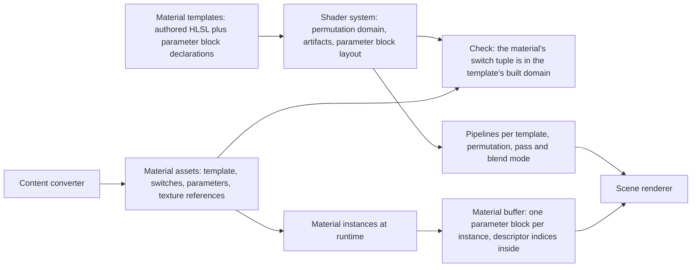
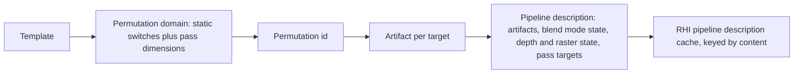
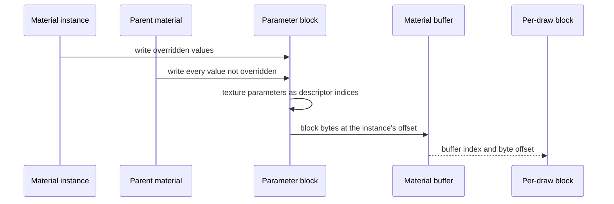

# Materials

How a surface's appearance is described, parameterized, compiled and bound.
A material is data that selects an authored material template, fixes its
static switches, and supplies parameter values; it contains no shader code.
There is no material graph and no shader generated from material data: the
game's materials are a small family that authored templates cover.

## Position

Above the [shader system](shaders.md), which compiles the templates and
owns their permutation domains and parameter blocks; beside the scene
renderer, which owns lighting, shadows, fog and post-processing and consumes
material attributes; fed by the content converter, which writes material
assets in these terms. The RHI sees only
buffers, descriptor indices and pipeline descriptions.

## Invariants

1. A material template is authored HLSL with a declared parameter block and
   a declared permutation domain. Templates are the only material shader
   source; no shader code is generated from material data.
2. A material is data: one template, a value for every static switch of that
   template, and parameter values. Static switches select a permutation;
   parameters never do.
3. Every switch combination a template's predicate admits is a built
   permutation before the game runs. Content can only select within that
   domain: a material whose switch tuple the predicate does not admit fails
   by name when it is converted and when it is loaded. The game never meets
   a combination that was not built.
4. Scalar, vector and texture parameters live in one parameter block per
   template, declared in C++ and laid out by the shader system. Texture
   parameters are 32-bit descriptor indices in that block. The layout hash is
   checked at load.
5. A material instance overrides parameter values of its parent at runtime
   without any compilation. An override of a static switch is not an
   instance; it is a different material, resolved by the converter.
6. The attribute set a template writes is fixed per shading model and blend
   mode by one table in code. A template that writes an attribute its shading
   model does not read fails to compile, by name.
7. Lighting inputs are not material parameters. Lights, light lists,
   spherical harmonics, lightmaps, shadows and fog are scene and view data
   owned by the scene renderer; a material supplies attributes to the
   lighting model and nothing else.
8. Materials never read the original game's formats and carry none of its
   fields. The content converter writes material assets in the terms of
   this document; what it maps from is its own
   ([content](content.md), "Material mapping").

## Attributes

The attribute set a template may write, and which shading models read each.

| Attribute | Lit | Unlit | Subsurface | Hair |
|---|---|---|---|---|
| Diffuse albedo | yes | | yes | yes |
| F0, reflectance at normal incidence, a color | yes | | yes | yes |
| F90, reflectance at grazing, a color | yes | | yes | yes |
| Roughness | yes | | yes | yes |
| Normal | yes | | yes | yes |
| Tangent | | | | yes |
| Emissive | yes | yes | yes | yes |
| Ambient occlusion | yes | | yes | yes |
| Subsurface color | | | yes | |
| Opacity | translucent blend modes | translucent blend modes | yes | yes |
| Opacity mask | masked blend mode | masked blend mode | masked | masked |
| World position offset | yes | yes | yes | yes |
| Pixel depth offset | opaque and masked | opaque and masked | opaque and masked | opaque and masked |

Shading models: unlit, lit, subsurface, hair. Blend modes: opaque, masked,
translucent, additive, modulate. Each template declares one shading model;
the blend mode is a material property that the renderer's pass selection
and pipeline state honor. Clear coat, cloth, eye, water and thin translucent
are not in the set and are added as a row when a template needs one.

## Material to pipelines

Pass dimensions such as the depth-only or shadow variant of a template are
permutation dimensions declared by the renderer, so the one build-time
enumeration that builds the switch domain builds the pass set. Blend mode
and pass render targets enter the pipeline description, not the
permutation; the masked blend mode alone is also a switch, because it adds
a discard. Vertices are pulled, so no vertex layout enters either: a
permutation states the vertex attributes it reads, and a draw whose mesh
lacks one fails by name when it is created.

## Parameters at runtime

| Parameter kind | Where it lives | Changes at runtime | Changes the permutation |
|---|---|---|---|
| Scalar, vector | the template's parameter block | yes | no |
| Texture | a 32-bit descriptor index in the same block | yes | no |
| Static switch | the template's permutation domain | no | yes |

Every material block lives in one buffer reached through the descriptor
arrays. A draw names its material by that buffer's index and the block's
byte offset, carried in its per-draw block; the shader reads the block from
there at the offsets the C++ declaration gives. A block is filled only when
an instance's values change, and the range it fills is shared by every draw
of that instance in the frame. Blocks differ per template, so a material
block is never one of the root layout's static slots.

## Components and ownership

| Component | Lives in | Consumed by |
|---|---|---|
| Material templates, HLSL and parameter block declarations | `src/engine/rendering/materials/templates` | shader system, scene renderer |
| Material and instance types, parameter block fill | `src/engine/rendering/materials/public/bw/rendering/materials` | scene renderer, content loading |
| Attribute activation table, shading and blend enumerations | `src/engine/rendering/materials/public/bw/rendering/materials` | templates at compile time, renderer at pass selection |
| Material buffer | `src/engine/rendering/materials/public/bw/rendering/materials` | scene renderer |
| Permutation enumeration of each template | the shader build | RHI precompilation |
| Switch tuple check against the template's domain | `tools/content_converter`, material loading | content loader |
| Material asset writer | `tools/content_converter` | content loader |

## Boundaries

Above: the scene renderer, which owns the lighting model, pass selection,
post-processing and every lighting input. Below: the shader system, which
compiles templates and lays out parameter blocks, and the RHI, which binds
them. Beside: the content converter, which writes material assets.
User-made materials are new material assets over the same templates, which
the self-describing artifacts and the fully built switch domain already
allow; a user-made template is a shader source and follows the shader
system's rules for one.
