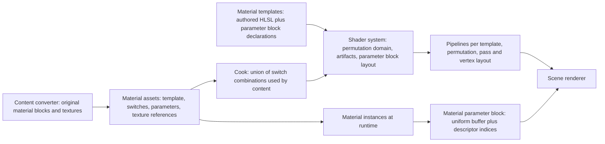
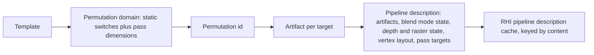
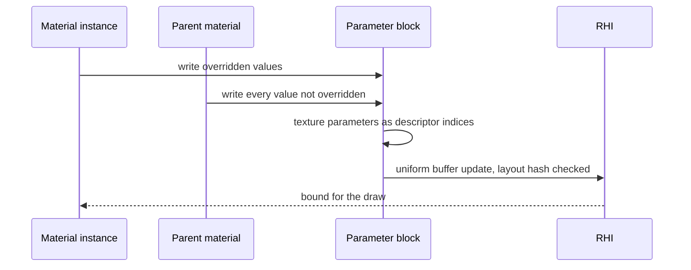

# Materials

How a surface's appearance is described, parameterized, compiled and bound.
A material is data that selects an authored material template, fixes its
static switches, and supplies parameter values; it contains no shader code.
The shading and blend model split, parameters versus permutations, and instances; its graph
compiler is not reproduced, because the game's materials are a small family
that authored templates cover.

## Position

Above the [shader system](shaders.md), which compiles the templates and
owns their permutation domains and parameter blocks; beside the scene
renderer, which owns lighting, shadows, fog and post-processing and consumes
material attributes; fed by the content converter, which maps the original
game's material data onto templates and parameters. The RHI sees only uniform
buffers, descriptor indices and pipeline descriptions.

## Invariants

1. A material template is authored HLSL with a declared parameter block and
   a declared permutation domain. Templates are the only material shader
   source; no shader code is generated from material data.
2. A material is data: one template, a value for every static switch of that
   template, and parameter values. Static switches select a permutation;
   parameters never do.
3. The set of switch combinations is closed at cook time as the union over
   all content. Every combination is a built permutation before the game
   runs; the game never meets a combination that was not built.
4. Scalar, vector and texture parameters live in one parameter block per
   template, declared in C++ and laid out by the shader system. Texture
   parameters are 32-bit descriptor indices in that block. The layout hash is
   checked at load.
5. A material instance overrides parameter values of its parent at runtime
   without any compilation. An override of a static switch is not an
   instance; it is a different material, resolved by the converter.
6. The attribute set a template writes is fixed per shading model and blend
   mode by one table in code. A template that writes an attribute its shading
   model does not read fails to compile, by name.
7. Lighting inputs are not material parameters. Lights, light lists,
   spherical harmonics, lightmaps, shadows and fog are scene and view data
   owned by the scene renderer; a material supplies attributes to the
   lighting model and nothing else.
8. Materials never read the original game's formats. The content converter
   maps original material blocks onto templates, switches and parameters,
   and records what it could not map by name.

## Attributes

The attribute set a template may write, and which shading models read each.

| Attribute | Lit | Unlit | Subsurface | Hair |
|---|---|---|---|---|
| Base color | yes | | yes | yes |
| Metallic | yes | | yes | |
| Specular | yes | | yes | yes |
| Roughness | yes | | yes | yes |
| Normal | yes | | yes | yes |
| Tangent | | | | yes |
| Emissive | yes | yes | yes | yes |
| Ambient occlusion | yes | | yes | yes |
| Subsurface color | | | yes | |
| Opacity | translucent blend modes | translucent blend modes | yes | yes |
| Opacity mask | masked blend mode | masked blend mode | masked | masked |
| World position offset | yes | yes | yes | yes |
| Pixel depth offset | opaque and masked | opaque and masked | opaque and masked | opaque and masked |

Shading models: unlit, lit, subsurface, hair. Blend modes: opaque, masked,
translucent, additive, modulate. Each template declares one shading model;
the blend mode is a material property that the renderer's pass selection
and pipeline state honor. Clear coat, cloth, eye, water and thin translucent
are not in the set and are added as a row when a template needs one.

## Material to pipelines

Pass dimensions such as the depth-only or shadow variant of a template are
permutation dimensions declared by the renderer, so the same enumeration
that closes the switch set closes the pass set. Vertex layout and pass
render targets enter the pipeline description, not the permutation.

## Parameters at runtime

| Parameter kind | Where it lives | Changes at runtime | Changes the permutation |
|---|---|---|---|
| Scalar, vector | the template's parameter block | yes | no |
| Texture | a 32-bit descriptor index in the same block | yes | no |
| Static switch | the template's permutation domain | no | yes |

A parameter block is filled only when an instance's values change, and the
uniform buffer it fills is shared by every draw of that instance in the
frame.

## Content mapping

What the content converter maps from the original game's material model
onto this system. The original data decides the values; the mapping is ours.

| Original material data | Maps to |
|---|---|
| Base texture, second base texture with its blend, third base texture with a mask | base color inputs and a layer switch |
| Normal texture | normal input, a static switch |
| Gloss texture in the ambient-occlusion slot | roughness and specular inputs; the slot name conflict is resolved per content family and recorded |
| Fresnel, specular and reflection coefficients, environment reflection power | specular and roughness parameters of the lit shading model; a fresnel strength parameter |
| Constant color, illuminance, ambient | base color tint, emissive, and an ambient term that belongs to the renderer |
| Subsurface marker and its level | the subsurface shading model with a strength parameter, where the content family warrants it |
| Light list, spherical harmonics, lightmaps, shadow and fog constants | nothing in the material; lighting data for the scene renderer |
| Effect and post-process materials | renderer passes with their own parameter blocks, not materials |

The 14 feature axes of the original collapse onto a handful of switches
because several axes only add lighting inputs. The converter records every
original field it leaves unmapped, by name, beside the converted asset.

## Components and ownership

| Component | Lives in | Consumed by |
|---|---|---|
| Material templates, HLSL and parameter block declarations | `src/engine/rendering/materials/templates` | shader system, scene renderer |
| Material and instance types, parameter block fill | `src/engine/rendering/materials/public/bw/rendering/materials` | scene renderer, content loading |
| Attribute activation table, shading and blend enumerations | `src/engine/rendering/materials/public/bw/rendering/materials` | templates at compile time, renderer at pass selection |
| Switch set closure and pipeline enumeration | `tools/content_converter` | shader system, RHI precompilation |
| Original material block to material asset | `tools/content_converter` | content loader |

## Boundaries

Above: the scene renderer, which owns the lighting model, pass selection,
post-processing and every lighting input. Below: the shader system, which
compiles templates and lays out parameter blocks, and the RHI, which binds
them. Beside: the content converter, the only code that reads original
material data.
User-made materials are new material assets over the same templates, which
the self-describing artifacts and the closed-at-cook switch set already
allow; a user-made template is a shader source and follows the shader
system's rules for one.
