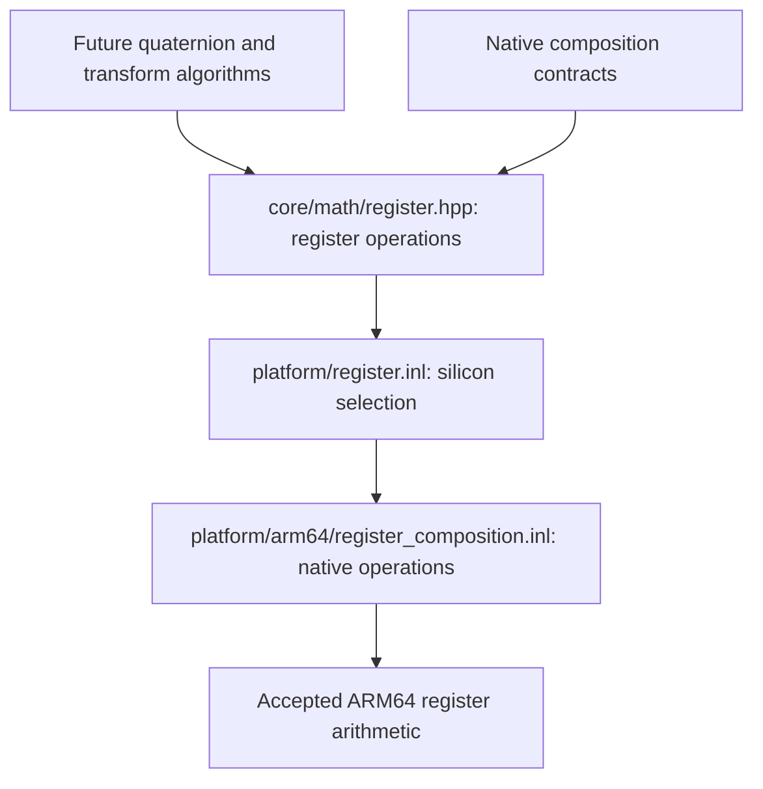

# Register permutations and reductions

Status: **accepted**. Native register
primitives are accepted as `11fc535`. This slice implements the next bounded
register dependencies, without quaternion, matrix or transform implementations.

## Source boundary

All references are pinned to Unreal
`f45729c0b6f097038e72b52d366a62baeca3275b`, under
`Engine/Source/Runtime/Core/`. Source remains a local reference, not bundled code.

Source consumers justify the bounded API:

- `Public/Math/UnrealMathNeon.h:2318–2335`, quaternion multiplication, needs
  lane replication and single-source swizzle.
- `Public/Math/UnrealMathVectorCommon.h.inl:741–773`, quaternion rotation, needs
  replication and cross product. These composite algorithms remain later work.
- `Public/Math/TransformVectorized.h:303–346`, matrix construction, uses two-source
  shuffle and W setters to assemble rows; its rotation normalization and blend
  paths use dot4, absolute value and comparison masks.
- `UnrealMathVectorCommon.h.inl:425–440`, normalize-safe, needs GE comparison and
  dot4. Its tolerance/default behavior is not implemented in this raw leaf.
- `TransformVectorized.h:817–819,1215–1241` bridges quaternion/XYZ values to
  register storage, requiring exact three-element loads and stores.

| Operation | Inspected source | Implemented algorithm |
|---|---|---|
| replicate | `UnrealMathNeon.h:767–794` | Compile-time selected lane duplicated to all lanes; double selects XY or ZW pair |
| swizzle | `UnrealMathNeon.h:1326–1368` | Selected Clang builtin permutation; double helper selects the required source pair combination for each result pair |
| shuffle | `UnrealMathNeon.h:1465–1480` | Result XY from selected lanes of first input, ZW from second; indices each 0–3 |
| dot3 | `UnrealMathNeon.h:977–995` | Float products then W zero then pairwise sum; double XY products fused with ZW, then X+Z lane added to Y product |
| dot4 | `UnrealMathNeon.h:1022–1039` | Float pairwise (X+Y)+(Z+W); double fused X+Z and Y+W, then add swapped pair; replicate result |
| cross | `UnrealMathNeon.h:1568–1587` | Swizzle, multiply, fused negative multiply-add, final swizzle; W follows the same arithmetic |
| GE comparison | `UnrealMathNeon.h:1115–1126` | Ordered native compare, all-one/zero mask lane; NaN false |
| abs / negate | `UnrealMathNeon.h:805–835` | Native sign operations on float4 or each double pair |
| float XYZ loads | `UnrealMathVectorCommon.h.inl:102–105,167–170` | Read three scalar components, construct with W zero or one; no fourth-element load |
| double XYZ loads | `UnrealMathNeon.h:518–537` | Load XY pair and single Z, combine with explicit W zero or one |
| XYZ store | `UnrealMathNeon.h:724–740` | Store XY pair then Z lane, exactly three elements |
| W setters | `UnrealMathNeon.h:544–570,1782–1807` | Replace lane 3 with zero/one; preserve every XYZ bit |

## Contracts and ownership

The accepted register layout, aliases and precision are unchanged. Shared headers
contain no silicon conditionals or intrinsic code. The platform selector includes
the ARM64 operation definitions. The actual selected compiler branch is Clang's native
shuffle builtin, not the source's non-Clang runtime table implementation.

Permutation indices are compile-time integers in 0–3. Declare that domain with
C++20 constraints; this is an explicit spelling of the source lane domain, not a
new runtime validation or recovery policy. No runtime index clamping, fallback,
heap allocation, retained pointer, mutable global state or operation dispatch.

XYZ load/store borrows exactly three element-aligned scalars for its call. Three
initialized values are required for loads; stores need three writable values.
W setters and permutations preserve transported bits, including signed zero and
NaN payload bits. Arithmetic retains native FP behavior and source reduction
order. Dot results broadcast to all lanes; dot3's result ignores W even if W is
nonfinite, but the source can still evaluate W arithmetic and affect FP status.
There is no claim that ignored W bypasses all exception evaluation.

Float and double reductions are intentionally different. Double dot uses fused
products in the X/Z and Y/W grouping; it must not be replaced with float-style
pairwise summation or a generic scalar dot helper. The source cross comment
describes W0 inputs, while the actual quaternion rotation caller passes a finite
quaternion W with a second operand W0. Preserve
the source fused arithmetic in all lanes, with no added guard or forced W clear;
do not impose a stricter input contract than those callers.
No normalization tolerance, safe fallback, NaN clamp or quaternion policy belongs
in this slice. Raw bitwise operations and any-lane diagnostics are deferred until
their actual consumers are prepared, rather than added as a general API inventory.

## Implementation and verification

`src/core/math/register.hpp` declares the shared operations; the platform selector
includes the inline definitions in `src/platform/arm64/register_composition.inl`.
The source double-pair swizzle helper remains local to that target implementation.
Native low-pair extraction replaces the source float store aliasing cast without
changing arithmetic, layout or the three-element memory extent. No runtime
routing, scalar fallback, allocation or retained pointer was added.

Both C++ corpora were queried again for implementation. Full Per.11, F.20, GEN.6
and SIMD.1 rules were read: compile-time routing, owned return values and
header-visible kernels. The user-selected source intrinsics take precedence over
the corpus's general autovectorization recommendation; this is not a benchmark
claim that autovectorization would be inadequate.

Prepared Debug/Release tests first compiled and failed linking on actual absent
operations. Implementation then made the same assertions pass; none were changed.
The target now participates in the default build and CTest. Tests cover both
precisions, lane routing across double pairs, source reduction grouping and fused
cancellation, W-independent dot3 results, basis cross orientation, comparison
masks, signed zero, NaN payload transportation and W replacement values. Guarded
XYZ inputs end immediately before an inaccessible page, and stores retain
adjacent sentinels.

Debug and Release full builds pass fatal clang-tidy, 31 standalone header checks
and 28/28 CTest entries each. Formatting, whitespace and DOM-backed Mermaid
parsing pass. Root independently reviewed bodies against the pinned source, inspected all twelve
optimized callers and repeated Debug CTest with 28/28 passing.
Evidence remains ignored under `research/evidence/math-register-composition/`:

- `debug-build.txt`, `release-build.txt`: full build/lint/header results.
- `debug-tests.txt`, `release-tests.txt`: real native test execution.
- `codegen.cpp`, `codegen.s`: twelve isolated optimized consumers. Float dot uses
  vector multiply and pairwise adds; double dot uses paired multiply/fused add
  with the source grouping. Cross uses native fused subtract, permutations use
  register extraction/moves, and XYZ accesses are exactly 8+4 bytes for float or
  16+8 for double. No per-operation calls or runtime dispatch in these consumers.

Code inspection and native tests verify these kernel contracts, not an engine
frame-time improvement. Other ISAs and higher-level math remain separate work.

## Later dependencies

Quaternion/matrix APIs, source normalize-safe and quaternion composites, min/max,
mask reductions/nonfinite diagnostics, matrix inversion and transform negative
scale behavior remain separate preparation. Accepted low-level primitives may be
used by their new implementation; no old Bullet Witch implementation is reused.

After this slice, the user requested a folder-structure review/proposal and a
separate organization slice before further math expansion. No reorganization is
part of this implementation.
