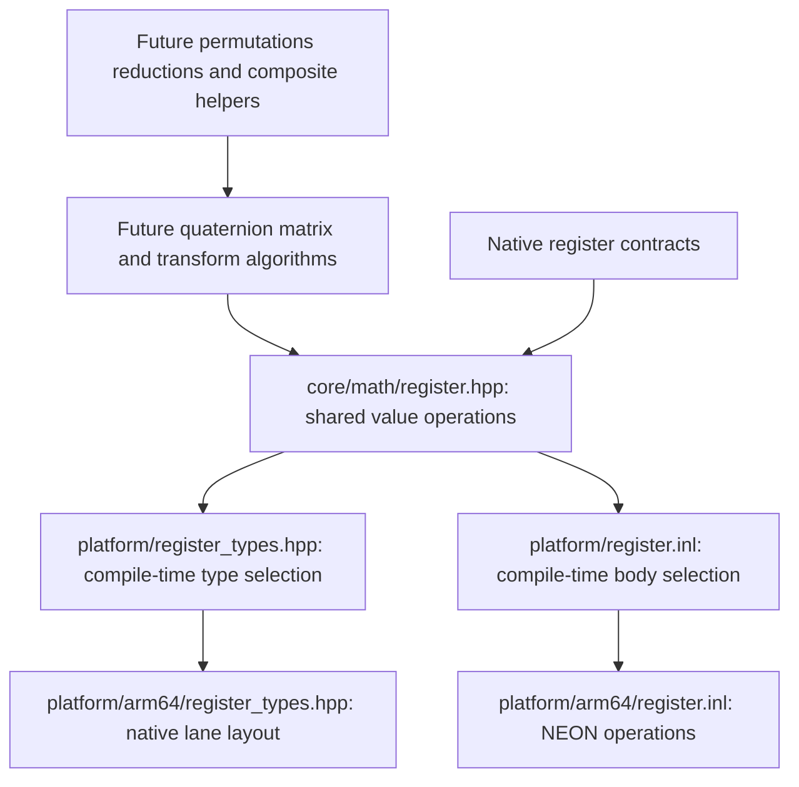

# Native register foundation

Status: **accepted**. The accepted vector
leaf is committed as `1d3e5d9`. Native register operations and conversions now
execute the prepared source algorithms. Debug and Release validation passes.

## Boundary and bounded scope

This is the raw four-lane value/primitive tier, not the entire register API and
not a quaternion, matrix or transform implementation. It includes load/store,
scalar broadcast, float/double conversion, arithmetic and fused multiply-add,
equality/greater masks, bit-select, reciprocal, square root, and reciprocal
square-root estimate/refinement. This is a coherent boundary to verify native
layout, precision and instruction behavior before composite algorithms use it.

Shared callers name register values and operations, without NEON intrinsics or
silicon conditionals. The platform selectors choose the ARM64 native definitions
at compile time. ARM64 is not inherently macOS; no OS service is needed for these
kernels. Other targets fail selection explicitly until their source path is
prepared. There is no runtime dispatch, opaque heap wrapper, scalar fallback,
or portable SIMD dependency. Source uses native types; their representation is
visible to the compiler through platform headers, not hidden by a pimpl.

Float has four 32-bit lanes in one 16-byte register. Double has XY and ZW pairs,
32 bytes total, aligned to 16 bytes. The default register alias is double. Values
own their bits, are trivially copyable, and default initialization does not
initialize lanes. Only initialized lanes may be read. The declaration uses named
pair members instead of the source's anonymous nested structure; no layout or
arithmetic change is intended. Named `widen`/`narrow` operations expose the source
conversion algorithms without implementing the source's implicit constructor
conversion surface. No operation retains pointers or changes a source register.

Load/store borrows four initialized elements or four writable elements for the
call. Ordinary variants permit element alignment without 16-byte alignment;
aligned variants retain the 16-byte source contract even though this NEON backend
uses the same instructions for both. There is no overread, hidden allocation,
reference lifetime or global mutable state. Masks use floating-register storage
as raw bits, as in the source: true lanes have all bits set, false lanes zero.
Select uses every mask bit, including partial masks; masks are not numeric booleans.

## Inspected source and implemented algorithms

Pin: `f45729c0b6f097038e72b52d366a62baeca3275b`. Paths below are under
`Engine/Source/Runtime/Core/`. No reference source is bundled with the project.
The source map and exact selection were reviewed before preparation.

| Surface | Reference | Selected algorithm |
|---|---|---|
| Target selection | `Public/Math/VectorRegister.h:11–19`; `Public/Mac/MacPlatform.h:38` | Select NEON for ARM Mac; keep selection in platform layer |
| Native layout | `Public/Math/UnrealMathNeon.h:115–120,144–169` | One float register; two double pairs aligned16; source default double alias |
| Load/store | `UnrealMathNeon.h:478–489,581–589,663–672,697–706` | Native four-float or paired-double loads/stores; aligned aliases retain same native instructions |
| Broadcast | `UnrealMathNeon.h:644–655` | Duplicate scalar across all lanes |
| Conversion | `UnrealMathNeon.h:154–158,404–413` | Widen low/high float pairs separately; narrow double pairs then combine XYZW |
| Add/subtract/multiply/divide | `UnrealMathNeon.h:844–924` | Native precision-matched lane operations, separately on double pairs |
| Fused operations | `UnrealMathNeon.h:934–966` | Native fused a*b+accumulator and accumulator-a*b; do not split rounding |
| Comparison/selection | `UnrealMathNeon.h:1050–1063,1094–1105,1178–1189` | Ordered EQ/GT masks; raw bit select |
| Reciprocal estimate | `UnrealMathNeon.h:1628–1640` | Hardware estimate for each precision |
| Reciprocal refinement | `UnrealMathNeon.h:1648–1670` | Float estimate then two source polynomial Newton steps using fused subtract; double native one/value division |
| Square root | `UnrealMathNeon.h:1680–1690` | Native square-root instructions |
| Reciprocal square root | `UnrealMathNeon.h:1698–1741` | Hardware estimate, then two hardware correction/multiply steps, for both precisions |
| Accurate aliases | `Public/Math/UnrealMathVectorCommon.h.inl:375–398` | Accurate names forward to the above refined operations; they do not select a different scalar/full-precision algorithm |

The source transform path demonstrates these dependencies at
`TransformVectorized.h:173–245` (aligned rotation loads), `337–421` (matrix row
stores), `1045–1105` (fused blend arithmetic), `1147–1182` (dot and selection),
and its quaternion helpers require further permutation and reduction primitives.
Those call sites justify this tier but do not establish that this API already
satisfies every later dependency.

### Precision and exceptional values

Native FP control state is inherited; this leaf does not change rounding modes,
flush subnormals, sanitize values or enable fast-math. Ordered comparisons with
NaN are false; signed zeros compare equal. Stores/conversions retain lane order;
float narrowing has native rounding/range behavior. Fused operations must remain
fused even where separate operations would round the product to a different value.

Float reciprocal is **not** interchangeable with direct division. Its polynomial
refinement can produce NaN at zero or infinity because intermediate products are
invalid; double reciprocal uses direct division and returns the corresponding
IEEE values. Neither adds a clamp or diagnostic. Reciprocal-square-root uses the
NEON correction instruction's special zero-times-infinity treatment. Its two
refinements do not establish full 53-bit double accuracy. Square root retains
signed zero and infinity, and yields NaN for a negative finite input. NaN payload
identity is not asserted across arithmetic/conversions.

The shared source `Accurate` aliases name these same algorithms. This slice uses
one refined name instead of redundant aliases; it must not imply correctly
rounded scalar sqrt/division for the refined estimate algorithms. No new runtime
tolerance or “safe normalize” policy is introduced.

## Files and verification

- `src/core/math/register.hpp`: shared declarations, aliases and contracts.
- `src/platform/register_types.hpp`, `src/platform/register.inl`: silicon selectors.
- `src/platform/arm64/register_types.hpp`: native value layout, no function bodies.
- `src/platform/arm64/register.inl`: inline kernels with source comments beside each operation.
- `tests/math_register_tests.cpp`: real consumers, no fake implementations.

Both C++ corpora were queried during preparation and again for implementation;
full F.20, I.1, SIMD.3 and GEN.6 rules were read.
Value returns and explicit alignment/precision contracts apply. SIMD.3 informs
the boundary; its portable-library recommendation does not override the user's
explicit native Unreal algorithm selection. GEN.6 supports header-visible tiny
kernels. Bodies sit alongside the source comments, and optimized callers were
inspected for native instructions without out-of-line operation dispatch.

The test fixtures independently check lane order, aligned and offset load/store
extent, double precision beyond float resolution, exact arithmetic and fused
cancellation, NaN/signed-zero comparison masks, partial-bit selection, and native
exceptional-value distinctions. Refinement tests use scalar reciprocal identities,
not a duplicate of the NEON implementation. Their preselected residual bounds
come from inspected `Tests/Math/UnrealMathTest.cpp:2029–2046,2877–2894`: estimate
reciprocal 0.008, refined reciprocal 1e-7, estimate rsqrt 0.007 and refined rsqrt 1e-6.
Source tests bound the sum of lane errors; this independent fixture applies the
listed bound per lane. These are verification bounds, not runtime policy or a
universal error guarantee.

The prepared tests first compiled and failed linking on genuine missing register
operations. They now participate in the default build and CTest, with every
prepared assertion unchanged. Debug and Release full builds pass fatal
clang-tidy and 31 independent header consumers; all 27 CTest entries pass in each
configuration, including the native register assertions. Source exceptional
values, fused cancellation, masks, layout and precision behavior are exercised.

Optimized ARM64 consumers emit native vector load/store, fused multiply-add,
float reciprocal estimate plus two fused polynomial refinements, direct double
division, double reciprocal-square-root estimate plus two correction passes, and
compare/bit-select instructions. No function calls or scalar fallback appear in
these bounded consumers. This is code-generation evidence, not a benchmark or a
claim that every future composite path is complete. Formatting, whitespace and
DOM-backed Mermaid parsing pass. Evidence remains ignored under
`research/evidence/math-register-preparation/`.

Implementation spelling replaces the source pointer-aliasing conversions with
explicit native pair construction/extraction and native bit reinterpretation.
Those changes retain layout, lane order and instruction semantics; they do not
introduce a new arithmetic algorithm. The source aligned store's identical native
operation is shared through an inline forward. No accepted vector or allocator
implementation was changed.

## Remaining prerequisites

Before quaternion/matrix/transform bodies, prepare the required lane replication,
permutations/shuffles, dot/cross reductions, additional comparison/bitwise masks,
3-component load/store and W handling. Then prepare shared composites such as
normalize-safe and quaternion multiplication/rotation, with their exact source
thresholds, composition order and nonfinite behavior. This leaf deliberately does
not hide those remaining dependencies or implement them as scalar substitutes.
