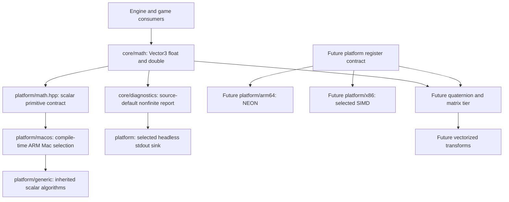

# Shared math foundation

Status: **accepted**. The prepared vector,
scalar primitive and source-default diagnostic bodies now execute. Debug and
Release checks pass. Accepted engine-loop and allocator behavior is unchanged.

## Dependency boundary

The first math leaf is three-component vector values and the scalar primitives
selected by Unreal for the current ARM64 Mac target. This is deliberately the
lowest dependency of rotations, matrices and transforms, not a claim that those
systems already exist.

`Vector3<T>` owns three plain values. Operations return values; only explicitly
mutating normalization changes its receiver. There are no heap allocations,
mutable global math objects, virtual calls or runtime ISA dispatch in numeric
operations. A diagnostic on invalid data is an exceptional reporting path.

Silicon and OS are separate boundaries. NEON belongs under `platform/arm64`, not
under macOS; that future implementation can serve other ARM64 OS targets.
Current `platform/macos/math.inl` selects inherited generic scalar algorithms
without a runtime forwarding wrapper. The selection belongs to the platform
layer even though the selected algorithm is shared. Later x86 selection must
inspect Unreal's platform overrides; it may not silently inherit this ARM Mac
choice. Core headers do not expose intrinsic register types.

The source uses scalar expressions for ordinary `TVector` arithmetic. The Mac
ARM math inheritance selects ordinary square root and reciprocal square root.
This is not a scalar replacement of Unreal's SIMD transforms. The later
register layer must preserve the separately selected NEON algorithms, including
the source reciprocal-square-root estimate/refinement sequence.

## Selected algorithms and conventions

All references are pinned to Unreal
`f45729c0b6f097038e72b52d366a62baeca3275b`. Paths below are under
`Engine/Source/Runtime/Core/`. Source is inspected locally and is not bundled.
Comments beside declarations and definitions identify the corresponding
method and source range in our own words.

| Surface | Inspected reference | Selected behavior |
|---|---|---|
| Value layout and initialization | `Public/Math/Vector.h:49–76,149–168,1471–1489,1514–1519` | Three components; ordinary default initialization leaves them uninitialized; explicit scalar/XYZ/zero construction initializes them |
| Precision | `Public/Math/MathFwd.h:46–79`; `Vector.h:1214–1216` | Float and double variants; default vector alias is double; explicit cross-precision component conversion |
| Add/subtract/component multiply | `Vector.h:1562–1577` | Component arithmetic in the selected precision |
| Scale/divide | `Vector.h:311–328` | Arithmetic scalar parameter; multiply casts scalar to component precision; divide computes the source reciprocal expression then scales |
| Dot/cross | `Vector.h:1521–1559` | XYZ dot and determinant cross product; X cross Y is positive Z |
| Exact comparison/negation | `Vector.h:1586–1595,1610–1615` | Compare components exactly; negate each component |
| Length | `Vector.h:1713–1734` | Sum of squared components, optionally square root; no overflow-rescaling algorithm substituted |
| In-place normalize | `Vector.h:624–630,1764–1775` | Normalize only when squared length is strictly greater than tolerance; otherwise return false and preserve receiver |
| Safe normalized copy | `Vector.h:640–647,2057–2073` | Exact unit length returns original first; squared length below tolerance returns supplied fallback; otherwise reciprocal-square-root scale |
| Default threshold | `Public/Math/UnrealMathUtility.h:130`; `Vector.h:630,647` | `1.e-8f` converted to component precision, including double; tolerance is squared length, not length |
| Mac scalar selection | `Public/Mac/MacPlatformMath.h:8,27–29`; `Public/Clang/ClangPlatformMath.h:11–19` | ARM Mac inherits Clang and generic scalar functions |
| Scalar primitives | `Public/GenericPlatform/GenericPlatformMath.h:552–561,582–590` | Precision-specific sqrt/reciprocal sqrt; IEEE exponent-bit nonfinite classification |
| Later SIMD selection | `Public/Mac/MacPlatform.h:38`; `Public/Math/VectorRegister.h:11–19`; `Public/Math/UnrealMathNeon.h:115–120,1698–1740` | ARM Mac selects NEON; four-float register and paired double registers, source estimate/refinement behavior |
| Later transform convention | `Public/Math/TransformVectorized.h:45–58` | Position scale → rotate → translate; transform A*B applies A then B; quaternion product order differs |

No world units, projection convention or asset-coordinate conversion is invented
in this vector leaf. Those belong to the inspected transform/world/import
contracts of their later slices. Vectors are not implicitly normalized, clamped,
made finite, or converted to float. Callers initialize before reading; tests
never read indeterminate components. Supplied zero/negative normalization
tolerances follow source arithmetic; no validation or additional positive-only
contract is introduced. The named `ZeroInit` tag is our spelling of
the source force-zero construction choice. Omitting the deprecated array-union
alias does not change component arithmetic or representation.

### Debug diagnostics are part of the dependency

`UnrealMathUtility.h:13–20` enables NaN diagnostics in Debug and disables them in
other source configurations by default. `Vector.h:128–147` checks each vector's
components and calls `logOrEnsureNanError`; `ContainsNaN` at 2293–2299 also detects
infinity. Constructors and result construction use that diagnostic. The
in-place Normalize method itself does not add a diagnostic or change its input
contract.

The exact default is `GEnsureOnNANDiagnostic=false` in
`Private/Misc/CoreMisc.cpp:503`. Its optional console setting is registered at
505–510. For the default, `Public/Logging/LogMacros.h:400–422` emits an Error once
per diagnostic callsite and continues; it does not throw, clamp or terminate.
The callsite here is the templated diagnostic method, so float and double each
have their own once state. The source uses a plain local static bool; this slice
does not claim synchronized concurrent first-error reporting or silently replace
it with a new policy. Normal numeric values never touch that once state.

`CoreMisc.cpp:516–522` formats through a bounded 4096-character buffer and sends
`LogCore`/Error. `Vector.h:2301–2305` formats XYZ with three fractional digits.
`Private/Logging/StructuredLog.cpp:1642–1678,1420–1436` builds the log record and
selects the warning device for Error, falling back to the log device.
`Private/Misc/OutputDeviceStdOut.cpp:33–49,208–245` provides the real stdout text
sink: format line, append newline, write and flush.

**Selected headless output adaptation:** this leaf implements the source-default
once-only diagnostic and a real stdout sink, with category/severity and XYZ
message, behind a platform output contract. It does not reconstruct the full
structured-log record/redirector, timestamps, category filters, console-variable
registry, warning-device selection, editor UI, or ensure/crash backend. No fake
reporter callback is injected. The explicit current headless sink selection is
analogous to the accepted memory diagnostics sink selection; it is not presented
as Unreal's complete logging subsystem. `EnsureOnNaNFail` override remains
unavailable until configuration/ensure services exist. Before broad worker use,
the source's unsynchronized exceptional once-state must be reviewed explicitly.

The concrete diagnostic formatting and native sink are implemented. The public
`bw_math` target defines diagnostics for CMake Debug and disables them otherwise,
matching the source Debug/non-Debug default. Its include/configuration and link
dependencies propagate to the test and independent header checks. Future
consumers must link that same target; per-consumer diagnostic definitions would
violate the inline-definition contract. The accepted host does not consume this
new math target yet.

## Files and integration

| File | Responsibility |
|---|---|
| `src/core/math/vector3.hpp` | Shared value declarations, contracts and precision aliases |
| `src/core/math/vector3.inl` | Header-visible inline template definitions |
| `src/core/math/vector3.cpp` | Source explicit zero constant definitions |
| `src/platform/math.hpp` | Scalar primitive declarations and compile-time target selection |
| `src/platform/macos/math.inl` | Current ARM Mac selection of the generic scalar implementation |
| `src/platform/generic/math.inl` | Inherited inline scalar primitive definitions |
| `src/core/diagnostics/math_diagnostic.hpp/.cpp` | Nonfinite formatting contract and source-default report |
| `src/platform/diagnostic_output.hpp` | Headless text-output contract; no injected function pointer |
| `src/platform/macos/diagnostic_output.cpp` | Native stdout write/flush |
| `tests/math_vector_tests.cpp` | Native value/precision/branch tests and real child stdout capture |

Numeric definitions are header-visible/inline, with declarations in `.hpp` and
bodies in `.inl`. The source zero constants have explicit float/double definitions
in the library. The ordinary defaulted constructor retains the language's source
initialization behavior. `bw_math` and `math_vector_tests` are in the default build;
the test is registered with CTest. Diagnostics have one consistent public build
configuration, including in standalone header checks.

Both C++ corpora were queried during preparation and again during implementation
for value semantics and SIMD boundaries. Full rules
read: Core Guidelines F.20 and ES.23; Performance SIMD.1 and SIMD.3. Return-value
operations and explicit initialization/conversion apply directly. SIMD guidance
informs the boundary; it does not authorize substituting a portable library or
new algorithm for the selected Unreal path. No new third-party dependency is
introduced.

## Review and verification

Native tests cover:

- Float and double basis orientation, perpendicular cross products and dot
  symmetry; independent known results for arithmetic and 3-4-12 length.
- Explicit conversion and double precision retained beyond float's integer
  resolution; no hidden float routing. Mixed float-vector/double-scalar division
  preserves a representable subnormal reciprocal instead of first overflowing
  the denominator to float infinity. The double default threshold retains the
  source float-literal conversion.
- Unit length with tolerance greater than one (unit branch takes priority),
  exact representable threshold equality, failed in-place preservation,
  unmodified custom fallback, zero and ordinary normalization.
- Real IEEE finite/NaN/infinity classification, preserving nonfinite values;
  real child-process stdout capture verifies two once-only Debug reports
  (one per precision), continued execution, and no reports outside Debug.

Preparation established honest Debug/Release link failures for missing production
definitions while the accepted tests stayed green. Those same native assertions
now run: Debug and Release full builds and 26/26 CTest entries pass, including
real Debug once-only stdout reporting and Release omission. Both builds include
fatal clang-tidy and 28 standalone header consumers. Formatting and whitespace
checks pass. Root independently reviewed the source correspondence and repeated
Debug 26/26, formatting and whitespace checks.

An optimized ARM64 compile of dot/cross/normalize/reciprocal-root consumers shows
direct arithmetic, square-root and division instructions with no function calls
or per-operation dispatch. This verifies inline visibility, not a performance
benchmark or completion of the future explicit NEON register layer. Mermaid was
parsed with a DOM-backed parser outside repository dependencies. Ignored evidence
and native logs are under `research/evidence/math-preparation/`.

## Next dependency tiers

1. Vector/primitive/default-diagnostic leaf accepted; retain its verified contracts.
2. Prepare native SIMD register operations required by source quaternion/matrix
   code, including ARM64 NEON and float/double storage/conversion contracts.
3. Prepare rotations and matrices from those accepted values/registers. Establish
   composition/storage conventions and inversion edge cases from source.
4. Prepare the selected vectorized transform algorithms, including negative and
   zero scale behavior, from the accepted quaternion/matrix/register tier.

General jobs, resource loading, world/actor state, rendering and game integration
are unchanged and remain later work.
