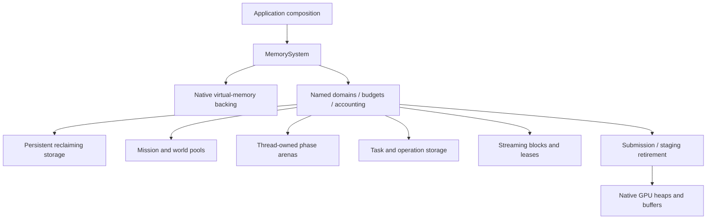

# Engine memory and residency

**Required architecture · implementation pending · October 22, 2026.**
[Runtime owners](runtime-model.md) · [Execution contracts](execution-contracts.md).

The engine requires a memory subsystem. Engine-authored allocations must route
through explicit memory capabilities with owners, budgets and release rules.
Default-heap containers, unrestricted `new` and a global allocation counter are
not the final allocation policy. Allocation strategy and object lifetime remain
distinct: constructing an object in engine-owned storage does not change who
must destroy it or wait for its consumers.

The current source uses standard containers and owning pointers with default
allocation. Those are an implementation gap, including in the media queues;
bounded queue capacity alone does not close it. This document defines the
required subsystem and migration, not an allocator implementation already present.

## Ownership and native backing

Application composition constructs `MemorySystem` before services and keeps it
alive until sessions, workers, callbacks and device submissions have quiesced.
Subsystem constructors receive the memory domains they need. Shared engine code
owns allocation policy, budgets, routing and diagnostics. Native providers own
page reservation/commitment and device allocations behind portable contracts.

Arrows show ownership/provisioning. An arena reset is permitted by its lifetime
contract, not merely because the application has started another frame.

## Allocation families

| Family | Contents | Reclamation rule |
|---|---|---|
| Persistent reclaiming storage | Engine services, catalog metadata, content definitions and long-lived state | Individual owners release allocations after their retained uses end |
| Mission/world storage | Entity/component pools, scene membership and world-local systems | Destruct objects and quiesce external consumers before bulk reclamation |
| Frame/phase scratch | Temporary evaluation, queries, culling and command preparation | Reset a thread-owned arena only when no references escape that phase |
| Task/operation storage | Continuations, copied job arguments, decode operations and save snapshots | Survives yields and worker execution; release after completion or joined cancellation |
| Streaming blocks | Compressed inputs, decoded frames/PCM and transfer staging | Reusable bounded blocks/slabs with leases; producers cannot recycle consumer-held storage |
| Submission/device storage | Command arenas, upload buffers, textures, native heaps and pipelines | Retire on the required CPU and GPU completion evidence, not on submission alone |

These families share backing and accounting contracts; they need not share one
allocation algorithm. Pool sizes and arena capacities follow actual owners and
measured workloads. A resource tag is a retention relationship, not permission
to free an entire physical region while another owner still uses it.

## Required contracts

Every engine allocation identifies a domain, owner/purpose, requested size and
alignment. Track requested/live payload separately from reserved and committed
backing, overhead, high-water marks and rejected requests. Parent/child accounting
must not charge the same physical backing twice. Unified CPU/GPU memory likewise
requires one physical charge with multiple logical uses, rather than two invented
heaps in the accounting.

Admission reserves budget before acquisition and rolls it back on failure.
Exhaustion is explicit; there is no silent fallback to the process heap, automatic
quality reduction or unrecorded eviction. Shared APIs describe alignment and
failure guarantees; native backends implement the required backing semantics.

Containers and ownership helpers must carry the allocation capability through
nested vectors, strings, associative nodes, custom deleters and shared control
blocks. An allocator on an outer container does not route its children's separate
allocations. Existing APIs must be migrated deliberately, preserving borrowed-view
and destruction guarantees. Replacing every container with a home-made collection
is not a requirement; explicit allocator propagation is.

Thread-owned scratch has one thread authority. Cross-thread allocation/free needs
a declared synchronized domain or owner return queue. Streaming leases and device
retirement govern reuse across workers and the GPU. Resetting storage must not
invalidate a queued sample, Lua continuation, archive view or submitted command.

Diagnostics use bounded/preallocated storage and must not recursively allocate
through the path they are measuring. Guards detect allocation in forbidden phases;
they complement actual routing rather than pretending to replace it. Native/driver
usage snapshots are observations, distinct from engine reservations and hard
budgets. Release builds retain required accounting without mandating expensive
per-allocation debug traces.

## External allocation boundaries

The engine can own the converted video/PCM buffers, stream queues and native
output staging. FFmpeg also allocates codec, demuxer and conversion state internally.
Its buffer hooks can route selected buffers; they do not replace every allocation.
`av_max_alloc` is a per-allocation size limit, not aggregate accounting or a custom
allocator callback. Full internal routing requires a separately maintained and
verified adapter/patch. Until implemented, report that usage as externally managed
decoder overhead with explicit admission headroom, rather than falsely counting it
as fully engine-controlled storage.

Lua 5.0.2 uses its own allocation path, currently backed by `realloc`; it needs an
adapter appropriate to that version. The modern Lua allocator constructor must
not be assumed to exist. Cocoa, system audio and graphics drivers also retain
native allocations. Document controllable buffers and externally managed costs
separately, including what can and cannot be bounded precisely.

## DoLittle reference and first implementation

DoLittle supplies useful common GPU allocation contracts, native Metal/CUDA
backing, admission checks and lifetime-based transient placement. Its CPU
allocation checker still forwards to system allocation; it is not a complete CPU
memory subsystem to import. Apply its separation of policy, native backing and
completion evidence while implementing the engine's broader lifetime families.

Delivery order is launch screen and launch cinematics first, then the full memory
foundation. This is substantial subsystem work, not a prerequisite detour for the
current startup milestone. Introduce a minimal allocation interface earlier only
where a concrete owner needs it; avoid empty scaffolding and preserve the explicit
migration gap.

The foundation slice should establish portable backing/domain contracts, alignment
and overflow checks, budget admission/accounting, persistent storage, phase arenas
and streaming leases. Migrate the existing resource, task/Lua and media owners
explicitly. Add concrete object pools and submission arenas as their owners are
implemented, under the same mandatory routing contract.

Verification must cover alignment, bounded failure and rollback, allocator
propagation, lease survival across producer/consumer boundaries, reset rejection
while storage is retained, cross-thread return rules, and clean teardown after
partial construction. A benchmark or allocation counter alone does not establish
those ownership guarantees.
