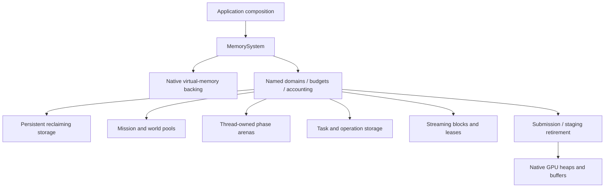
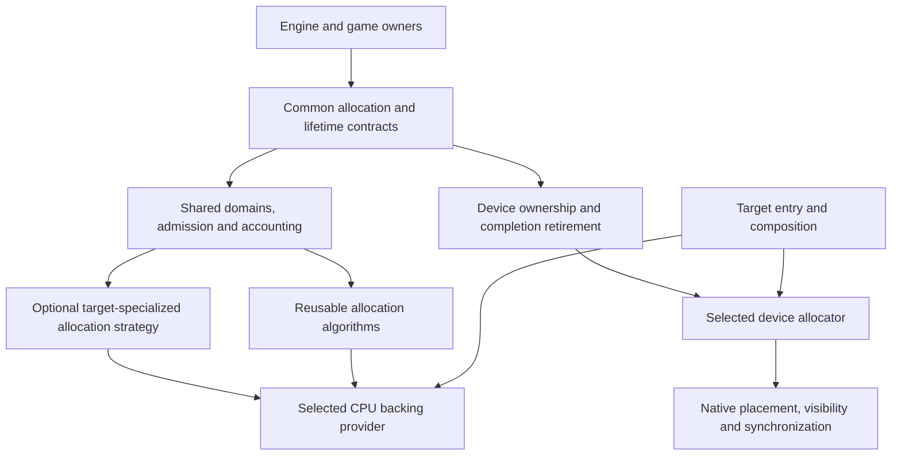

# Engine memory and residency

**Required architecture · current startup-owner migration implemented · October 23, 2026.**
[Runtime owners](runtime-model.md) · [Execution contracts](execution-contracts.md).

The October 23, 2026 approved implementation direction is to follow
[recovered Bullet Witch memory behavior](../../research/engine/subsystems/memory-management-research.md)
first. The requirements below describe ownership and the eventual subsystem;
specialized mechanisms are introduced as reconstructed callers require them.
Preserve verified free-block coalescing and study fragmentation and teardown
before choosing later cleanup or compaction changes.

The engine requires a memory subsystem. Engine-authored allocations must route
through explicit memory capabilities with owners, budgets and release rules.
Default-heap containers, unrestricted `new` and a global allocation counter are
not the final allocation policy. Allocation strategy and object lifetime remain
distinct: constructing an object in engine-owned storage does not change who
must destroy it or wait for its consumers.

The implementation supplies reclaiming CPU domains, owning container allocators,
a bounded first-fit coalescing heap for the current Lua context, and separate
device admission/accounting. Native startup uses explicit resource, runtime and
media domains. Catalogs, archives, task storage, owned decoded image/video/PCM
buffers and presentation state retain those capabilities. Metal texture owners
reconcile estimates with reported native bytes and retire after completion.
See [the current implementation record](../../research/engine/subsystems/memory-migration-completion.md)
for measured coverage and remaining external boundaries.

## Ownership and native backing

The eventual application composition constructs `MemorySystem` before services and keeps it
alive until sessions, workers, callbacks and device submissions have quiesced.
Subsystem constructors receive the memory domains they need. Shared engine code
owns allocation policy, budgets, routing and diagnostics. Native providers own
page reservation/commitment and device allocations behind portable contracts.

The current slice composes `memory::Domain` with `memory::CpuBacking` directly;
the framework carries these capabilities in `StartupMemory`, without a global
allocator singleton or an all-domain coordinator. Each domain
retains its selected backing provider. Containers and allocated blocks retain
their original domain, including when an archive lease outlives its service.
The implemented CPU capability handles individual aligned acquire/release; virtual
reservation/commitment remains future work. Device admission is implemented in
`DeviceBudget`; native texture allocation remains in the Mac backend.

Arrows show ownership/provisioning. An arena reset is permitted by its lifetime
contract, not merely because the application has started another frame.

## Target-aware implementation boundaries

Target-aware allocation is an explicit requirement. Common contracts live under
`include/bw/memory/`; reusable policy and algorithms live under `src/memory/`.
Native CPU backing belongs under `src/platform/<target>/`. Device allocation
belongs to the native renderer/device backend, using the common memory accounting
and lifetime contracts. Mac behavior must not become the implicit portable
implementation. Target entry points select providers during composition.

| Boundary | Shared responsibility | Target responsibility |
|---|---|---|
| Domain and allocation ownership | Purpose, admission, failure, allocator identity, retention and release rules | Fulfill the selected domain's storage requirements; report unsupported requests explicitly |
| CPU backing | Requested size/alignment, opaque backing ownership, reserve/commit/release semantics and accounting categories | Actual page granularity, virtual-memory operations, aligned backing and available commitment/decommitment behavior |
| Allocation algorithm | Recovered split/coalesce and scoped-lifetime algorithms where reusable | A selected optimized implementation may specialize allocation hot paths or backing geometry while preserving the common contract |
| Device and transfer storage | Resource usage, CPU access needs, lifetime, budget attribution and completion dependency | Native heap/resource placement, visibility/cache operations, mapping, device alignment and synchronization |
| Capabilities and pressure | Decide whether to admit, defer or reject work using supported requirements and observations | Report supported properties, granularity, relevant limits and pressure/budget observations with their scope |

CPU backing and device allocation are separate capabilities. A general CPU
allocation must not acquire renderer semantics, and a device allocation must not
pretend every resource is an ordinary CPU pointer. Shared ownership may use opaque
handles; native types and SDK flags stay inside the selected backend. Shared
interfaces express access and lifetime requirements rather than a list of vendor
names or silicon-specific switches.

This is a proposed dependency map, not a set of implemented classes. The optional
specialized path permits measured silicon-specific optimization without replacing
the shared ownership rules. Initial reconstruction uses the recovered algorithms
where their behavior matters. Later substitutions must preserve required
alignment, zeroing, failure, retention and synchronization guarantees, or be
documented as an intentional behavior change.

Do not hard-code a universal page size, cache-line size, coherence assumption or
CPU/GPU memory topology in shared algorithms. Distinguish caller-required
alignment from backend allocation granularity. Cache-management operations and
device completion are backend responsibilities even when the CPU and GPU share
physical memory. Capability observations do not grant permission to relocate
live allocations, silently change budgets or recycle storage before consumers
finish. Unsupported required behavior fails explicitly; optional optimizations
may use a documented compatible path.

The first implementation must establish these real provider seams with the
owners it migrates. Additional target backends and speculative capability fields
are added when concrete target work supplies their requirements. Contract checks
apply to each provider; native acceptance is required on each implemented target.

## Allocation families

| Family | Contents | Reclamation rule |
|---|---|---|
| Persistent reclaiming storage | Engine services, catalog metadata, content definitions and long-lived state | Individual owners release allocations after their retained uses end |
| Mission/world storage | Entity/component pools, scene membership and world-local systems | Destruct objects and quiesce external consumers before bulk reclamation |
| Frame/phase scratch | Temporary evaluation, queries, culling and command preparation | Reset a thread-owned arena only when no references escape that phase |
| Task/operation storage | Continuations, copied job arguments, decode operations and save snapshots | Survives yields and worker execution; release after completion or joined cancellation |
| Streaming blocks | Compressed inputs, decoded frames/PCM and transfer staging | Reusable bounded blocks/slabs with leases; producers cannot recycle consumer-held storage |
| Submission/device storage | Command arenas, upload buffers, textures, native heaps and pipelines | Retire on the required CPU and GPU completion evidence, not on submission alone |

These families share backing and accounting contracts; they need not share one
allocation algorithm. Pool sizes and arena capacities follow actual owners and
measured workloads. A resource tag is a retention relationship, not permission
to free an entire physical region while another owner still uses it.

## Required contracts

Every engine allocation identifies a domain, owner/purpose, requested size and
alignment. Track requested/live payload separately from reserved and committed
backing, overhead, high-water marks and rejected requests. Parent/child accounting
must not charge the same physical backing twice. Unified CPU/GPU memory likewise
requires one physical charge with multiple logical uses, rather than two invented
heaps in the accounting.

CPU domains implement admission with pending payload/backing/count reservations
under a short mutex. Native allocation, zeroing and release run outside that
mutex. Successful initialization transfers pending to live; native failure
rolls back pending without changing successful peaks. Limits include pending
plus live charges. A release retains its live charge until native free finishes
and bookkeeping completes, so its budget cannot be spent prematurely. Snapshots
report pending separately and remain available during native calls.

The current Lua coalescer is single-owner storage with no internal mutex.
All operations, snapshots and destruction require exclusive access; sequential
thread handoff requires external synchronization. Independent contexts may run
concurrently against a shared synchronized domain. See the
[concurrency refinement](../../research/engine/subsystems/memory-concurrency-refinement.md).

Admission reserves budget before acquisition and rolls it back on failure.
Exhaustion is explicit; there is no silent fallback to the process heap, automatic
quality reduction or unrecorded eviction. Shared APIs describe alignment and
failure guarantees; native backends implement the required backing semantics.

Containers and ownership helpers must carry the allocation capability through
nested vectors, strings, associative nodes, custom deleters and shared control
blocks. An allocator on an outer container does not route its children's separate
allocations. Existing APIs must be migrated deliberately, preserving borrowed-view
and destruction guarantees. Replacing every container with a home-made collection
is not a requirement; explicit allocator propagation is.

Thread-owned scratch has one thread authority. Cross-thread allocation/free needs
a declared synchronized domain or owner return queue. Streaming leases and device
retirement govern reuse across workers and the GPU. Resetting storage must not
invalidate a queued sample, Lua continuation, archive view or submitted command.

Diagnostics use bounded/preallocated storage and must not recursively allocate
through the path they are measuring. Guards detect allocation in forbidden phases;
they complement actual routing rather than pretending to replace it. Native/driver
usage snapshots are observations, distinct from engine reservations and hard
budgets. Release builds retain required accounting without mandating expensive
per-allocation debug traces.

## External allocation boundaries

The engine can own the converted video/PCM buffers, stream queues and native
output staging. FFmpeg also allocates codec, demuxer and conversion state internally.
Its buffer hooks can route selected buffers; they do not replace every allocation.
`av_max_alloc` is a per-allocation size limit, not aggregate accounting or a custom
allocator callback. Full internal routing requires a separately maintained and
verified adapter/patch. Until implemented, report that usage as externally managed
decoder overhead with explicit admission headroom, rather than falsely counting it
as fully engine-controlled storage.

The pinned Lua 5.0.2 patch carries an allocator callback through bootstrap,
global state, coroutines and close. The native root uses bounded reclaiming
storage; legacy tool/test constructors remain explicit. C protected entries
prevent allocation errors from jumping across C++ owners. Callback captures and
public diagnostic/value strings retain documented standard-library boundaries.
Cocoa, AudioQueue, libpng/zlib and graphics drivers also own internal allocations;
these are not included in engine payload accounting. Metal texture accounting
covers owned textures, not drawable/pipeline/driver allocations or physical RAM.

## DoLittle reference and first implementation

DoLittle supplies useful common GPU allocation contracts, native Metal/CUDA
backing, admission checks and lifetime-based transient placement. Its CPU
allocation checker still forwards to system allocation; it is not a complete CPU
memory subsystem to import. Apply its separation of policy, native backing and
completion evidence while implementing the engine's broader lifetime families.

The launch-screen/cinematic and initial interactive-menu slices precede memory.
The first memory slice now establishes portable CPU backing/domain contracts,
alignment and overflow checks, budget admission/accounting and reclaiming resource
storage. `Domain` zeroes payloads and retains owner identity; `Allocator<T>`
propagates that owner through copies, moves and shared control blocks. Bare PMR
users must retain a domain separately, including while empty.

The native entry selects Mac backing and injects the domain into the shared
framework. Resource archive reads use final domain-owned storage. No historical
resource cap is inferred: composition currently selects explicit uncapped limits,
while bounded domains and failure/rollback are supported and tested independently.
Requested backing includes engine metadata/alignment, not native allocator
overhead or physical residency. Allocator bootstrap uses separately documented
system allocations. Legacy parser/tool entry points retain an explicit default
allocation route; injected-domain exhaustion never falls back to it.

The current-owner migration extends that foundation through catalog storage,
root Lua, task nodes/snapshots, media outputs/queues, image/font data and native
texture owners. The scheduler uses a retained typed snapshot rather than an arena
reset beneath suspended tasks. Current Metal submission is synchronous and its
completion wait establishes safe texture retirement; asynchronous submission will
require an explicit completion-retirement owner. No worker arenas, world pools,
GPU heap suballocation or moving compaction are implemented without consumers.

See [migration evidence](../../research/engine/subsystems/memory-migration-completion.md),
[Lua memory](../../research/engine/subsystems/lua-memory-implementation.md) and
[device ownership](../../research/engine/subsystems/device-memory-ownership.md).
