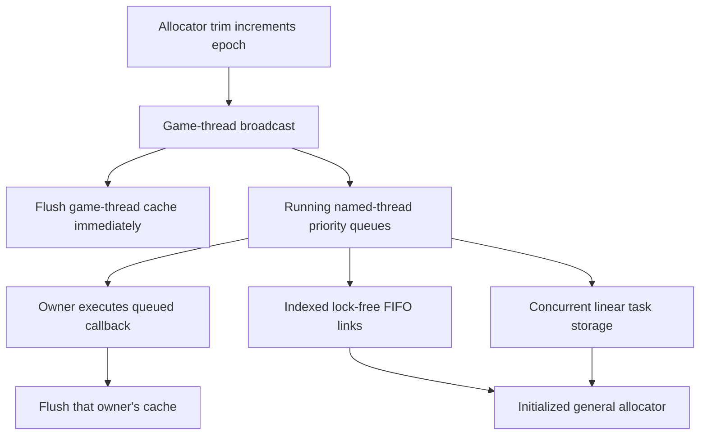

# Named-thread dispatch

Implemented and verified against the integrated native allocator target. This is the dependency brought forward for desktop
Binned3 global cache trim, using Unreal revision
`f45729c0b6f097038e72b52d366a62baeca3275b`. It does not claim the general jobs slice.

`FTaskGraphInterface::BroadcastSlow_OnlyUseForSpecialPurposes(false,false,...)`
(`TaskGraph.cpp:1913–2009`) requires the game thread, invokes its callback first,
and returns immediately if TaskGraph has not started. Otherwise it queues a
high-priority task to each running RHI/render thread. **It does not wait for those
tasks.** The three-second timeout and worker barrier belong to the excluded
`bDoTaskThreads` path. A test may drain owner queues to observe completion; trim
itself must not acquire that stronger contract.

## Selected dependency algorithms

- `FNamedTaskThread` (`TaskGraph.cpp:665–958`) owns two queues (main/local),
  high/normal priorities, a recursion guard, quit state and a stall event. This
  dependency extracts its main-queue `ProcessTasksUntilIdle` path: execution
  occurs only on the attached owner and returns when no task is available. The
  separate local queue and blocking run-until-quit/stall-event path belong to
  later host/jobs integration. The game broadcast callback executes directly.
- `FStallingTaskQueue` (`LockFreeList.h:689–838`) visits high priority first,
  uses tagged master-state CAS around queue publication. The selected idle-pump
  extraction never sets a stalled bit and does not sleep; wake signaling is
  required when the blocking processing path is introduced, not emulated here.
- FIFO storage (`LockFreeList.h:544–687`) is the indexed tagged Michael–Scott
  algorithm, including tail helping and reclamation of the old dummy link.
  Index pages hold 16,384 links, with 26 index bits and a remaining ABA counter.
  Pages remain alive, and recycled links preserve their counters. The shared
  free-list and 64-link TLS bundles follow `LockFreeList.cpp:82–279`.
- Task payloads follow `TGraphTask`'s concurrent linear storage, not per-task
  default `new`: `TaskGraphInterfaces.h:451–465,588–710` and
  `Experimental/ConcurrentLinearAllocator.h:38–115,187–548`. The tag uses 64 KiB
  blocks and a one-block TLS cache. Mac inherits the 4 KiB guaranteed VM
  alignment (`GenericPlatformProperties.h:279–282`), so the selected path has
  an allocation header recording the block offset. Cross-thread release uses
  the block's live-allocation counter; the producer closes a block by reconciling
  its initial UINT_MAX count with its actual allocation count.

## Ownership and bootstrap

No graph startup occurs inside allocator bootstrap. Explicit dispatcher startup
records the game owner after allocator initialization. Render/RHI attachment and
shutdown are lifecycle operations coordinated by that owner; tasks can be
submitted concurrently to attached owners. Callback payload ownership transfers
with queue publication; it survives return from broadcast and is destroyed only
after execution. Binned3's callback captures a process-lifetime allocator pointer.

Queue pages and TLS link-cache records use the general allocator, as
`LockFreeAllocLinks`/`GetTLS` do. Task blocks also use that facade after bootstrap.
There is no default-heap vector or guessed maximum registration count: the roles
are the source's game, rendering and RHI roles. This dependency starts no workers
and creates no renderer; owners attach their actual native threads.

Excluded: general worker scheduler, work stealing, arbitrary prerequisites and
subsequent-task graph, profiling/tracing, stats thread, render polling policy, blocking named-owner event loops and
worker broadcast barriers. These are not replaced by callbacks executed on the
calling thread. The current headless engine has only its game owner; tests attach
real additional threads to exercise the actual cross-thread path.

Both C++ corpora were queried. Core CP.2 requires explicit publication and owner
access; Performance CONC.2 requires matching acquire/release edges. These do not
replace source queue or allocation algorithms with a different design.

## Prepared and implemented files

`core/tasks/task_queue` provides source indexed links, TLS bundles, FIFO and
priority publication. `task_storage` provides task-block ownership.
`named_thread_dispatch` provides explicit lifecycle, owner attachment, submission,
nonblocking owner pump and async broadcast. `platform/task_dispatch.hpp` selects
the native counter-wrap sleep/diagnostic, keeping target calls out of core.

Callback type is narrowed to the allocator's function plus process-lifetime
context pointer. Both are copied into the queued task; the context is explicitly
borrowed through execution. No default-heap type erasure or stack callback
reference is retained. The facade is first obtained on the game thread before
any other access, corresponding to the source's already-established game-thread
identity. Queue allocation happens only at explicit startup.

The source block allocator and its single-block cache have TLS cleanup. Indexed
queue links deliberately have the source process-lifetime pages/TLS cache
retention; they are not task payload leaks. Allocator lifetime must extend beyond
native thread joins/TLS cleanup. Detach is coordinated with submissions, drains
its owner's queue and publishes detachment before game-owner shutdown.

Headers, comment-only plans and tests preceded production bodies. Syntax and
fatal clang-tidy pass. Missing-definition red is saved outside Git under
`research/evidence/tasks/dispatch-link-red.txt`. The native test executable passes and covers pre-startup
game callback, asynchronous distinct-owner execution, priority/FIFO, concurrent
producers across multiple link pages, and cross-thread task-block release after
producer exit. A five-second bounded child case also verifies that an impossible
64 KiB allocation with 64 KiB alignment takes the source fatal assertion path
instead of recycling blocks forever. The source cold-path size check includes
both headers; equivalent subtraction checks avoid unsigned overflow.

Verification: `cmake --build build-game-loop --target named_thread_dispatch_tests`
and `ctest --test-dir build-game-loop -R named_thread_dispatch_contracts
--output-on-failure` pass (0.32 seconds). Fatal clang-tidy and pinned formatting
pass for the owned units. No game or renderer was launched.
