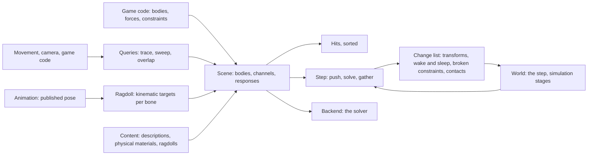
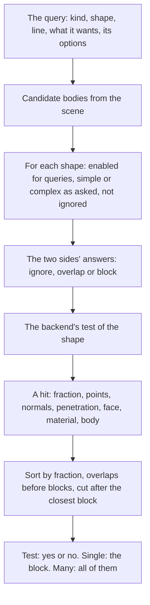
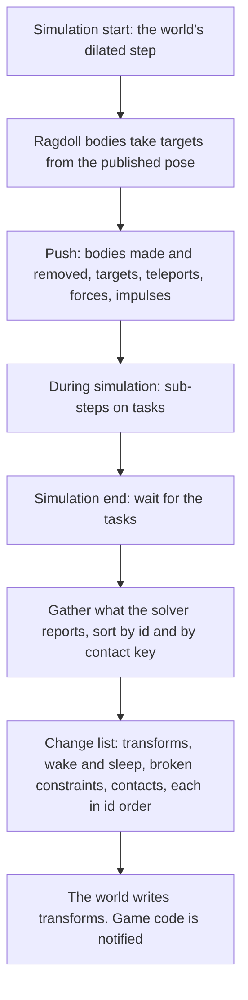

# Physics

What things collide with and how bodies move under force. Physics keeps
one scene of bodies, answers queries against it, and steps the bodies that
simulate. It holds no rule about what a hit means: damage, sound, effects
and what breaks belong to the game's code.

| Term | Means |
|---|---|
| Body | one thing in the scene: a description, a transform, a channel, responses, and a kind |
| Description | a body's collision: its simple collision and at most one complex triangle mesh |
| Simple shape | a sphere, a box, a capsule or a convex hull |
| Simple collision | a body's simple shapes, or for a piece of a stage a coarser triangle mesh in their place |
| Channel | the class a body or a query belongs to: static world, moving world, character, camera, and the game's own |
| Response | what a body answers to a channel: block, overlap or ignore |
| Profile | a named set of a channel, an enabled mode and responses |
| Query | a line trace, a sweep or an overlap, asked of the scene |
| Hit | what a query returns for one body it met |
| Physical material | friction, restitution, density and a surface type, on a shape or on a face |
| Constraint | a joint between two bodies, or between a body and the world |
| Ragdoll | a character's bodies, one per bone, and the constraints between them |
| Change list | what simulation hands back when it ends: bodies that moved, with what happened to them |
| Backend | the solver that implements the scene, behind this contract |

## Position

Below movement, the camera and the game's code, which ask queries and
make bodies. Inside the [world](world.md)'s tick, whose simulation stages
it fills. Beside [animation](animation.md), whose published pose a
ragdoll's bodies follow, and [content](content.md), which holds
descriptions, physical materials and ragdolls in cooked form. Above the
backend.

## Invariants

1. A world has one scene. Every body in it has a description, a channel,
   a response to every channel, and an enabled mode: none, queries,
   simulation, both, or probe, which reports contacts without reacting.
2. A description holds simple collision and at most one complex triangle
   mesh. Simple collision is simple shapes, or for a piece of a stage a
   second, coarser triangle mesh. A flag says which answers simple
   queries and which complex ones: each its own, the simple collision
   for both, or the complex mesh for both. Bodies collide in simulation
   by their simple collision. A body whose simple collision is a
   triangle mesh is never simulated.
3. A shape may switch off queries or simulation for itself. What is
   enabled for a shape is what both it and its body enable.
4. There are three query kinds. A line trace. A sweep of a sphere, a box
   or a capsule along a line at a fixed rotation. An overlap of a shape
   at rest. Each is asked as a test, for the first blocking hit, or for
   every hit.
5. A query names what it wants in one of three ways: a channel, with
   the responses the query itself has; a set of channels, meaning any
   body of those; or a profile, which is resolved to a channel and
   responses.
6. A query asked by channel meets a body with the lesser of the two
   sides' answers, ignore below overlap below block. A query asked by a
   set of channels blocks on a body whose channel is in the set. Two
   bodies in simulation collide only if each blocks the other's channel.
7. A query says whether it reads simple or complex collision, which
   bodies it ignores, whether it reports a sweep that starts overlapping,
   and whether it wants the physical material and the face.
8. A hit carries: the fraction of the query at which it happened and the
   distance; the query shape's location there; the point of contact;
   the normal for the swept shape and the normal of the surface hit;
   whether it blocks; whether the query started in penetration, and how
   deep; the face; the physical material; the body, and its bone when it
   belongs to a ragdoll.
9. Hits are returned in order of the fraction. At the same fraction an
   overlap comes before a block. Nothing past the closest blocking hit
   is returned, and it is last.
10. A sweep that starts overlapping returns a hit at fraction zero marked
    as starting in penetration, with the direction and the depth that
    separate the two. With no usable direction the normal is up and the
    depth zero.
11. A physical material sits on a shape, or on each face of a complex
    mesh. A hit returns the one on the shape or the face it met. Two
    materials in contact combine friction and restitution by a mode:
    average, least, product or greatest.
12. A body is static, kinematic or simulated. A kinematic body is moved
    by a target for the next step and by nothing in the solver. A
    simulated body has a mass, from its shapes and its material's density
    or given outright, linear and angular damping, a gravity switch,
    locked axes, and a switch for continuous detection.
13. A simulated body sleeps when it has been still long enough and wakes
    when touched, pushed or told to. A body that asks is told when it
    wakes and when it sleeps.
14. A force, an impulse, a velocity, a teleport or a kinematic target set
    by game code is held on the game's side and reaches the solver when
    simulation next starts.
15. A step runs in this order. When simulation starts, every change game
    code made since the last step is pushed to the solver, ragdoll
    targets included. During simulation the solver steps on tasks. When
    simulation ends the change list is gathered and handed to the world
    on the game thread.
16. The step simulation takes is the world's dilated step held to a
    longest step, cut into sub-steps no longer than a longest sub-step,
    up to a count. A count of one is one step a tick. While the world is
    paused no step is taken.
17. The change list holds, in this order: for each body the solver moved,
    its new transform; wake and sleep notices; constraints that broke;
    contact notifications. The [world](world.md) writes the transforms.
    Nothing reaches game code from inside the solver's step.
18. A contact notification goes only to bodies that ask, once for a pair
    of bodies in a step, with both bodies, the contact points, the normal
    and the impulse the contact is expected to apply, estimated from the
    two bodies' velocities and masses before the solve.
19. Order never depends on which task finished first. Ids are given in
    order of creation. Moved bodies and wake and sleep notices enter the
    change list in order of body id, and broken constraints in order of
    constraint id. Every contact has a key made of its two bodies' ids
    and its two shapes' ids, the same whichever body is named first, and
    contacts enter in order of that key. The same calls in the same order
    on the same build give the same change lists.
20. A constraint leaves each linear and each angular axis free, limited
    or locked, may drive toward a position or a velocity, and may break
    at a force or a torque.
21. A ragdoll has one body for each bone it names and constraints between
    them. A body that is not simulating takes its bone's transform from
    the pose published this tick as a kinematic target. Each body can be
    switched to simulate on its own. The change list gives a simulating
    body's transform by bone.
22. A query asked on the game thread reads the scene as the last change
    list left it, with the game's own changes since.
23. No type of the backend appears in a public header. The backend is
    given the engine's allocator and its tasks, and registers with the
    library once, when the engine starts.
24. A description whose hull cannot be built or whose mesh is malformed,
    and a body, a constraint or a ragdoll that names a shape, a material,
    a profile or a bone that does not exist, fail by name when loaded.

## A query

## A step

| Enabled mode | Queries | Simulation |
|---|---|---|
| None | no | no |
| Queries | yes | no |
| Simulation | no | yes |
| Both | yes | yes |
| Probe | as set | contacts reported, no reaction |

| Kind of body | Moved by | Collides in simulation |
|---|---|---|
| Static | nothing | simulated bodies stop against it |
| Kinematic | a target each step | simulated bodies stop against it, and nothing moves it |
| Simulated | the solver: gravity, forces, impulses, contacts, constraints | against every body both sides block |

## Dependencies

| Dependency | Role | In the repository |
|---|---|---|
| Jolt Physics, one pinned release tag | the backend: collision detection, the solver, constraints | pinned when the backend is built, MIT, with its license |

## Components and ownership

| Component | Lives in | Consumed by |
|---|---|---|
| The scene, bodies, channels, responses, profiles | `src/engine/physics` | game code, movement, the camera |
| Queries and hits | `src/engine/physics` | movement, the camera, game code |
| Physical materials | `src/engine/physics` | descriptions, hits |
| The step, the push and the change list | `src/engine/physics` | the world |
| Constraints and ragdolls | `src/engine/physics` | game code |
| The backend | `src/engine/physics/backends` | the scene |
| Payload layouts of descriptions, physical materials and ragdolls | `src/engine/content` | the converter, the readers |
| Readers of those payloads | `src/engine/physics` | the scene |
| The game's channels, profiles and surface types | `src/game` | the scene |

## Boundaries

Above: movement and the camera, which make queries and resolve them
themselves, and the game's code, which makes bodies, pushes them and
reads contacts. Below: the backend. Beside: the [world](world.md), which
gives the step, runs the simulation stages and writes transforms;
[animation](animation.md), whose pose a ragdoll follows;
[content](content.md), which holds what a body is made from. What a
contact does, which surface makes which sound, and what replaces an
object when it breaks are outside this document.
