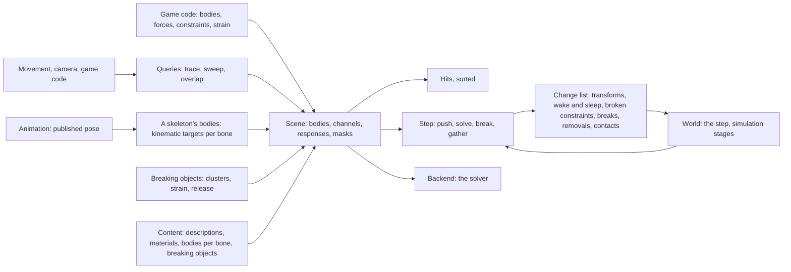
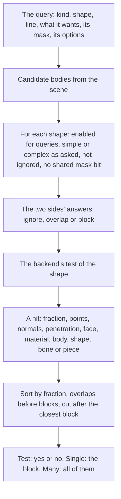
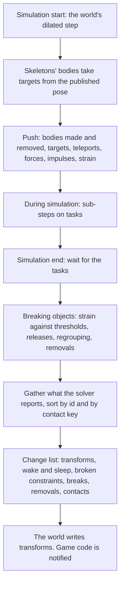
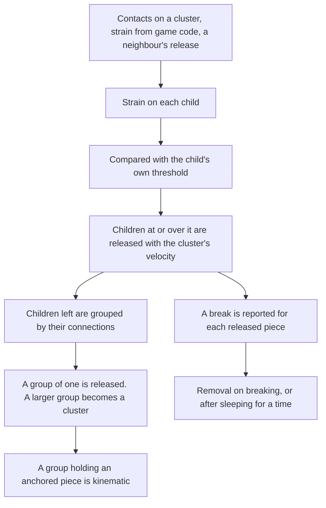

# Physics

What things collide with, how bodies move under force, and how things
come apart. Physics keeps one scene of bodies, answers queries against
it, steps the bodies that simulate, and breaks the objects made to break.
It holds no rule about what a hit means: damage, sound, effects and how
hard a weapon strains what it hits belong to the game's code.

| Term | Means |
|---|---|
| Body | one thing in the scene: a description, a transform, a channel, responses, a mask and a kind |
| Description | a body's collision: its simple collision and at most one complex triangle mesh |
| Simple shape | a sphere, a box, a capsule or a convex hull, with its own switches for queries and for simulation |
| Simple collision | a body's simple shapes, or for a piece of a stage a coarser triangle mesh in their place |
| Channel | the class a body or a query belongs to: static world, moving world, character, camera, and the game's own |
| Response | what a body answers to a channel: block, overlap or ignore |
| Profile | a named set of a channel, an enabled mode and responses |
| Query | a line trace, a sweep or an overlap, asked of the scene |
| Hit | what a query returns for one body it met |
| Physical material | friction, restitution, density, combine modes and a surface type, on a body or on a face of a complex mesh |
| Constraint | a joint between two bodies, or between a body and the world |
| Skeleton's bodies | the bodies of an object with bones, one per bone, and the constraints between them |
| Weight | per body of a skeleton, how far its bone follows physics instead of animation |
| Breaking object | an object's pieces in a tree of clusters, made to come apart |
| Piece | a leaf of that tree: shapes, a mass and a threshold |
| Cluster | pieces or clusters held as one body until they are released |
| Strain | what is compared with a piece's threshold to release it |
| Change list | what simulation hands back when it ends: bodies and pieces that moved, with what happened to them |
| Backend | the solver that implements bodies, collision detection and the solve, behind this contract |

## Position

Below movement, the camera and the game's code, which ask queries, make
bodies and apply strain. Inside the [world](world.md)'s tick, whose
simulation stages it fills. Beside [animation](animation.md), whose
published pose a skeleton's bodies follow, and [content](content.md),
which holds descriptions, physical materials, skeletons' bodies and
breaking objects in cooked form. Above the backend.

## Invariants

### Bodies and queries

1. A world has one scene. Every body in it has a description, a channel,
   a response to every channel, a mask, and an enabled mode: none,
   queries, simulation, both, or probe, which reports contacts without
   reacting.
2. A description holds simple collision and at most one complex triangle
   mesh. Simple collision is simple shapes, or for a piece of a stage a
   second, coarser triangle mesh. A flag says which answers simple
   queries and which complex ones: each its own, the simple collision
   for both, or the complex mesh for both. A body whose simple collision
   is a triangle mesh is never simulated.
3. Every simple shape has its own switch for queries and for simulation.
   What is enabled for a shape is what both it and its body enable. So
   one body may hold shapes that only simulate beside shapes that only
   answer queries. No moving body holds a triangle mesh: a mesh that is
   not convex is cooked into hulls.
4. There are three query kinds. A line trace. A sweep of a sphere, a box
   or a capsule along a line at a fixed rotation. An overlap of a shape
   at rest. Each is asked as a test, for the first blocking hit, or for
   every hit.
5. A query names what it wants in one of three ways: a channel, with
   the responses the query itself has; a set of channels, meaning any
   body of those; or a profile, which is resolved to a channel and
   responses.
6. A query asked by channel meets a body with the lesser of the two
   sides' answers, ignore below overlap below block. A query asked by a
   set of channels blocks on a body whose channel is in the set. Two
   bodies in simulation collide only if each blocks the other's channel.
   A query skips a body whose mask shares a bit with its own.
7. A query says whether it reads simple or complex collision, which
   bodies it ignores, whether it reports a sweep that starts overlapping,
   and whether it wants the physical material and the face.
8. A hit carries: the fraction of the query at which it happened and the
   distance; the query shape's location there; the point of contact;
   the normal for the swept shape and the normal of the surface hit;
   whether it blocks; whether the query started in penetration, and how
   deep; the face; the physical material; the body; the index of the
   shape inside the body; the bone, when the body belongs to a skeleton;
   the piece, when it belongs to a breaking object.
9. Hits are returned in order of the fraction. At the same fraction an
   overlap comes before a block. Nothing past the closest blocking hit
   is returned, and it is last.
10. A sweep that starts overlapping returns a hit at fraction zero marked
    as starting in penetration, with the direction and the depth that
    separate the two. With no usable direction the normal is up and the
    depth zero.
11. A physical material sits on a body, or on each face of a complex
    mesh; a simple shape has none of its own. A hit returns the one on
    the body or the face it met. Two materials in contact combine
    friction and restitution by a mode: average, least, product or
    greatest.
12. A query asked on the game thread reads the scene as the last change
    list left it, with the game's own changes since.

### Simulation

13. A body is static, kinematic or simulated. A kinematic body is moved
    by a target for the next step and by nothing in the solver. A
    simulated body has a mass, from its shapes and its material's density
    or given outright, linear and angular damping, a gravity switch,
    locked axes, a switch for continuous detection, and a start state,
    awake or asleep.
14. A simulated body sleeps when it has been still long enough and wakes
    when touched, pushed or told to. A body that asks is told when it
    wakes and when it sleeps.
15. A force, an impulse, a velocity, a teleport, a kinematic target or a
    strain set by game code is held on the game's side and reaches the
    solver when simulation next starts.
16. A step runs in this order. When simulation starts, every change game
    code made since the last step is pushed, the targets of skeletons'
    bodies included. During simulation the solver steps on tasks. When
    simulation ends, breaking objects are evaluated, then the change list
    is gathered and handed to the world on the game thread.
17. The step simulation takes is the world's dilated step held to a
    longest step, cut into sub-steps no longer than a longest sub-step,
    up to a count. A count of one is one step a tick. While the world is
    paused no step is taken.
18. The change list holds, in this order: for each body and each piece
    that moved, its new transform; wake and sleep notices; constraints
    that broke; breaks; removals; contact notifications. The
    [world](world.md) writes the transforms. Nothing reaches game code
    from inside the solver's step.
19. A contact notification goes only to bodies that ask, once for a pair
    of bodies in a step, with both bodies, the contact points, the normal
    and the impulse the contact is expected to apply, estimated from the
    two bodies' velocities and masses before the solve.
20. Order never depends on which task finished first. Ids are given in
    order of creation. Moved bodies, moved pieces, wake and sleep
    notices, breaks and removals enter the change list in order of body
    or piece id, and broken constraints in order of constraint id. Every
    contact has a key made of its two bodies' ids and its two shapes'
    ids, the same whichever body is named first, and contacts enter in
    order of that key. The same calls in the same order on the same
    build give the same change lists.
21. A constraint leaves each linear and each angular axis free, limited
    or locked, may drive toward a position or a velocity, and may break
    at a force or a torque.

### Bodies of a skeleton

22. An object with bones may have one body for each bone it names, and
    constraints between them. The body a trace hits and the body that
    simulates are the same body; its shapes' switches say which shapes
    do which.
23. Each such body follows its owner, or is always kinematic, or is
    always simulated. A body that is not simulating takes its bone's
    transform from the pose published this tick as a kinematic target.
    All the bodies, one body, or the bodies below a bone can be switched
    to simulate, and back.
24. Each body has a weight from animation to physics. The change list
    gives a body's transform by bone together with its weight.

### Objects that break

25. A breaking object is a tree. Its leaves are pieces, each with shapes,
    a mass, a physical material and a threshold. Its inner nodes are
    clusters. It is one object with a transform for each piece.
26. A cluster that has not been released is one body made of its
    children's shapes, and its children are not bodies. A whole object is
    its top cluster.
27. Strain reaches a child three ways: from contacts on its cluster, as
    the contact's impulse given to the children near the contact; from
    game code, applied at a place with a radius; and from a neighbour's
    release. A contact gives strain only when its bodies are closing
    faster than a set speed, so a body at rest on a cluster gives none.
    Strain from contacts lasts one step. Game code may also lower a
    child's threshold for good.
28. When simulation ends, each child whose strain has reached its own
    threshold is released: it becomes a body, or a cluster body, at its
    place with its cluster's velocity. Children under their threshold
    stay.
29. Siblings are joined by connections. After a release the children
    left are grouped by their connections. A group of one is released. A
    larger group becomes a cluster of its own.
30. An anchored piece is kinematic, and a cluster that holds one is
    kinematic. Game code can anchor a piece, free it, and make a
    kinematic piece dynamic.
31. Game code can crumble a cluster, which releases all its children at
    the next evaluation, set the velocity of the pieces a break frees,
    and reset an object to whole.
32. Each released piece is reported once as a break, with its place, its
    velocity, its mass and which piece it is. A crumble is reported with
    the cluster. Breaks in one step may be capped, and the rest wait for
    the next.
33. A released piece may be removed: on breaking, or after it has slept
    for a time. It shrinks as it goes, and its removal is reported.
34. A breaking object is drawn as one object from its pieces' transforms.
    While whole it may draw one mesh in place of its pieces.

### The backend and failure

35. No type of the backend appears in a public header. The backend is
    given the engine's allocator and its tasks, and registers with the
    library once, when the engine starts. Order of results, clusters and
    their breaking, and weights are this system's own, above the backend.
36. A description whose hull cannot be built or whose mesh is malformed,
    and a body, a constraint, a skeleton's bodies or a breaking object
    that names a shape, a material, a profile, a bone or a piece that
    does not exist, fail by name when loaded.

## A query

## A step

## A break

| Enabled mode | Queries | Simulation |
|---|---|---|
| None | no | no |
| Queries | yes | no |
| Simulation | no | yes |
| Both | yes | yes |
| Probe | as set | contacts reported, no reaction |

| Kind of body | Moved by | Collides in simulation |
|---|---|---|
| Static | nothing | simulated bodies stop against it |
| Kinematic | a target each step | simulated bodies stop against it, and nothing moves it |
| Simulated | the solver: gravity, forces, impulses, contacts, constraints | against every body both sides block |

## Dependencies

| Dependency | Role | In the repository |
|---|---|---|
| Jolt Physics, one pinned release tag | the backend: bodies, collision detection, the solver, constraints | pinned when the backend is built, MIT, with its license |

## Components and ownership

| Component | Lives in | Consumed by |
|---|---|---|
| The scene, bodies, channels, responses, masks, profiles | `src/engine/physics` | game code, movement, the camera |
| Queries and hits | `src/engine/physics` | movement, the camera, game code |
| Physical materials | `src/engine/physics` | descriptions, hits |
| The step, the push and the change list | `src/engine/physics` | the world |
| Constraints, skeletons' bodies and their weights | `src/engine/physics` | game code, animation |
| Breaking objects: clusters, strain, release, removal | `src/engine/physics` | game code, the world |
| The backend | `src/engine/physics/backends` | the scene |
| Payload layouts of descriptions, physical materials, bodies per bone and breaking objects | `src/engine/content` | the converter, the readers |
| Readers of those payloads | `src/engine/physics` | the scene |
| The game's channels, profiles, surface types, and its tables by body and shape | `src/game` | the scene, game code |

## Boundaries

Above: movement and the camera, which make queries and resolve them
themselves, and the game's code, which makes bodies, pushes them, applies
strain and reads contacts and breaks. Below: the backend. Beside: the
[world](world.md), which gives the step, runs the simulation stages and
writes transforms; [animation](animation.md), whose pose a skeleton's
bodies follow and to which their transforms and weights return;
[content](content.md), which holds what a body is made from. What a
contact or a break does, which surface makes which sound, how much strain
a weapon applies, and which part of a character a shape is are outside
this document.
